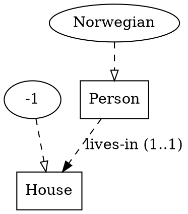
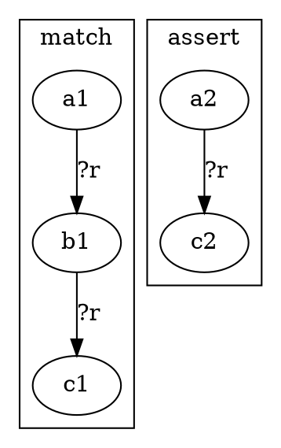
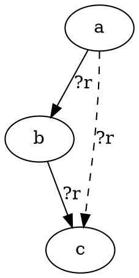
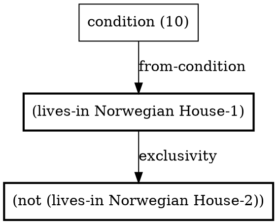
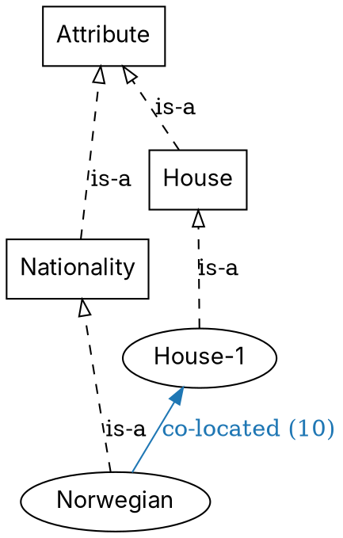
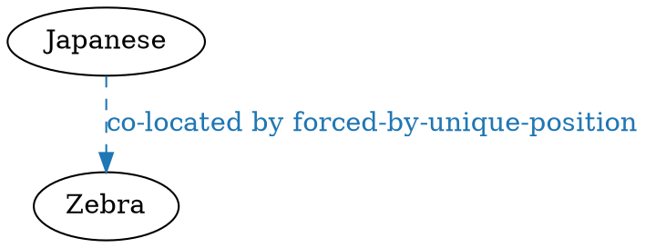

# IR ↔ DOT rendering

Every kernel IR form has a **fixed DOT shape**. Only **graph
structure** is fixed by this schema; layout (positions, rank,
unspecified style choices) is free — `random_layout` is permitted.

Per [Q21](../../../../plans/open_questions.md#q21--ir--dot-structural-isomorphism),
render is mandatory and shipped (S1.1.4) — today
[`ein_render::ir_dot`](../../../../ein.rs/crates/ein-render/src/ir_dot.rs) for
the IR-form view and
[`ein_render::kb_dot`](../../../../ein.rs/crates/ein-render/src/kb_dot.rs) for
the unified KB view. **Reverse parse was not built**: `from_dot` was a P1.2
deliverable, P1.2 closed in May 2026 without it, and no such function exists
in any crate. § Reverse parse below is the design it would have followed.

This was [`docs/ir.md` §6](../../README.md) before the kernel-
documentation split. The conceptual content overlaps with the
**detailed (Levi-bipartite) view** in
[`../01-ein-graph/01_kb.md` §2.2](../01-ein-graph/01_kb.md) —
this document specifies the *concrete DOT encoding*.

---

## Node-shape legend

| IR element                | DOT shape                          |
|---------------------------|------------------------------------|
| `type` declaration        | `box`                              |
| `instance` declaration    | `oval` (ellipse)                   |
| ground atom               | `rectangle`                        |
| hyperedge (Levi-bipartite) | `octagon`                          |
| equality class            | `doublecircle`                     |
| pattern variable `?x`     | `diamond`                          |
| wildcard `_`              | `diamond` with `style=dashed`      |
| relation schema           | dashed labelled edge               |
| derived edge (fact)       | solid labelled edge                |
| hypothetical edge         | solid edge with `style=dashed`     |

## Hyperedge encoding — Levi-bipartite

DOT has no native hyperedges. Every n-ary relation fact `(name a b c)`
is encoded **Levi-bipartite**: one `octagon` node for the hyperedge
itself, with directed edges to each participant labelled by role index
(or role name when declared). The hyperedge's node identity is what
[Q18](../../../../plans/open_questions.md#q18--provenance-granularity)
provenance tuples reference; this anchors
[Q1](../../../../plans/open_questions.md#q1--what-kind-of-graph-is-the-ir)'s
typed-hypergraph + equality-class-ID answer visually.

The Levi-bipartite scheme is the *canonical* form — see
[`../01-ein-graph/01_kb.md` §2.2](../01-ein-graph/01_kb.md). For
binary facts, the compact rendering (collapsed labelled arrow) is
also permitted; see
[`../01-ein-graph/01_kb.md` §2.1](../01-ein-graph/01_kb.md).

**Default = compact (S1.6.0).** Faithful as it is, the
list-node-per-relation Levi view is unreadable as a default. So
[`ir_dot::to_dot`](../../../../ein.rs/crates/ein-render/src/ir_dot.rs)
renders **compact** by default: a binary fact `(rel a b)` collapses to one labelled,
relation-coloured arrow `a → b [label="rel"]` (the colour is the
shared per-relation palette — see §Unified KB view), and a **unary**
fact `(rel a)` to a labelled self-loop `a → a [label="rel"]` — the same
collapse with source == target (S1.22.4). That is the compact view's
convention for the predicate-as-subset idiom `(symmetric R)` /
`(bijective R)` / `(relation R)`; it keeps per-fact edge styling
(derived → dashed, transition highlight → `penwidth`) that an octagon
would scatter over two DOT elements. `not`-headed facts keep their own
encoding. Remaining arities stay Levi-bipartite (no native hyperedge to
collapse). The canonical Levi-bipartite view of *every* relation is opt-in
via the library-level
[`DotOpts.levi`](../../../../ein.rs/crates/ein-render/src/ir_dot.rs).
(**There is no `EIN_RENDER_LEVI`.** This line claimed one until M1e S1e.2.2;
no code path has ever read it —
[`configuration.md` §4](../../configuration.md) files it among the greppable
`EIN_*` names that are not environment variables, and `config_reference.rs`
pins that.)

## Ontology — UML-ish



## Rule rendering — modes, configurable

**Default = (a) side-by-side, `rankdir=TB` (S1.6.0).** The previous
cross-product (rule-mode × trace-view) collapsed to one diagram per
rule: the side-by-side LHS|RHS view, the most readable for rule
libraries. The overlay variant (c) is opt-in via
`render_rule(…, mode="overlay")`
(the legacy single-letter names `"a"` / `"c"` are still accepted).
**(b)** is opt-in.

The renderer lives in
[`ein_render::rules`](../../../../ein.rs/crates/ein-render/src/rules.rs)
(`ein render rules|rule …`); `ir.to_dot` delegates to it.

**(a) Side-by-side LHS | RHS** — explicit; readable for rule libraries.



**Faithful pattern rendering (S1.6.1).** Within each panel the renderer
distinguishes the three things that can appear in a `:match` / `:assert`:

- **Relations** `(R a b)` → a labelled arrow `a → b` (relation-coloured;
  `R` may be a `?var`); n-ary `(R a b c …)` → a Levi octagon.
- **Guard predicates** `(neq ?a ?b)` / `(eq …)` → a *dotted, undirected*
  `≠` / `=` link with `constraint=false` — they are computed, not data,
  so they are never drawn as a relation arrow.
- **NAF guards** `(absent (and …))` → a `cluster_absent` subgraph (∄):
  inner conjuncts render *inside* it, the binder-local variables are
  declared inside while shared variables stay outside, so the
  "no such match exists" reading survives. `(not P)` renders red with a
  `¬` prefix.

Node ids carry a per-panel `_L`/`_R` suffix so the `match` and `assert`
copies of a variable are distinct nodes (the panels don't collapse),
but the **label** is always the clean name — both panels show `?a`.
Variables are diamonds, ground atoms rectangles (the shape legend).

**(b) DPO span `L ← K → R`** — categorical reading
([idea 07](../../../../plans/ideas/07-categorical-formulation.md)). Three
sub-clusters share the interface graph K (the bindings preserved by
the rule); the left morphism deletes nothing for our pattern
language (positive conjunctive), the right morphism adds the RHS.

**(c) Overlay** — most compact; LHS in solid, RHS additions in dashed.
Default at rule-firing time inside traces:



## Trace rendering — three views, configurable

Default: **(a)** — matches
M1 acceptance §2's
`zebra/` snapshot folder.

**(a) Per-step DOT** — one file per step under
`<trace-name>/sNN.dot`; each shows working memory immediately after
the step's `:derives` is committed.

**(b) Aggregate** — single file, final state, edges coloured by step
number (early = blue, late = red). For overviews and paper figures.

**(c) Derivation DAG** (alias `dag`; **implemented S1.6.3 T1.6.3.3**) —
nodes are derived facts (one per `:derives`), edges connect each
derived fact to its `:using` premises (chaining through earlier steps),
the edge labelled by the firing `:rule`. The natural "explanation
graph" view per
[idea 08](../../../../plans/ideas/08-human-style-deductive-trace.md):



The view names accept friendly aliases: `per-step` (a), `aggregate`
(b), `dag` (c).

## Branch rendering — the commitment lattice (S1.6.3)

The P1.5 ordered search tree was removed with the tree solver
(2026-05-29); the engine now produces a **set-indexed commitment
lattice**. [`ein_render::lattice_dag`](../../../../ein.rs/crates/ein-render/src/lattice_dag.rs)
renders it as a DAG (`render_lattice(proof | snapshot, view=)`):

- `rankdir=LR`, ranked by **layer** (= commitment-set size); layer 0
  (root saturation) at the left, layers flowing rightward.
- One node per visited commitment / `state_key`; when several
  commitments collapse to one post-saturation state the node is a
  multilabel ("+N ≡ same state").
- Colour by verdict — **alive** grey, **dead** red, **solution** green.
  Dead nodes carry their `unsat_core` in the tooltip and a dashed
  back-edge labelled with the lifted `learned_clause` (no-good).
- Two views: `full` (every commitment) and `solution` (survivors + pruned
  siblings — the small sub-DAG the trace embeds). **`full` always falls back
  to `solution`**, and not for want of `store_lattice`: `solve` stores no
  per-commitment `SetNode` DAG at all, under any flag, so the view emits one
  DOT comment saying so and is otherwise the `solution` view. That is what
  `ein render lattice --view full`'s help says, and since M1e S1e.4.6
  (`CD-L3`) what the DOT says too —
  `presentation_semantics::the_full_lattice_view_is_the_solution_view_plus_one_honest_note`
  holds the two to each other, and the note to the help text.

Fed a `LatticeSnapshotV1`
([`dump/snapshot.rs`](../../../../ein.rs/crates/ein-render/src/dump/snapshot.rs))
the diagram is **order-stable across `lattice_order_seed`** (reuses the
S1.5b.31 shuffle-invariance guarantee).

## Region rendering — the cube and the walk (S1e2.1a.2)

`ein render region DIR` draws a
[`--dump-region`](../../inference/region_dump.md) directory: the hypothesis
lattice with every node classified by saturation alone, and the run's walk
over it. It reads `region.json` and `walk.json` and nothing else (no load, no
solve), so the picture is of the run whose answer it shows. The join of the
walk to the cube is
[`ein_render::region_doc`](../../../../ein.rs/crates/ein-render/src/region_doc.rs)
and the views are
[`ein_render::region_dot`](../../../../ein.rs/crates/ein-render/src/region_dot.rs).
M1e2
[S1e2.1a.2](../../../../plans/m1e2_correctness/p1e2.1a_the_solution_region/s1e2.1a.2_the_lattice_drawn.md).

```sh
ein solve examples/branching/15_lookahead_two_step_on.ein -e --dump-region out/
ein render region out/ | dot -Tsvg > region.svg     # --view auto|full|border|lines|table
```

A directory with no `walk.json` — what `ein oracle --dump DIR` writes since
M1e2 S1e2.1a.9 — is drawn with **no run overlaid**: every node carries its
status and nothing else, and the note says *no run overlaid (an `ein oracle`
dump)* where it would name the walk.

**The nodes are the pure cube.** Every subset `C` of the root candidates `H₁`
is a node. There is one rank per layer, with `L0` at the top, and a thin edge
from `C` to `C + h` for each single hypothesis `h`. This cube is the lattice
as it would be if no rule derived a hypothesised fact: a program whose rules
only emit obligations and constraints. Where saturation does derive
candidates, **it is drawn as a move inside the cube**, not as a node of its
own. `sat(root + C)` holds candidates `C` did not commit to, and their union
with `C` is `cl(C)`. A `sat` arrow goes from `C` to `cl(C)`, and `C` is drawn
*transient* (dashed outline, paler fill) because it is the state it lands on.
A cube edge that adds a fact the saturation already derived is *absorbed*
(dotted): it moves nothing.

That rests on a measured property: an alive node and its closure are one
state. Committing to what saturation derived changes no fixpoint.
`ein-infer/tests/region.rs` pins it on two programs, and the corpus census
(`EIN_REGION_CENSUS=1 cargo test --release -p ein-infer --test region
census_for_inspection -- --nocapture`, 2026-10-15) counts **32 074** alive
nodes that move, in 12 files, and **0** whose closure is another state.

A dead node's move is not drawn, because a contradictory fixpoint holds
everything. Facts a fixpoint holds that are not coordinates are counted in the
tooltip, not drawn. Those are derived facts, and facts over a candidate
relation that root's generator did not propose. They decide a node's status
without being a position in the cube.

### One channel per question

| channel | says | values |
|---|---|---|
| **fill** | what the cube says | green **R** (alive, discharged; one colour per component when R has several); amber **owing**; salmon **dead**; a salmon-to-amber gradient for dead+owing |
| **shape** | what the search did | **octagon**: a recorded state (model or open); **rounded box**: the search stood here (root, the root after the forced-positive cascade, an entering) or reached it by saturation; **ellipse**: never stood here, with the reason under the facts |
| **border** | the lines and the defects | double: **R's minimal line**; heavy green: **R's maximal line**; purple: a **hole**; red: **MISSING**; magenta: **SPURIOUS**, an **unsound exclusion**, or the search's reading of a node against the cube's |

The lines are named *minimal* and *maximal*, never *top* or *bottom*, so a
reader who flips the picture is not misled. With `L0` at the top, the maximal
line is the lower one.

### Edges

| edge | style | meaning |
|---|---|---|
| R → R | green, solid | inside R |
| R → owing | orange, dashed | adding the fact adds a debt (an obligation's trigger, a non-monotone site) |
| R → dead | red, solid | adding the fact kills |
| owing → R | blue, solid | adding the fact pays the last debt: how the minimal line is reached |
| owing → owing | light orange | still owing |
| owing → dead | red, dashed | kills an owing node |
| dead → R | magenta, bold | revives a dead node: dead is not upward-closed here |
| dead → owing | magenta, dashed | revives a dead node, owing |
| dead → dead | grey, thin | dead to dead |
| absorbed | grey, dotted, no arrowhead | adds a fact saturation already derived |
| `sat` | dark blue, heavy | `C ⇒ cl(C)`, layout-neutral (`constraint=false`) |
| `+fact` | purple label | a **repair edge**: the fact that takes a hole back into R |
| `✗ alive` | magenta, dashed | an unsound exclusion, to the smallest alive superset it pruned |
| `+k` | grey, dashed | the `lines` view only: inclusion across `k` facts, the nodes between hidden |

A node on the maximal line is one whose upward edges all leave R, so the
picture shows why it is maximal. Every edge's tooltip names the fact it adds.

### The walk, overlaid

The walk is joined to the cube by fact text (`region_doc::Overlay`). Each
entering is placed on the node it **stood on**: its commitment plus every
forced positive promoted before it, which `walk.json` times
(`promotions[].after_enterings`). Each node then says what the run did with
it:

- **recorded** model or open;
- **root**, or **root after the cascade** (W2's move);
- **entered** `alive` / `dead_pre` / `dead_post`;
- **reached by saturation** (the search held its state without entering it);
- or why the search never stood there, first match in this order:
  - *outside the run's universe*;
  - *pre-killed* (the lookahead or a root negative);
  - *below the search's root* (it lacks a promoted fact);
  - *element refuted* (a refuted singleton dropped from `alive`);
  - *pruned by a clause*;
  - *past -m*;
  - *never generated* (the search stopped at `-n`, or no join proposed it).

**MISSING and SPURIOUS compare states, not masks.** Two nodes are one state
when the oracle gave them one `class`. A recorded commitment whose saturation
lands on a line node therefore records that node. A line node is **missing**
when no recorded *model* is its state. A recorded model is **spurious**
against a line when its state is on no node of it. Which line is *the* answer
is S1e2.1a.3's ruling (a), so both are compared, and the legend says so.

**Every exclusion is checked against the cube.** That covers each learned
clause, each refuted singleton and each lookahead kill. It is sound exactly
when every superset is dead. An unsound one is named, with the smallest alive
superset it pruned. That is W3's mechanism made visible on
`ein-bugs/wrong-answers/naf-nowb.ein`. A node whose entering the search called
alive and the cube calls dead, or the reverse, is marked `≠ the cube`.

### Views

| view | draws | `auto` picks it |
|---|---|---|
| `full` | every node and edge of the cube | `n ≤ 6` (64 nodes, 192 edges) |
| `border` | R, its holes, every node one edge from R, the root, the recorded nodes, what an unsound exclusion pruned; the hidden nodes counted per layer in the rank column | while that is ≤ 64 nodes |
| `lines` | the root, both lines, the holes, the recorded nodes, what an unsound exclusion pruned, and where saturation takes them; joined by inclusion. When R is empty, `N` and `E` instead of lines | past that |
| `table` | every node as markdown, one section per layer: status, why, where saturation takes it, what the walk did | never (it is not DOT) |

A run of layers with nothing drawn is one rank label, not a column of empty
ranks: `tests/stdlib/bijection/06_blind_enumeration.ein` (n = 16) draws R's one
node and its sixteen dead neighbours, then `L2–L16 · 65519 … hidden: 0 R, 0
owing, 65519 dead`. A node of more than four facts is labelled by its
bits (`#0 #3 #5`), and the legend lists the bits. The legend's lists are
capped at twelve entries, and `--view table` has all of them.

**The cutoffs were measured** (2026-10-15, release, every corpus file `ein solve
FILE --dump-region` then every view through `dot`).

- **Corpus counts.** 178 dumps rendered with every view accepted by Graphviz.
  `auto` picks `full` for 139, `border` for 5 (largest 56 nodes), `lines` for 5
  (largest 40), and 29 are over the oracle's limit.
- **`full` stops at n = 6.** It reads at n = 6
  (`ein-bugs/alive-set-fresh-name-declared.ein`, 64 nodes).
- **`border` stops at 64 nodes.** It reads at 56 nodes
  (`branching/05_mini_zebra.ein`, n = 9; its widest layer holds 21). It does
  not read at 247 (`type-exclusivity/colors.ein`, n = 8): one layer holds about
  60 nodes and the SVG is 6 400 px wide at 40 dpi.
- **`lines` is unbounded.** It stayed under 41 nodes on every corpus program.

`ein-cli/tests/region_render.rs` runs every view of nine programs through `dot
-Tsvg` (this page's standard, `dot_wellformed.rs`'s), holds `auto` to those
cutoffs, and pins W1, W2, W3 and a saturation move as drawn.

**Sub-cubes** are listed under the drawing with their dimension and free
facts. Each node's tooltip names the ones it is in. A sub-cube's outline is its
R → R edges: sub-cubes overlap whenever two share a node, which they do on
W1's own `branching/15`, so a cluster per sub-cube cannot be drawn.

## Markdown trace (S1.6.4)

The capstone output — what makes Ein *not just a solver* (idea 08)
— is not DOT but a **markdown narrative** that threads the diagrams
together. [`ein_render::trace`](../../../../ein.rs/crates/ein-render/src/trace/)
(`ein solve <file> --trace=out.md`):

- `linearize(verdict)` turns the *unordered* commitment lattice into a
  depth-ordered story: the primary solution's firings as numbered
  steps (smallest commitment first; `()` = unconditional root
  saturation), and each refuted `DeadCommitment` as a reductio.
- `render_markdown(trace)` emits one section per step — rule name,
  English `:why` (`render_why(rule.why, firing.bindings)`), premises
  with their quoted `:source` sentences, and an inline `dot` derivation
  slice (S1.6.2). Refuted hypotheses fold into `<details>` blocks
  (closed by their lifted no-good); the file closes with the
  lattice-DAG (S1.6.3) + solution grid. `--no-diagrams` suppresses the
  `dot` blocks; `--reorder` clusters steps by target entity; round-trips
  through the parser as a `(trace …)` form (`trace.ast.TraceStep`).

Every diagram is an inline fenced `dot` block — no SVG. The trace is
the **M1 acceptance artefact** (criterion #3): every named move in the
[idea-08 walkthrough](../../../../plans/ideas/08-human-style-deductive-trace.md)
must surface as a named rule firing (P1.7 / S1.6.5 enforce this).

## Unified KB view (S1.2.4)

When the renderer has the full :class:`KnowledgeBase` (not just a
single-form AST), it produces a **unified graph** where node
identity is fused across forms — `Norwegian` (instance) appears
**once** and participates in:

- its `is-a` edge to `Nationality` (background),
- its `(co-located Norwegian House-1)` fact edge (a given),
- any derived edges that mention it.

This is the 2021 prototype's *linked.svg* aesthetic — all the entity
types on one canvas, related by labelled arrows, coloured by relation. See
S1.2.4
for the design plan; the implementation is
[`ein-render/kb_dot.rs`](../../../../ein.rs/crates/ein-render/src/kb_dot.rs).

### Schema

| graph element                       | DOT shape / style                              |
|-------------------------------------|------------------------------------------------|
| type-role node (from `is-a`/`type` facts) | `shape=box`                              |
| instance/object node (leaf)         | `shape=oval`                                   |
| Binary `Fact(rel, a, b)`            | direct edge `a → b [label=rel ...]`            |
| Unary `Fact(rel, a)`                | self-loop `a → a [label=rel ...]`              |
| n-ary `Fact` (arity ∉ {1, 2})       | `shape=octagon` Levi node + n slot-edges       |
| Instance-of (type-edge)             | `style=dashed, arrowhead=empty, label="is-a"`  |
| `is-a` fact (zebra2 encoding)       | same as instance-of (dashed empty arrow)        |
| background fact (no annotation)     | `style=solid`, plain                            |
| given fact (`:source`)              | `style=solid`, label includes `(N)` short source id |
| derived fact (`:rule` / hypothesis) | `style=dashed`, label includes `by <rule-name>` |
| per-relation colour (default)       | SHA1(`rel.name`) mod palette                    |
| per-origin colour (opt-in)          | background grey, given black, derived blue      |

**Suppressed by default**:

- **Rule-application meta-facts** like `(symmetric co-located)` —
  they're meta, not data. (Their structural effect — making the
  `symmetric` rule fire on `co-located` — is visible in the
  derivation DAG, not in the unified KB view.)
- **`not`-headed facts** with collapsed arg structure — current
  loader limitation (S1.2.3 T1.2.3.4 deferral). Revisit when the
  loader preserves nested SForm args.

### Worked Zebra fragment

For the proposition *"The Norwegian lives in the first house"*
(condition (10)) the unified renderer produces:



(The actual `co-located` colour is whatever
``SHA1("co-located") mod palette`` picks — stable across runs.)

A derivation `(co-located Japanese Zebra :rule
forced-by-unique-position)` would render as a dashed edge:



### How to ask for this view

The renderer is [`ein_render::kb_dot`](../../../../ein.rs/crates/ein-render/src/kb_dot.rs)
(`to_dot(kb, terms, &KbDotOpts)`, with `ColourBy` and the `include_*`
fields). It is exercised over the whole corpus by
[`dot_wellformed.rs`](../../../../ein.rs/crates/ein-render/tests/dot_wellformed.rs)
and digested in six views by `shape.rs`. **Since M1e2 S1e2.1.3 it has a
door again**, the one `ein kb dot` was until P1.11:

```sh
ein render kb examples/zebra2.ein                       # root, after saturation
ein render kb examples/zebra2.ein --colour-by origin    # given / derived / hypothesis
ein solve examples/lattice/02_genuine_3set_death.ein -e --dump-answer out/
ein render kb out/models/02.ein --since out/root.ein    # model 2, what it added in bold
```

`FILE` is loaded and saturated, so a `--dump-answer` state file
([`answer_dump.md`](../../inference/answer_dump.md)) is a `FILE`: it loads as
a program and saturates to itself. `--since FILE` loads a second one into the
same interner and draws every fact it lacks at `penwidth=3` — the transition
highlight below, *this step added E*, which nothing had asked for before.
`--no-types` / `--no-instances` are the two `include_*` switches. On `zebra2`'s
root the view is 195 nodes, so it draws, and S1e2.1.4 chooses what a model's
default view is.

The program **as written** — this chapter's per-form IR view — is the other
door: `ein render program FILE [--levi] [--rule-mode …]`. It prints one
digraph per group (the rule library, the ontology, the facts, the query). It
**parses and never loads**, so a program the loader refuses still has a
picture. [`utils/render_examples.sh`](../../../../utils/render_examples.sh)
writes both views for every example. Both doors are held by
`ein-cli/tests/render_doors.rs`, which pipes what the *command* prints
through `dot -Tsvg`.

### No head is special-cased

The renderer derives node shapes by reading the puzzle's `is-a` facts
directly (there is no `logical_types` / `kb.types` entity-view to consult —
S1.7.23). `is-a` facts get the type-edge
styling — box parent, oval leaf, dashed empty arrow — rather than the
regular coloured-arrow styling.

`is-a` is the one relation the *presentation* layer knows a convention
for; that is not kernel reasoning, and nothing else is privileged. A
puzzle that spells membership with a relation of its own (as
`zebra.ein` does, declaring `type` and `instance`) renders those facts
as ordinary coloured arrows, like every other relation it declares.

### 2021-prototype comparison (T1.2.4.5 — deferred)

The 2021 prototype's *linked.svg* is the visual target. A
checklist of deliberate divergences (new derived-fact dashed
styling, per-relation colour-palette change) lands when the
renderer's output is reviewed visually.

## Derivation slices + KB snapshots (S1.6.2)

The trace (S1.6.4)
does not embed the whole KB per step — it embeds a **provenance cone**:
[`ein_render::slice`](../../../../ein.rs/crates/ein-render/src/slice.rs).

- `render_slice(commitment, firings, kb)` — one hypothesis's cone: the
  hypothesis fact(s) (red seeds), the premises each firing consumed,
  the firings as rule-nodes (labelled with the rendered `:why`), and
  the derived facts (bold). **Only cone facts appear**, never the whole
  KB. Negative / eliminated-alternative facts are greyed. Fed a
  `DeadCommitment`'s `contradiction=(unsat_core, learned_clause)` it
  becomes the refuted-branch slice terminating in a `⊥` node tagged
  with the lifted no-good.
- `render_state(kb, *, since=)` — the whole-KB snapshot
  (the §Unified KB view), flag-gated in the trace behind
  `--full-kb-snapshots`. `since=<kb_before>` thickens (`penwidth=3`) the
  facts a step added — the transition highlight.
- `render_solution(kb)` — the solved-state view for the closing section.

All three emit inline `dot`: **`ein` emits DOT and never rasterises** —
turning it into SVG is a shell job, which is what
[`utils/render_examples.sh`](../../../../utils/render_examples.sh) is for.

## Reverse parse (`from_dot`) — designed, never built

Required by Q21 but not blocking on P1.1, and **it did not land**: P1.2 closed
in May 2026 with the typed-hypergraph data model and without a reverse parser,
and `from_dot` resolves nowhere in the crates (checked M1e S1e.2.2). The
schema fixed by this chapter is the contract such a function *would* follow —
generic DOT outside this schema is not round-trippable, and the API would
reject a non-conforming input rather than guess. What round-trips today is
`.ein` text; the `.einb` container is a private cache, never an interchange
format.

## See also

- [`../01-ein-graph/01_kb.md` §2](../01-ein-graph/01_kb.md) —
  conceptual compact vs detailed views; this document gives the
  concrete DOT encoding.
- [`../02-data-model/02_store.md`](../02-data-model/02_store.md) —
  `DerivationDAG.to_dot()` and (S1.2.4) `KnowledgeBase.to_dot()`.
- Grammar: [`00_ebnf.md`](00_ebnf.md).
