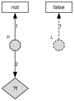
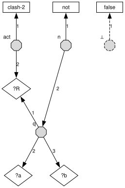
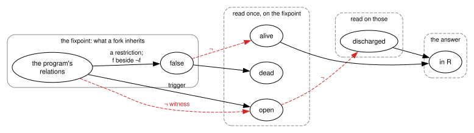
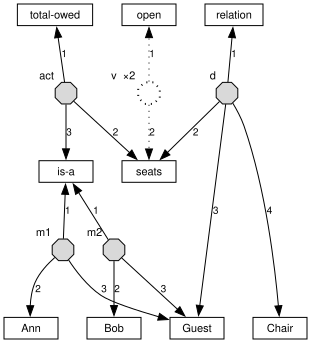
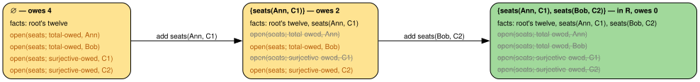
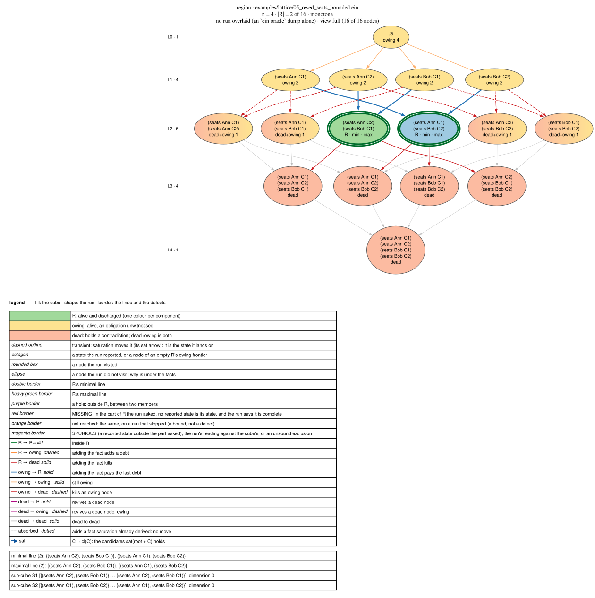
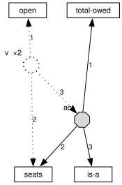
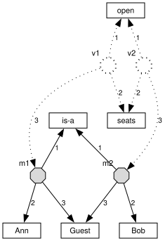
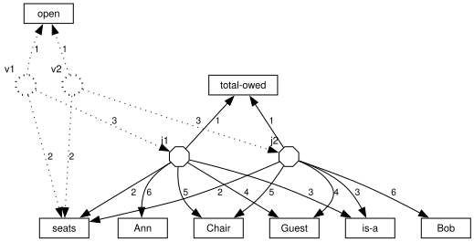
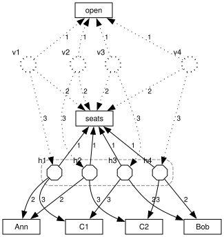

# S1f.21.1 — the kernel's verdicts as rules, and `(open R <justification>)`: the survey and the design

**Phase:** [P1f.21](README.md) · **Stage:** [S1f.21.1](s1f.21.1_the_survey_and_the_design.md) ·
**The question it puts:** [Q-M1f.390](../open_questions.md#q-m1f390--what-an-obligation-emits-the-verdict-with-its-justification-or-as-a-fact)

This page answers the stage's five questions in its order. Sections 1 to 3 are a survey: every claim about the
engine stands beside the command that shows it and the lines of its output that carry it. Section 4 is the
design of `(open R <justification>)`, and section 5 is the page to rule from.

**How the runs were taken.** `ein` below is the gate build, `ein.rs/target/gate/ein`, of the main tree as it
stood on 2026-11-17 (`ein --version`: `ein 0.1.0`, `protocol ein-events/1`, `stdlib sha256:73cf68e6…`); the code
read is the tree's at `c38b4048`.
A program named with a path is the repository's. A program named without one was written for this stage in a
scratch directory that does not last, so its **whole text is in this page**, where it is used or in
[Appendix A](#appendix-a-the-rule-sets-appended-to-corpus-programs); the scripts that took a count are in
[Appendix B](#appendix-b-the-instruments). Nothing under `docs/`, `ein.rs/`, `stdlib/`, `examples/`, `tests/` or
`corpus/` was changed.

**Two terms**, the user's ruling of 2026-11-17 in
[the knowledge base § The relation, its extent, a fact of it](../../../docs/ein/reasoning/01-static-ir/01-knowledge-base.md#the-relation-its-extent-a-fact-of-it):
the **extent** of a relation is every fact whose first arrow points at the relation's atom, held or not, and the
**held extent** is what a knowledge base holds of it:

$$
\begin{aligned}
\operatorname{ext}(r) &= \lbrace\, f \in F \;:\; \operatorname{rel}(f) = r \,\rbrace \\
\operatorname{ext}_K(r) &= \operatorname{ext}(r) \cap K
\end{aligned}
$$

**What the page finds, in five lines.**

1. The kernel's contradiction is a **verdict and not a fact**: a state dead by a fact beside its negation holds
   no `(false)`. Ein cannot write *from a fact and its negation, `(false)`* as one rule, since no premise is a
   variable; it can write it as one rule a count of arguments, and a program that carries those rules answers as
   it did on 560 of the 567 corpus programs `ein solve` answers. The other seven are **refused**, by *forbid*:
   the kernel's own contradiction is a refutation *forbid* does not read.
2. *Dead from `(false)`* is a rule Ein runs; *alive from its absence* loads and makes the program one the static
   check flags, and a dead node then holds `(alive)`.
3. `(open R)` as a fact has both of the instruction's properties, shown on
   `examples/lattice/05_owed_seats_bounded.ein`: root owes four instances and they are one tuple; the state above
   owes two, and holds every other fact root holds.
4. **No fact that means *is owed now* can be a fact of a state**, whatever its justification, while a fork
   inherits what its parent holds: written as an ordinary rule, the debt outlives its payment in 15 of that
   program's 16 nodes, and the engine reports each as a *stale fact*. What **can** be facts are the requirement,
   its payment, and *discharged*: three ordinary rules Ein runs today, on which the static check stays
   *monotone*, and whose count of unpaid requirements is the kernel's `owes` at every node of both programs the
   stage names.
5. With the **instance** as the justification, the tuple `open(r, j)` is one per debt at every one of the 120
   nodes `ein solve examples/zebra2-obligations.ein` visits. The engine already computes that instance and prints
   it on every `owe` event. The recommendation is to give the verdict its justification and to keep it a verdict:
   [§ 5](#5-the-question-and-a-recommendation).

---

## 1. What the kernel does today

Three verdicts about a state $S$, each read off its facts by code that is no rule
([solution semantics § 1.5](../../../docs/ein/reasoning/02-kb-evolution/06-solution-semantics.md#15-commitment-node-state)):

$$
\begin{aligned}
\operatorname{dead}(S) &\iff \bot \in S \;\lor\; \exists f.\; f \in S \land \lnot f \in S \\
\operatorname{alive}(S) &\iff \lnot \operatorname{dead}(S) \\
\operatorname{owes}(o, a, \theta, S) &\iff S \models T_o(a, \theta) \;\land\; \lnot \exists \bar{y}.\; S \models W_o(a, \theta, \bar{y}) \\
\operatorname{discharged}(S) &\iff \operatorname{Owed}(S) = \emptyset
\end{aligned}
$$

### 1.1 Contradiction

**Where.** [`ein-infer/src/contradiction.rs`](../../../ein.rs/crates/ein-infer/src/contradiction.rs) is the whole
of it: `detect` lists every contradiction of a knowledge base, the direct ones (a held `(false)`) first and then
each pair (a held `(not X)` whose `X` is held); `has_contradiction` is the same as a yes or no; `contradicts` asks
of one fact just written whether it made one. Three places call it:

| caller | what it reads it for |
|---|---|
| `Saturator::saturate` ([`saturator.rs`](../../../ein.rs/crates/ein-infer/src/saturator.rs)) | under `stop_at_first_contradiction`, returns before any firing where the knowledge base already holds one (`has_contradiction`), and after the firing one of whose conclusions makes one (`contradicts`) |
| `node_in_region` ([`region.rs`](../../../ein.rs/crates/ein-infer/src/region.rs)) | `dead = !contradiction::detect(&fork, terms).is_empty()`: the node's `DEAD` bit |
| `explain::contradiction_frontier` ([`explain.rs`](../../../ein.rs/crates/ein-infer/src/explain.rs)) | the core: a pair's two sides, `X` and `(not X)`, explained together; a direct one's `(false)` alone |

**It derives nothing.** A pair is found and no fact is written: `(false)` is a fact of a state only where a rule
concluded it. The program `c1.ein`:

```lisp
;; a fact beside its stored negation, derived by two rules
(relation p Thing :why "p holds of {?1}")
(relation q Thing :why "q holds of {?1}")
(relation r Thing :why "r holds of {?1}")
(q one)
(r one)
(rule q-gives-p ()
  :match (q ?x)
  :assert (p ?x)
  :why "{?x} is q, so p.")
(rule r-denies-p ()
  :match (r ?x)
  :assert (not (p ?x))
  :why "{?x} is r, so not p.")
```

`ein saturate --dump c1.ein` ends with the saturated knowledge base, and it holds the pair and no `(false)`:

```text
;; ── DERIVED (2 facts) ──
  (not (p one) :rule r-denies-p)
  (p one :rule q-gives-p)
```

`ein solve c1.ein` (exit 0) calls root dead, and its wording is that of a derivation that did not happen:

```text
  states (k_s)      0
  empty             every node is dead — root's own fixpoint derives (false)
  work              1 saturation · 0 facts beyond root · 1 layer

  unsat core        (q one)
  unsat core        (r one)
  refuted by        q-gives-p, r-denies-p

  (false)
```

**What a core of such a state rests on**: the givens under both sides, `(q one)` under `(p one)` and `(r one)`
under `(not (p one))`, and *refuted by* names the rules of both derivations. **What the events show**
(`ein solve c1.ein --events c1.jsonl`): two firings, no third, and the verdict on the node's `enter` line.

```text
{"e": "fire", "n": 6, "rule": "q-gives-p", …, "premises": ["(q one)"], "derived": ["(p one)"], "redundant": false}
{"e": "fire", "n": 7, "rule": "r-denies-p", …, "premises": ["(r one)"], "derived": ["(not (p one))"], "redundant": false}
{"e": "enter", "n": 13, "layer": 0, "commitment": [], "kind": "dead", "owes": 0, "core": ["(q one)", "(r one)"], "core_status": "within-budget"}
```

**What the trace shows** (`ein solve c1.ein --trace c1.trace.md`): `## Root — 2 steps`, the two firings, and
under `## N — 1 minimal dead sets` the lines `Core: (q one), (r one)` and ``Refuted by `q-gives-p`,
`r-denies-p`.`` No step derives `(false)`.

**What holds it.** `contradiction.rs`' own tests (`a_pair_and_a_direct_are_both_found_direct_first`,
`a_pairs_sides_are_both_its_facts_and_a_directs_its_one`, `the_incremental_check_agrees_with_the_scan`,
`a_consistent_kb_reports_nothing`); `ein-infer/tests/first_contradiction.rs`'
`every_question_answers_alike_with_the_stop_and_without`; the agenda that fires first what can make one,
`ein-infer/tests/agenda.rs`
([Q-M1f.313](../../../docs/decisions/engine/Q-M1f.313-the-agenda-fires-first-what-leads-to-false.md)).

### 1.2 Alive and dead

**The predicate** is `contradiction::detect` returning something, and it is read in one place per node,
`node_in_region`, as the bit `DEAD` (`region.rs`: *"The status bit of a node that derives `(false)`"*). Root's is
read the same way. What reads the bit:

| reader | what it does with it |
|---|---|
| the routes ([`explore.rs`](../../../ein.rs/crates/ein-infer/src/explore.rs), `known_dead.rs`) | a dead node is not in $R$ and, on a monotone program, decides every node above it (licence L1); a route's node stops at its first contradiction |
| the oracle (`region.rs`) | the cube's status array, `DEAD` and `OWING` independent, both read on every node |
| the events | the `enter` line's `kind`: `dead`, `owing` or `in-r` |
| the read-out | the `∅` row, the `empty` row (*every node is dead — root's own fixpoint derives (false)*), `N`, the `unsat core` and `refuted by` rows, and the bare `(false)` where $R$ is empty and root is dead |
| a claim | `(solve :expect (false))` and a query's `:expect (false)`: $R$ is empty |

A claim that reads it: `ein test examples/features/12_expect_false.ein` prints `ok` and
`1 held, 0 FAILED, 0 not checked`. What holds every reader to one predicate is
`ein-infer/tests/explore.rs`' `every_mode_is_the_oracle` and `ein-infer/tests/region.rs`'
`the_seven_programs_have_the_tables_regions`.

**Alive is nothing the engine stores or prints as a fact**: it is the absence of the bit. No relation `alive` or
`dead` exists.

### 1.3 Owed and discharged

**Told apart at load.** The grammar writes `open` in one production,
[`ein-ir/src/ein.y`](../../../ein.rs/crates/ein-ir/src/ein.y)'s `Assert`: a rule's whole `:assert`, `(open)` or
`(open ?R)`. The loader's `validate_open` ([`from_ir.rs`](../../../ein.rs/crates/ein-ir/src/from_ir.rs)) finds
such an `:assert`, resolves the witness step out of the rule's one `(absent …)`, and the rule goes to
`Program::add_obligation` instead of `add_rule` (`ein-core/src/program.rs`): it is in no agenda.
`ein saturate --dump examples/lattice/05_owed_seats_bounded.ein` lists `;; Rules (38)`, among which neither
`total-owed` nor `surjective-owed` stands, and no `DERIVED` section: the knowledge base is root's twelve written
facts.

**Where it is read.** [`obligations::tally`](../../../ein.rs/crates/ein-infer/src/obligations.rs), once per
quiescent knowledge base: at root (`region.rs`, after $H$ is built) and in `node_in_region`, after the node's
saturation returns, on a dead node too. It runs each obligation rule's plan under each of its activators, keeps
each match whose guard finds no witness, and counts them.

**What an instance is.** `obligations::Owed`: the rule, the activator's arguments, the relation `(open ?R)`
names, the **bindings** of the match (the trigger's variables; two disjuncts that reach one binding are one
debt), and the rule's `:why` rendered. `region.rs` keys an instance by `(rule, activator, bindings)` where the
tree route indexes it (`axes.instances`).

**What is counted**: `Owes::total`, the number of instances; `by_relation` groups them by the named relation. A
node carries `owes` and the `OWING` bit.

**What the events carry.** `ein solve examples/lattice/05_owed_seats_bounded.ein --events seats.jsonl`; the
first of root's four `owe` lines, the generator's `rung` line, and root's `enter`:

```text
{"e": "owe", "n": 22, "rule": "total-owed", "activator": ["seats", "is-a"], "relation": "seats", "bindings": [["R", "seats"], ["isa", "is-a"], ["A", "Guest"], ["B", "Chair"], ["a", "Ann"]], "why": "seats owes Ann a Chair."}
{"e": "rung", "n": 21, "mode": "obligations", "reason": "rule-order", "owed": 4, "branches": 4, "declined": 0, "candidates": 8, "uncovered": 1}
{"e": "enter", "n": 31, "layer": 0, "commitment": [], "kind": "owing", "owes": 4, "core": null, "core_status": null}
```

An obligation never produces a `fire`. Root's `owe` lines are in the stream twice, once as root's pass and once
as the node of the empty commitment, as [the events page](../../../docs/ein/ein.rs/05-events.md) says.

**What hypothesis generation reads of it.** The obligations rung
([`oblgen.rs`](../../../ein.rs/crates/ein-infer/src/oblgen.rs)): for each instance root owes, the facts that
would pay it, read off the rule's own guard with the witness step skipped (`Matcher::scan_without`); $H$ is their
union. The tree route reads each instance's own alternatives (`oblgen::alternatives`, licence L5's table). The
verdict's argument, the relation, is read for the report and for scoping; the payments come from the guard.

**What a claim can say of it.** That a state owes, not how much: `(solve … :expect (region (owing (model …))))`
lists the alive states that owe by their facts. `ein test tests/stdlib/algebra/23_total_owed.ein` prints `ok`;
its header says *"no expectation here can say 'owes 1'"*, and the count is asserted in
`ein-infer/tests/obligation_reports.rs` (`each_obligation_rule_owes_exactly_what_its_fixture_states`,
`an_obligation_rule_never_reaches_the_firing_stream`, `a_state_that_owes_is_open_and_not_a_solution`).

---

## 2. Each verdict as a rule

### 2.1 From a fact and its negation, `(false)`

The rule the instruction states, with $f$ a variable that stands for a whole fact:

$$
f \;\land\; \lnot f \;\implies\; \bot
$$



The diamond is the variable $f$, filled because it is itself a premise: a held fact, of any relation and any
count of arguments. $n$ is the premise $\operatorname{not}(f)$, a held fact of $\mathsf{not}$ whose second arrow
points at whatever $f$ is. The dashed octagon is the conclusion, the fact of $\mathsf{false}$ with its first
arrow alone.

**Ein cannot write it.** Four spellings, each the program `c1.ein` above with one rule appended, each refused at
the parse (`ein solve`, exit 1):

```lisp
;; c2a.ein
(rule contradiction ()
  :match (and ?f (not ?f))
  :assert (false)
  :why "{?f} holds beside its negation.")
;; c2b.ein
(rule contradiction ()
  :match (not ?f)
  :assert (false)
  :why "{?f} is denied.")
;; c2e.ein
(rule contradiction ()
  :match (and (written ?f) ?f (not ?f))
  :assert (false)
  :why "{?f} holds beside its negation.")
;; c2f.ein
(relation holds Fact :why "{?1} holds")
(rule contradiction ()
  :match (and (holds ?f) (not ?f))
  :assert (false)
  :why "{?f} holds beside its negation.")
```

```text
c2a.ein:15:15: unexpected `?f`: a variable
  repair: Insert `(`
c2a.ein:15:23: unexpected `?f`: a variable
  repair: Insert `(`
c2b.ein:15:15: unexpected `?f`: a variable
  repair: Insert `(`, Shift `?f`, Insert `)`
c2e.ein:15:28: unexpected `?f`: a variable
c2f.ein:16:31: unexpected `?f`: a variable
```

**What the language lacks**, exactly, in `ein.y`:

1. **a premise that is a variable.** `Premise` is `"(" PremiseHead Args ")"`, `(false)` or a connective; a bare
   `?f` is an argument and never a premise. A variable can be *bound* to a fact, as an argument (`(written ?f)`,
   `(holds ?f)`), and nothing then asks whether that fact is held;
2. **a negated premise of a variable.** In a `:match`, `(not …)` takes `Negated`, a pattern with a head or an
   `eq`. `(not ?x)` is written in a conclusion only (`Conclusion`'s `"(" "not" Var ")"`,
   [Q-M1f.351](../../../docs/decisions/language/Q-M1f.351-a-bare-variable-or-name-is-no-whole-conclusion.md));
3. behind both, **a quantifier over relations**. In the pattern language a variable under a first arrow is a
   parameter, given its atom by an activator
   ([the rules § The conditions of a declaration](../../../docs/ein/reasoning/01-static-ir/02-rewriting-rules.md#the-conditions-of-a-declaration)),
   and a fact pattern matches only a fact with as many arrows. A whole-fact variable ranges over every relation
   and every count at once, which no premise does. So the rule is a **schema**: one rule for each relation $r$
   and each count $n$,

$$
r(x_1, \dots, x_n) \;\land\; \lnot r(x_1, \dots, x_n) \;\implies\; \bot
$$

**The nearest rules Ein can write**, three of them:

- **one rule a relation**, `c2d.ein`: loads, exit 0, `refuted by contradiction-p`;

```lisp
(rule contradiction-p ()
  :match (and (p ?a) (not (p ?a)))
  :assert (false)
  :why "(p {?a}) holds beside its negation.")
```

- **one relation-polymorphic rule a count of arguments**, applied under an activator a relation, `c2c.ein`:
  loads, exit 0, `refuted by contradiction`;

```lisp
(rule contradiction (?R)
  :match (and (?R ?a) (not (?R ?a)))
  :assert (false)
  :why "({?R} {?a}) holds beside its negation.")
(contradiction p)
```



- **a rule over `written`**: none. `written` binds $f$ to a fact a file nests, and that is lack 1 again.

The second is the widest, and a second rule a count derives its activators from the declarations, so a program
that carries the set names no relation: [Appendix A.1](#a1-the-contradiction-rule-set-contrainc) is the set for
counts 0 to 6, `clash-n` and `clash-of-n`. It reaches every **declared** relation; a relation nothing declares
has no declaration to read and needs its activator written.

**It runs, and the state then holds `(false)`.** `c3.ein` is `c1.ein` with the set appended.
`ein saturate --dump c3.ein`:

```text
;; ── DERIVED (9 facts) ──
;;   clash-0 (3)
  (clash-0 p :rule clash-of-0)
  (clash-0 q :rule clash-of-0)
  (clash-0 r :rule clash-of-0)
;;   clash-1 (3)
  (clash-1 p :rule clash-of-1)
  (clash-1 q :rule clash-of-1)
  (clash-1 r :rule clash-of-1)
  (false :rule clash-1)
  (not (p one) :rule r-denies-p)
  (p one :rule q-gives-p)
```

and `ein solve c3.ein --events c3.jsonl` narrates the contradiction as a firing whose premises are the pair:

```text
{"e": "fire", "n": 30, "rule": "clash-1", "activator": ["p"], "bindings": [["R", "p"], ["a", "one"]], "premises": ["(p one)", "(not (p one))"], "derived": ["(false)"], "redundant": false}
```

**On the corpus.** Every corpus entry under `examples/` or `tests/` with a `solve` run, 812 programs, solved as
it stands and with the set appended, the two `--json-summary` files compared in every field of `region` (the
counts, both lines, the states and their generators, the universe, the route), the queries' classes, the claim's
verdict, the monotone verdict and the number of saturations
([`sweep_clash.py`](#b1-sweep_clashpy), `SWEEP_TIMEOUT=60 python3 sweep_clash.py REPO clash.tsv`):

| | programs |
|---|---:|
| not answered as they stand (the corpus's refused programs, and one whose claim fails) | 245 |
| answered, and answer **the same** with the set | 560 |
| — of which hold a stored negation at root or write `(not ` | 85 |
| answered, and **refused** with the set | 7 |

The seven: `examples/features/07_unstratifiable.ein`, `examples/lattice/08_absent_witness_hole.ein`,
`examples/lattice/10_fifo_gap.ein`, and `f07-fpoff`, `f07-rules-swapped`, `kw-neq-in-absent`,
`kw-neq-in-absent-twin` under `examples/ein-bugs/wrong-answers/`. Each is refused by *forbid*
([Q-M1e2.5](../../../docs/decisions/language/Q-M1e2.5-a-refutation-may-not-rest-on-an-absent.md)), for example:

```text
rule 'clash-0' [activator meal]: concludes (false) from meal, which rule 'soup-unless-allergic' derives resting on (absent …) over allergic, a relation a commitment can still extend — so it calls a state that has not yet decided allergic a contradiction, and a commitment would lift it (dead is not upward-closed under absent; Q-M1e2.5). …
```

Each of the seven is a program the static check already flags (`monotonicity.monotone` is `false` in its
summary as it stands). Of the 140 answered programs whose root is dead, one is dead by a pair alone,
`examples/features/09_adjacent_via_same_house.ein`: its root holds no `(false)` as it stands and one with the set
([`dead_roots.py`](#b2-dead_rootspy)), and its core and its `refuted by` row are the same in both.

**In what the kernel's own doing differs from firing the rule:**

| | the kernel | the rule, fired |
|---|---|---|
| what the state holds | the pair; no `(false)` | the pair and `(false)`, with a derivation record whose premises are the pair |
| what it reaches | every fact of every relation and count, declared or not | the relations an activator names, at the counts a rule is written for |
| when | as each fact is written (`contradicts`), which is what lets a node stop at its first contradiction | when the agenda takes the firing: in its first half, since the rule concludes `(false)` |
| *forbid* | not read: a pair one side of which rests on an absence a commitment can fill is a dead state of a **flagged** program | read: the same program is **refused** |
| a core | the smallest environment of the two sides taken together | the smallest environment of `(false)`, whose premises are the two sides: the same facts on `c1.ein`; the `refuted by` row names `clash-1` there and the two rules as it stands |
| the read-out's words | *derives (false)*, of a state that holds none | *derives (false)*, of a state that does |

### 2.2 Dead from `(false)`, alive from its absence

$$
\begin{aligned}
\bot &\implies \operatorname{dead} \\
\operatorname{absent}(\bot) &\implies \operatorname{alive}
\end{aligned}
$$

**Dead is a rule Ein runs, and it derives less than the kernel reads.** `v3.ein`:

```lisp
;; dead from (false), with no rule for alive: a monotone program.
(relation locked Door :why "{?1} is locked")
(relation dead  :why "the state is dead")
(rule no-lock ()
  :match  (locked front)
  :assert (false)
  :why    "the front door is never locked.")
(hrule guess ()
  :match  ()
  :assert (locked front)
  :why    "suppose the front door is locked.")
(rule dead-from-false ()
  :match  (false)
  :assert (dead)
  :why    "a state that holds (false) is dead.")
```

`ein oracle v3.ein --dump dv3 --states` runs every node to quiescence, and the dead node holds the fact:

```text
oracle ['(locked front)'] dead ['(dead)', '(false)', '(locked front)']
```

`ein solve v3.ein --events v3.jsonl` stops the same node at its first contradiction, and `dead-from-false` never
fires there: the node's only firing is `no-lock`, and the run reports `2 saturations · 2 facts beyond root`.

```text
{"e": "fire", "n": 10, "rule": "no-lock", …, "premises": ["(locked front)"], "derived": ["(false)"], "redundant": false}
{"e": "enter", "n": 11, "layer": 1, "commitment": ["(locked front)"], "kind": "dead", "owes": 0, "core": ["(locked front)"], "core_status": "within-budget"}
```

And on a state dead by a pair it derives nothing at all, the state holding no `(false)`: `v2.ein` is `c1.ein`
with the relation `dead` declared and `dead-from-false` appended, and `ein saturate --dump v2.ein` ends as
`c1.ein`'s does, with two derived facts and no `(dead)`. So *dead from `(false)`* is the kernel's predicate only
beside the contradiction rule of § 2.1.

**Alive is a rule Ein loads, and no rule a program may carry and keep its licences.** `v1.ein` is `v3.ein` with
this added:

```lisp
(relation alive :why "the state is alive")
(rule alive-from-no-false ()
  :match  (absent (false))
  :assert (alive)
  :why    "a state that holds no (false) is alive.")
```

`ein solve v1.ein -p` (exit 0):

```text
  lattice           not monotone: 1 site (the static check) — no hole in this cube
    site            alive-from-no-false: absent reads false at absent depth 1, concludes a positive fact — at stake: the state
    state           stale facts — 1 of the cube's 2 nodes holds one: a fact whose absent guard the node's own fixpoint falsifies
    stale           {(locked front)}, dead: (alive) ← alive-from-no-false (absent (false))
  route             2, the cube — no licence: the static check flags the program
```

Root derives `(alive)`; the node `{(locked front)}` is a fork of root, inherits it, and derives `(false)` and
`(dead)` beside it. It is not refused: [Q-M1e2.5](../../../docs/decisions/language/Q-M1e2.5-a-refutation-may-not-rest-on-an-absent.md)
refuses a *refutation* that rests on an absence a commitment can fill, and `(alive)` is a positive conclusion, so
the program loads and is flagged, and of a flagged program the engine claims nothing. *Alive* is true of a state
and false of a larger one, so no fork can inherit it: it is a verdict read on each state, as the kernel reads it.

### 2.3 Owed and discharged

The stdlib's four obligation rules, each *owed where a trigger holds and no witness does*
([`stdlib/algebra.ein`](../../../stdlib/algebra.ein), [`stdlib/slots.ein`](../../../stdlib/slots.ein)); the
parameters are bound by the activator, and $j$ stands for the instance, which § 4.1 defines:

$$
\begin{aligned}
\textbf{total-owed}(R, m):\quad & \operatorname{relation}(R, A, B) \land m(a, A) \land \operatorname{absent}\big(m(b, B) \land R(a, b)\big) \implies \operatorname{open}(R) \\
\textbf{surjective-owed}(R, m):\quad & \operatorname{relation}(R, A, B) \land m(b, B) \land \operatorname{absent}\big(m(a, A) \land R(a, b)\big) \implies \operatorname{open}(R) \\
\textbf{slot-owed-room}(R, m, s, u, x):\quad & m(a, T) \land s(T, u) \land T \neq x \land \operatorname{absent}\big(m(i, x) \land R(a, i)\big) \implies \operatorname{open}(R) \\
\textbf{slot-owed-fill}(R, m, s, u, x):\quad & m(i, x) \land s(T, u) \land T \neq x \land \operatorname{absent}\big(m(v, T) \land R(i, v)\big) \implies \operatorname{open}(R)
\end{aligned}
$$

In each the part before the absence is the trigger $T_o$ and the absence is over the witness $W_o$. *Discharged*,
as a rule over them, reads the absence of every such conclusion:

$$
\operatorname{absent}\big(\operatorname{open}(r, j)\big) \;\implies\; \operatorname{discharged}
$$

**Neither can be run as written**: `open` is reserved, written only as a rule's whole verdict, and read by no
`:match` (§ 3.3). Under another relation's name both run, and what they derive is right **one state at a
time** and wrong across a fork. Three runs show the three halves of that.

**(i) One state at a time, the rules give the kernel's verdicts.** For each of the 16 commitments of
`examples/lattice/05_owed_seats_bounded.ein`, a program that writes the commitment's facts beside the program's
own, carries the verdict rules below and states `(solve :no-search)`: its root is that commitment's state, and
what the rules derive there is compared with the oracle's node. The program of the commitment
`{(seats Ann C1), (seats Bob C2)}`, in full; the others differ in the two `(seats …)` lines:

```lisp
;; the commitment {(seats Ann C1), (seats Bob C2)}, written as facts
(import std.algebra :symbols (functional injective))

(relation is-a   T T         :why "{?1} is a {?2}")
(relation seats  Guest Chair :why "{?1} is seated at {?2}")
(relation owing  R J         :why "{?1} owes {?2}")
(relation alive      :why "the state is alive")
(relation dead       :why "the state is dead")
(relation discharged :why "the state owes nothing")
(relation solution   :why "the state is a state of R")

(is-a Ann Guest) (is-a Bob Guest)
(is-a C1 Chair)  (is-a C2 Chair)
(functional seats)
(injective  seats)
(seats Ann C1)
(seats Bob C2)

(rule total-owing (?R ?isa)
  :match  (and (relation ?R ?A ?B)
               (?isa ?a ?A)
               (absent (and (?isa ?b ?B) (?R ?a ?b))))
  :assert (owing ?R (total-owed-of ?R ?isa ?A ?B ?a))
  :why    "{?R} owes {?a} a {?B}.")
(rule surjective-owing (?R ?isa)
  :match  (and (relation ?R ?A ?B)
               (?isa ?b ?B)
               (absent (and (?isa ?a ?A) (?R ?a ?b))))
  :assert (owing ?R (surjective-owed-of ?R ?isa ?A ?B ?b))
  :why    "{?R} owes {?b} a preimage in {?A}.")
(total-owing seats is-a)
(surjective-owing seats is-a)

(rule discharged-from-nothing-owing ()
  :match  (absent (owing ?R ?j))
  :assert (discharged)
  :why    "nothing is owed.")

(rule dead-from-false ()
  :match  (false)
  :assert (dead)
  :why    "a state that holds (false) is dead.")
(rule alive-from-no-false ()
  :match  (absent (false))
  :assert (alive)
  :why    "a state that holds no (false) is alive.")
(rule solution-from-alive-and-discharged ()
  :match  (and (alive) (discharged))
  :assert (solution)
  :why    "alive and discharged.")
(solve :no-search)
```

`ein oracle examples/lattice/05_owed_seats_bounded.ein --dump d05 --states`, then
[`python3 tower.py d05`](#b6-towerpy); five of its sixteen lines and its last:

```text
ok  {} · oracle owing, owes 4 · rules: owing 4, alive
ok  {(seats Ann C1)} · oracle owing, owes 2 · rules: owing 2, alive
ok  {(seats Ann C1), (seats Ann C2)} · oracle dead+owing, owes 1 · rules: owing 1, dead
ok  {(seats Ann C1), (seats Bob C2)} · oracle R, owes 0 · rules: owing 0, alive, discharged, solution
ok  {(seats Ann C1), (seats Ann C2), (seats Bob C1)} · oracle dead, owes 0 · rules: owing 0, dead, discharged
16 states, 0 differ from the oracle
```

**(ii) The order of the rules decides it.** The same sixteen programs with the rule for `discharged` written
*before* the two that conclude `owing` (`python3 tower.py d05 --discharged-first`):

```text
BAD {} · oracle owing, owes 4 · rules: owing 4, alive, discharged, solution
…
16 states, 9 differ from the oracle
```

Both kinds of candidate wait at one boundary, the agenda admits the first written, and `discharged` is admitted
before the facts whose absence it read exist. `ein solve` of that program says
`lattice  monotone (the static check)` and `∅  in R — root is alive and owes nothing`. It is the documented gap
between the agenda's order and the strata's
([monotonicity § 8.3](../../../docs/ein/reasoning/02-kb-evolution/08-monotonicity.md#83-the-fifo-gap)), met at
root.

**(iii) Across a fork the debt outlives its payment.** `seats-stored.ein` is
`examples/lattice/05_owed_seats_bounded.ein` with `total-owed` written a second time as an ordinary rule, the
same match and a fact in the place of the verdict; the lines added:

```lisp
(relation owing  R J         :why "{?1} owes {?2}")
(rule total-stored (?R ?isa)
  :match  (and (relation ?R ?A ?B)
               (?isa ?a ?A)
               (absent (and (?isa ?b ?B) (?R ?a ?b))))
  :assert (owing ?R (total-owed-of ?R ?isa ?A ?B ?a))
  :why    "{?R} owes {?a} a {?B}.")
(total-stored seats is-a)
```

`ein solve seats-stored.ein`:

```text
  lattice           not monotone: 1 site (the static check) — no hole in this cube
    site            total-stored [activator seats is-a]: absent reads seats at absent depth 1, concludes a positive fact — at stake: the state
    state           stale facts — 15 of the cube's 16 nodes hold one: a fact whose absent guard the node's own fixpoint falsifies
    stale           {(seats Ann C1)}, owing: (owing seats (total-owed-of seats is-a Guest Chair Ann)) ← total-stored (absent (is-a _ Chair)) (absent (seats Ann _))
  route             2, the cube — no licence: the static check flags the program
```

and `ein solve seats-stored.ein -p` prints, under both states of $R$, where nothing is owed,

```text
  (owing seats (total-owed-of seats is-a Guest Chair Ann))
  (owing seats (total-owed-of seats is-a Guest Chair Bob))
```

That is [Q-M1d.2](../../../docs/decisions/hypotheses/Q-M1d.2-an-obligation-is-a-rule-that-concludes-open-r.md)'s
reason, *a stored debt would survive its own payment in the fork that paid it*, as a run, and the engine has a
name for the fact: **stale**.

### 2.4 The verdicts together: which may be a fact

A verdict may be a fact of a state exactly when it stays true as the state grows, for a fork inherits what its
parent holds and nothing is retracted. On a program the static check calls monotone, with $C \subseteq C'$:

| verdict | of $\operatorname{st}(C)$, then of $\operatorname{st}(C')$ | may a fork inherit it | as a rule |
|---|---|---|---|
| $\bot$, *dead* | stays (L1, dead is upward-closed) | yes: `(false)` is a fact | $f \land \lnot f \implies \bot$, a schema; $\bot \implies \operatorname{dead}$ |
| *alive* | can be lost | no | $\operatorname{absent}(\bot) \implies \operatorname{alive}$, read on the fixpoint |
| *owed*, $\operatorname{open}(r, j)$ | can be lost, by a payment | no | $T \land \operatorname{absent}(W) \implies \operatorname{open}(r, j)$, read on the fixpoint |
| *paid* | stays | yes | $T \land W \implies \operatorname{paid}(r, j)$ |
| *discharged* | stays (L2, discharged is upward-closed) | yes | every requirement is paid |

**The upward-closed half of *owed* runs in Ein today, as three ordinary rules.** Write the requirement and its
payment in place of the debt:

$$
\begin{aligned}
T_o(a, \theta) &\implies \operatorname{due}(r, j) \\
T_o(a, \theta) \land W_o(a, \theta, \bar{y}) &\implies \operatorname{paid}(r, j) \\
\operatorname{absent}\big(\operatorname{due}(r, j) \land \operatorname{absent}(\operatorname{paid}(r, j))\big) &\implies \operatorname{discharged}
\end{aligned}
$$

The first two read no absence. The third reads a nested one, a universal, which a larger state can only turn
from failing to passing. [Appendix A.2](#a2-the-requirement-and-the-payment-emuinc) is the first two for
`std.algebra`'s pair; `seats-dis.ein` is `examples/lattice/05_owed_seats_bounded.ein` with them, their four
activators and the third rule, the kernel's obligations kept beside them so that both are read on the same
states. `ein oracle seats-dis.ein --dump ddis --states`:

```text
  lattice           monotone (the static check) — R is convex: no hole
```

and of the sixteen nodes the fact `(discharged)` is held at exactly the seven the kernel says owe nothing (the two
of $R$ and the five dead above them), and at none of the nine that owe. The count of `due` facts with no `paid`
beside them is the kernel's `owes` at every node ([`python3 cmp_owes.py seats-emu.ein demu`](#b3-cmp_owespy)):

```text
ok  layer 0 owing  kernel owes 4 · due 4 paid 0 unpaid 4 · {}
ok  layer 1 owing  kernel owes 2 · due 4 paid 2 unpaid 2 · {(seats Ann C1)}
ok  layer 2 dead+owing kernel owes 1 · due 4 paid 3 unpaid 1 · {(seats Ann C1), (seats Ann C2)}
ok  layer 2 R      kernel owes 0 · due 4 paid 4 unpaid 0 · {(seats Ann C1), (seats Bob C2)}
16 nodes, 0 differ
```

On `examples/zebra2-obligations.ein` with [Appendix A.2](#a2-the-requirement-and-the-payment-emuinc) appended
(`z2o-emu.ein`), at every node `ein solve` visits ([`python3 cmp_events.py z2o-emu.jsonl`](#b4-cmp_eventspy)):

```text
root: due 50 paid 14 unpaid 36
24 dead same
64 in-r same
32 owing same
```

and with the third rule too (`z2o-dis.ein`) the fact `(discharged)` is derived at the 64 nodes of $R$ and at none
of the other 56, the static check still says monotone, and every field of the summary's `region` is that of
`examples/zebra2-obligations.ein` ([`python3 cmp_sum.py z2o.sum.json z2o-dis.sum.json`](#b7-cmp_sumpy):
`region: same 25 fields; differ: none`). `std.slots`' two obligations emulate the same way at root, on the four
fixtures of `tests/stdlib/slots/` that activate them ([`cmp_root.py`](#b5-cmp_rootpy), with
[Appendix A.3](#a3-stdslots-two-obligations-slots-emuinc)):

```text
ok  slots_09_owed_room.ein: kernel owes 3 · due 4 paid 1 unpaid 3
ok  slots_10_owed_room_satisfied.ein: kernel owes 0 · due 4 paid 4 unpaid 0
ok  slots_11_owed_fill.ein: kernel owes 3 · due 4 paid 1 unpaid 3
ok  slots_12_owed_fill_satisfied.ein: kernel owes 0 · due 4 paid 4 unpaid 0
```

So the dual of `(false)` is not `(open R)`. It is `(discharged)`: what is dead stays dead and can be stored, and
what is discharged stays discharged and can be stored; *alive* and *owed* are the two that a larger state loses.

**The rules as strata.** Read with the stratification of
[absence § Stratification](../../../docs/ein/reasoning/02-kb-evolution/03-absent-and-naf.md#stratification), the
verdicts are the last strata of every program, and that is the whole of what is special about them:



A black arrow is a positive read and a red dashed one a read under an absence. `false` is concluded in the
fixpoint, by a restriction or by a fact beside its negation. `open` and `alive` each read an absence over the
fixpoint, `discharged` an absence over `open`, and a state is in $R$ where it is alive and discharged. What the
kernel does differs from firing these rules in two things and no more: **it applies them once, after the
fixpoint, in the order of the strata**, where the agenda would admit them in written order (run (ii)); and
**what they conclude is the state's own**, never part of what a fork starts from (run (iii)).

---

## 3. `(open R)` as a fact

### 3.1 It duplicates

`examples/lattice/05_owed_seats_bounded.ein`: two guests, two chairs, `(total-owed seats is-a)` and
`(surjective-owed seats is-a)`. `ein solve` of it:

```text
  ∅                 not in R — root owes 4 instances
    owed            seats owes Ann a Chair.
    owed            seats owes Bob a Chair.
    owed            seats owes C1 a preimage in Guest.
    owed            seats owes C2 a preimage in Guest.
```

Each of the four is a match of a rule whose conclusion is `(open ?R)` with `?R` bound to `seats`, and each `owe`
event carries `"relation": "seats"` (§ 1.3). The conclusion's instance is the same tuple four times, and by the
second condition of [the graph](../../../docs/ein/reasoning/01-static-ir/01-knowledge-base.md#the-graph), *one
list of arrows, one node*, a knowledge base that held it would hold one fact:

$$
\begin{aligned}
\operatorname{out}(v) &= (\mathsf{open},\ \mathsf{seats}) \\
\operatorname{owes}(\mathrm{root}) &= 4 \\
\lvert \lbrace v \rbrace \rvert &= 1
\end{aligned}
$$



The filled octagons are root's facts that `total-owed`'s two instances read: its activator $\mathit{act}$, the
declaration $d$, and the two memberships $m_1$, $m_2$. The dotted octagon $v$ is the verdict, drawn dotted
because no knowledge base holds it: both instances conclude it, and it is one node. On
`examples/zebra2-obligations.ein` root owes 36 instances, and they are five tuples, one for each of the five
relations ([`python3 owe_census.py z2o.jsonl`](#b8-owe_censuspy); § 4.1 has the table).

### 3.2 It can be removed

The same program, three commitments in a chain; `ein oracle examples/lattice/05_owed_seats_bounded.ein --dump d05
--states` writes each node's `owes`, its `owed` lines and its facts beyond root's:

```text
[] owing owes 4 ['seats owes Ann a Chair.', 'seats owes Bob a Chair.', 'seats owes C1 a preimage in Guest.', 'seats owes C2 a preimage in Guest.']
   state beyond root: []
['(seats Ann C1)'] owing owes 2 ['seats owes Bob a Chair.', 'seats owes C2 a preimage in Guest.']
   state beyond root: ['(seats Ann C1)']
['(seats Ann C1)', '(seats Bob C2)'] R owes 0 []
   state beyond root: ['(seats Ann C1)', '(seats Bob C2)']
```

Every fact of the smaller state is a fact of the larger: root's twelve, then one more, then two. What the
smaller owes and the larger does not is the one thing that does not carry over.



The whole cube, drawn by the engine (`ein render region d05`): an owing node is amber, a node of $R$ green or
blue, a dead one red, and the blue edges are those that pay a node's last debt.



On a monotone program the removal runs one way: a trigger reads only what no commitment changes, so a larger
state owes no instance a smaller one did not
([satisfiability § 4](../../../docs/ein/reasoning/02-kb-evolution/10-satisfiability.md#4-why-an-obligations-alternatives-are-jointly-exhaustive)).
*Alive* is removed the same way (§ 2.2), and is the one other thing that is; but no rule concludes *alive*, so of
what a rule can conclude, `(open R)` is the only one.

### 3.3 What the engine does with `open` anywhere but the verdict

Every place is a parse error with one note
([Q-M1f.66](../../../docs/decisions/language/Q-M1f.66-open-is-written-only-as-a-rules-verdict.md),
`ein-cli/tests/open_reserved.rs`' `open_is_refused_wherever_it_is_not_the_verdict`). Five programs, each run with
`ein solve`, each exit 1:

```lisp
;; o1.ein — a fact (open R) a program writes
(relation seats Guest Chair :why "{?1} is seated at {?2}")
(open seats)
```

```lisp
;; o2.ein — a rule that reads (open ?R) in its :match
(relation seats Guest Chair :why "{?1} is seated at {?2}")
(relation unfinished R :why "{?1} is unfinished")
(rule reads-open (?R)
  :match  (open ?R)
  :assert (unfinished ?R)
  :why    "{?R} is open.")
```

```lisp
;; o3.ein — a rule that concludes (open seats) beside another literal
(relation is-a T T :why "{?1} is a {?2}")
(relation seats Guest Chair :why "{?1} is seated at {?2}")
(relation waits Guest :why "{?1} waits")
(is-a Ann Guest) (is-a C1 Chair)
(rule owes-and-waits ()
  :match  (and (is-a ?g Guest) (absent (and (is-a ?c Chair) (seats ?g ?c))))
  :assert (and (open seats) (waits ?g))
  :why    "{?g} has no chair yet, and waits.")
```

```lisp
;; o4.ein — the verdict with a second argument
(relation is-a T T :why "{?1} is a {?2}")
(relation seats Guest Chair :why "{?1} is seated at {?2}")
(is-a Ann Guest) (is-a C1 Chair)
(rule owes ()
  :match  (and (is-a ?g Guest) (absent (and (is-a ?c Chair) (seats ?g ?c))))
  :assert (open seats (owes ?g))
  :why    "{?g} has no chair yet.")
```

```lisp
;; o5.ein — open as a value, and its stored negation
(relation seats Guest Chair :why "{?1} is seated at {?2}")
(relation says Person Fact :why "{?1} says {?2}")
(says Ann (open seats))
(not (open seats))
```

```text
o1.ein:3:2: unexpected `open`
  note: open is reserved: it is the verdict a rule's :assert states, written as the whole :assert, (open) or (open ?R), and nowhere else, so it names no relation and no value
o2.ein:5:12: unexpected `open`
o3.ein:8:17: unexpected `open`
o4.ein:8:23: unexpected `(`
  repair: Insert `)`, Insert `:assert`
o5.ein:4:12: unexpected `open`
o5.ein:5:7: unexpected `open`
```

`o2`, `o3` and `o5`'s two lines carry `o1`'s note. `o4` is refused at the second argument: the grammar's verdict
takes none or one. The corpus holds the same refusals as `examples/broken/open_in_match.ein`,
`open_mixed_assert.ein` and `open_arity.ein`; the last is the form the verdict had before, `(open ?b G B)`, which
restated the guard in the head, where it could disagree with it
([`obligations.rs`](../../../ein.rs/crates/ein-infer/src/obligations.rs), *Firing is undischarged*). So today
no program writes, reads or derives a fact of `open`, and the verdict's instances exist only in the pass's tally.

### 3.4 The extent: an owed instance, a hypothesis, and `open(r)`

With the extent as every fact of a relation, held or not, the three stand to it like this. Write
$\operatorname{pay}_S(o, a, \theta) = \lbrace w_o(a, \theta, \bar{y}) : S \models \Delta_o(a, \theta, \bar{y}) \rbrace$
for the payments of an instance read at $S$
([hypothesis generation § 4.1](../../../docs/ein/reasoning/02-kb-evolution/04-hypothesis-generation.md#41-an-instance-and-the-facts-that-would-pay-it)).

$$
\begin{aligned}
h \in H &\implies h \in \operatorname{ext}(\operatorname{rel}(h)) \setminus \operatorname{ext}_{\mathrm{root}}(\operatorname{rel}(h)) \\
\operatorname{pay}_S(o, a, \theta) &\subseteq \operatorname{ext}(r) \\
\operatorname{owes}(o, a, \theta, S) &\iff S \models T_o(a, \theta) \;\land\; \operatorname{pay}_S(o, a, \theta) \cap \operatorname{ext}_S(r) = \emptyset
\end{aligned}
$$

- **A hypothesis** is one fact of an extent that root does not hold and does not deny: an *open* fact in the
  sense of [the knowledge base § A fact, its negation, both, or neither](../../../docs/ein/reasoning/01-static-ir/01-knowledge-base.md#a-fact-its-negation-both-or-neither),
  and a *hypothetical* one once it is a candidate. A commitment is a set of them, and the state
  $\operatorname{st}(C)$ is where they are held.
- **An owed instance** is a **set** of facts of the extent of the relation the verdict names, its payments, none
  of which the state holds, beside a trigger the state does hold. It is not one fact of the extent; it is a
  requirement that the held extent meet that set.
- **`open(r)`** is a fact *about* the relation: $r$ stands under its second arrow, so it speaks of the whole
  relation as one object, as a declaration or a property does, and says that the held extent
  $\operatorname{ext}_S(r)$ lacks something it must have. It names none of the facts that are missing.
- **`open(r, j)`** is itself a fact, an object of $\operatorname{ext}(\mathsf{open})$. What every option of § 5
  decides is only whether a state **holds** it. Held or not, it is a fact about facts that are not held: through
  $j$ it reaches the instance's payments, each a member of $\operatorname{ext}(r)$ outside the held extent. Under
  the candidate of § 4.1 whose justification is a payment, its third arrow points at such a fact directly.

So the vocabulary has two words *open* that are not one: a **fact** is open in $K$ when $K$ holds neither it nor
its negation, and a **relation** is open in a state when an obligation's guard finds no witness among its held
facts. The second is a statement about a set of the first.

---

## 4. `(open R <justification>)`, designed

The two programs of this section are `examples/lattice/05_owed_seats_bounded.ein` (*seats*: 4 candidates, root
owes 4, $\lvert R \rvert = 2$) and `examples/zebra2-obligations.ein` (*zebra2*: 56 candidates, root owes 36,
one state of $R$ from 261 982 commitments). Where a number is **run**, the command is beside it; where it is
**by hand**, it is read off the `owe` events of `ein solve FILE --events F` and said so.

### 4.1 What the justification is

An instance is a triple $(o, a, \theta)$: the obligation rule, its activator, the bindings of its trigger. Four
candidates for the object that stands in `(open R j)`:

| | $j$ | on *seats*, for *total-owed* and Ann | an object the graph already has? |
|---|---|---|---|
| **J1** | the rule's **activator** fact | `(total-owed seats is-a)` | yes, a held fact; none where the rule has no parameter |
| **J2** | the trigger's **matched facts** | `(relation seats Guest Chair)`, `(is-a Ann Guest)` | yes, held facts; several, so a tuple of them or one fact a premise; none where the trigger is empty |
| **J3** | the **instance**: the rule's name, the activator's arguments, the trigger's bindings in the order the match first writes them | `(total-owed seats is-a Guest Chair Ann)` | no: a fact that nothing holds, of the relation the activator is a fact of, made of names the program has |
| **J4** | a **payment** | `(seats Ann C1)`, and `(seats Ann C2)` | only where something already points at it: a fact of $\operatorname{ext}(\mathsf{seats})$ outside the held extent |

**What each makes of property (1)**, the count of distinct tuples against the count of instances. Run, from the
`owe` events of `ein solve FILE --events F` ([`python3 owe_census.py F`](#b8-owe_censuspy)):

| program, node | instances owed | `(open R)` | J1 | J3 |
|---|---:|---:|---:|---:|
| *seats*, root | 4 | 1 | 2 | 4 |
| *zebra2*, root | 36 | 5 | 10 | 36 |
| *seats*, the 10 nodes the run enters: nodes where tuples = instances | | 5 | 9 | 10 |
| *zebra2*, the 120 nodes the run enters: nodes where tuples = instances | | 64 | 70 | 120 |

(64 of the 120 nodes owe nothing, where both counts are zero.) By hand, for the two the events do not carry:

- **J2** equals J3 on both programs: `std.algebra`'s triggers are `(relation ?R ?A ?B)` and one membership, and
  every binding is an argument of one of the two facts. It fails where two obligations over one relation share
  a trigger. `dup-b.ein`:

```lisp
;; two obligations over one relation with one trigger: every guest has a
;; chair, and every guest has a chair by the window.
(relation is-a   T T         :why "{?1} is a {?2}")
(relation seats  Guest Chair :why "{?1} is seated at {?2}")
(relation by-window Chair    :why "{?1} is by the window")
(is-a Ann Guest)
(is-a C1 Chair) (is-a C2 Chair)
(by-window C2)
(rule sits ()
  :match  (and (is-a ?g Guest)
               (absent (and (is-a ?c Chair) (seats ?g ?c))))
  :assert (open seats)
  :why    "{?g} has no chair yet.")
(rule sits-by-window ()
  :match  (and (is-a ?g Guest)
               (absent (and (by-window ?c) (seats ?g ?c))))
  :assert (open seats)
  :why    "{?g} has no chair by the window yet.")
```

  `ein solve dup-b.ein`: `∅  not in R — root owes 2 instances`. Both rules have no parameter, so J1 has no fact
  at all; both triggers match the one fact `(is-a Ann Guest)`, so J2 is one tuple; J3 is two, `(sits Ann)` and
  `(sits-by-window Ann)`.
- **J4** counts payments, not instances. On *seats* root owes 4 and the payments are 4 facts, each paying two
  instances, a coincidence of the size; at `{(seats Ann C1)}` two instances are owed (Bob a chair, C2 a guest)
  and their payments are three facts, `(seats Bob C1)`, `(seats Bob C2)`, `(seats Ann C2)`. On *zebra2* root's
  36 instances have 180 payments counting repeats (the `rung` event's `candidates`), of which the `hyp` events
  before it show 56 emitted, 56 seen twice and 68 already denied. A tuple of J4 identifies no instance, and an
  instance is no tuple.

So **J3 is the one candidate under which the tuples are the instances**, by construction: the engine's own
identity of an instance is `(rule, activator, bindings)` (§ 1.3), and J3 is that triple written as one fact.
It is also the candidate that is no object of the knowledge base today.









In all four a dotted octagon is a tuple of `open` and an empty one a fact that nothing holds; the dashed frame
under J4 is the part of $\operatorname{ext}(\mathsf{seats})$ drawn.

**No choice of $j$ changes $R$.** $R$ reads $\operatorname{Owed}(S) = \emptyset$, and a set of tuples is empty
exactly when the set of instances is, whatever maps one onto the other. What a $j$ that is not injective changes
is the *count*: `owes`, the `owed` rows, the `owe` lines, `root_owes`.

**Who writes $j$**, two ways, the second the design's:

- the **rule**, as a second argument of its verdict, `:assert (open ?R (total-owed ?R ?isa ?A ?B ?a))`. The four
  stdlib rules and every program's own change; a rule that leaves a trigger variable out of its term brings the
  duplicates back, so the loader would have to hold the term to every variable the trigger binds; and the verdict
  again restates part of its guard, which is what the superseded `(open ?b G B)` was refused for;
- the **kernel**: the rule writes `(open ?R)` as today and the instance is made where the pass matches. Nothing a
  program writes changes, and the term cannot disagree with the match it is made from.

### 4.2 What becomes of property (2)

**Proposition.** Let $C \subseteq C'$ with $\operatorname{st}(C) \subseteq \operatorname{st}(C')$, as on a
monotone program, and let $j$ be an instance that $\operatorname{st}(C)$ owes and $\operatorname{st}(C')$ has
paid. Then no fact $g$ is held exactly where $j$ is owed:

$$
\begin{aligned}
g \in \operatorname{st}(C) &\iff \operatorname{owes}(j, \operatorname{st}(C)) && \text{puts } g \text{ in } \operatorname{st}(C) \subseteq \operatorname{st}(C') \\
g \in \operatorname{st}(C') &\iff \operatorname{owes}(j, \operatorname{st}(C')) && \text{puts } g \text{ outside } \operatorname{st}(C')
\end{aligned}
$$

So a fact that means *owed now* is not a fact of a state, under any justification, while states grow with their
commitments. Three ways out, and what each does:

**(i) The fact stays, and *owes* is an absence.** What is emitted is the requirement, from the trigger alone, and
it is in every larger state; a second fact is emitted where a witness is held; a state owes where it holds the
first with no second beside it. No fact is ever removed. This is § 2.4's `due` and `paid`, and it runs: the
static check says *monotone* with them and with `discharged` (§ 2.4), so **the routes keep every licence** (the
`route` row of `z2o-dis.ein` names L1, L2, L3, L4, L5 and L8, as `examples/zebra2-obligations.ein`'s does);
*forbid* reads the two as it reads any rule, and a refutation that rests on `(absent (paid …))` is refused as
the same refutation over the owed relation is today. Run: `seats-emu.ein` with the rule

```lisp
(rule unpaid-is-dead ()
  :match  (and (due ?R ?j) (absent (paid ?R ?j)))
  :assert (false)
  :why    "{?R} has not paid {?j}.")
```

  is refused by `ein solve`, exit 1: *rule 'unpaid-is-dead': concludes (false) from (absent …) over paid, a
  relation a commitment can still extend … (Q-M1e2.5)*. What it costs is the name: the fact that stays is not
*open*. In a state that has paid it, `(open seats j)` would read *the facts of `seats` are incomplete* where
they are complete.

**(ii) The fact is not emitted where it is paid.** Each state gets its own `(open R j)` facts from one pass on
its fixpoint, in a part of the node that no fork starts from. Then

$$
\begin{aligned}
\operatorname{st}^{\circ}(C) &= \operatorname{st}(C) \;\cup\; \lbrace\, \operatorname{open}(r, j) : \operatorname{owes}(j, \operatorname{st}(C)) \,\rbrace \\
C \subseteq C' &\implies \operatorname{st}(C) \subseteq \operatorname{st}(C') \\
C \subseteq C' &\;\nRightarrow\; \operatorname{st}^{\circ}(C) \subseteq \operatorname{st}^{\circ}(C')
\end{aligned}
$$

The fixpoint part is what it is today, and every licence is stated on it: L1 and L2 on the two bits, L3 on the
closure, L5 on the alternatives. The verdict part is a function of the fixpoint part, so two commitments with
one fixpoint have one verdict part and state identity does not move. The static check and *forbid* read what
they read today, **provided no rule reads `open`**: a rule that did would be a rule over an absence a commitment
fills (the witness), and the facts it derived would be § 2.3's stale ones. So the facts are held and nothing
that saturates may match them.

**(iii) The agenda emits it, as any conclusion.** Refuted by § 2.3's runs: (iii) is `seats-stored.ein`, the
static check flags every program that carries an obligation, the route is the cube, and 15 of 16 nodes hold a
debt that is paid.

### 4.3 Who emits it

| | the agenda | the pass on the quiescent state |
|---|---|---|
| what it can emit soundly | what reads no absence: the requirement, the payment (4.2 (i)) | what reads one: the debt itself (4.2 (ii)), and `discharged` |
| the order | none matters for the requirement and the payment: both are positive, and the order decides no fixpoint where nothing reads an absence ([saturation](../../../docs/ein/reasoning/02-kb-evolution/02-saturation.md#the-agenda-the-order-rules-fire-in)) | the pass is after the fixpoint, so it reads the fixpoint whole, what negative completion and elimination derived included; a rule over what it emits has to be read after it, in the strata's order, which the agenda does not follow (§ 2.3 (ii): 9 of 16 states wrong with `discharged` written first) |
| what may read what it emits | any rule, as any fact | nothing that saturates; the readers of § 4.4, each after the fixpoint |
| a dead node stopped at its first contradiction | emits what the firings before the stop derived: the payments counted may lag the witnesses held; no route reads a dead node's debts | reads the node as far as the stop, as today |

The measured agreement of the two counts includes dead nodes, stopped ones among them: 24 of 24 on *zebra2*
(§ 2.4). That it holds of every stopped node is not shown, and nothing depends on it.

### 4.4 What reads it

| reader | today | with the instance as a term | with facts in the knowledge base |
|---|---|---|---|
| **hypothesis generation**, the obligations rung | the instances root owes; each one's payments off its guard, the witness step skipped | the same: $j$ holds no domain, and the payments are still the guard's | the same. Under J4 alone the facts *are* the rung's raw proposal, and the instance each belongs to is lost |
| **the tree route**, choosing an owed instance | `axes.instances`, keyed `(rule, activator, bindings)` | the key is $j$ | the key is $j$ |
| **the read-out** | `owed` rows, each instance through its rule's `:why` | unchanged; the term could stand beside the sentence | `-p` and the dumps list the facts; `outside` names the new relations (run: `outside  due, paid — no candidate: no obligation owes them`) |
| **the events** | `owe`: `rule`, `activator`, `relation`, `bindings`, `why` | already there in three fields; one more could carry the term | `fire` lines for the requirement and the payment (4.2 (i)); `owe` as today (4.2 (ii)) |
| **the answer dump** | the owing frontier and `root_owed`, as `:why` texts; each state a loadable file | the term beside the text | a saved file does not change: it holds the program, its modules and the choices, `(commit …)`, and no fact of the state (`ein-saved/1`; `ein solve examples/lattice/05_owed_seats_bounded.ein --dump-answer D`, whose `D/models/01.ein` ends `(commit (seats Ann C1) (seats Bob C2))`), so no file writes a debt and none is stale. What would list the facts is `-p` and the forms. **Corrected 2026-11-19** by S1f.21.6 ([review item 32 § 7](review/32-Q-M1f.390/README.md#7-found-while-building)): the cell first read a state file that lists facts, as one did before save and load were merged, and had a dumped owing state hold `(open R j)` lines the loader would refuse or drop |
| **a claim** | `(owing (model …))`: that a state owes | unchanged | may name the facts, and so say **which** debts. Run, with `paid`: `claim1.ein` below |
| **a core** | none: a node that is not dead has no core | none | the requirement has an ordinary derivation record: the rule, the activator, the bindings and the trigger's facts. Under 4.2 (ii) the record of `(open R j)` also holds the absence it rested on, as every fact admitted at a boundary does |

`claim1.ein` is `tests/stdlib/algebra/23_total_owed.ein` with the requirement and the payment as facts and a
claim that names `paid`, which closes it:

```lisp
(import std.algebra :symbols (total-owed))

(relation is-a  T T         :why "{?1} is a {?2}")
(relation likes Person Food :why "{?1} likes {?2}")
(relation due  R J :why "{?1} is required to have {?2}")
(relation paid R J :why "{?1} has {?2}")

(is-a Ann Person) (is-a Bob Person)
(is-a Soup Food)  (is-a Stew Food)

(total-owed likes is-a)

(likes Bob Stew)

(rule total-due (?R ?isa)
  :match  (and (relation ?R ?A ?B) (?isa ?a ?A))
  :assert (due ?R (total-owed-of ?R ?isa ?A ?B ?a))
  :why    "{?R} is required to give {?a} a {?B}.")
(rule total-paid (?R ?isa)
  :match  (and (relation ?R ?A ?B) (?isa ?a ?A) (?isa ?b ?B) (?R ?a ?b))
  :assert (paid ?R (total-owed-of ?R ?isa ?A ?B ?a))
  :why    "{?R} gives {?a} the {?B} {?b}.")
(total-due likes is-a) (total-paid likes is-a)

(solve
  :no-search
  :expect (region (owing (model (likes Bob Stew)
                                (paid likes (total-owed-of likes is-a Person Food Bob))))))
```

`ein test claim1.ein`: `ok`, `1 held`. With Ann's payment added to the claimed model (`claim2.ein`) it is
`FAILED`, *an owing state no model lists*, exit 1. So a claim can then say which debt a state has paid, and by
the one it does not list, which it owes.

### 4.5 What changes for a program

| | the verdict with its instance, not held | the requirement and the payment as facts | `(open R j)` held by the state that owes it |
|---|---|---|---|
| the stdlib's four rules | unchanged | unchanged in text; each is compiled to two more plans, its trigger and its trigger with its witness | unchanged |
| a program's own obligations | unchanged | unchanged | unchanged |
| `open` in the grammar | as today | as today; two relation names, or one with a marker, become the kernel's | `(open R j)` becomes a fact a claim may write, and stays refused in a `:match`, a conclusion and a written program. A saved file holds no fact of a state, so it writes none (**corrected 2026-11-19**, as § 4.4's row: the cell first had a state file write it) |
| `:expect` | unchanged | a claim may name the two relations | a claim's `(owing (model …))` may list `(open R j)` |
| `tests/stdlib/` | unchanged; `obligation_reports.rs` may assert the terms where it asserts counts | every fixture with an obligation holds more facts; the count the suite asserts is also a fact count | the owing fixtures may claim their debts |
| the corpus's goldens | none moves unless a surface prints the term | the digests of every program with an obligation move: 78 of the 567 answered programs have an obligation plan at root, 63 of them owing (the summaries of [`sweep_clash.py`](#b1-sweep_clashpy)) | `-p` of owing states moves; the saved files, which hold no fact of a state, do not (**corrected 2026-11-19**, as § 4.4's row: the cell first had the dumps move) |

### 4.6 What it costs and what it buys

**What would have to be built and checked**, with no estimate:

- **the instance as a term** (not held): one function that writes `(rule, activator, bindings)` as a fact's
  text, in the order the events already print; where a surface is to show it, that surface and its page; a test
  that the terms of a node are as many as its `owes`. Nothing in the loader, the matcher, the routes or the
  licences.
- **the requirement and the payment as facts**: the compiler lowers an obligation to two more plans, read off
  the guard the projection already splits; two relation names reserved; the pass either counts facts or stays
  as it is with a test that the two counts agree at every node (they do on the 16 nodes of *seats* and the 120
  of *zebra2*); the read-out's listings, the model and the `outside` row taught to leave the two relations out
  or to show them; every golden of a program with an obligation re-banked; the
  monotone check and *forbid* confirmed on the corpus (run here on two programs). `discharged` as a fact is
  optional beside it.
- **`(open R j)` held where it is owed**: a part of a node that a fork does not copy and root's own forks do not
  see; the pass writes facts into it with a derivation record; the grammar and the loader take the fact in a
  claim and refuse it elsewhere (no saved file writes one: § 4.4's row, corrected 2026-11-19); the renderers and `-p`
  list it; a test that no saturation
  plan can match it. How the copy-on-write layers and the `.einb` container would carry such a part was not
  read closely enough to say what it touches.

**The cost in facts of the second**, run (the emulation writes its own activators and declarations, which a
build would not):

| program | root's facts as it stands | with the requirement and payment | facts beyond root over the run's nodes, as it stands | with them |
|---|---:|---:|---:|---:|
| *seats* | 12 | 24 | 19 | 35 |
| *zebra2* | 390 | 478 | 5 409 | 8 623 |

(`ein solve FILE --json-summary S`, the summary's `root.facts` and `work.facts`.) No time was measured.

**What would become sayable that is not today:**

| | not held | requirement and payment | held where owed |
|---|---|---|---|
| the count of debts is a count of distinct objects | yes | yes | yes |
| the obligation's instance has a node in the graph | no | yes, held: `due(r, j)` points at the relation and at $j$ | yes, held in the state that owes |
| a rule reads what is required and what is paid | no | yes, both monotone | no |
| a rule reads what is owed now | no | only as an absence over `paid`, which makes the program flagged or, for a refutation, refused | no |
| a claim says which debts a state has | no | yes (run) | yes |
| *why is this owed* has a derivation record | no; the `owe` line has the bindings | yes, the trigger's facts | yes, with the absence |
| *discharged* is a fact, and $R$ is *alive and holds it* | no | yes (run) | no |

---

## 5. The question, and a recommendation

**[Q-M1f.390](../open_questions.md#q-m1f390--what-an-obligation-emits-the-verdict-with-its-justification-or-as-a-fact):
what does an obligation emit?** Four options. In every one $j$ is the instance (J3), made by the kernel, since
§ 4.1 shows it is the one justification under which a tuple is a debt.

- **(a) As today.** The rule concludes `open(r)`; the pass counts matches. The reasoning pages state the three
  verdicts as rules and say of `(open R)` what the instruction says: as facts they would duplicate and would be
  removable.
- **(b) The verdict carries its justification, and stays a verdict.** The pass's result is the set of tuples
  `open(r, j)`: facts of $\operatorname{ext}(\mathsf{open})$ that are true of the state and that no knowledge
  base holds, as a hypothesis is a fact of an extent that is not held. The pages write the verdict so; the
  engine, which already prints $j$ in three fields of every `owe` line, may print it as one term there and in
  the answer dump.
- **(c) The requirement and the payment are facts; *owed* is their difference.** The kernel emits, in the agenda,
  a fact for each instance of an obligation's trigger and a second where a witness is held. Nothing is removed.
  `(discharged)` can be a fact beside them. The word `open` remains the verdict's.
- **(d) `(open R j)` is a fact of the state that owes it**, written by the pass after the fixpoint into a part of
  the node that no fork inherits, and matched by no rule.

The fifth, *the agenda derives `(open R j)` as any conclusion*, is not offered: § 2.3 (iii) is its run.

**On the two programs.** *seats*: $s_0 = \emptyset$, $s_1 = \lbrace \operatorname{seats}(\mathsf{Ann},
\mathsf{C1}) \rbrace$, $s_2 = s_1 \cup \lbrace \operatorname{seats}(\mathsf{Bob}, \mathsf{C2}) \rbrace \in R$.
*zebra2*: $z_0 = \emptyset$, $z_1 = \lbrace \operatorname{color-loc}(\mathsf{Green}, \mathsf{House\text{-}5})
\rbrace$, and $z_2 \in R$, the commitment of six candidates the run reaches first. The fact counts are the
engine's (`ein saturate --dump` for root, `ein solve --dump-lattice` for a node's facts beyond root); the
`due` and `paid` counts are run (§ 2.4); the `open` counts are the kernel's `owes` at the node, by hand under (b)
and (d) in that no engine writes those tuples.

| state | kernel `owes` | (a) the knowledge base holds | (b) holds; beside it | (c) holds | (d) holds |
|---|---:|---|---|---|---|
| $s_0$ | 4 | 12 facts | 12 facts; 4 tuples `open(seats, j)` | 12, and 4 `due`, 0 `paid` | 12, and 4 `open` |
| $s_1$ | 2 | 13 | 13; 2 tuples | 13, and 4 `due`, 2 `paid` | 13, and 2 `open` |
| $s_2$ | 0 | 14 | 14; none | 14, and 4 `due`, 4 `paid`, `discharged` | 14, and none |
| $z_0$ | 36 | 390 | 390; 36 tuples | 390, and 50 `due`, 14 `paid` | 390, and 36 `open` |
| $z_1$ | 26 | 410 | 410; 26 tuples | 410, and 50 `due`, 24 `paid` | 410, and 26 `open` |
| $z_2$ | 0 | 446 | 446; none | 446, and 50 `due`, 50 `paid`, `discharged` | 446, and none |

Under (a) the 4 debts of $s_0$ are the one tuple `open(seats)` and the 36 of $z_0$ are five.

**What each leaves true.**

| | (a) | (b) | (c) | (d) |
|---|---|---|---|---|
| *the answer is a region R* | as it is | as it is | as it is: $R$ is the alive states with no unpaid requirement, the same set (run: both programs, every field of `region`) | as it is, $R$ read on the fixpoint part |
| *no option changes R* | holds | holds: nothing computed moves | holds by the runs of § 2.4; to be held by a test over the corpus | holds if no rule matches `open`; to be held by a test |
| property (1), duplicates | stays, and the pages say so | gone | gone | gone |
| property (2), removal | stays: a verdict is read on each state | stays, and is what a verdict is: *alive* has it too | gone: no fact is removed, and no fact means *owed now* | stays, as a part of the node that is not inherited: the one place a state's facts are not its parent's and more |
| a state's facts grow with its commitment | yes | yes | yes | no, for `open` |
| a rule can read a debt | no | no | the requirement and the payment, yes | no |
| what must be built | nothing | nothing; one term on `owe` and in the dump if wanted | two plans an obligation, two reserved relations, the listings, every golden with an obligation | a node part no fork copies, the grammar's fact, the loader, the dumps |

### The recommendation: (b)

**Give the verdict its justification, and keep it a verdict.**

1. **It is all of the instruction's *maybe* that can be had.** `(open R <justification>)` with the instance for
   its justification removes the duplicate at every node measured, and the instance is something the engine
   already computes, keys its table by and prints. What it cannot remove is the removal: § 4.2's proposition is
   about any fact that means *owed now*, and § 2.3's run shows the engine catching such a fact as stale. That is
   a property of the verdict and not a defect of its spelling; *alive* is the same kind of thing.
2. **It states the kernel as rules without building anything on it.** § 2.4's table and the strata are the
   statement: the contradiction rule a schema Ein writes one count at a time; `dead` a rule; `alive`, `open` and
   `discharged` rules of the last strata, applied once on the fixpoint, in the strata's order, their conclusions
   the state's own. A reader has the rule, the graph and the two things that make the kernel's doing differ from
   firing it.
3. **Nothing an answer rests on moves**: no licence, no check, no golden, no state's facts.
4. **(c) is not closed by it.** The requirement, the payment and `discharged` are three rules that run in today's
   Ein with the static check monotone; a later phase that wants a rule or a claim to read debts can build them
   in the kernel, or a module can state them, without undoing (b).

**The strongest argument against it.** (b) leaves the obligation outside the knowledge base. The instruction's
point is that what the kernel does should *read as rewriting like everything else*, and under (b) it does so on
the page only: the graph has no node for a debt, no rule and no claim can read one, a claim still cannot say how
much a state owes, and the pass remains a second mechanism beside the agenda. (c) answers that completely for
the half of the verdict that is upward-closed, with runs behind it: `owes` becomes a count over ordinary facts,
`discharged` becomes a fact as `(false)` is, and $R$ becomes *the states that hold `(discharged)` and not
`(false)`*. If the user's aim is the uniformity and not only the spelling, (c) is the option that delivers it,
and its price is the listed build and a requirement stated twice in the knowledge base (the fact and the rule's
guard), which [Q-M1d.2](../../../docs/decisions/hypotheses/Q-M1d.2-an-obligation-is-a-rule-that-concludes-open-r.md)
chose not to have. (d) is the literal reading of the instruction's sentence and the only option that makes a
state's facts stop growing with its commitment; it is recommended against for that.

**What was not determined.** Whether (c)'s two counts agree on every dead node a route stops early (24 of 24
measured on one program); what (c) costs in time (facts were counted, on two programs); what (d) asks of the
copy-on-write layers and the `.einb` container; whether the seven programs § 2.1 finds refused under a written
contradiction rule show a gap in *forbid* or only its scope (they are filed in [`findings.md`](findings.md)).

### What S1f.21.2 writes under each ruling

**Under every ruling**, since it states today's kernel:

| page | what is added |
|---|---|
| [`09-cores.md` § A contradiction](../../../docs/ein/reasoning/02-kb-evolution/09-cores.md#a-contradiction), with a pointer from [`01-firing.md`](../../../docs/ein/reasoning/02-kb-evolution/01-firing.md) | the contradiction rule: the schema $f \land \lnot f \implies \bot$, its pattern graph, why it is a schema (a premise is no variable), the rule Ein writes a count of arguments, and the two differences of § 2.1's table that are true of any implementation: the state holds the pair and need not hold $\bot$, and the contradiction is read as each fact is added |
| [`06-solution-semantics.md` § 1.5](../../../docs/ein/reasoning/02-kb-evolution/06-solution-semantics.md#15-commitment-node-state) | *dead* and *alive* as the two rules of § 2.2, and why the second is read on a state and never inherited |
| [`10-satisfiability.md` § 1](../../../docs/ein/reasoning/02-kb-evolution/10-satisfiability.md#1-two-bounds-each-a-sentence-about-one-state) | *owed* and *discharged* as rules; the table of § 2.4, *a verdict may be a fact exactly when it is upward-closed*; the strata; the requirement, the payment and `discharged` as the upward-closed half, three rules Ein runs |
| [`03-absent-and-naf.md` § Stratification](../../../docs/ein/reasoning/02-kb-evolution/03-absent-and-naf.md#stratification) | one paragraph: the verdicts are the last strata of every program, read in the strata's order |
| the user's pages, [`06-constraints.md`](../../../docs/ein/user/03-syntax-and-semantics/06-constraints.md) and [`08-obligations.md`](../../../docs/ein/user/03-syntax-and-semantics/08-obligations.md) | *in Ein*: the contradiction rule for one relation and for one count; the requirement, the payment and `discharged` for one obligation, each a program with its answer. Not `alive`, and not a stored debt: the first flags a program and the second is stale |

**And by the ruling:**

| ruling | the remark on `(open R)`, and what else |
|---|---|
| (a) | as the instruction has it: read as facts, the verdicts would be the only facts that duplicate and that can be removed, and that is why they are no facts. $\operatorname{Owed}(S)$ stays a set of triples beside the verdict |
| (b) | the verdict is written $\operatorname{open}(r, j)$ with $j = (o, a, \theta)$ wherever the pages write an instance; $\operatorname{Owed}(S)$ is a set of such facts, none held; the remark keeps its second half only, and § 3.4's paragraph on the extent goes in beside the definition of *owes*. If the term is to be printed, the events page and the answer-dump page gain a field, in S1f.21.3 |
| (c) | the pages define the requirement and the payment as what an obligation rewrites, `owes` as their difference and `discharged` as a fact; `(open R)` is the name of the difference. S1f.21.3 is planned from § 4.5 and § 4.6, and the user's obligations page and the read-out reference follow it |
| (d) | the pages define the fixpoint part and the verdict part of a state, $\operatorname{st}$ and $\operatorname{st}^{\circ}$, restate the licences on the first, and say that `open` is the one relation no rule matches. S1f.21.3 is planned from § 4.5 and § 4.6 |

---

## Appendix A. The rule sets appended to corpus programs

### A.1 The contradiction rule set (`contra.inc`)

```lisp
;; ── the contradiction rule, the nearest Ein can write: one rule a count of
;; arguments, applied under an activator a relation, and one rule a count that
;; derives the activator from the relation's declaration.
(rule clash-0 (?R)
  :match  (and (?R) (not (?R)))
  :assert (false)
  :why    "({?R}) holds beside its negation.")
(rule clash-1 (?R)
  :match  (and (?R ?a) (not (?R ?a)))
  :assert (false)
  :why    "({?R} {?a}) holds beside its negation.")
(rule clash-2 (?R)
  :match  (and (?R ?a ?b) (not (?R ?a ?b)))
  :assert (false)
  :why    "({?R} {?a} {?b}) holds beside its negation.")
(rule clash-3 (?R)
  :match  (and (?R ?a ?b ?c) (not (?R ?a ?b ?c)))
  :assert (false)
  :why    "({?R} {?a} {?b} {?c}) holds beside its negation.")
(rule clash-4 (?R)
  :match  (and (?R ?a ?b ?c ?d) (not (?R ?a ?b ?c ?d)))
  :assert (false)
  :why    "({?R} {?a} {?b} {?c} {?d}) holds beside its negation.")
(rule clash-5 (?R)
  :match  (and (?R ?a ?b ?c ?d ?e) (not (?R ?a ?b ?c ?d ?e)))
  :assert (false)
  :why    "({?R} {?a} {?b} {?c} {?d} {?e}) holds beside its negation.")
(rule clash-6 (?R)
  :match  (and (?R ?a ?b ?c ?d ?e ?f) (not (?R ?a ?b ?c ?d ?e ?f)))
  :assert (false)
  :why    "({?R} {?a} {?b} {?c} {?d} {?e} {?f}) holds beside its negation.")
(rule clash-of-0 () :match (relation ?R)                         :assert (clash-0 ?R) :why "{?R} is declared with no argument.")
(rule clash-of-1 () :match (relation ?R ?A)                      :assert (clash-1 ?R) :why "{?R} is declared with one argument.")
(rule clash-of-2 () :match (relation ?R ?A ?B)                   :assert (clash-2 ?R) :why "{?R} is declared with two arguments.")
(rule clash-of-3 () :match (relation ?R ?A ?B ?C)                :assert (clash-3 ?R) :why "{?R} is declared with three arguments.")
(rule clash-of-4 () :match (relation ?R ?A ?B ?C ?D)             :assert (clash-4 ?R) :why "{?R} is declared with four arguments.")
(rule clash-of-5 () :match (relation ?R ?A ?B ?C ?D ?E)          :assert (clash-5 ?R) :why "{?R} is declared with five arguments.")
(rule clash-of-6 () :match (relation ?R ?A ?B ?C ?D ?E ?F)       :assert (clash-6 ?R) :why "{?R} is declared with six arguments.")
```

`clash-of-0` matches the fact `(relation r)` that every declaration states, so every declared relation gets a
`clash-0` activator, and the rule matches only a fact of no argument.

### A.2 The requirement and the payment (`emu.inc`)

Appended to `examples/zebra2-obligations.ein` it is `z2o-emu.ein`; with the five lines after it, `z2o-dis.ein`.
The instance is written under the heads `total-owed-of` and `surjective-owed-of`, names of the emulation's own,
so that no fact of it stands under an obligation rule's name.

```lisp
;; ── std.algebra's two obligations emulated beside the kernel's: a requirement
;; fact from each trigger, a payment fact from each trigger with its witness,
;; activated wherever the obligation is. Nothing here reads an absence.
(import std.algebra :symbols (total-owed surjective-owed))
(relation due  R J :why "{?1} is required to have {?2}")
(relation paid R J :why "{?1} has {?2}")
(rule total-due (?R ?isa)
  :match  (and (relation ?R ?A ?B) (?isa ?a ?A))
  :assert (due ?R (total-owed-of ?R ?isa ?A ?B ?a))
  :why    "{?R} is required to give {?a} a {?B}.")
(rule total-paid (?R ?isa)
  :match  (and (relation ?R ?A ?B) (?isa ?a ?A) (?isa ?b ?B) (?R ?a ?b))
  :assert (paid ?R (total-owed-of ?R ?isa ?A ?B ?a))
  :why    "{?R} gives {?a} the {?B} {?b}.")
(rule surjective-due (?R ?isa)
  :match  (and (relation ?R ?A ?B) (?isa ?b ?B))
  :assert (due ?R (surjective-owed-of ?R ?isa ?A ?B ?b))
  :why    "{?R} is required to give {?b} a preimage in {?A}.")
(rule surjective-paid (?R ?isa)
  :match  (and (relation ?R ?A ?B) (?isa ?b ?B) (?isa ?a ?A) (?R ?a ?b))
  :assert (paid ?R (surjective-owed-of ?R ?isa ?A ?B ?b))
  :why    "{?R} gives {?b} the preimage {?a}.")
(rule emulate-total ()
  :match  (total-owed ?R ?isa)
  :assert (and (total-due ?R ?isa) (total-paid ?R ?isa))
  :why    "{?R} is owed totally over {?isa}: emulate it.")
(rule emulate-surjective ()
  :match  (surjective-owed ?R ?isa)
  :assert (and (surjective-due ?R ?isa) (surjective-paid ?R ?isa))
  :why    "{?R} is owed surjectively over {?isa}: emulate it.")
```

```lisp
(relation discharged :why "the state owes nothing")
(rule discharged-from-nothing-unpaid ()
  :match  (absent (and (due ?R ?j) (absent (paid ?R ?j))))
  :assert (discharged)
  :why    "every requirement is paid.")
```

`seats-emu.ein` is `examples/lattice/05_owed_seats_bounded.ein` with the two `(relation …)` lines and the four
rules `total-due`, `total-paid`, `surjective-due`, `surjective-paid` above, and the activators written as facts,

```lisp
(total-due seats is-a) (total-paid seats is-a)
(surjective-due seats is-a) (surjective-paid seats is-a)
```

placed before its `(query …)`; `seats-dis.ein` is that with the `discharged` relation and rule as well.

### A.3 `std.slots`' two obligations (`slots-emu.inc`)

Appended to each of `tests/stdlib/slots/09_owed_room.ein`, `10_owed_room_satisfied.ein`, `11_owed_fill.ein` and
`12_owed_fill_satisfied.ein`, with the activators `(room-due co-loc instance type Attribute Seat) (room-paid
co-loc instance type Attribute Seat)` for the first two and the `fill-` pair for the last two.

```lisp
(relation due  R J :why "{?1} is required to have {?2}")
(relation paid R J :why "{?1} has {?2}")
(rule room-due (?R ?isa ?sub ?super ?index)
  :match  (and (?isa ?a ?Ta) (?sub ?Ta ?super) (neq ?Ta ?index))
  :assert (due ?R (slot-owed-room-of ?R ?isa ?sub ?super ?index ?a ?Ta))
  :why    "{?a} is required to be in some {?index}.")
(rule room-paid (?R ?isa ?sub ?super ?index)
  :match  (and (?isa ?a ?Ta) (?sub ?Ta ?super) (neq ?Ta ?index) (?isa ?i ?index) (?R ?a ?i))
  :assert (paid ?R (slot-owed-room-of ?R ?isa ?sub ?super ?index ?a ?Ta))
  :why    "{?a} is in {?i}.")
(rule fill-due (?R ?isa ?sub ?super ?index)
  :match  (and (?isa ?i ?index) (?sub ?Tv ?super) (neq ?Tv ?index))
  :assert (due ?R (slot-owed-fill-of ?R ?isa ?sub ?super ?index ?i ?Tv))
  :why    "slot {?i} is required to have a {?Tv}.")
(rule fill-paid (?R ?isa ?sub ?super ?index)
  :match  (and (?isa ?i ?index) (?sub ?Tv ?super) (neq ?Tv ?index) (?isa ?v ?Tv) (?R ?i ?v))
  :assert (paid ?R (slot-owed-fill-of ?R ?isa ?sub ?super ?index ?i ?Tv))
  :why    "slot {?i} has the {?Tv} {?v}.")
```

## Appendix B. The instruments

Each is a script of the scratch directory, kept here whole. `EIN` in them is the gate build of the engine.

### B.1 `sweep_clash.py`

<details><summary>the corpus, as it stands and with A.1 appended</summary>

```python
#!/usr/bin/env python3
"""sweep_clash.py REPO OUT.tsv — every corpus program that `ein solve` answers, solved as it stands and solved
with the contradiction rule set (contra.inc) appended, and the two JSON summaries compared.

The programs are copied to ./corp/ (examples/ and tests/), so the repository is not written; the stdlib is the
repository's ($EIN_STDLIB)."""
import json
import os
import re
import shutil
import subprocess
import sys
import tomllib
from concurrent.futures import ThreadPoolExecutor
from pathlib import Path

EIN = "/home/user/work/ein/ein.rs/target/gate/ein"
HERE = Path(__file__).resolve().parent
repo = Path(sys.argv[1])
out_tsv = Path(sys.argv[2])
inc = (HERE / (sys.argv[3] if len(sys.argv) > 3 else "contra.inc")).read_text()
TIMEOUT = int(os.environ.get("SWEEP_TIMEOUT", "120"))
corp = HERE / "corp"
if corp.exists():
    shutil.rmtree(corp)
for d in ("examples", "tests"):
    shutil.copytree(repo / d, corp / d)
env = dict(os.environ, EIN_STDLIB=str(repo / "stdlib"))

entries = tomllib.loads((repo / "corpus/corpus.toml").read_text())["entry"]
paths = [
    e["path"]
    for e in entries
    if e["path"].split("/")[0] in ("examples", "tests") and any(r == "solve" or r.startswith("solve ") for r in e["runs"])
]


def solve(path: Path):
    summ = path.with_suffix(".sum.json")
    try:
        p = subprocess.run(
            [EIN, "solve", str(path), "--json-summary", str(summ)],
            capture_output=True, text=True, env=env, timeout=TIMEOUT,
        )
    except subprocess.TimeoutExpired:
        return "timeout", None, ""
    if p.returncode != 0 or not summ.exists():
        return f"exit {p.returncode}", None, (p.stderr or p.stdout)[:300].replace("\n", " | ")
    return "ok", json.loads(summ.read_text()), ""


def strip(x):
    """Drop the activators the rule set derives from what a summary lists."""
    if isinstance(x, list):
        return [strip(v) for v in x if not (isinstance(v, str) and re.match(r"\(clash-\d ", v))]
    if isinstance(x, dict):
        return {k: strip(v) for k, v in x.items()}
    return x


REGION = ["k_s", "k_c", "exhausted", "stopped", "root", "root_owes", "empty", "minimal", "maximal", "components",
          "subcubes", "merged", "universe", "states", "route", "licences"]


def one(rel):
    src = corp / rel
    text = src.read_text()
    st0, s0, msg0 = solve(src)
    if st0 != "ok":
        return rel, "base-" + st0, "", msg0
    var = src.with_name(src.stem + "__clash.ein")
    var.write_text(text + "\n" + inc)
    st1, s1, msg1 = solve(var)
    neg_root = s0["root"]["facts_by_relation"].get("not", 0)
    neg = "neg" if (neg_root or "(not " in text) else "-"
    if st1 != "ok":
        return rel, "variant-" + st1, neg, msg1
    diffs = []
    for k in REGION:
        if strip(s0["region"].get(k)) != strip(s1["region"].get(k)):
            diffs.append("region." + k)
    for k in ("core", "refuted_by"):
        if s0["region"].get(k) != s1["region"].get(k):
            diffs.append("explain." + k)
    q0 = [(q["goal"], strip(q["classes"]), q.get("expect")) for q in s0["queries"]]
    q1 = [(q["goal"], strip(q["classes"]), q.get("expect")) for q in s1["queries"]]
    if q0 != q1:
        diffs.append("queries")
    if s0.get("verdict") != s1.get("verdict") or s0.get("claim") != s1.get("claim"):
        diffs.append("claim")
    if s0["monotonicity"]["monotone"] != s1["monotonicity"]["monotone"]:
        diffs.append("monotone")
    if s0["work"]["saturations"] != s1["work"]["saturations"]:
        diffs.append("work.saturations")
    return rel, "same" if not diffs else "differs", neg, ",".join(diffs)


with ThreadPoolExecutor(max_workers=int(os.environ.get("SWEEP_JOBS", "8"))) as pool:
    rows = list(pool.map(one, paths))
out_tsv.write_text("".join("\t".join(r) + "\n" for r in rows))
tally = {}
for _, status, neg, _ in rows:
    tally[(status, neg)] = tally.get((status, neg), 0) + 1
for k in sorted(tally):
    print(tally[k], *k)
print(len(rows), "programs")
```

Its output: `245 base-exit 1`, `475 same -`, `85 same neg`, `6 variant-exit 1 -`, `1 variant-exit 1 neg`,
`812 programs`. No program timed out.

</details>

### B.2 `dead_roots.py`

<details><summary>the dead roots of the sweep, before and after</summary>

```python
#!/usr/bin/env python3
"""dead_roots.py — after sweep_clash.py: every swept program whose root is dead, with what refutes it as it stands
and with the rule set appended, and whether its saturated root holds (false) as a fact in each."""
import json
import sys
from pathlib import Path

corp = Path(__file__).resolve().parent / "corp"
n = 0
for base in sorted(corp.rglob("*.sum.json")):
    if base.name.endswith("__clash.sum.json"):
        continue
    var = base.with_name(base.name.replace(".sum.json", "__clash.sum.json"))
    if not var.exists():
        continue
    s0, s1 = json.loads(base.read_text()), json.loads(var.read_text())
    if s0["region"]["root"] != "dead":
        continue
    n += 1
    f0 = s0["root"]["facts_by_relation"].get("false", 0)
    f1 = s1["root"]["facts_by_relation"].get("false", 0)
    print(
        f"{base.relative_to(corp)}\tfalse-facts {f0}->{f1}\t"
        f"refuted_by {s0['region']['refuted_by']} -> {s1['region']['refuted_by']}\t"
        f"core {'same' if s0['region']['core'] == s1['region']['core'] else 'differs'}"
    )
print(n, "dead roots", file=sys.stderr)
```

Its output: 140 dead roots; 139 lines `false-facts 1->1`, one `false-facts 0->1`
(`examples/features/09_adjacent_via_same_house`), every line `core same` and the same `refuted_by` on both
sides.

</details>

### B.3 `cmp_owes.py`

<details><summary>an oracle dump's nodes: the kernel's owes against the unpaid requirements</summary>

```python
#!/usr/bin/env python3
"""cmp_owes.py PROGRAM DUMPDIR — the kernel's owes of every node of an oracle dump (--states) against the
emulation's count: the (due R j) facts the node holds with no (paid R j) beside it. Root's facts are read from
`ein saturate --dump`."""
import json
import re
import subprocess
import sys

EIN = "/home/user/work/ein/ein.rs/target/gate/ein"
prog, dump = sys.argv[1], sys.argv[2]
out = subprocess.run([EIN, "saturate", "--dump", prog], capture_output=True, text=True).stdout


def facts_of(lines, head):
    found = set()
    for line in lines:
        m = re.match(r"\s*\(%s (.*?)(?: :rule [^ )]+)?\)\s*$" % head, line)
        if m:
            found.add(m.group(1))
    return found


root_lines = out.splitlines()
root_due, root_paid = facts_of(root_lines, "due"), facts_of(root_lines, "paid")
d = json.load(open(dump + "/region.json"))
bad = 0
print(f"root: due {len(root_due)} paid {len(root_paid)}")
for n in d["region"]["nodes"]:
    due = root_due | facts_of(n["state"], "due")
    paid = root_paid | facts_of(n["state"], "paid")
    emu = len(due - paid)
    ok = emu == n["owes"]
    bad += not ok
    print(
        f"{'ok ' if ok else 'BAD'} layer {n['layer']} {n['status']:6} kernel owes {n['owes']} · "
        f"due {len(due)} paid {len(paid)} unpaid {emu} · {{{', '.join(n['facts'])}}}"
    )
print(f"{len(d['region']['nodes'])} nodes, {bad} differ")
```

Run as `ein oracle seats-emu.ein --dump demu --states`, then `python3 cmp_owes.py seats-emu.ein demu`.

</details>

### B.4 `cmp_events.py`

<details><summary>a run's nodes, from its events: the kernel's owes against the unpaid requirements</summary>

```python
#!/usr/bin/env python3
"""cmp_events.py EVENTS.jsonl — a run of a program that carries emu.inc: at every node the route entered, the
kernel's owes (the `enter` line) against the emulation's count, the (due R j) facts with no (paid R j) beside
them. A node's facts are root's and what the node's own firings derived, read off the `fire` lines: root's are
those before the first `enter`, a node's those since the `enter` before it."""
import json
import re
import sys
from collections import Counter


def facts(derived, head):
    return {d for d in derived if d.startswith("(" + head + " ")}


root_due, root_paid = set(), set()
due, paid = set(), set()
seen_root = False
tally = Counter()
rows = []
for line in open(sys.argv[1]):
    e = json.loads(line)
    if e["e"] == "fire":
        due |= facts(e["derived"], "due")
        paid |= {re.sub(r"^\(paid ", "(due ", p) for p in facts(e["derived"], "paid")}
    elif e["e"] == "enter":
        if not seen_root:
            root_due, root_paid, seen_root = set(due), set(paid), True
        d, p = root_due | due, root_paid | paid
        unpaid = len(d - p)
        same = unpaid == e["owes"]
        tally[(e["kind"], "same" if same else "differs")] += 1
        rows.append((len(e["commitment"]), e["kind"], e["owes"], len(d), len(p), unpaid))
        due, paid = set(), set()
print(f"root: due {len(root_due)} paid {len(root_paid)} unpaid {len(root_due - root_paid)}")
for k in sorted(tally):
    print(tally[k], *k)
if len(sys.argv) > 2:
    for r in rows:
        print("layer %d %-6s kernel owes %d · due %d paid %d unpaid %d" % r)
```

Run as `ein solve z2o-emu.ein --events z2o-emu.jsonl`, then `python3 cmp_events.py z2o-emu.jsonl`.

</details>

### B.5 `cmp_root.py`

<details><summary>root alone: the kernel's owes against the unpaid requirements</summary>

```python
#!/usr/bin/env python3
"""cmp_root.py PROGRAM… — at root: the kernel's owes (`ein solve --json-summary`'s root.owes) against the
emulation's count, the (due R j) facts of `ein saturate --dump` with no (paid R j) beside them."""
import json
import os
import re
import subprocess
import sys
import tempfile

EIN = "/home/user/work/ein/ein.rs/target/gate/ein"
for prog in sys.argv[1:]:
    with tempfile.TemporaryDirectory() as tmp:
        summ = os.path.join(tmp, "s.json")
        subprocess.run([EIN, "solve", prog, "--json-summary", summ], capture_output=True, text=True)
        owes = json.load(open(summ))["root"]["owes"]
    dump = subprocess.run([EIN, "saturate", "--dump", prog], capture_output=True, text=True).stdout
    dump = dump.split("SATURATED KB DUMP")[-1]
    due = set(re.findall(r"^\s*\(due (.*?)(?: :rule [^ )]+)?\)\s*$", dump, re.M))
    paid = set(re.findall(r"^\s*\(paid (.*?)(?: :rule [^ )]+)?\)\s*$", dump, re.M))
    print(f"{'ok ' if len(due - paid) == owes else 'BAD'} {prog}: kernel owes {owes} · due {len(due)} paid {len(paid)} unpaid {len(due - paid)}")
```

</details>

### B.6 `tower.py`

<details><summary>the verdict rules, one state at a time, against the oracle</summary>

The program it writes for a commitment is § 2.3 (i)'s, with the commitment's facts in the place of the two
`(seats …)` lines; `--discharged-first` moves the rule `discharged-from-nothing-owing` before `total-owing`.

```python
#!/usr/bin/env python3
"""tower.py DUMPDIR [--discharged-first] — the verdicts as ordinary rules, one state at a time.

For each of the 16 commitments of examples/lattice/05_owed_seats_bounded.ein, a program is written that states the
commitment's facts beside the program's own and carries the verdict rules, with `(solve :no-search)`: its
root is then that commitment's state, and what the rules derive there is read off `ein saturate --dump`. Each is
compared with the oracle's node of the same commitment (DUMPDIR/region.json, written by
`ein oracle examples/lattice/05_owed_seats_bounded.ein --dump DUMPDIR --states`).

--discharged-first writes the rule for `discharged` before the two that conclude `owing`."""
import itertools
import json
import re
import subprocess
import sys
from pathlib import Path

EIN = "/home/user/work/ein/ein.rs/target/gate/ein"
HERE = Path(__file__).resolve().parent
dump = sys.argv[1]
first = "--discharged-first" in sys.argv

HEAD = """…"""        # § 2.3 (i)'s program from its (import …) to its (injective seats) line
OWING = """…"""       # its two rules that conclude `owing`, and their two activators
DISCHARGED = """…"""  # its rule discharged-from-nothing-owing
REST = """…"""        # its last three rules and (solve :no-search)

cands = ["(seats Ann C1)", "(seats Ann C2)", "(seats Bob C1)", "(seats Bob C2)"]
nodes = {tuple(n["facts"]): n for n in json.load(open(dump + "/region.json"))["region"]["nodes"]}
out = HERE / ("tower-first" if first else "tower")
out.mkdir(exist_ok=True)
bad = 0
for k in range(5):
    for c in itertools.combinations(cands, k):
        body = (DISCHARGED + OWING) if first else (OWING + DISCHARGED)
        text = ";; the commitment {%s}, written as facts\n" % ", ".join(c) + HEAD + "\n".join(c) + "\n" + body + REST
        path = out / ("c%s.ein" % "".join("1" if x in c else "0" for x in cands))
        path.write_text(text)
        res = subprocess.run([EIN, "saturate", "--dump", str(path)], capture_output=True, text=True)
        if res.returncode != 0:
            print("refused:", path.name, (res.stderr or res.stdout).strip().splitlines()[:2])
            bad += 1
            continue
        derived = res.stdout.split("SATURATED KB DUMP")[-1]
        owing = len(re.findall(r"^\s*\(owing ", derived, re.M))
        got = {w: bool(re.search(r"^\s*\(%s[ )]" % w, derived, re.M)) for w in ("alive", "dead", "discharged", "solution")}
        n = nodes[tuple(sorted(c))]
        k_dead, k_owes, k_r = "dead" in n["status"], n["owes"], n["status"] == "R"
        ok = (owing == k_owes and got["dead"] == k_dead and got["alive"] == (not k_dead)
              and got["discharged"] == (k_owes == 0) and got["solution"] == k_r)
        bad += not ok
        print(
            f"{'ok ' if ok else 'BAD'} {{{', '.join(c)}}} · oracle {n['status']}, owes {k_owes} · rules: owing {owing}"
            + "".join(f", {w}" for w in got if got[w])
        )
print(f"16 states, {bad} differ from the oracle")
```

The four string constants are elided: joined in that order, with a commitment's facts after the first, they are
the program of § 2.3 (i), character for character.

</details>

### B.7 `cmp_sum.py`

<details><summary>two summaries: which fields of <code>region</code> differ</summary>

```python
#!/usr/bin/env python3
"""cmp_sum.py A.json B.json — two `--json-summary` files: which top-level parts and which fields of `region`
differ, and the two `work` and `root.facts` values."""
import json
import sys

a, b = (json.load(open(p)) for p in sys.argv[1:3])
same = [k for k in a["region"] if a["region"][k] == b["region"].get(k)]
diff = [k for k in a["region"] if a["region"][k] != b["region"].get(k)]
print("region: same", len(same), "fields; differ:", diff or "none")
print("queries same:", [q["classes"] for q in a["queries"]] == [q["classes"] for q in b["queries"]])
print("monotone:", a["monotonicity"]["monotone"], b["monotonicity"]["monotone"])
print("work:", a["work"], b["work"])
print("root facts:", a["root"]["facts"], b["root"]["facts"], "owes", a["root"]["owes"], b["root"]["owes"])
```

`python3 cmp_sum.py z2o.sum.json z2o-emu.sum.json` and `… seats.sum.json seats-emu.sum.json` each print
`region: same 25 fields; differ: none`, `queries same: True`, `monotone: True True`; the `work` and `root facts`
lines are § 4.6's table.

</details>

### B.8 `owe_census.py`

<details><summary>a run's <code>owe</code> events, per node: instances against distinct tuples</summary>

```python
#!/usr/bin/env python3
"""owe_census.py EVENTS.jsonl — the owe events of a run, per node: how many instances each node owes, how many
distinct (open R) tuples that is, and how many distinct tuples under each candidate justification.

A node's owe lines are those between two `enter` events: the pass narrates a node's debts before its `enter`.
Root's pass is narrated once before the nodes and once more as the node of the empty commitment (events.md), so
the first group holds root's lines twice, and the second half of it is kept."""
import json
import sys
from collections import Counter

nodes = []
cur = []
for line in open(sys.argv[1]):
    e = json.loads(line)
    if e["e"] == "owe":
        cur.append(e)
    elif e["e"] == "enter":
        if not nodes:
            cur = cur[len(cur) // 2 :]
        nodes.append((e, cur))
        cur = []


def count(owes, key):
    return len({key(o) for o in owes})


keys = {
    "(open R)": lambda o: o["relation"],
    "(a) the activator": lambda o: (o["relation"], o["rule"], tuple(o["activator"])),
    "(c) the instance": lambda o: (o["relation"], o["rule"], tuple(o["activator"]), tuple(map(tuple, o["bindings"]))),
}
print(f"{len(nodes)} nodes entered")
for label, (e, owes) in zip(["root"] + [None] * (len(nodes) - 1), nodes):
    if label is None and not (len(sys.argv) > 2 and sys.argv[2] == "--all"):
        continue
    assert e["owes"] == len(owes), (e["owes"], len(owes))
    print(f"node {e['commitment']} kind {e['kind']} owes {e['owes']}")
    for k, f in keys.items():
        print(f"  distinct tuples as {k}: {count(owes, f)}")
    by = Counter((o["rule"], o["relation"]) for o in owes)
    for (rule, rel), n in sorted(by.items()):
        print(f"    {rule} over {rel}: {n}")
tot = sum(len(o) for _, o in nodes)
print(f"owe events {tot} over {len(nodes)} nodes; every node's owes equals its owe lines")
for k, f in keys.items():
    worst = max(((len(o), count(o, f)) for _, o in nodes), key=lambda t: t[0] - t[1])
    print(f"  {k}: tuples equal instances at {sum(1 for _, o in nodes if count(o, f) == len(o))} of {len(nodes)} nodes; widest gap {worst[0]} instances, {worst[1]} tuples")
```

Its `(a)` and `(c)` are this page's J1 and J3. `python3 owe_census.py z2o.jsonl`, after
`ein solve examples/zebra2-obligations.ein --events z2o.jsonl`:

```text
120 nodes entered
node [] kind owing owes 36
  distinct tuples as (open R): 5
  distinct tuples as (a) the activator: 10
  distinct tuples as (c) the instance: 36
owe events 1106 over 120 nodes; every node's owes equals its owe lines
  (open R): tuples equal instances at 64 of 120 nodes; widest gap 36 instances, 5 tuples
  (a) the activator: tuples equal instances at 70 of 120 nodes; widest gap 36 instances, 10 tuples
  (c) the instance: tuples equal instances at 120 of 120 nodes; widest gap 36 instances, 36 tuples
```

and on `examples/lattice/05_owed_seats_bounded.ein`: `10 nodes entered`, root `owes 4` with 1, 2 and 4 distinct
tuples, and tuples equal to instances at 5, 9 and 10 of the 10 nodes.

</details>
