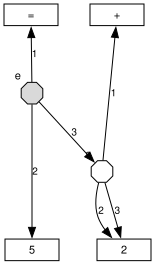
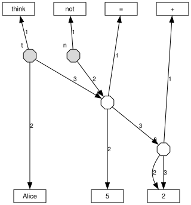
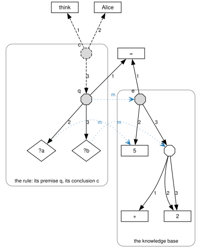
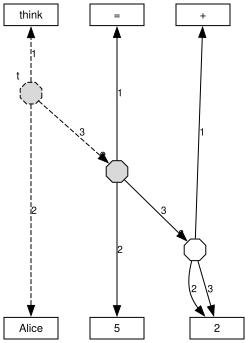
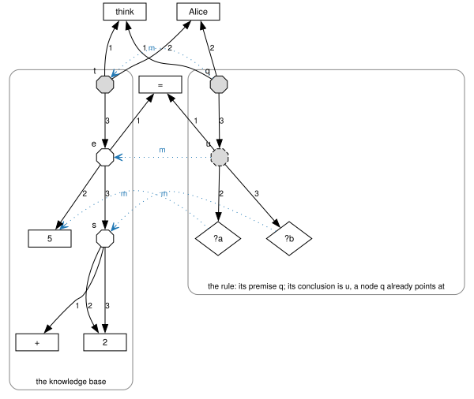
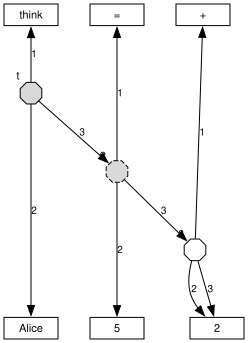

# P1f.22 — nested facts: what we have

**Stage:** [S1f.22.1](s1f.22.1_what_we_have.md) of [P1f.22](README.md). This page is the stage's deliverable: what
the engine does with a fact under an arrow of another (§ 1), what the pages and the decisions say of it (§ 2), the
explanation as it would be written in `docs/ein/reasoning/` (§ 3), and what is the user's to decide (§ 4). What the
stage found outside its scope is in [`findings.md`](findings.md).

**How § 1 was taken.** Every claim is a run of the gate build of the main checkout,
`EIN=ein.rs/target/gate/ein` (`ein --version`: `ein 0.1.0`, `protocol ein-events/1`, `container einb/2.0`), on a
program written for the claim. Each program is given in full, with the command and the lines of its output that
carry the claim; rows of the read-out that carry none (`exhausted`, `route`, `work`, the lines) are left out, and
`…` marks a cut inside a line. The words are the knowledge-base page's
([`01-knowledge-base.md`](../../../docs/ein/reasoning/01-static-ir/01-knowledge-base.md)): **object**, **atom**,
**fact**, **arrow**, **relation**, **held**, **extent**, **held extent**; a fact under an argument arrow of
another, at any depth, is **nested** in it.

**The example's names.** The user's example is `(= 5 (+ 2 2))` against `(think Alice (= 5 (+ 2 2)))`. Ein has no
numbers: `5` and `2` are names, and `=` and `+` are names too, neither reserved (the reserved equality is `eq`), so
`=` and `+` are ordinary relations of two arguments and the example is used as the user wrote it. It has **two**
nested facts, not one: `(+ 2 2)` is a fact of the relation `+`, under the third arrow of `(= 5 (+ 2 2))`.

---

## 1. What the engine does

### 1.1 Identity, and what is held

Three programs, one per case.

`u1_stated.ein`:

```lisp
(= 5 (+ 2 2))
```

`u2_nested.ein`:

```lisp
(think Alice (= 5 (+ 2 2)))
```

`u3_both.ein`:

```lisp
(= 5 (+ 2 2))
(think Alice (= 5 (+ 2 2)))
```

`ein saturate --dump FILE`, the dump's facts:

```text
u1_stated.ein
;; ── BACKGROUND (1 facts) ──
  (= 5 (+ 2 2))
;; ── DERIVED (1 facts) ──
  (written (+ 2 2) :rule "#written")

u2_nested.ein
;; ── BACKGROUND (1 facts) ──
  (think Alice (= 5 (+ 2 2)))
;; ── DERIVED (2 facts) ──
  (written (= 5 (+ 2 2)) :rule "#written")
  (written (+ 2 2) :rule "#written")

u3_both.ein
;; ── BACKGROUND (2 facts) ──
  (= 5 (+ 2 2))
  (think Alice (= 5 (+ 2 2)))
;; ── DERIVED (2 facts) ──
  (written (+ 2 2) :rule "#written")
  (written (= 5 (+ 2 2)) :rule "#written")
```

**What is held.** The knowledge base holds exactly the facts the file states at its top level, and for each fact
nested in one of them a fact of `written` (§ 1.6). A nested fact is not listed: `u2` does not hold
`(= 5 (+ 2 2))`, and none of the three holds `(+ 2 2)`.

| case | holds `(= 5 (+ 2 2))` | holds `(think Alice (= 5 (+ 2 2)))` | holds `(written (= 5 (+ 2 2)))` | holds `(+ 2 2)` |
|---|---|---|---|---|
| only stated (`u1`) | yes | no | no | no |
| only nested (`u2`) | no | yes | yes | no |
| both (`u3`) | yes | yes | yes | no |

**A query** reads the held extent, and a pattern reads under the arrows of a held fact. The same five queries on
the nested case and on both. `a1_nested_query.ein`:

```lisp
(think Alice (= 5 (+ 2 2)))
(rule saw-equality ()
  :match  (= ?a ?b)
  :assert (equality-held ?a ?b)
  :why    "{?a} equals {?b} is held")
(query :goal (= 5 ?x))
(query :goal (think ?who ?what))
(query :goal (think ?who (= ?a ?b)))
(query :goal (equality-held ?a ?b))
(query :goal (written ?t))
```

`ein solve a1_nested_query.ein`:

```text
  query 1 of 5      (= 5 ?x)
    class 1 of 1    1 state (1) — the goal has no row: undetermined here
  query 2 of 5      (think ?who ?what)
                      ?what = (= 5 (+ 2 2)) · ?who = Alice
  query 3 of 5      (think ?who (= ?a ?b))
                      ?a = 5 · ?b = (+ 2 2) · ?who = Alice
  query 4 of 5      (equality-held ?a ?b)
    class 1 of 1    1 state (1) — the goal has no row: undetermined here
  query 5 of 5      (written ?t)
                      ?t = (+ 2 2)
                      ?t = (= 5 (+ 2 2))
```

`a3_both_query.ein` is the same with the line `(= 5 (+ 2 2))` put first; `ein solve a3_both_query.ein`:

```text
  query 1 of 5      (= 5 ?x)
                      ?x = (+ 2 2)
  query 4 of 5      (equality-held ?a ?b)
                      ?a = 5 · ?b = (+ 2 2)
```

and its queries 2, 3 and 5 answer as above. So in the nested case the query for `(= 5 ?x)` has no row and the rule
that matches `(= ?a ?b)` does not fire; in the both case the query has its row and the rule fires. A variable in an
argument's place is bound to the nested fact whole (`?what`), and a pattern in that place reads its parts (`?a`,
`?b`).

**It is one object.** Four things show that the fact stated and the fact under the arrow are the same object, not
two with one text.

1. *A negation built from the nested one kills the stated one.* `j1.ein`:

   ```lisp
   (think Alice (= 5 (+ 2 2)))
   (liar Alice)
   (= 5 (+ 2 2))
   (rule distrust ()
     :match  (and (liar ?p) (think ?p ?f))
     :assert (not ?f)
     :why    "{?p} lies and thinks {?f}")
   ```

   `ein solve j1.ein`: `states (k_s) 0`, `empty every node is dead — root's own fixpoint derives (false)`,
   `unsat core (= 5 (+ 2 2))`, `unsat core (liar Alice)`, `unsat core (think Alice (= 5 (+ 2 2)))`,
   `refuted by (given), distrust`. The variable `?f` was bound under the third arrow of the `think` fact, and the
   negation the rule concluded of it contradicts the fact the file states.
2. *A join on a whole fact.* `c4.ein`:

   ```lisp
   (think Alice (= 5 (+ 2 2)))
   (think Bob (= 5 (+ 2 2)))
   (doubt Carol (= 5 (+ 2 2)))
   (doubt Carol (= 4 (+ 2 2)))
   (query :goal (and (think ?p ?f) (doubt ?q ?f)))
   (query :goal (and (think ?p ?f) (think ?q ?g) (eq ?f ?g) (neq ?p ?q)))
   (query :goal (and (think ?p ?f) (eq ?f (= 5 (+ 2 2)))))
   (query :goal (and (doubt ?p ?f) (neq ?f (= 5 (+ 2 2)))))
   ```

   `ein solve c4.ein`: query 1 has the rows `?f = (= 5 (+ 2 2)) · ?p = Alice · ?q = Carol` and `… ?p = Bob · ?q =
   Carol`; query 2 `?f = (= 5 (+ 2 2)) · ?g = (= 5 (+ 2 2)) · ?p = Alice · ?q = Bob` and its mirror; query 3 the
   two rows `?p = Alice`, `?p = Bob`; query 4 the one row `?f = (= 4 (+ 2 2)) · ?p = Carol`. One variable in two
   premises, and `eq` between two variables or a variable and a written fact, compare the objects.
3. *A nested fact that a rule then concludes is new; one already held is not.* `j2.ein`:

   ```lisp
   (think Alice (= 5 (+ 2 2)))
   (reliable Alice)
   (rule trust-equalities ()
     :match  (and (reliable ?p) (think ?p (= ?a ?b)))
     :assert (= ?a ?b)
     :why    "{?p} is reliable and thinks {?a} is {?b}")
   ```

   and `j3.ein`, which is `j2.ein` with `(= 5 (+ 2 2))` stated as well. `ein saturate j2.ein`:
   `productive (new fact) 1`, `redundant (already in KB) 0`; `ein saturate j3.ein`: `productive (new fact) 0`,
   `redundant (already in KB) 1`.
4. *In the code* a fact is interned by its relation and its arguments, and a knowledge base is a set of the ids:
   `ein-core/src/facts.rs`' `FactStore::intern(rel, args) -> FactId` returns the one id of a tuple, an argument
   that is a fact is `Value::fact(FactId)` (`ein-core/src/value.rs`), and the matcher's arm for a nested pattern
   reads the row of that id and unifies its arguments, asking nothing of whether a knowledge base holds it
   (`ein-infer/src/match_.rs`, `Slot::Nested`).

**What each surface shows.** `ein saturate --dump` lists the held facts only (above). `ein solve`'s `(model …)`
lists held facts of the state. `ein show hyps` lists candidates, which are facts a commitment would hold (§ 1.6).
`ein render kb` draws with labelled arrows, where a nested fact is a node labelled with its text;
`ein render kb u3_both.ein`:

```text
  "5" -> "(+ 2 2)" [label="=", color="#2ca02c", fontcolor="#2ca02c", style=solid];
  "Alice" -> "(= 5 (+ 2 2))" [label="think", color="#17becf", fontcolor="#17becf", style=solid];
  f_b53cc592e7 [shape=octagon, label="(written)\\nby #written", color="#d62728", fontcolor="#d62728", style=dashed];
  f_b53cc592e7 -> "(+ 2 2)" [label="#1", color="#d62728", style=dashed];
  f_19da8aee83 [shape=octagon, label="(written)\\nby #written", color="#d62728", fontcolor="#d62728", style=dashed];
  f_19da8aee83 -> "(= 5 (+ 2 2))" [label="#1", color="#d62728", style=dashed];
```

and `ein render kb u2_nested.ein` is the same less its first line. The held `(= 5 (+ 2 2))` is the arrow labelled
`=`; the nested one is the node `"(= 5 (+ 2 2))"`. In the both case the drawing has the arrow and the node, and
nothing in it says that they are one fact (§ 1.8, N-3).

### 1.2 A nested fact is not asserted

Each line of the table is one program and `ein solve FILE`; the programs follow it.

| program | what it writes | the engine |
|---|---|---|
| `b1` | the nested fact, and a query for `(= 5 ?x)` | the query has no row |
| `b7` | the nested fact, and a rule `(= 5 ?x)` ⟹ `(false)` | the rule does not fire: `∅ in R — root is alive and owes nothing` |
| `b8` | the fact stated, and the same rule | `empty every node is dead`, `unsat core (= 5 (+ 2 2))`, `refuted by no-such-equality` |
| `b2` | the nested fact, and its stored negation stated | alive: a held negation and a nested fact are no contradiction |
| `b3` | the fact stated, and its stored negation stated | dead: `unsat core (= 5 (+ 2 2))`, `unsat core (not (= 5 (+ 2 2)))`, `refuted by (given)` |
| `b4` | a nested `(false)` | alive |
| `b5` | a nested negation, beside the fact it denies, stated | alive |
| `b6` | a fact and its negation, both nested; `(false)` and `(not (false))`, both nested | alive |

```lisp
;; b1.ein
(think Alice (= 5 (+ 2 2)))
(query :goal (= 5 ?x))

;; b2.ein
(think Alice (= 5 (+ 2 2)))
(not (= 5 (+ 2 2)))

;; b3.ein
(= 5 (+ 2 2))
(not (= 5 (+ 2 2)))

;; b4.ein
(think Alice (false))

;; b5.ein
(think Alice (not (= 5 (+ 2 2))))
(= 5 (+ 2 2))

;; b6.ein
(think Alice (= 5 (+ 2 2)))
(think Alice (not (= 5 (+ 2 2))))
(think Bob (false))
(think Bob (not (false)))

;; b7.ein
(think Alice (= 5 (+ 2 2)))
(rule no-such-equality ()
  :match  (= 5 ?x)
  :assert (false)
  :why    "five equals {?x}, which cannot be")

;; b8.ein
(= 5 (+ 2 2))
(rule no-such-equality ()
  :match  (= 5 ?x)
  :assert (false)
  :why    "five equals {?x}, which cannot be")
```

`ein solve b1.ein`: `class 1 of 1 1 state (1) — the goal has no row: undetermined here`. `ein solve` on `b2`,
`b4`, `b5`, `b6` and `b7`: `states (k_s) 1`, `∅ in R — root is alive and owes nothing`. `ein solve b3.ein` and
`ein solve b8.ein`: `states (k_s) 0` and the rows quoted in the table.

**The same holds of every relation the engine itself reads.** A nested activator activates nothing, a nested
closure marker closes nothing, a nested declaration declares nothing, and a nested fact of `written` is not one the
loader refuses. `g30.ein`:

```lisp
(think Alice (transitive left-of))
(think Alice (__closed__ left-of))
(think Alice (__symmetric__ left-of))
(left-of a b)
(left-of b c)
(rule transitive (?R)
  :match  (and (?R ?x ?y) (?R ?y ?z))
  :assert (?R ?x ?z)
  :why    "{?R} is transitive")
```

`ein saturate --dump g30.ein` holds the five facts as written and three facts of `written`, and no
`(left-of a c)`. `g31.ein` is `g30.ein` with its three first lines replaced by `(transitive left-of)`, and its
dump holds `(left-of a c :rule transitive)`. `g17.ein`:

```lisp
(think Alice (relation p A B))
(query :goal (relation ?r ?a ?b))
```

loads, holds `(think Alice (relation p A B))` and `(written (relation p A B) :rule "#written")`, and no fact of
`relation`. `g16.ein`, the one line `(think Alice (written (p a)))`, loads and holds
`(written (written (p a)) :rule "#written")` and `(written (p a) :rule "#written")`, where a fact of `written`
stated at the top level is refused ([Q-M1f.280](../../../docs/decisions/stdlib/math/Q-M1f.404-a-numeral-is-checked-where-an-operation-takes-it.md)).

**A claim is held to the same.** `f9.ein`:

```lisp
(think Alice (= 5 (+ 2 2)))
(solve :expect (region (model (= 5 (+ 2 2)))))
```

`ein test f9.ein` exits 1: `the model lists (= 5 (+ 2 2)), which the state does not hold`. `f8.ein`, the same with
`(solve :expect (region (model (think Alice (= 5 (+ 2 2))))))`, is `ok`.

### 1.3 What a pattern can match inside a fact

`c1.ein`:

```lisp
(think Alice (= 5 (+ 2 2)))
(think Bob (= 4 (+ 2 2)))
(think Bob (odd 5))
(= 4 (+ 2 2))
(query :goal (think ?who ?f))
(query :goal (think ?who (= ?a (+ ?x ?y))))
(query :goal (think ?who (= ?a (+ ?x ?x))))
(query :goal (think ?who (= ?a)))
(query :goal (think ?who (= ?a ?b ?c)))
(query :goal (and (think ?who (= ?a ?b)) (= ?a ?b)))
(query :goal (and (think ?who (= ?a ?b)) (absent (= ?a ?b))))
(query :goal (absent (think ?who (= 5 ?z))))
(query :goal (absent (think ?who (= 6 ?z))))
```

`ein solve c1.ein`:

```text
  query 1 of 9      (think ?who ?f)
                      ?f = (= 4 (+ 2 2)) · ?who = Bob
                      ?f = (= 5 (+ 2 2)) · ?who = Alice
                      ?f = (odd 5) · ?who = Bob
  query 2 of 9      (think ?who (= ?a (+ ?x ?y)))
                      ?a = 4 · ?who = Bob · ?x = 2 · ?y = 2
                      ?a = 5 · ?who = Alice · ?x = 2 · ?y = 2
  query 3 of 9      (think ?who (= ?a (+ ?x ?x)))
                      ?a = 4 · ?who = Bob · ?x = 2
                      ?a = 5 · ?who = Alice · ?x = 2
  query 4 of 9      (think ?who (= ?a))
    class 1 of 1    1 state (1) — the goal has no row: undetermined here
  query 5 of 9      (think ?who (= ?a ?b ?c))
    class 1 of 1    1 state (1) — the goal has no row: undetermined here
  query 6 of 9      (and (think ?who (= ?a ?b)) (= ?a ?b))
                      ?a = 4 · ?b = (+ 2 2) · ?who = Bob
  query 7 of 9      (and (think ?who (= ?a ?b)) (absent (= ?a ?b)))
                      ?a = 5 · ?b = (+ 2 2) · ?who = Alice
  query 8 of 9      (absent (think ?who (= 5 ?z)))
    class 1 of 1    1 state (1) — the goal has no row: undetermined here
  query 9 of 9      (absent (think ?who (= 6 ?z)))
    class 1 of 1    1 state (1)
```

| shape | loads | binds |
|---|---|---|
| a variable in an argument's place, `(think ?who ?f)` | yes | the object there, an atom or a whole fact |
| a pattern in an argument's place, `(think ?who (= ?a ?b))` | yes | the parts of a fact of that relation and that count; a fact of another count is no match (queries 4, 5) |
| a pattern at depth two and more, `(think ?who (= ?a (+ ?x ?y)))` | yes | at every depth (`c10` below reads four deep) |
| one variable twice inside, `(+ ?x ?x)` | yes | one object in both places |
| a nested pattern and a top-level premise over the same parts, query 6 | yes | *nested and held*: the row of the fact that is both |
| a nested pattern and an `absent` of the same parts, query 7 | yes | *nested and not held* |
| an `absent` over a nested pattern, queries 8, 9 | yes | holds where no held fact has such a fact under its arrow |
| a stored negation under an arrow, `(think ?p (not (= ?a ?b)))` | yes (`c9b`) | the parts of the fact a nested negation denies |
| `eq` / `neq` of two variables bound to facts, or of one and a fact with no variable | yes (`c4`, § 1.1) | compares the objects |
| `eq` of a variable and a form that holds a variable, `(eq ?f (= 5 ?x))` | **refused** (`c5`) | — |
| a variable for the nested fact's relation, in a query, `(think ?who (?r ?a ?b))` | **refused** (`c2`) | — |
| the same in a rule whose parameter `?r` is | yes (`c3`) | one application an activator; a nested fact of another count is no match |
| a variable as a premise, `?f`, `(not ?f)`, `(absent ?f)`, in a rule, a query or a macro's expansion | **refused** (`c6`, `c7b`, `c8`, `i1`, `i2`, `i3`, `i6`) | — |
| `(think ?p (not ?f))`, a variable under a nested `not` | **refused** (`c9`) | — |

`c10.ein`:

```lisp
(think Alice (= 5 (+ 2 2)))
(believe Bob (think Alice (= 5 (+ 2 2))))
(believe Carol (believe Bob (think Alice (= 5 (+ 2 2)))))
(query :goal (believe ?p (think ?q (= ?a (+ ?x ?y)))))
(query :goal (believe ?p (believe ?q (think ?r (= ?a (+ ?x ?y))))))
(query :goal (believe ?p (believe ?q ?f)))
```

`ein solve c10.ein`: query 1 `?a = 5 · ?p = Bob · ?q = Alice · ?x = 2 · ?y = 2`; query 2
`?a = 5 · ?p = Carol · ?q = Bob · ?r = Alice · ?x = 2 · ?y = 2`; query 3
`?f = (think Alice (= 5 (+ 2 2))) · ?p = Carol · ?q = Bob`.

`c9b.ein`:

```lisp
(think Alice (not (= 5 (+ 2 2))))
(think Alice (= 4 (+ 2 2)))
(query :goal (think ?p (not (= ?a ?b))))
(query :goal (think ?p (= ?a ?b)))
```

`ein solve c9b.ein`: query 1 `?a = 5 · ?b = (+ 2 2) · ?p = Alice`; query 2 `?a = 4 · ?b = (+ 2 2) · ?p = Alice`.
A nested negation is an object of its own: the pattern `(= ?a ?b)` under the arrow does not match it.

`c3.ein`:

```lisp
(think Alice (= 5 (+ 2 2)))
(think Alice (odd 5))
(rule heads (?r)
  :match  (think ?who (?r ?a ?b))
  :assert (thinks-of ?who ?r)
  :why    "{?who} thinks something of the relation {?r}")
(heads =)
(heads odd)
(query :goal (thinks-of ?who ?r))
```

`ein solve c3.ein`: the one row `?r = = · ?who = Alice`. The activator `(heads odd)` gives nothing: `(odd 5)` has
one argument and the pattern two.

The refusals, each a program of the two lines shown and `ein solve FILE`, exit 1:

```text
c2.ein   (think Alice (= 5 (+ 2 2)))
         (query :goal (think ?who (?r ?a ?b)))
kb load error: query: its :goal writes (?r ?a ?b) with ?r as its relation, which nothing binds — a relation is
named by a name, or by a rule's parameter its activator binds, and a query has no activator

c5.ein   (think Alice (= 5 (+ 2 2)))
         (query :goal (and (think ?p ?f) (eq ?f (= 5 ?x))))
kb load error: query: its :goal writes (eq ?f (= 5 ?x)), and the form (= 5 ?x) holds a variable — a guard
compares two values, each a variable, a name, or a fact that holds no variable

c6.ein   (think Alice (= 5 (+ 2 2)))
         (query :goal (and (think ?p ?f) ?f))
c6.ein:2:33: unexpected `?f`: a variable

c8.ein   (think Alice (= 5 (+ 2 2)))
         (query :goal (and (think ?p ?f) (absent ?f)))
c8.ein:2:41: unexpected `?f`: a variable

c9.ein   (think Alice (not (= 5 (+ 2 2))))
         (query :goal (think ?p (not ?f)))
c9.ein:2:29: unexpected `?f`: a variable
```

A premise `(not ?f)` in a rule, and the same shapes through a macro, each `ein saturate --dump FILE`, exit 1:

```lisp
;; c7b.ein
(think Alice (= 5 (+ 2 2)))
(not (= 5 (+ 2 2)))
(rule r ()
  :match  (and (think ?p ?f) (not ?f))
  :assert (wrong ?p)
  :why    "{?p} thinks {?f}, which is denied")

;; i1.ein
(think Alice (= 5 (+ 2 2)))
(not (= 5 (+ 2 2)))
(macro denied (?x) (not ?x) :why "{?x} is denied")
(rule wrong ()
  :match  (and (think ?p ?f) (denied ?f))
  :assert (wrong ?p)
  :why    "{?p} thinks {?f}, which is denied")

;; i2.ein
(think Alice (= 5 (+ 2 2)))
(= 5 (+ 2 2))
(macro holds (?x) (and ?x) :why "{?x} holds")
(rule right ()
  :match  (and (think ?p ?f) (holds ?f))
  :assert (right ?p)
  :why    "{?p} thinks {?f}, which holds")

;; i3.ein
(think Alice (= 5 (+ 2 2)))
(macro missing (?x) (absent ?x) :why "{?x} is not held")
(rule unsupported ()
  :match  (and (think ?p ?f) (missing ?f))
  :assert (unsupported ?p)
  :why    "{?p} thinks {?f}, which nothing says")

;; i6.ein
(think Alice (= 5 (+ 2 2)))
(import std.macro :symbols (unknown))
(rule undecided ()
  :match  (and (think ?p ?f) (unknown ?f))
  :assert (undecided ?p)
  :why    "{?p} thinks {?f}, which is neither held nor denied")
```

```text
c7b.ein:4:35: unexpected `?f`: a variable
i1   kb load error: i1.ein:5:38: rule 'wrong': its :match writes (not ?f), and not takes a pattern (relation
     argument …), not ?f — it is the stored negation of one fact; negation as failure is (absent …)
i2   kb load error: rule 'right': its :match writes ?f as a premise of and, and ?f is no premise — a premise is a
     pattern (relation argument …), a guard (eq a b) or (neq a b), an (absent …), or an (and …) or (or …) of
     premises
i3   kb load error: rule 'unsupported': its :match writes ?f as a premise of absent, and ?f is no premise — …
i6   kb load error: rule 'undecided': its :match writes ?f as a premise of absent, and ?f is no premise — …
```

**So a pattern cannot ask of a fact it holds in a variable whether it is held, denied or absent.** It can ask it
of a fact whose shape it spells, which is what the rules of `h7.ein`, `h8.ein` and `i5.ein` do:

```lisp
;; h7.ein
(think Alice (= 5 (+ 2 2)))
(= 5 (+ 2 2))
(think Bob (= 4 (+ 2 2)))
(rule right ()
  :match  (and (think ?p (= ?a ?b)) (= ?a ?b))
  :assert (right ?p)
  :why    "{?p} thinks {?a} is {?b}, and it is")
(rule unsupported ()
  :match  (and (think ?p (= ?a ?b)) (absent (= ?a ?b)))
  :assert (unsupported ?p)
  :why    "{?p} thinks {?a} is {?b}, and nothing says so")
(query :goal (right ?p))
(query :goal (unsupported ?p))

;; h8.ein
(think Alice (= 5 (+ 2 2)))
(not (= 5 (+ 2 2)))
(rule wrong ()
  :match  (and (think ?p (= ?a ?b)) (not (= ?a ?b)))
  :assert (wrong ?p)
  :why    "{?p} thinks {?a} is {?b}, and it is not")
(query :goal (wrong ?p))

;; i5.ein
(think Alice (= 5 (+ 2 2)))
(import std.macro :symbols (unknown))
(rule undecided ()
  :match  (and (think ?p (= ?a ?b)) (unknown (= ?a ?b)))
  :assert (undecided ?p)
  :why    "{?p} thinks {?a} is {?b}, which is neither held nor denied")
```

`ein solve h7.ein`: `(right ?p)` has the row `?p = Alice`, `(unsupported ?p)` the row `?p = Bob`.
`ein solve h8.ein`: `(wrong ?p)` has the row `?p = Alice`. `ein saturate --dump i5.ein` holds
`(undecided Alice :rule undecided)`.

### 1.4 Packing

A rule **packs** when its conclusion is a fact that points at a fact. Every form a program might write, each a
program and `ein saturate --dump FILE` (the facts of the dump) or `ein solve FILE` (the rows).

**A fact it matched, by its shape.** `p1.ein`:

```lisp
(= 5 (+ 2 2))
(rule alice-sees ()
  :match  (= ?a ?b)
  :assert (think Alice (= ?a ?b))
  :why    "{?a} is {?b}, and Alice thinks so")
```

```text
    (= 5 (+ 2 2))
    (think Alice (= 5 (+ 2 2)) :rule alice-sees)
    (written (+ 2 2) :rule "#written")
```

The matched fact stays held and is now also nested: the stated case becomes the both case. **No fact of `written`
is stated for it**: the loader states `(written T)` for a fact a file nests, and a fact a rule assembles from
variables is none ([Q-M1f.275](../../../docs/decisions/stdlib/math/Q-M1f.404-a-numeral-is-checked-where-an-operation-takes-it.md)).

**A fact it builds from bound variables.** `p3.ein`:

```lisp
(pair 5 (+ 2 2))
(rule alice-supposes ()
  :match  (pair ?a ?b)
  :assert (think Alice (= ?a ?b))
  :why    "Alice thinks {?a} is {?b}")
```

```text
    (pair 5 (+ 2 2))
    (think Alice (= 5 (+ 2 2)) :rule alice-supposes)
    (written (+ 2 2) :rule "#written")
```

The dump holds no `(= 5 (+ 2 2))`: the nested fact is built and pointed at, and is not held. This is the nested
case made by a rule.

**A fact its conclusion writes whole.** `d2.ein`:

```lisp
(person Bob)
(rule pack-ground ()
  :match  (person ?p)
  :assert (think ?p (= 5 (+ 2 2)))
  :why    "{?p} thinks five is two plus two")
(query :goal (think ?p ?f))
(query :goal (= ?a ?b))
(query :goal (written ?t))
```

`ein solve d2.ein`: query 1 `?f = (= 5 (+ 2 2)) · ?p = Bob`; query 2 *the goal has no row*; query 3
`?t = (+ 2 2)` and `?t = (= 5 (+ 2 2))`. A nested fact with no variable in a conclusion is `written` from the
rule's text, whether the rule fires or not: `d2b.ein` is the rule of `d2.ein` alone, and
`ein saturate --dump d2b.ein` holds `(written (= 5 (+ 2 2)) :rule "#written")` and
`(written (+ 2 2) :rule "#written")` and nothing else.

**A fact it holds in a variable.** `d3.ein`:

```lisp
(think Alice (= 5 (+ 2 2)))
(trusts Bob Alice)
(rule repeat ()
  :match  (and (trusts ?q ?p) (think ?p ?f))
  :assert (think ?q ?f)
  :why    "{?q} trusts {?p}, who thinks {?f}")
(query :goal (think ?p ?f))
(query :goal (= ?a ?b))
(query :goal (written ?t))
```

`ein solve d3.ein`: query 1 `?f = (= 5 (+ 2 2)) · ?p = Alice` and `… ?p = Bob`; query 2 *the goal has no row*.
The fact moves from one context to another and is held in neither.

**A fact one level further in, and `(false)`.** `d4a.ein`:

```lisp
(think Alice (= 5 (+ 2 2)))
(rule report ()
  :match  (think ?p ?f)
  :assert (and (reported (think ?p ?f)) (absurd ?p (false)))
  :why    "{?p} thinks {?f}")
(query :goal (reported ?f))
(query :goal (absurd ?p ?f))
(query :goal (written ?t))
```

`ein solve d4a.ein`: `?f = (think Alice (= 5 (+ 2 2)))`; `?f = (false) · ?p = Alice`; and `written` of `(+ 2 2)`,
`(= 5 (+ 2 2))` and `(false)`. The state is alive: a nested `(false)` is no contradiction.

**A stored negation under an arrow, by its shape; not by a variable.** `d7.ein`:

```lisp
(pair 5 (+ 2 2))
(rule pack-neg ()
  :match  (pair ?a ?b)
  :assert (and (known (not (= ?a ?b))) (not (known (= ?a ?b))))
  :why    "{?a} is not {?b}")
(query :goal (known ?f))
(query :goal (not (known ?f)))
```

`ein solve d7.ein`: `?f = (not (= 5 (+ 2 2)))` for the first, `?f = (= 5 (+ 2 2))` for the second: a variable is
bound to a nested negation as to any object. By a variable it is refused. `d4b.ein`:

```lisp
(think Alice (= 5 (+ 2 2)))
(rule report ()
  :match  (think ?p ?f)
  :assert (denied ?p (not ?f))
  :why    "{?p} thinks {?f}")
```

``d4b.ein:4:27: unexpected `?f`: a variable``. Through a macro, `i4.ein`:

```lisp
(think Alice (= 5 (+ 2 2)))
(macro neg (?x) (not ?x) :why "not {?x}")
(rule report ()
  :match  (think ?p ?f)
  :assert (denies ?p (neg ?f))
  :why    "{?p}")
```

`kb load error: i4.ein:5:27: rule 'report': its :assert writes (not ?f), and not takes a pattern (relation
argument …), not ?f — it is the stored negation of one fact; negation as failure is (absent …)`.

**A relation that is a parameter.** `d6.ein`:

```lisp
(pair 5 (+ 2 2))
(rule pack-rel (?r)
  :match  (pair ?a ?b)
  :assert (known (?r ?a ?b))
  :why    "{?a} and {?b} stand in {?r}")
(pack-rel =)
(query :goal (known ?f))
```

`ein solve d6.ein`: `?f = (= 5 (+ 2 2))`.

**An activator's argument.** `h4.ein`:

```lisp
(person Alice)
(rule about (?c)
  :match  (person ?p)
  :assert (think ?p ?c)
  :why    "{?p} thinks {?c}")
(about (= 5 (+ 2 2)))
(query :goal (think ?p ?f))
(query :goal (= ?a ?b))
```

`ein solve h4.ein`: `?f = (= 5 (+ 2 2)) · ?p = Alice`, and *the goal has no row* for `(= ?a ?b)`. The activator
`(about (= 5 (+ 2 2)))` is a held fact that points at the fact, which is not held.

**Without bound.** `d5.ein`:

```lisp
(think Alice (= 5 (+ 2 2)))
(rule wrap ()
  :match  (think ?p ?f)
  :assert (think ?p (think ?p ?f))
  :why    "{?p} thinks that {?p} thinks {?f}")
```

`ein saturate --dump --max-steps 6 d5.ein`: `!! saturator step limit hit: --max-steps 6 stopped saturation after
6 firings, before it checked for a fixpoint. The last firing: (wrap) with ?p = Alice · ?f = (think Alice (think
Alice (think Alice (think Alice (think Alice (= 5 (+ 2 2))))))) derived …`. Nothing bounds the depth a rule can
build, which is what [saturation](../../../docs/ein/reasoning/02-kb-evolution/02-saturation.md) says where it
assumes termination.

**What the standard library packs.** Read by text, `stdlib/` has 193 rules and hrules, of which 42 conclude a
fact that nests a form and 46 read inside a nested fact (§ 1.9). All 42 are the calculator's: a numeral is a nested
fact, `(n (n z 4) 2)`, and a step of a computation carries what it is working on as a **tag**, a fact under the
first argument arrow of a call: `(gcd-call (gcd ?x ?y) ?u ?v)`, `(div-call (halving ?x ?acc) (n ?p ?a) (n z 2))`.
A flag packs the request it is about, held in a variable: `std.math.positional`'s `bad-request-malformed`
concludes `(?MALFORMED ?request)`, and `std.math.arith`'s rule reads `(division-by-zero ?request)`.

### 1.5 Unpacking

A rule **unpacks** when its conclusion is a fact that its pattern found under an arrow.

**By the nested fact's shape: yes.** `p2.ein`:

```lisp
(think Alice (= 5 (+ 2 2)))
(rule alice-is-right ()
  :match  (think Alice (= ?a ?b))
  :assert (= ?a ?b)
  :why    "Alice thinks {?a} is {?b}, and she is right")
```

`ein saturate --dump p2.ein`:

```text
    (think Alice (= 5 (+ 2 2)))
    (= 5 (+ 2 2) :rule alice-is-right)
    (written (= 5 (+ 2 2)) :rule "#written")
    (written (+ 2 2) :rule "#written")
```

The nested case becomes the both case, by this rule and by nothing else.

**By a variable that stands for the whole of it: no.** Each `ein solve FILE`, exit 1:

```lisp
;; e2.ein
(think Alice (= 5 (+ 2 2)))
(reliable Alice)
(rule trust ()
  :match  (and (reliable ?p) (think ?p ?f))
  :assert ?f
  :why    "{?p} is reliable and thinks {?f}")

;; e3.ein: e2.ein with   :assert (and ?f)

;; e6.ein: e2.ein with the line below before the rule, and   :assert (id ?f)
(macro id (?x) ?x :why "the thing itself")

;; e8.ein
(think Alice (= 5 (+ 2 2)))
(hrule maybe-right ()
  :match  (think ?p ?f)
  :assert ?f
  :why    "perhaps {?p} is right that {?f}")
```

```text
e2.ein:5:11: unexpected `?f`: a variable
e3.ein:5:16: unexpected `?f`: a variable
kb load error: e6.ein:6:15: rule 'trust': its :assert concludes ?f, which is not a fact — a conclusion is a fact
(relation argument …), or an (and …) of facts
e8.ein:4:11: unexpected `?f`: a variable
```

This is [Q-M1f.351](../../../docs/decisions/language/Q-M1f.351-a-bare-variable-or-name-is-no-whole-conclusion.md).

**The negation of a variable: yes.** A conclusion `(not ?f)` is the one place a variable stands for a whole fact
in a conclusion. `e4.ein`:

```lisp
(think Alice (= 5 (+ 2 2)))
(liar Alice)
(rule distrust ()
  :match  (and (liar ?p) (think ?p ?f))
  :assert (not ?f)
  :why    "{?p} lies and thinks {?f}")
(query :goal (not (= ?a ?b)))
```

`ein saturate --dump e4.ein` holds `(not (= 5 (+ 2 2)) :rule distrust)`. So a program can deny whatever fact a
variable holds, of any relation and any count, and cannot hold it. Where the variable holds a nested negation the
engine stores the negation of a negation, which is N-1 (§ 1.8).

**By a relation that is a parameter: yes, one rule a count, one activator a relation.** `h6.ein`:

```lisp
(think Alice (= 5 (+ 2 2)))
(think Alice (odd 5))
(reliable Alice)
(rule trust2 (?R)
  :match  (and (reliable ?p) (think ?p (?R ?a ?b)))
  :assert (?R ?a ?b)
  :why    "{?p} is reliable and thinks {?a} {?R} {?b}")
(rule trust1 (?R)
  :match  (and (reliable ?p) (think ?p (?R ?a)))
  :assert (?R ?a)
  :why    "{?p} is reliable and thinks {?R} of {?a}")
(trust2 =)
(trust1 odd)
(query :goal (= ?a ?b))
(query :goal (odd ?a))
```

`ein solve h6.ein`: `?a = 5 · ?b = (+ 2 2)` and `?a = 5`. The relation's place takes its atom from an activator
alone; the nested fact cannot supply it. `g32.ein`:

```lisp
(think Alice (= 5 (+ 2 2)))
(rule unpack (?R)
  :match  (think ?p (?R ?a ?b))
  :assert (?R ?a ?b)
  :why    "{?p} is believed")
(unpack (= 5 (+ 2 2)))
```

`kb load error: rule 'unpack': its parameter ?R names a relation, and (unpack (= 5 (+ 2 2))) binds it to the fact
(= 5 (+ 2 2)) — a relation is named by a symbol, not a fact`. `g33.ein`, where a second rule would derive the
activator from the nested fact:

```lisp
(think Alice (hold (= 5 (+ 2 2))))
(rule mk ()
  :match  (think ?p (hold ?f))
  :assert (unpack ?f)
  :why    "{?p}")
(rule unpack (?R)
  :match  (think ?p (?R ?a ?b))
  :assert (?R ?a ?b)
  :why    "{?p} is believed")
```

`kb load error: rule 'mk': its :assert writes (unpack ?f), whose ?f is rule 'unpack''s parameter ?R, which names a
relation, and (think ?p (hold ?f)) can bind ?f to a fact, as an argument of (hold ?f) — a relation is named by a
symbol, not a fact`.

**As a hypothesis: yes, by shape.** `f6.ein`:

```lisp
(think Alice (= 5 (+ 2 2)))
(think Bob (= 4 (+ 2 2)))
(hrule believe-someone ()
  :match  (think ?p (= ?a ?b))
  :assert (= ?a ?b)
  :why    "suppose {?p} is right that {?a} is {?b}")
(rule one-value ()
  :match  (and (= ?a ?x) (= ?b ?x) (neq ?a ?b))
  :assert (false)
  :why    "{?a} and {?b} cannot both be {?x}")
(query :goal (= ?a ?b))
```

`ein show hyps f6.ein`: `(= 4 (+ 2 2))`, `(= 5 (+ 2 2))`, ``H, built by the rung `hrules`: 2 candidates``.
`ein solve f6.ein`: `states (k_s) 3`, the states `(model)`, `(model (= 4 (+ 2 2)))` and `(model (= 5 (+ 2 2)))`;
`ein oracle f6.ein` prints the same three. Root holds neither equality; a commitment holds one, and the two
together are dead.

**A nested negation, by shape.** `e12.ein`:

```lisp
(think Alice (not (= 5 (+ 2 2))))
(reliable Alice)
(rule trust-denials ()
  :match  (and (reliable ?p) (think ?p (not (= ?a ?b))))
  :assert (not (= ?a ?b))
  :why    "{?p} is reliable and denies that {?a} is {?b}")
(query :goal (not (= ?a ?b)))
```

`ein solve e12.ein`: `?a = 5 · ?b = (+ 2 2)`.

**What the standard library does.** By text, no rule of `stdlib/` concludes a fact it matched under an arrow, and
none concludes `(not ?x)` (§ 1.9: `unpack 0`, `neg_var 0` of 193). The calculator reads the *parts* of a nested
fact and concludes a fact of another relation over them. `std.math.gcd`'s

```lisp
(rule gcd-answer ()
  :match  (gcd-done (gcd ?x ?y) ?g)
  :assert (gcd-of ?x ?y ?g)
  :why    "the greatest common divisor of {?x} and {?y} is {?g}")
```

reads the tag `(gcd ?x ?y)` and answers with `gcd-of`. In `examples/`, 5 rules of 1 006 unpack by text, two of
them the user's [`examples/beliefs/01_common_belief.ein`](../../../examples/beliefs/01_common_belief.ein), whose
`common-belief-likes` concludes `(likes ?p ?f)` from `(believes ?x (likes ?p ?f))` under a universal premise; 10
conclude `(not ?x)`, three of them the rule of
[`examples/saturation/hypothesis-contradiction/`](../../../examples/saturation/hypothesis-contradiction/coloc-disproved.ein),
which Q40 cites.

### 1.6 The engine's own nested facts

**`written`.** The loader states `(written T)` for each fact `T` nested in a fact a file writes, at any depth
(`u1` to `u3`, § 1.1), and for each nested fact with no variable in a rule's or an hrule's conclusion (`d2b`,
§ 1.4); it states none for a fact a rule assembles from variables (`p1`, `p3`). It is a held fact whose one
argument arrow points at a fact that need not be held. For a stored negation it states the facts nested in the
fact denied and not that fact; for a negation under an arrow it states the negation and not the fact it denies.
`f3.ein`:

```lisp
(not (think Alice (= 5 (+ 2 2))))
(not (p (q a) (not (r (s b)))))
```

`ein saturate --dump f3.ein`:

```text
  (not (think Alice (= 5 (+ 2 2))))
  (not (p (q a) (not (r (s b)))))
  (written (= 5 (+ 2 2)) :rule "#written")
  (written (+ 2 2) :rule "#written")
  (written (q a) :rule "#written")
  (written (not (r (s b))) :rule "#written")
  (written (s b) :rule "#written")
```

No `(written (think Alice …))`, no `(written (p …))` and no `(written (r (s b)))`. **`written` tells a fact a file
nested from one a rule built**, and a rule can read the difference. `f12.ein`:

```lisp
(note (pair (bad 1) 2))
(rule no-bad ()
  :match  (written (bad ?x))
  :assert (false)
  :why    "bad {?x} is written")
```

`ein solve f12.ein`: `states (k_s) 0`, `unsat core (note (pair (bad 1) 2))`, `refuted by no-bad`. `f13.ein`:

```lisp
(item a)
(rule make ()
  :match  (item ?x)
  :assert (note (pair (bad ?x) 2))
  :why    "note {?x}")
(rule no-bad ()
  :match  (written (bad ?x))
  :assert (false)
  :why    "bad {?x} is written")
(query :goal (note ?n))
```

`ein solve f13.ein`: `states (k_s) 1`, `∅ in R — root is alive and owes nothing`, `?n = (pair (bad a) 2)`. Both
states hold a `note` fact that nests a fact of `bad`; the first is dead and the second alive. What follows from
that for a state file is N-2 (§ 1.8).

**A stored negation** is a held fact of `not` whose one argument arrow points at the fact it denies, and that fact
is not held by it: `b2` (§ 1.2) holds `(not (= 5 (+ 2 2)))` and is alive beside the nested fact, and `b3` is dead
only because the fact is held too. `not` is the one relation the engine reads as saying something of whether the
fact under its arrow is held.

**A hypothesis and a commitment.** A candidate is a fact; a commitment is a set of candidates, and its state holds
them as facts at the top level. The engine wraps no candidate in a fact of its own: the relation `hypothesis` of
`examples/saturation/hypothesis-contradiction/` is the program's. A candidate may point at a fact, when an hrule
proposes one. `f7.ein`:

```lisp
(person Alice)
(person Bob)
(claim (= 5 (+ 2 2)))
(hrule someone-thinks ()
  :match  (and (person ?p) (claim ?f))
  :assert (think ?p ?f)
  :why    "suppose {?p} thinks {?f}")
(query :goal (think ?p ?f))
(query :goal (= ?a ?b))
```

`ein show hyps f7.ein`: `(think Alice (= 5 (+ 2 2)))`, `(think Bob (= 5 (+ 2 2)))`,
``H, built by the rung `hrules`: 2 candidates``. `ein solve f7.ein`: `states (k_s) 4`, and the query `(= ?a ?b)`
has `class 1 of 1 4 states (1, 2, 3, 4) — the goal has no row`: no commitment holds the nested fact.

**The blind enumerator proposes no fact that points at a fact.** Its objects are names, and the names under the
arrows of a nested fact are among them. `h1.ein`:

```lisp
(relation likes Person Person :why "{?1} likes {?2}")
(think Alice (likes Bob Carol))
```

`ein show hyps h1.ein`: `(likes Alice Bob)`, `(likes Alice Carol)`, `(likes Bob Alice)`, `(likes Bob Carol)`,
`(likes Carol Alice)`, `(likes Carol Bob)`, ``H, built by the rung `blind`: 6 candidates``. The nested fact
`(likes Bob Carol)` is a candidate because `likes` is declared and `Bob` and `Carol` are names of the program, as
`(likes Carol Bob)` is: being nested gives it no place of its own. `f5.ein`:

```lisp
(relation = Number Number :why "{?1} is {?2}")
(think Alice (= 5 (+ 2 2)))
```

`ein show hyps f5.ein`: `(= 2 5)`, `(= 2 Alice)`, `(= 5 2)`, `(= 5 Alice)`, `(= Alice 2)`, `(= Alice 5)`,
``H, built by the rung `blind`: 6 candidates``. `(= 5 (+ 2 2))` is not among them: `(+ 2 2)` is a fact and no object
of the enumerator. `ein solve f5.ein` and `ein oracle f5.ein` both print `states (k_s) 64`.

**A claim** names facts a state holds, nested ones only inside them (`f8`, `f9`, § 1.2). A query's claim lists its
projection classes. `f10.ein`:

```lisp
(think Alice (= 5 (+ 2 2)))
(query :goal (think Alice ?f) :expect (model (think Alice (= 5 (+ 2 2)))))
(query :goal (= 5 ?x) :expect (model))
(query :goal (= 5 ?x) :expect (model (= 5 (+ 2 2))))
```

`ein test f10.ein`: `3 expectations: 2 held, 1 FAILED`, the third: `the claim lists (model (= 5 (+ 2 2))), which
is no class`.

**A core** names held facts. Where a nested fact is what a contradiction turns on, the core names the fact it is
nested in. `f11.ein`:

```lisp
(think Alice (= 5 (+ 2 2)))
(rule no-fives ()
  :match  (think ?p (= 5 ?x))
  :assert (false)
  :why    "{?p} thinks five is {?x}, which nobody may think")
```

`ein solve f11.ein`: `unsat core (think Alice (= 5 (+ 2 2)))`, `refuted by no-fives`. A contradiction that rests
on a `written` fact names the fact it was written in (`f12`, above, and
[Q-M1f.279](../../../docs/decisions/stdlib/math/Q-M1f.404-a-numeral-is-checked-where-an-operation-takes-it.md)).

**The read-out, the JSON and the answer dump** print a fact by its text, a nested fact inside it:
`ein solve f7.ein --dump-answer DIR` writes `"facts": ["(think Alice (= 5 (+ 2 2)))"]` in `DIR/answer.json`, and
`ein solve e1.ein --events F` (`e1.ein` is `j2.ein` with the line `(query :goal (= ?a ?b))`) writes
`"premises": ["(reliable Alice)", "(think Alice (= 5 (+ 2 2)))"], "derived": ["(= 5 (+ 2 2))"]` in its `fire`
event. A state file lists the state's held facts, the facts of `written` left out
([`10-answer-dump.md`](../../../docs/ein/user/04-reference/10-answer-dump.md)).

### 1.7 What is refused

Each row is a program of the one line shown and `ein saturate --dump FILE`, exit 1. A row that shows a `:match` is
the program `(rule r () :match M :assert (odd ?p) :why "{?p}")` with that `M`, and one that shows an `:assert` is
`(rule r () :match (think ?p ?f) :assert A :why "{?p}")` with that `A`.

| shape | program | the engine | at |
|---|---|---|---|
| an equality as an argument | `(think Alice (eq a b))` | ``unexpected `eq` `` · *eq is computed and never stored, so (eq a b) is no value: write it as a premise or a conclusion of its own, where it is checked, and never inside another fact or pattern* | parse |
| an inequality | `(think Alice (neq a b))` | the same note for `neq` | parse |
| a connective | `(think Alice (and (p a) (q b)))`, `(think Alice (or (p a) (q b)))` | ``unexpected `and` ``, ``unexpected `or` ``, no note | parse |
| an absence | `(think Alice (absent (p a)))` | ``unexpected `absent` `` · *absent is negation as failure, a test a premise makes of a state, (absent &lt;premise&gt;) in a :match or a :goal, so no fact, value or conclusion is of it: the stored negation of a fact is (not …)* | parse |
| `false` with an argument | `(think Alice (false k))` | ``unexpected `k`: a name`` · *false takes no argument: (false) says that the state is impossible, and names nothing* | parse |
| `not` of a name | `(think Alice (not Bob))` | ``unexpected `Bob`: a name`` | parse |
| the negation of a negation | `(think Alice (not (not (p a))))` | ``unexpected `not` `` | parse |
| a fact as a relation | `((p a) b)`, `(think Alice ((p a) b))` | ``unexpected `(` `` | parse |
| a variable in a fact | `(think Alice ?x)` | ``unexpected `?x`: a variable`` | parse |
| a text | `(think Alice "five is four")` | ``unexpected `"five is four"`: a string`` · *"five is four" is a string, and a string is natural-language text, written only after :why, :source or :goal-text: write a name bare* | parse |
| the empty list | `(think Alice ())` | ``unexpected `)` `` | parse |
| the verdict | `(think Alice (open p))` | ``unexpected `open` `` · *open is reserved: it is the verdict a rule's :assert states, written as the whole :assert, (open) or (open ?R), and nowhere else, so it names no relation and no value* | parse |
| a macro's call | `(think Alice (unknown (p a)))` | *the fact (think Alice (unknown (p a))) holds (unknown (p a)), a call of std.macro's macro unknown, which the program does not import — a macro is called in a :match, an :assert or a :goal, where its call is replaced by its body; a fact is not expanded, and no fact is of a macro: write the fact itself* | load |
| a rule, a query, a clause | `(think Alice (rule r () :match (p ?x) :assert (q ?x) :why "x"))`, `(think Alice (query :goal (p ?x)))`, `(think Alice (p :source "said so"))` | ``unexpected `rule` ``, ``unexpected `query` ``, ``unexpected `:source` `` | parse |
| a declared relation at another count, nested | `(relation = Number Number :why "{?1} is {?2}")` and `(think Alice (= 5))` | *the fact (think Alice (= 5)) holds (= 5), which gives = 1 argument, and (relation = Number Number) declares 2 — a form headed by a declared relation has as many arguments as its declaration has types* | load |
| the same in a pattern | the declaration, and `:match (think ?p (= ?a))` | *rule 'r': its :match writes (= ?a), which gives = 1 argument, and (relation = Number Number) declares 2 — …* | load |
| a connective in a pattern's argument | `:match (think ?p (and (q ?a) (s ?a)))` | *rule 'r': its :match writes (think ?p (and (q ?a) (s ?a))), and (and (q ?a) (s ?a)) is a connective where a value goes — and heads no fact, and a value is a name, a variable or a fact (relation argument …)* | load |
| an equality in a pattern's argument | `:match (think ?p (eq ?a ?b))` | *… and (eq ?a ?b) is written where a value goes — eq is computed and never stored, and a value is a name, a variable, or a fact a state could hold, (relation argument …) or its negation* | load |
| an absence in a pattern's argument | `:match (think ?p (absent (q ?a)))` | *… and (absent (q ?a)) is written where a value goes — absent is negation as failure, a premise's test that no fact is of, and a value is a name, a variable, or a fact a state could hold, (relation argument …) or its negation; the stored negation of a fact is (not …)* | load |
| an equality or a connective in a conclusion's argument | `:assert (told ?p (eq ?f ?f))`, `:assert (told ?p (and ?f ?f))` | ``unexpected `eq` `` with the note above, ``unexpected `and` `` | parse |
| a fact where a relation's parameter goes | `g32`, `g33` (§ 1.5) | *a relation is named by a symbol, not a fact* | load |
| a guard over a form that holds a variable | `c5` (§ 1.3) | *a guard compares two values, each a variable, a name, or a fact that holds no variable* | load |
| a variable as a premise or a conclusion | `c6`, `c7b`, `c8`, `e2`, `e3`, `e6`, `e8`, `i1` to `i4`, `i6` | § 1.3 to § 1.5 | parse, or load after a macro's expansion |

**What loads, and might not be expected to.** `g20.ein`, the three lines `(think Alice (not (false)))`,
`(think Alice (false))` and `(not (false))`, loads and holds them. `(think Alice (written (p a)))` (`g16`),
`(think Alice (relation p A B))` (`g17`) and `(think Alice (transitive left-of))` with the two markers nested
(`g30`) are in § 1.2. `g24.ein`, the three lines `(think Alice (model (p a)))`, `(think Alice (step s))` and
`(think Alice (region (p a)))`, loads: `model`, `step` and `region` are names a value may be headed by, as the
grammar's `ValueHead` lists them.

Whether each refusal is stated on a page is § 2.3.

### 1.8 Where the engine is not consistent

Each is entered in [`findings.md`](findings.md) under the number given.

**N-1. A rule can make the negation of a negation, which the pages say is no fact and no file can write.** A
conclusion `(not ?x)` whose variable holds a nested negation stores `(not (not g))`. `e11.ein`:

```lisp
(think Alice (not (= 5 (+ 2 2))))
(liar Alice)
(rule distrust ()
  :match  (and (liar ?p) (think ?p ?f))
  :assert (not ?f)
  :why    "{?p} lies and thinks {?f}")
(query :goal (= ?a ?b))
(query :goal (not (= ?a ?b)))
```

`ein saturate --dump e11.ein` holds `(not (not (= 5 (+ 2 2))) :rule distrust)`; `ein solve e11.ein` is alive, and
neither query has a row. The engine reads it as the negation of the fact `(not (= 5 (+ 2 2)))`. `f1.ein` is
`e11.ein` less its queries with `(not (= 5 (+ 2 2)))` stated after `(liar Alice)`, and is dead:
`unsat core (liar Alice)`, `unsat core (not (= 5 (+ 2 2)))`, `unsat core (think Alice (not (= 5 (+ 2 2))))`,
`refuted by (given), distrust`. `f2.ein` is `e11.ein` less its queries with `(= 5 (+ 2 2))` stated there instead,
and is alive. The state file that `ein solve f2.ein --dump-answer f2.ans` writes holds the line
`(not (not (= 5 (+ 2 2)))) ; rule distrust: Alice lies and thinks (not (= 5 (+ 2 2)))`, and
`ein solve f2.ans/models/01.ein` answers ``f2.ans/models/01.ein:31:7: unexpected `not` ``. No tracked corpus program
holds one at root:

```sh
git ls-files 'examples/*.ein' 'tests/*.ein' 'stdlib/*.ein' | xargs -P 8 -I{} sh -c \
  'timeout 10 ein.rs/target/gate/ein saturate --dump {} 2>/dev/null | grep -c "^  (not (not "' | sort | uniq -c
```

prints `880 0`: 880 files, none with such a line (a file that is refused, or stopped at 10 s, counts 0 here, and
the command reads root's fixpoint, not a commitment's).

**N-2. A state file can read back as another state, through `written`.** A state file writes a derived fact as a
fact, so on reload the loader states `written` for what is nested in it, which the run that wrote the file did not
state where a rule assembled the nested fact. `ein solve f13.ein --dump-answer f13.ans` (`f13.ein` is in § 1.6;
alive, one state) writes `f13.ans/models/01.ein`, whose state lists

```lisp
(item a)
(note (pair (bad a) 2)) ; rule make: note a
```

and `ein solve f13.ans/models/01.ein`: `states (k_s) 0`, `empty every node is dead — root's own fixpoint derives
(false)`, `unsat core (note (pair (bad a) 2))`, `refuted by no-bad`. With the standard library's numeral,
`h2.ein`:

```lisp
(import std.math.decimal :symbols (decimal n))
(import std.math.arith :symbols (z))
(digit-read x)
(rule assemble ()
  :match  (digit-read ?d)
  :assert (reading (n z ?d))
  :why    "the reading is the numeral of {?d}")
(query :goal (reading ?r))
```

`ein solve h2.ein --dump-answer h2.ans`: `states (k_s) 1`, `?r = (n z x)`; `ein solve h2.ans/models/01.ein`:
`states (k_s) 0`, `unsat core (reading (n z x))`, `refuted by std.math.decimal.not-decimal-is-false`. The header
every state file carries says *It loads, and saturating it derives nothing new: the state is a fixpoint of the
program*. A fact a file marks as derived is treated alike: `k1.ein` is `f13.ein` less its query with the line
`(note (pair (bad a) 2) :rule make)` added, and its dump holds `(false :rule no-bad)`. The `.einb` of the program
is not affected: `ein kb save f13.ein f13.einb` and `ein solve f13.einb` print `states (k_s) 1`.

**N-3. `ein render kb` draws the both case as two things.** § 1.1: the held fact is an arrow, the nested one a
node labelled with its text, and nothing joins them, so the drawing of `u3` does not show which of the three cases
the nested node is in; a reader has to look for an arrow of the same relation between the same ends. The
labelled-arrow form has no place for it, as the knowledge-base page says of that form.

**N-4. `ein render rule` hides what a nested pattern binds.** `ein render rule e1.ein --name trust-equalities`:

```text
  subgraph cluster_lhs { label="match";
    "?p_L" [label="?p", shape=diamond];
    "(= ?a ?b)_L" [label="(= ?a ?b)", shape=rectangle];
    "h1_reliable_L" [shape=octagon, label="reliable", color="#2ca02c", fontcolor="#2ca02c"];
    "h1_reliable_L" -> "?p_L" [label="1", color="#2ca02c"];
    "?p_L" -> "(= ?a ?b)_L" [label="think", color="#17becf", fontcolor="#17becf"];
  }
  subgraph cluster_rhs { label="assert";
    "?a_R" [label="?a", shape=diamond];
    "?b_R" [label="?b", shape=diamond];
    "?a_R" -> "?b_R" [label="=", color="#2ca02c", fontcolor="#2ca02c", style=dashed];
  }
```

The pattern's nested part is one box labelled `(= ?a ?b)`, with no `?a` and no `?b` in the match; the conclusion
is an arrow between two diamonds. That the conclusion is the fact under the arrow is to be read off the box's
label.

**N-5. `ein saturate`'s census of names reads the top level only.** `ein saturate u2_nested.ein` prints
`names (global, encoding-agnostic) 3`, `category = object 1`, `category = relation 2`: `Alice`, `think` and
`written`. `5`, `2`, `=` and `+` are not counted, though the blind enumerator takes `5` and `2` for objects
(`f5`, § 1.6) and a query over `=` loads (`b1`). The dump's `;; Relations — auto-vivified (1)` lists `think`
alone. This one is stated: [`01-static-ir.md`](../../../docs/ein/ein.rs/08-reasoning-in-code/01-static-ir.md),
§ *Commands that show it*, says the census *"reads the facts held and their own arguments: a name that stands only
inside a nested fact, or as the relation of a fact that is only pointed at, is in neither count"*. It is here as
the count that reads the top level only, and is no finding.

**N-6. Which relations are *the program's* is said two ways.** `(query :goal (= 5 ?x))` loads where `=` stands
only under an arrow (`b1`), and so does `(query :goal (+ ?a ?b))` (`c0.ein`: `(think Alice (= 5 (+ 2 2)))` and
that query; one state, *the goal has no row*). That agrees with
[Q-M1f.114](../../../docs/decisions/language/Q-M1f.114-a-relation-a-solve-list-names-is-one-the-program.md), which
counts the relation of a form *in a fact's argument*. A query over a relation the program does not write at all is
refused with a sentence that names three ways and not this one, and the pages that define the notion for a goal
leave it out too (§ 2.5). `a2_stated_query.ein` is `a1_nested_query.ein`
with its first line replaced by `(= 5 (+ 2 2))`: `kb load error: a2_stated_query.ein:7:15: query: its :goal writes
(think ?who ?what), and the program names no relation think — a relation of the program is one it declares, states
a fact of, or writes in a rule or an hrule, so no state holds a fact of think`.

**N-7. A comment in the planner names a premise the grammar refuses.** `ein-infer/src/plan.rs`, on `Probe`:
*"a variable in a `(not ?x)` premise binds to a nested fact on some rows and to a name on others"*. `(not ?x)` is
no premise (`c7b`, `i1`).

### 1.9 The census script

The counts of § 1.4 and § 1.5 are `python3 plans/m1f_hypothesis_and_documentation/p1f.22_nested_facts/packscan.py
. stdlib examples tests`, run in the repository's root, which printed

```text
stdlib {'files': 24, 'rules': 193, 'pack': 42, 'pack_matched': 0, 'unpack': 0, 'neg_var': 0, 'nested_match': 46}
examples {'files': 588, 'rules': 1006, 'pack': 83, 'pack_matched': 6, 'unpack': 5, 'neg_var': 10, 'nested_match': 119}
tests {'files': 268, 'rules': 87, 'pack': 14, 'pack_matched': 1, 'unpack': 0, 'neg_var': 0, 'nested_match': 11}
```

and the names of the rules it counted. [`packscan.py`](packscan.py) reads rules as text and expands no macro and no
import, so it is a census of what is written: `pack` a conclusion that nests a form, `pack_matched` one whose
nested form is a premise of the same rule, `unpack` a conclusion that is a form nested in a premise, `neg_var` a
conclusion `(not ?x)`, `nested_match` a rule with a premise that nests a form.

---

## 2. What the pages and the decisions say now

Each row is a statement, where it is, and whether the engine agrees, by the run of § 1 named. Paths are under
`docs/`; a line number is the line at this stage's commit. *Agrees* means that a run of § 1 shows what the sentence
says; *unstated* that no page says what the engine does there.

### 2.1 The pages

**`ein/reasoning/`**

| where | what it says | the engine |
|---|---|---|
| [`01-static-ir/01-knowledge-base.md`](../../../docs/ein/reasoning/01-static-ir/01-knowledge-base.md) § *The graph* | one list of arrows is one node; a knowledge base is the graph and the set $K$ it holds; *"A node that the graph has and $K$ lacks is only pointed at"* | agrees (§ 1.1) |
| same, § *What is where*, Facts | *"An arrow of a fact points at an atom or at a fact, and a fact under an arrow of another is **nested** in it"* (Q40) | agrees |
| same, § *A fact about a relation, a fact about a fact, a negation, falsity* | *"The knowledge base holds $s$ and does not hold $g$ … Saying it does not make it held"*; a stored negation is a fact of `not` whose argument is the fact | agrees (`b1`, `b2`) |
| same section, the shapes of `not` and `false` | $\operatorname{rel}(\operatorname{arg}_1(f)) \neq \mathsf{not}$: *"$\lnot\lnot g$ is no fact"* | **disagrees**: a rule's `(not ?x)` stores one (N-1) |
| same, § *Drawn with labelled arrows* | *"a fact under an arrow of another: one node labelled with the fact's text, its own arrows not drawn"*; the form has no place for a fact that points at a fact | agrees with `ein render kb` (§ 1.1); the both case is not named |
| same, § *The knowledge base of a program* | $K_0 = T \cup D \cup \lbrace \operatorname{written}(t) : t \in \operatorname{sub}(f),\ f \in T \rbrace$ | agrees (`u1` to `u3`, `f3`) |
| same, § *Nesting* | $\operatorname{sub}$, with $\operatorname{sub}(\lnot f) = \operatorname{sub}(f)$, *"the one exception to the arrows"*; *"A nested fact is an object like any other … whether or not the knowledge base holds $g$"* | agrees (`f3`) |
| same, § *A fact, its negation, both, or neither* | status and death read $K$ | agrees (`b2` to `b6`) |
| [`01-static-ir/02-rewriting-rules.md`](../../../docs/ein/reasoning/01-static-ir/02-rewriting-rules.md) § *A match* | *"a fact pattern that is no premise is sent to a fact that need not be held: the pattern $\operatorname{says}(x, \operatorname{owns}(x, y))$ matches into the nested fact"*; matching is by count; a variable under a first arrow is sent to an atom | agrees (`c1`, `c3`) |
| same, § *The conditions on a match* | in an equality *"a term is a variable, an atom, or a fact with no variable"* (Q-M1f.30) | agrees (`c4`, `c5`) |
| same, § *A conclusion, and the result of rewriting* | a literal is a fact pattern, $\lnot x$, or a check; $\lnot x \mapsto \lbrace \lnot\,\theta(x) \rbrace$ where $\theta(x) \in F$ | agrees for a fact that is no negation (`e4`); where $\theta(x)$ is a stored negation the formula gives $\lnot\lnot g$, which the first page says is no fact (N-1) |
| same, § *As a span* | the result is the pushout *"among the graphs in which one list of arrows is one node"*; *"a fact of the conclusion that $K$ already has is the node $K$ has"* | agrees; it does not say that a conclusion may be a node the pattern has and does not hold (§ 3.4) |
| same, § *The program, and its names* | a rule's declaration adds $\operatorname{written}(t)$ for each fact with no variable nested in a literal of its conclusion | agrees (`d2b`; an hrule's too, `m1` below) |
| [`02-kb-evolution/01-firing.md`](../../../docs/ein/reasoning/02-kb-evolution/01-firing.md) § *The vocabulary*, § *Firing a rule* | an object is an atom or a fact; activators are compared *"in every argument, as objects, names and nested facts alike"* | agrees (`h4`) |
| [`02-kb-evolution/02-saturation.md`](../../../docs/ein/reasoning/02-kb-evolution/02-saturation.md) § *The fixpoint* | *"A rule may build a fact out of a fact, so nesting can grow without bound"* | agrees (`d5`) |
| same, § *The agenda* | the activator's fact $\operatorname{src}(\mathsf{Y})$, *"of which nothing says that it holds, so it derives nothing"* | agrees |
| same, § *The alive-set invariant* | $\operatorname{names}(X)$ at any depth; *"a candidate's arguments are names of the program or facts built of them"* | agrees (`h1`, `f7`) |
| [`02-kb-evolution/04-hypothesis-generation.md`](../../../docs/ein/reasoning/02-kb-evolution/04-hypothesis-generation.md) § 5 | the enumerator's objects are names of the program | agrees (`f5`: no candidate points at a fact) |
| [`02-kb-evolution/06-solution-semantics.md`](../../../docs/ein/reasoning/02-kb-evolution/06-solution-semantics.md) § 1.2 | $\operatorname{names}(P)$ *"at any depth"*; and $\operatorname{names}(\mathrm{root})$ *"counts a fact's head beside its top-level arguments"* | the first agrees (`f5`); the two sentences give two depths for two sets with one name (§ 2.5) |
| `02-kb-evolution/09-cores.md` | says nothing of a nested fact | a core names held facts (`f11`): unstated |

**`ein/user/`**

| where | what it says | the engine |
|---|---|---|
| [`03-syntax-and-semantics/03-facts.md`](../../../docs/ein/user/03-syntax-and-semantics/03-facts.md) § *In Ein* | *"`(knows Carol Dan)` inside the `claims` fact is a **value**, not a fact of the knowledge base: Carol claims it, and nothing says it holds, so `knows-back` does not fire on it"* | agrees in what it says is held; its words are not the knowledge-base page's (§ 2.5) |
| same, § *As a graph* | *"A fact held as a value is a node of its own, named by its form"* | agrees (`ein render kb`, § 1.1) |
| same, § *A fact inside a fact* | *"The inner fact is an ordinary value, identified by its structure at every depth, and a pattern matches into it … It is not asserted by being written there"*; what may be a value; `written` for *"every fact a rule's conclusion nests that holds no variable"* | agrees; an hrule's conclusion is left out, and the engine states it too (`m1`) |
| [`03-syntax-and-semantics/01-objects.md`](../../../docs/ein/user/03-syntax-and-semantics/01-objects.md) § *In mathematics* | the values $V$: $\lnot f \in V$ for every fact $f$ *of an ordinary relation*; *"two facts are one node exactly when their relations and their argument lists are equal, at every depth"* | identity agrees; a state can hold $\lnot\lnot f$ (N-1) |
| [`03-syntax-and-semantics/05-rules.md`](../../../docs/ein/user/03-syntax-and-semantics/05-rules.md) § *The pattern*, § *What is refused* | *"a nested pattern matches into a fact held as an argument"*; refused: a relation variable no parameter binds, a parameter an activator would bind to a fact, a connective, a guard or an `absent` where a value goes, `(not ?x)` where `?x` can hold a name | agrees (`c1`, `c2`, `g32`, § 1.7) |
| [`03-syntax-and-semantics/06-constraints.md`](../../../docs/ein/user/03-syntax-and-semantics/06-constraints.md) § *Two shapes* | *"`(not P)` is a fact whose one argument is the fact it denies"* | agrees |
| [`03-syntax-and-semantics/12-query.md`](../../../docs/ein/user/03-syntax-and-semantics/12-query.md) § `(query …)` | every relation a goal names is one the program has: *"declared, stated, written in a rule or an hrule …"* | the engine also takes one written only under an arrow (`b1`, N-6) |
| [`04-reference/02-syntax.md`](../../../docs/ein/user/04-reference/02-syntax.md) § *Relation declarator* | *"a stored negation's denied fact is no term, and what it nests is"*; `(p (q a (k b)))` states `written` of `(q a (k b))` and `(k b)` | agrees (`f3`) |
| same, § *Facts* | *"An argument is a name or a fact … A value is a name, or a fact a state could hold"*; `not` is shape-pinned, `(not <fact>)` | agrees at the parse (§ 1.7) |
| same, § *Rules* | *"An activator binds each parameter to its argument, any value: a name, or a nested fact, `(act (f a))` binding `?y` to `(f a)`, which the rule's patterns match and its conclusions write as they would a name"* | agrees (`h4`) |
| same, § *Conclusion forms*, § *The primitives* | *"A conclusion `(not ?x)` negates the fact `?x` holds"*; a name has no negation | agrees for a name; **unstated** for a negation (N-1) |
| same, § *Premise order around a guard* | `(and (p ?a) (neq ?m z) (eq ?m ?a))` *"is how a rule says a name, and not a fact"* | not run here |
| [`04-reference/03-reserved-names.md`](../../../docs/ein/user/04-reference/03-reserved-names.md) § `written` | who writes it, who reads it, *"never guessed, and decided at root"*; *"a `--dump-answer` state file writes none of it, since the loader states it again when the file is read"* | agrees; that the loader then states more than the state held is what N-2 turns on |
| [`04-reference/07-diagnostics.md`](../../../docs/ein/user/04-reference/07-diagnostics.md) § 2.22 | *"A fact inside a fact, a pattern inside a pattern, and a conclusion's or a guard's argument are values"*, with every refusal | agrees (§ 1.7) |
| same, § 2.23 | the negation of a name: refused at load where the text shows it, nothing concluded where only a run meets it | agrees; nothing of a negation (N-1) |
| same, § 2.30 | `written`: what is stated, from what, where it shows; *"a nested fact a rule assembles from a variable is stated by nothing"* | agrees (`p1`, `p3`, `f3`) |
| [`04-reference/10-answer-dump.md`](../../../docs/ein/user/04-reference/10-answer-dump.md) § *Every state file loads, and is a fixpoint* | the reloaded state holds *"every `written` fact the state held and one for each fact nested only in a derived one … So the file loads as a program, and saturating it derives no fact and no `(false)`"* | **disagrees** where a rule reads `written` (N-2); the depth exception is stated elsewhere (Q-M1f.185) |
| [`04-reference/12-rendering.md`](../../../docs/ein/user/04-reference/12-rendering.md) § *The KB*, § *Rules* | the shapes by count of arguments; *"it loads as a program and saturates to itself"* | names no nested fact and no nested pattern (N-3, N-4); the second sentence is N-2 |
| [`04-reference/04-stdlib/07-calculator.md`](../../../docs/ein/user/04-reference/04-stdlib/07-calculator.md) § *What stays silent* | *"a numeral a rule assembles from a variable, `(n ?p x)`, which is no term a file writes, and a top-level fact of `n`"* | agrees (`h2`); it is the first half of N-2 |
| [`04-reference/04-stdlib/08-natural-numbers.md`](../../../docs/ein/user/04-reference/04-stdlib/08-natural-numbers.md) § *The tagged calls* | *"TAG is a fact of the caller's own relation, which the answer carries back"* | agrees (§ 1.4) |

**`ein/ein.rs/`**

| where | what it says | the engine |
|---|---|---|
| [`03-design/03-data-model.md`](../../../docs/ein/ein.rs/03-design/03-data-model.md) § 1 | *"Interning is not belief. The intern tables say that a name or a proposition has a number; whether a KB holds the proposition is a bit in that KB"* | agrees; it is § 1.1's point 4 |
| same, § 6.1 | the index reaches *"one level inside"* a nested fact; *"the nesting a program writes is a negation around a fact"* | the second is no longer all a program nests (the calculator's numerals and tags) |
| [`03-design/05-matcher.md`](../../../docs/ein/ein.rs/03-design/05-matcher.md) § 3.1, § 5.1 | *"`Nested` requires a fact, reads its row once, compares the relation, and only then unifies the inner slots"*; *"A nested pattern naming a proposition that was never interned matches nothing"* | agrees |
| [`08-reasoning-in-code/01-static-ir.md`](../../../docs/ein/ein.rs/08-reasoning-in-code/01-static-ir.md) § *Commands and drawings* | *"No command draws the graph as the reasoning defines it"*; *"a fact that is only pointed at is interned in `Terms` and in no `Kb`"*; the census reads the facts held and their own arguments | agrees (N-3, N-5) |

`m1.ein`, for the hrule's row:

```lisp
(person Bob)
(hrule suppose ()
  :match  (person ?p)
  :assert (think ?p (= 5 (+ 2 2)))
  :why    "suppose {?p} thinks five is two plus two")
```

`ein saturate --dump m1.ein` holds `(person Bob)`, `(written (= 5 (+ 2 2)) :rule "#written")` and
`(written (+ 2 2) :rule "#written")`.

### 2.2 The decisions

| decision | what it rules | the engine |
|---|---|---|
| [Q40](../../../docs/decisions/language/Q40-a-fact-may-hold-a-fact-as-an-argument.md) | an argument is a name or a fact; *"an ordinary value, interned by its structure at every depth, and a pattern matches into it"*; no relation of this kind is the kernel's | agrees (§ 1.1, § 1.3) |
| [Q-M1f.113](../../../docs/decisions/language/Q-M1f.113-an-object-is-an-atom-or-a-fact-a-state-could.md), .122 to .126 | a value is a name, or a fact a state could hold, *"an atom of an ordinary relation, or its negation"*; what never heads a nested form | agrees at the parse and the load (§ 1.7); a state can hold a value that is none of these (N-1) |
| [Q-M1f.123](../../../docs/decisions/language/Q-M1f.123-false-with-no-argument-is-an-object.md) | `(false)` is a value; `(q (false))` and `(not (false))` load | agrees (`b4`, `g20`) |
| [Q-M1f.127](../../../docs/decisions/language/Q-M1f.127-a-conclusion-not-x-is-refused-where-the-program.md), [.128](../../../docs/decisions/language/Q-M1f.128-a-firing-that-meets-the-negation-of-a-name.md) | `(not ?x)` of a name: refused where the text shows it, nothing concluded where a run meets it | agrees; neither speaks of `?x` bound to a negation |
| [Q-M1f.272](../../../docs/decisions/stdlib/math/Q-M1f.404-a-numeral-is-checked-where-an-operation-takes-it.md), [.275](../../../docs/decisions/stdlib/math/Q-M1f.404-a-numeral-is-checked-where-an-operation-takes-it.md), [.279](../../../docs/decisions/stdlib/math/Q-M1f.404-a-numeral-is-checked-where-an-operation-takes-it.md), [.280](../../../docs/decisions/stdlib/math/Q-M1f.404-a-numeral-is-checked-where-an-operation-takes-it.md) | what `written` states, from what, where it shows, and that no program writes it | agrees (§ 1.6); .280 refuses *a fact of `written`*, and one under an arrow loads (`g16`), which is consistent with a nested fact being none the state holds and is said nowhere; .279's *"the loader states it again from the facts a file holds"* is the premise of N-2 |
| [Q-M1f.351](../../../docs/decisions/language/Q-M1f.351-a-bare-variable-or-name-is-no-whole-conclusion.md) | a variable is no whole conclusion; it stands whole only under `not` | agrees (`e2`, `e3`, `e6`, `e8`) |
| [Q-M1f.30](../../../docs/decisions/language/Q-M1f.30-a-guard-argument-holds-no-variable-inside-a-fact.md) | a guard's argument is a variable, a name or a fact with no variable | agrees (`c4`, `c5`) |
| Q-M1f.1, Q-M1e2.18, Q-M1f.41, [Q-M1f.43](../../../docs/decisions/engine/Q-M1f.43-a-plans-activator-is-every-argument.md), Q-M1e.16 | an activator's argument may be a fact, which binds its parameter; a relation's parameter bound to a fact is refused, written or derivable | agrees (`h4`, `g32`, `g33`) |
| Q-M1e2.9, Q-M1e.21, [Q-M1f.306](../../../docs/decisions/hypotheses/Q-M1f.306-the-guessable-atoms-are-the-programs-names-never.md) | the names of a program are its constants at any depth; the enumerator's objects are names | agrees (`h1`, `f5`) |
| [Q-M1f.114](../../../docs/decisions/language/Q-M1f.114-a-relation-a-solve-list-names-is-one-the-program.md), Q-M1f.119 | a relation of the program; .114 counts the relation of a form *"in a fact's argument"*, .119, for a goal, does not say so | the engine does what .114 says, for a goal too (`b1`, `c0`) |
| [Q-M1f.315](../../../docs/decisions/language/Q-M1f.315-a-form-of-a-declared-relation-has-as-many.md) | the declared count holds *"a fact inside a fact at any depth and under `(not …)`"* | agrees (`g18`, `g19`) |
| Q-M1f.203 | a marker or an activator at another count *"loads and activates nothing"* | agrees; nothing of one under an arrow (`g30`) |
| [Q-M1f.185](../../../docs/decisions/engine/Q-M1f.185-a-state-file-nested-past-the-parsers-limit-does.md) | a state file nested past the parser's limit does not load again | not run here; the one stated exception to the state file's round trip |
| Q-M1f.352, Q-M1f.353, Q-M1f.361, Q-M1f.189, Q-M1f.177, Q-M1f.210, Q-M1f.274 | an integer, a rational and a numeral are nested facts; a tag is a nested fact that names the caller; a malformed term is flagged where it is written | agrees (§ 1.4, `h3`: `(reading (n z x))` stated is dead, `unsat core (reading (n z x))`, `refuted by std.math.decimal.not-decimal-is-false`) |

`h3.ein`:

```lisp
(import std.math.decimal :symbols (decimal n))
(import std.math.arith :symbols (z))
(reading (n z x))
```

### 2.3 The refusals of § 1.7, and where each is stated

| refusal | stated in |
|---|---|
| `eq`, `neq`, `and`, `or`, `absent`, `false` with an argument as a nested head | `07-diagnostics.md` § 2.22; `02-syntax.md` § *Facts*; `03-reserved-names.md`; `01-grammar.md` § 1.5; Q-M1f.113, .122, .124, .125 |
| `not` of a name; `(not (not …))` written | `07-diagnostics.md` § 2.23 for the name; for the negation of a negation only as a row of § 2.16 (*"`not` of what is no pattern: … a `not` …"*) and the grammar's `NotFact`; no sentence of prose says that the negation of a negation is refused |
| a fact as a relation; a variable, a text, `()` in a fact | the grammar (`01-grammar.md` § 2.4); `01-objects.md` § *What is refused* for the text and `()` |
| `open` under an arrow | `08-obligations.md` § *The form*; Q-M1f.66 |
| a macro's call in a fact, at any depth | `07-diagnostics.md` § 2.24; `11-macros.md`; Q-M1f.133 |
| the declared count, nested | `07-diagnostics.md` § 2.26; `02-relations.md` § *The count is held*; Q-M1f.315 |
| a connective, an equality or an absence as a pattern's or a conclusion's argument | `07-diagnostics.md` § 2.22; `01-grammar.md` § 3; Q-M1f.125 |
| a relation's parameter bound to a fact | `07-diagnostics.md` § 2.9; Q-M1f.1, Q-M1e2.18 |
| a guard over a form that holds a variable | `07-diagnostics.md` § 2.9; Q-M1f.30 |
| a variable as a conclusion | Q-M1f.351; the grammar |
| a variable as a premise, alone or under `not` or `absent` | `07-diagnostics.md` § 2.16's row for `not` (*"or in a `:match` a variable"*); for a bare variable and for `(absent ?x)` the grammar's `Premise` alone: no page says that a premise cannot be a variable that holds a fact |
| a variable under a nested `not`, `(think ?p (not ?f))` | the grammar's `Term` alone |

**What loads and is stated nowhere**: a nested activator, a nested declaration, a nested marker and a nested fact
of `written` (§ 1.2). The nearest sentence is `03-facts.md`'s *"It is not asserted by being written there"*.

### 2.4 Where a page or a decision disagrees with the engine

1. **The negation of a negation** (N-1). The knowledge-base page (*"$\lnot\lnot g$ is no fact"*), `01-objects.md`'s
   $V$ and Q-M1f.113's *"or its negation"* give a state no such value; the rewriting-rules page's
   $\lnot x \mapsto \lbrace \lnot\,\theta(x) \rbrace$ gives one, and so does the engine.
2. **The state file** (N-2). `10-answer-dump.md` (*"derives no fact and no `(false)`"*), `12-rendering.md`
   (*"saturates to itself"*) and the header every state file carries.
3. **A goal's relation** (N-6). `12-query.md`, `02-syntax.md` § *Query*, `07-diagnostics.md` § 2.21, Q-M1f.119 and
   the refusal's own sentence list the ways a relation is the program's without *written under an arrow of a
   fact*; the engine counts it, as Q-M1f.114 and `07-diagnostics.md` § 2.20 do.
4. **An hrule's conclusion and `written`**. `03-facts.md` says *a rule's conclusion*; the engine, Q-M1f.275 and
   the reference pages say a rule's or an hrule's (`m1`).

### 2.5 Where the pages disagree with one another

1. **What the inner thing is called, and whether it is a fact.** The knowledge-base page: a **fact**, an
   **object**, *nested*, *only pointed at*. `03-facts.md`: *"a **value**, not a fact of the knowledge base"*.
   `01-objects.md`, `02-syntax.md`, the calculator's pages and several decisions: a **term**, *"a ground term over
   the relations"*. `04-ontology.md` and `03-data-model.md`: a **relational node**. `05-matcher.md`: a
   *fact-valued argument*. And *value* is used for three other things: a number a numeral stands for
   (`10-theory.md`), a name (`08-natural-numbers.md`, `18-boolean-functions.md`), and a program's text
   (`13-glossary.md`).
2. **Object.** An atom or a fact (the knowledge-base page, `01-firing.md`, `08-reasoning-in-code/01-static-ir.md`);
   a node named by a name (`04-ontology.md`, `13-glossary.md`, `01-objects.md`, `09-hypotheses.md`'s $O$).
3. **Atom.** A labelled node, a name (the knowledge-base page, `13-glossary.md`); a fact (Q-M1f.113's *"an atom of
   an ordinary relation"*, `03-facts.md`'s *"a ground atom"*, `07-diagnostics.md` § 2.22).
4. **Is the fact a negation denies under its arrow?** *"A fact whose one argument is the fact it denies"*
   (`06-constraints.md`, `04-ontology.md`, the knowledge-base page's $n = \operatorname{not}(g)$) against
   *"a stored negation's denied fact is no term"* (`02-syntax.md`, `07-diagnostics.md` § 2.30) and
   $\operatorname{sub}(\lnot f) = \operatorname{sub}(f)$. Both are true of the engine: the arrow is there, and
   `written` skips it.
5. **Which names, at which depth.** $\operatorname{names}(X)$ at any depth (the knowledge-base page,
   `02-saturation.md`, the README's notation) against $\operatorname{names}(\mathrm{root})$ that *"counts a fact's
   head beside its top-level arguments"* (`06-solution-semantics.md` § 1.2) and the names index's *"direct
   arguments only"* (`03-data-model.md` § 6).
6. **`(false)` as a value.** `03-facts.md` and `02-syntax.md` limit a value to *"a fact of an ordinary relation, or
   its stored negation"*; `07-diagnostics.md` § 2.22 and Q-M1f.123 add `(false)`.
7. **Tag.** A nested fact that names the caller (Q-M1f.189, `10-theory.md`, `07-calculator.md`); the request
   itself (Q-M1f.177); a property fact such as `(symmetric co-located)` (`02-syntax.md`, `12-rendering.md`).
8. **Is `written` drawn?** `07-diagnostics.md` § 2.30: *"a KB view draws it"* and, five lines on, *"`ein render`'s
   KB text leaves them out"*. `ein render kb` draws it (§ 1.1).

---

## 3. The explanation, drafted

Written as it would stand in `docs/ein/reasoning/`, in the knowledge-base page's vocabulary and voice. § 3.6 says
which part goes on which page. The symbols $G$, $O_K$, $K$, $F$, $\operatorname{out}$, $\operatorname{arg}_i$,
$\operatorname{ext}$, $\operatorname{sub}$, $\operatorname{status}_K$, $\theta$, $\varphi$, $\psi$ are those pages';
$\operatorname{ctx}_K$ is new here. The example is the user's, with its objects named once:

$$
\begin{aligned}
s &= \operatorname{+}(\mathsf{2}, \mathsf{2}) \\
e &= \operatorname{=}(\mathsf{5}, s) \\
t &= \operatorname{think}(\mathsf{Alice}, e)
\end{aligned}
$$

`=`, `+`, `5` and `2` are names like any other: Ein has no numbers, and its equality is another word.

### 3.1 The representation: one node, held or only pointed at

**A fact may stand under an arrow of a fact.** An arrow of a fact points at an object, and an object is an atom or
a fact. By the second condition of the graph there is one node for one list of arrows, so $e$ is **one node**,
whether a program states it, writes it under an arrow of $t$, or does both: writing it twice, in two places, writes
one fact. Nothing in the node says where it was written.

**What differs is what the knowledge base holds.** A knowledge base is the graph together with the set $K$ of the
facts it holds, and a fact of the graph that $K$ lacks is only pointed at. For a fact $g$ of the graph, its
**context** in $K$ is the held facts from which a path of argument arrows leads to it:

$$
\operatorname{ctx}_K(g) \;=\; \{\, f \in K \;:\; \text{a path of one or more argument arrows leads from } f \text{ to } g \,\}
$$

A fact of the context **speaks about** $g$: $t$ says that Alice thinks it, a stored negation $\lnot g$ says that
it does not hold, $\operatorname{written}(g)$ says that a file wrote it under an arrow. Every fact of the graph is
held or has a context, since every node of the graph is in $K$ or on a path from a node of $K$. So a fact of the
graph is in exactly one of three cases:

| | $g \in K$ | $\operatorname{ctx}_K(g) \ne \emptyset$ | the node is drawn |
|---|---|---|---|
| **held, in no context** | yes | no | filled, no arrow pointing at it |
| **in a context, not held** | no | yes | empty, an arrow pointing at it |
| **held, and in a context** | yes | yes | filled, an arrow pointing at it |

The three for $e$, each the knowledge base of one program. The facts of $\mathsf{written}$ that reading a program
adds are left out of the three drawings.

$K = \lbrace e \rbrace$, the program `(= 5 (+ 2 2))`:



$K = \lbrace t \rbrace$, the program `(think Alice (= 5 (+ 2 2)))`:


$K = \lbrace e, t \rbrace$, both lines:


The three graphs differ in one node, $t$, and in which octagons are filled. $e$ is the same node in all three,
with the same arrows. And $s$, the fact $\operatorname{+}(\mathsf{2}, \mathsf{2})$, is in a context and not held in
all three: nobody states that two plus two.

**A reader tells the case by the filling**, and by nothing else: an octagon is filled exactly when the knowledge
base holds it. Drawn with labelled arrows, a held fact is an arrow and a fact under an arrow is a node labelled
with its text, so a fact that is held and in a context is drawn twice, and that form does not show that the two are
one.

### 3.2 A context gives a fact no truth

Three definitions already read $K$ and nothing else, and they are all that *holding* means:

$$
\begin{aligned}
K \models t\theta &\iff t\theta \in K && \text{a premise is a held fact} \\
\operatorname{status}_K(g) &\ \text{reads}\ \ g \in K \ \text{ and } \ \lnot g \in K && \text{asserted, negated, open, contradicted} \\
\operatorname{dead}(K) &\iff \bot \in K \ \lor\ \exists f.\ f \in K \land \lnot f \in K
\end{aligned}
$$

None of them follows an argument arrow. So:

**Proposition 1 (holding is not carried by an arrow).** For a fact $f \in K$ and a fact $g$ under an argument
arrow of $f$, nothing follows about $g \in K$; and for $g \in K$, nothing follows about any fact that points at
$g$. In particular, with $g \notin K$ and $\lnot g \notin K$:

$$
\begin{aligned}
\operatorname{think}(\mathsf{Alice}, g) \in K &\implies \operatorname{status}_K(g) = \text{open} \\
\operatorname{think}(\mathsf{Alice}, \bot) \in K &\ \not\Longrightarrow\ \operatorname{dead}(K) \\
\operatorname{think}(\mathsf{Alice}, g) \in K \ \land\ \operatorname{think}(\mathsf{Alice}, \lnot g) \in K &\ \not\Longrightarrow\ \operatorname{dead}(K) \\
\operatorname{think}(\mathsf{Alice}, g) \in K \ \land\ \lnot g \in K &\ \not\Longrightarrow\ \operatorname{dead}(K)
\end{aligned}
$$

*Argument.* Each right-hand side is defined by membership in $K$ of a fact that the left-hand side does not put in
$K$. $\square$

*Alice thinks that five is two plus two* is a fact about Alice and about $e$. It is true or false as a statement
of what Alice thinks, and says nothing of whether five is two plus two. The knowledge base below holds $t$ and
$\lnot e$, and is alive: one held fact says that Alice thinks $e$, another that $e$ does not hold, and no fact is
held together with its negation.



$$
\begin{aligned}
n &= \operatorname{not}(e) \\
K &= \lbrace t, n \rbrace \\
\operatorname{ctx}_K(e) &= \lbrace t, n \rbrace \\
\operatorname{status}_K(e) &= \text{negated}
\end{aligned}
$$

**One relation is read as speaking of whether its argument is held: $\mathsf{not}$.** A stored negation is a held
fact that points at the fact it denies, so it is a context like any other, and it is the only one the definitions
above read: $\lnot g \in K$ makes $g$ negated, and dead together with $g \in K$. Every other relation's facts are
opaque to those definitions. What $\mathsf{think}$ means, whether what a reliable witness says holds, is what the
rules of a program make of it (§ 3.4), and with no such rule it means nothing.

**The same holds of every relation that something reads.** A fact of a rule's name is an activator when it is
held; a declaration declares when it is held; a marker marks when it is held. Under an arrow each is a fact about
which something is said, and it activates, declares and marks nothing:

$$
\operatorname{think}(\mathsf{Alice}, \operatorname{transitive}(\operatorname{left-of})) \in K \ \not\Longrightarrow\ \operatorname{transitive}(\operatorname{left-of}) \in \operatorname{Act}_K(\operatorname{transitive})
$$

since $\operatorname{Act}_K(\rho) \subseteq K$ by its definition.

### 3.3 What is the same in the three cases, and what differs

| of a fact $g$ | the same in all three | differs with $g \in K$ |
|---|---|---|
| its **identity** | one node, $\operatorname{out}(g)$ | |
| its **text**, its **quoted form**, its place in the **order** $\prec$ | functions of the object alone | |
| its membership of the **extent** | $g \in \operatorname{ext}(\operatorname{rel}(g))$ | $g \in \operatorname{ext}_K(\operatorname{rel}(g))$, the held extent, only where held |
| the **names** under its arrows | in $\operatorname{names}(K)$, which reads every depth | |
| being what a **variable** is bound to | a variable under an argument arrow is bound to any object | |
| being compared by an **equality** or an inequality | compares objects | |
| being matched by a **fact pattern under an arrow** of a premise | a pattern that is no premise is sent to a fact that need not be held | |
| being matched by a **premise** | | only where held |
| being found **absent** | | $K \models \operatorname{absent}(g)$ exactly where not held |
| its **status** | | asserted or contradicted where held; negated or open where not |
| making $K$ **dead** with $\lnot g$, or as $\bot$ | | only where held |
| being a member of a **state**, of a model, of a core | | only where held |
| being a **candidate** a commitment holds | | a commitment holds its candidates, and what they point at it does not |
| $\operatorname{written}(g) \in K$ | whether a file wrote $g$ under an arrow: neither *held* nor *in a context* (§ 3.5) | |

### 3.4 Packing and unpacking are rewritings

A fact changes case when $K$ changes, and $K$ changes by a rewriting, $K \cup \psi\theta$. Two shapes of rule move
a fact between the cases, and neither needs anything the rewriting rules do not already have.

**Packing.** A rule **packs** when a literal of its conclusion is a fact pattern $c$ with a fact pattern $u$ under
one of its argument arrows. The result holds $c\theta$, which points at $u\theta$:

$$
\begin{aligned}
c\theta &\in K \cup \psi\theta \\
u\theta \in K \cup \psi\theta &\iff u\theta \in K \ \lor\ u\theta \in \psi\theta
\end{aligned}
$$

so packing holds the fact that points, and **never the fact pointed at**: $u\theta$ is held after exactly where it
was held before, or where the conclusion states it too. Where $u$ is a premise of the rule, $u\theta$ was held and
stays held, and gains a context; where $u$ is built from the variables and is no premise, $u\theta$ is a fact in a
context and not held. The rule *what is so, Alice thinks*,

$$
\operatorname{=}(a, b) \;\implies\; \operatorname{think}(\mathsf{Alice}, \operatorname{=}(a, b))
$$

has one premise, $q$, and its conclusion $c$ points at that same node $q$ with its third arrow: in the pattern
graph one list of arrows is one node, as in a knowledge base. Its one match in $K = \lbrace e \rbrace$:



$$
\begin{aligned}
\theta &= \lbrace a \mapsto \mathsf{5},\ b \mapsto s \rbrace \\
q\theta &= e \\
c\theta &= \operatorname{think}(\mathsf{Alice}, e) = t \\
K \cup \psi\theta &= \lbrace e, t \rbrace
\end{aligned}
$$



The dashed octagon and its three dashed arrows are what the rewriting added: one node, $t$. $e$ was held in no
context and is now held and in a context.

**Unpacking.** A rule **unpacks** when a literal of its conclusion is a fact pattern $u$ that stands under an
argument arrow of one of its premises. The pattern graph already has the node $u$, as a fact pattern that is no
premise, and a match sends it to a fact $u\theta$ of the graph that need not be held. The conclusion holds it:

$$
\begin{aligned}
u\theta &\in O_K && \text{the graph of } K \text{ has the node before the rewriting} \\
K \cup \psi\theta &= K \cup \lbrace u\theta \rbrace \\
O_{K \cup \psi\theta} &= O_K && \text{no node and no arrow is added}
\end{aligned}
$$

**So an unpacking changes nothing in the graph but which nodes are held.** The rule *what Alice thinks is so*,

$$
\operatorname{think}(\mathsf{Alice}, \operatorname{=}(a, b)) \;\implies\; \operatorname{=}(a, b)
$$

has the premise $q$ and, under its third arrow, the fact pattern $u$, which is also its conclusion. Its one match
in $K = \lbrace t \rbrace$:



$$
\begin{aligned}
\theta &= \lbrace a \mapsto \mathsf{5},\ b \mapsto s \rbrace \\
q\theta &= t \\
u\theta &= e \\
K \cup \psi\theta &= \lbrace t, e \rbrace
\end{aligned}
$$



The graph after is the graph before. The octagon $e$ is filled, with a dashed outline for what the rewriting did,
and its arrows are solid: they were there. $e$ was in a context and not held, and is now held and in a context.

**Read on the gluing square**, the two differ in what $L^{+}$ adds to $L$. A packing adds a node, the fact pattern
$c$, glued on along the match. An unpacking adds no node: $L^{+}$ has the nodes of $L$, with $u$ among its held
ones. So the graphs of the square are to be read with their held sets, a pattern's premises being its held set,
and the inclusion $L \to L^{+}$ may keep every node and only hold more.

**Proposition 2 (a fact changes case only by a rule that says so).** Let $K'$ be the result of rewriting $K$ by a
rule at a match, and $g$ a fact of the graph of $K$. Then

$$
\begin{aligned}
g \in K &\implies g \in K' && \text{a held fact stays held} \\
g \in K' \setminus K &\implies g \in \psi\theta && \text{a fact becomes held only as an instance of a literal of the conclusion} \\
\operatorname{ctx}_{K'}(g) \setminus \operatorname{ctx}_K(g) &\subseteq \psi\theta && \text{and gains a context only by a fact the conclusion adds}
\end{aligned}
$$

*Argument.* $K' = K \cup \psi\theta$, a union of sets of facts, and $\operatorname{ctx}$ is taken among held facts.
$\square$

So along a saturation a fact moves from *in a context* to *held and in a context* exactly when some rule concludes
it, from *held* to *held and in a context* exactly when some rule concludes a fact that points at it, and never
out of *held*. A commitment does the same without a rule: it holds its candidates, each a fact, and holds nothing
they point at.

**What a rule can spell.** A premise is a fact pattern, and a conclusion's literal is a fact pattern, the
negation of a variable, or a check. So:

| a rule that would | is written | by |
|---|---|---|
| hold a fact found under an arrow | $\operatorname{think}(p, \operatorname{=}(a, b)) \implies \operatorname{=}(a, b)$ | spelling the fact's relation and its count |
| the same for any relation of one count | $\operatorname{think}(p, R(a, b)) \implies R(a, b)$, $R$ a parameter | one application for each activator that names a relation |
| deny a fact found under an arrow, whatever it is | $\operatorname{think}(p, x) \implies \lnot x$ | the literal $\lnot x$ |
| hold a fact found under an arrow, whatever it is | not a rule | a variable is no literal |
| ask whether the fact a variable stands for is held, denied or absent | not a rule | a variable is no premise; the fact's shape is spelt instead, $\operatorname{think}(p, \operatorname{=}(a, b)) \land \operatorname{=}(a, b)$ |

A relation's place takes its atom from an activator and never from a fact under an arrow, so no rule reads off
*the relation of whatever fact this is*.

### 3.5 What reads a fact under an arrow

Five things read what stands under an argument arrow, and none of them holds it.

1. **A pattern**: a fact pattern under an arrow of a premise is matched against the fact there, held or not, and
   a variable there is bound to it.
2. **Identity, text and order**: a fact is its list of arrows, at every depth.
3. **The names**: $\operatorname{names}(X)$ reads every depth, so an atom under an arrow of a fact that is only
   pointed at is a name of the knowledge base. Where candidates are proposed over the names of the program, with
   nothing narrower stated, those atoms are among the objects; a fact is never one of them, so no candidate so
   proposed points at a fact.
4. **Reading a program**: for each fact $g$ nested in a fact the text writes, and for each fact with no variable
   nested in a rule's conclusion, $K_0$ holds $\operatorname{written}(g)$. It says that the text wrote $g$ under
   an arrow. It is a context of $g$, and it is neither of the two things the cases are made of:

   $$
   \begin{aligned}
   \operatorname{written}(g) \in K &\ \not\Longrightarrow\ g \in K \\
   \operatorname{ctx}_K(g) \ne \emptyset &\ \not\Longrightarrow\ \operatorname{written}(g) \in K && \text{a fact a rule built under an arrow is written by no text}
   \end{aligned}
   $$

   and it is stated when the program is read and by no rule, so it is the same in every knowledge base a
   saturation or a commitment reaches.
5. **The contradiction test**, through $\mathsf{not}$ alone (§ 3.2).

**Proposition 3 (nothing holds a fact because of its context).** For every program $P$, every commitment $C$ and
every fact $g$,

$$
g \in \operatorname{st}(C) \iff g \in K_0 \cup C \ \lor\ g \in \psi[a]\theta \ \text{ for a match } (a, \theta) \text{ of a rule of } P \text{ along the saturation of } K_0 \cup C
$$

and no clause of the right-hand side reads $\operatorname{ctx}$.

*Argument.* $\operatorname{st}(C)$ is $K_0 \cup C$ closed under rewriting by the rules of $P$, and by Proposition 2
a fact becomes held only as an instance of a literal of a conclusion. $\square$

The proposition is the definition of a saturation read for this one question, and that is its point: there is no
other way in. A program in which no rule concludes a fact that its pattern found under an arrow never moves a fact
from *in a context* to *held* because of the context. The rules of the standard library are such: read as text,
none concludes a fact that it matched under an arrow (§ 1.5).

**A fact that is only ever pointed at.** $s = \operatorname{+}(\mathsf{2}, \mathsf{2})$ is a fact that nothing
states and nothing is meant to: it stands for a thing, the sum, as a name stands for a thing. The graph has no
second sort of node for it. It is a fact of the relation $\mathsf{+}$, in the extent of $\mathsf{+}$, and what
keeps it out of every knowledge base is that no text states it and no rule concludes it. A numeral of the standard
library is such a fact, and so is the tag a step of a computation carries.

**Depth.** A rule may build a fact under an arrow of a fact it concludes, out of a fact it matched, so the depth
of the facts of a saturation is not bounded by the program's text, and a saturation need not end
([saturation](../../../docs/ein/reasoning/02-kb-evolution/02-saturation.md)).

### 3.6 Where each part goes

| part | page | how |
|---|---|---|
| § 3.1, the three cases and $\operatorname{ctx}_K$ | `01-static-ir/01-knowledge-base.md` | § *A fact about a relation, a fact about a fact, a negation, falsity* keeps its drawing and gains the cases, the definition and the three drawings; § *Nesting* gains one sentence that $\operatorname{sub}$ leaves the denied fact out where $\operatorname{ctx}$ follows the arrow; § *Drawn with labelled arrows* gains the sentence on a fact drawn twice |
| § 3.2 and § 3.3 | the same page | after § *A fact, its negation, both, or neither*, which defines what Proposition 1 reads |
| § 3.4 | `01-static-ir/02-rewriting-rules.md` | a section after § *A conclusion, and the result of rewriting*; one sentence in § *As a span* on the held sets; the bullet under § *A match* that says a fact pattern that is no premise is sent to a fact that need not be held stays, and points at the new section |
| § 3.5, items 3 and 4, Proposition 3 | `02-kb-evolution/02-saturation.md` (the alive-set invariant already reads the names at any depth), `04-hypothesis-generation.md` § 5 (the objects are names), `06-solution-semantics.md` (a state lists held facts), `09-cores.md` (a core names held facts; one that rests on $\operatorname{written}(g)$ names the fact $g$ was written in) | a sentence each, linking the knowledge-base page |
| the propositions' witnesses | `examples/beliefs/` | three programs for the three cases and one each for a packing and an unpacking, their `:expect` the claim, beside the two that are there |

---

## 4. What is the user's to decide

Six points. Each is entered in [`open_questions.md`](../open_questions.md) under the id given, not ruled, with the
recommendation as its default. Nothing here is built: the stage changed no engine, no standard library, no corpus
and no page of `docs/`.

**What needs no ruling.** The representation is already the knowledge-base page's: one node, held or only pointed
at. The engine agrees with it in every run of § 1.1 to § 1.6 but the two of § 1.8 that points 1 and 2 below are
about. So the explanation of § 3 can be written on the pages as drafted, whatever is ruled below; the rulings move
single sentences of it.

| | point | recommended |
|---|---|---|
| 1 | [Q-M1f.391](../open_questions.md#q-m1f391--the-negation-of-a-negation-that-a-rule-builds): a rule builds the negation of a negation | (a) the firing concludes nothing for it, as for a name |
| 2 | [Q-M1f.392](../open_questions.md#q-m1f392--a-state-file-that-reads-back-dead-through-written): a state file reads back dead, through `written` | (c) the page and the header say so; no engine change |
| 3 | [Q-M1f.393](../open_questions.md#q-m1f393--a-fact-held-in-a-variable-as-a-conclusion-or-a-premise): a fact held in a variable, as a conclusion or a premise | (a) stay as is: a rule unpacks by shape |
| 4 | [Q-M1f.394](../open_questions.md#q-m1f394--the-words-for-a-fact-under-an-arrow): the words | (a) *fact*, *held*, *context*; *value* and *term* leave the user's pages |
| 5 | [Q-M1f.395](../open_questions.md#q-m1f395--what-ein-render-draws-of-a-fact-under-an-arrow): what `ein render` draws | (a) the pages say what the drawing leaves out; no writer changed |
| 6 | [Q-M1f.396](../open_questions.md#q-m1f396--where-the-explanation-stands-and-which-example-it-uses): where the explanation stands | (a) sections of the two pages of `01-static-ir/`, no page of its own |

### 4.1 Q-M1f.391 — the negation of a negation that a rule builds

**The point.** `(not ?x)` is the one conclusion that takes whatever fact a variable holds. Where the variable
holds a stored negation, the engine stores `(not (not g))` (N-1, § 1.8): a fact that the knowledge-base page, the
user's objects page and Q-M1f.113 say does not exist, that the grammar refuses, and that makes a state file that
does not load. The program, `e11.ein` of § 1.8, in words: *Alice lies, and Alice thinks that five is not two plus
two*.

| option | on `e11.ein` | costs |
|---|---|---|
| **(a) nothing is concluded** where `?x` holds a negation, as where it holds a name (Q-M1f.128). The loader adds a `note:` where the text shows that `?x` can hold one | root holds no negation of a negation; `(= 5 (+ 2 2))` stays open; `f1` (the denial stated too) is alive, where today it is dead | one arm in `firing::build_fact`, the line that returns nothing for a name; a note in the loader's reading of what a variable can hold; a sentence in Q-M1f.128 and `07-diagnostics.md` § 2.23. The liar's rule then says nothing of a negative statement: the program writes a second rule by shape, `(think ?p (not (= ?a ?b)))` ⟹ `(= ?a ?b)` |
| (b) **the denial of a denial holds the fact**: `(not ?x)` with `?x` $= \lnot g$ concludes $g$ | root holds `(= 5 (+ 2 2))`: the liar's rule works for both polarities with one line | the same arm. But it is an unpacking by a variable, which the language otherwise has not (point 3): every reading that asks which relations a rule can conclude (the strata, the monotone check, *forbid*, the invariant's *no new relations*) must take `(not ?x)` as able to conclude a fact of any relation that stands under a nested `not`. And it reads $\lnot\lnot g$ as $g$, which is more than *the denial of $g$ does not hold* |
| (c) **it is a fact**: the grammar, Q-M1f.113 and the knowledge-base page admit `(not (not g))` | as today: held, dead beside `(not g)`, alive beside `g`; the state file loads | the grammar's `NestedFact` and `Term`; the value rule becomes recursive; the knowledge-base page's shape of $\mathsf{not}$ and its four statuses gain a fifth thing to say, what a held $\lnot\lnot g$ is |
| (d) as it is, documented | | the state file that does not load stays |

**Recommendation: (a).** It keeps every page and decision true as written, makes no state hold what no file can
write, and follows the precedent the user ruled for the same conclusion over a name. (b) is the reading a puzzle
of liars wants, and belongs with point 3 if that is ever opened.

### 4.2 Q-M1f.392 — a state file that reads back dead, through `written`

**The point.** `written` is defined on files, and a state file is a file. A state that holds a fact with a fact
under its arrow that a rule assembled, in a program with a rule over `written`, is written as a file whose reload
states that `written` fact, and the rule fires (N-2, § 1.8, `f13.ein` and, with the standard library's numeral,
`h2.ein`). `10-answer-dump.md` says the reload *"derives no fact and no `(false)`"*. No tracked program is known to
do this: `ein-cli/tests/answer_round_trip.rs`, which reloads every corpus program's dumped states, is in the gate,
and this stage did not run it.

| option | on `h2.ein` | costs |
|---|---|---|
| (a) **the state file marks what the state derived or committed, and the loader states no `written` for a marked fact**. The grammar has the clause, `(note (pair (bad a) 2) :rule make)`; today it is a comment, and a fact with the clause is `written` like any other (`k1`) | the reload is alive, the state as it was | the dump's writer; `state_written`; a mark for a commitment's candidates, for which the grammar has no clause; Q-M1f.275 and `10-answer-dump.md`, which says a state file *"is the state's facts, not a second kind of program that re-states where each came from"*; a hand-written program could mark a fact to pass a check |
| (b) **`written` follows every held fact**: a fact that nests $g$, derived or committed, states `written(g)` | `h2.ein` itself is dead: the assembled numeral is flagged where it is built | reverses Q-M1f.275's second half and Q-M1f.280's reason (`written` decided at root); every step of the calculator, which nests its operands in its tag, states `written` facts of its own |
| **(c) the page and the header say it**: a state that holds a fact assembled under an arrow, in a program that reads `written`, can read back with more `written` facts than it held, and a rule that reads them fires | unchanged | two sentences, in `10-answer-dump.md` and `12-rendering.md`, and the header's line; the round trip stays broken for such a program, as it is for a state nested past the parser's limit (Q-M1f.185) |

**Recommendation: (c)**, as Q-M1f.185 treats the other state that does not read back: the cost of (a) is a second
kind of fact in a file, for a case no corpus program reaches. If the round trip is to hold without exception, (a)
is the way and (b) is not.

### 4.3 Q-M1f.393 — a fact held in a variable, as a conclusion or a premise

**The point.** *Rules can pack and unpack facts*: they can, by spelling the fact's shape (§ 1.5). What no rule can
write is the general form, over a variable bound to a whole fact:

```lisp
(rule trust ()                                   ; refused: e2.ein, Q-M1f.351
  :match  (and (reliable ?p) (think ?p ?f))
  :assert ?f
  :why    "{?p} is reliable and thinks {?f}")

(rule right ()                                   ; refused: c6.ein, i2.ein
  :match  (and (think ?p ?f) ?f)
  :assert (right ?p)
  :why    "{?p} thinks {?f}, which holds")
```

while `:assert (not ?f)` loads. So today a program denies whatever a variable holds and cannot hold it, and cannot
ask whether it is held, denied or absent.

| option | what a program writes | costs |
|---|---|---|
| **(a) as it is** | a rule a relation and a count, `(think ?p (= ?a ?b))` ⟹ `(= ?a ?b)`; or a rule a count with the relation a parameter and an activator a relation (`h6.ein`); the test *nested and held* by spelling the shape twice (`h7.ein`) | none; the pages say it (§ 3.4's table) |
| (b) **a variable is a literal and a premise**: `:assert ?f` holds the fact, `?f`, `(not ?f)` and `(absent ?f)` test it; a name in its place is treated as Q-M1f.127 and Q-M1f.128 treat one | the two rules above, as written | Q-M1f.351 reversed. A conclusion of no fixed relation: the strata, the monotone check, *forbid*, the mechanisms' check and the invariant's *no new relations* each read which relations a rule concludes, and would read *any relation a fact under an arrow can have*. A premise of no fixed relation has no index to probe. The grammar's `Premise` and `Conclusion` |
| (c) **only the tests**: a variable as a premise, not as a conclusion | the second rule above | the matcher's part of (b) without the analyses' |

**Recommendation: (a).** Nothing in the corpus needs (b): by text, no rule of the standard library unpacks, and
the five rules of `examples/` that do spell the shape (§ 1.5). A truth predicate over arbitrary facts is the kind
of thing M1g, logic in Ein, would ask for with a use in hand, and it is the place to open this.

### 4.4 Q-M1f.394 — the words for a fact under an arrow

**The point.** The knowledge-base page's vocabulary, ruled the same day as this phase, has *object*, *atom*,
*fact*, *held*, and for a fact under an arrow *nested* and *only pointed at*. The rest of the documentation says
*value*, *term*, *ground term*, *relational node* and *fact-valued argument* for the same thing, and the user's
facts page says of it *"a value, not a fact of the knowledge base"* (§ 2.5, items 1 to 3). Three things to settle.

| | question | options | recommended |
|---|---|---|---|
| i | what the three cases are called | (a) by the two things they are made of: **held**, and **in a context**, the context of a fact being the held facts that point at it, at any depth (§ 3.1). (b) the knowledge-base page's *held* and *only pointed at*, with no word for the third case | (a): the user's own words were *in KB* and *in another fact context* |
| ii | whether the fact a stored negation denies is in the negation's context | (a) yes: the arrow is there, and it is the one context the engine reads. $\operatorname{sub}$ stays as it is, leaving the denied fact out, since `written` reads it. (b) no: a context is by $\operatorname{sub}$, and a negation is no context | (a): § 3.2 turns on it |
| iii | *value* and *term* | (a) the reasoning pages and the user's pages say **fact** for a fact wherever it stands, and *held* or *not held* for the difference; *value* stays in Q-M1f.113's title and the diagnostics that quote it, read as *what may stand under an argument arrow*; *term* stays in the standard library's pages for a fact written to stand for a thing, a numeral or a tag, defined once in the glossary. (b) *value* is the user's word and *object* the reasoning's, each page saying once that they are one | (a) |

**What it costs.** (i) and (ii) are sentences of § 3. (iii)(a) is a pass over `03-facts.md`, `01-objects.md`,
`05-rules.md`, `04-ontology.md` and the glossary, which S1f.22.2 makes when it writes there; the diagnostics'
messages are the engine's text and stay.

### 4.5 Q-M1f.395 — what `ein render` draws of a fact under an arrow

**The point.** `ein render kb` draws a held fact as a labelled arrow and a fact under an arrow as a node labelled
with its text, so a fact that is both is drawn twice with nothing joining the two (N-3); `ein render rule` draws a
nested pattern as one box and hides the variables in it (N-4). The reasoning pages draw the graph itself, and
`08-reasoning-in-code/01-static-ir.md` says *"No command draws the graph as the reasoning defines it"*.

| option | costs |
|---|---|
| **(a) the pages say what the drawing leaves out**: `12-rendering.md` gains the row for a fact under an arrow and the sentence that the view does not show whether it is held; the reasoning pages keep drawing the graph | words |
| (b) **the node of a nested fact is filled where the knowledge base holds the fact**, as an octagon is in the reasoning's drawings | one attribute in `kb_dot.rs`; the shape golden's lines of every program with such a fact re-banked; `utils/ci_container.sh` green on the commit, as for every change to a DOT writer |
| (c) **a view that draws the graph as the reasoning defines it**: atoms, octagons, numbered arrows, filled where held | a new writer and its page; it would also draw a nested pattern's variables |

**Recommendation: (a) now.** (b) is small and can be planned in S1f.22.3 if wanted; (c) is a view nothing has
asked for.

### 4.6 Q-M1f.396 — where the explanation stands, and which example it uses

**The point.** § 3 can be a page of its own in `01-static-ir/`, or sections of the two pages there with a sentence
each on the pages of `02-kb-evolution/` (§ 3.6). And it can be told on the user's example or on the three-house
example the pages return to, whose knowledge-base page already has $\operatorname{says}(\mathsf{Norwegian}, g)$.

| | options | recommended |
|---|---|---|
| where | (a) sections of `01-knowledge-base.md` and `02-rewriting-rules.md`, as § 3.6 lists. (b) a third page, `03-nested-facts.md`, linked from both | (a): the representation is the graph's, and a page of its own would say again what the first page defines; Q-M1f.367 rules the pages of the tree, and (a) adds none |
| the example | (a) the user's, `(think Alice (= 5 (+ 2 2)))`, with one sentence that `=`, `+`, `5` and `2` are names. (b) the three-house example's `says`. (c) both: the cases and the two rewritings on the user's, the page's existing drawing kept | (c): the user's example has what `says` lacks, a second fact that is never held, `(+ 2 2)` |

### 4.7 What S1f.22.3 would build under the recommendations

- Q-M1f.391 (a): the arm in `firing::build_fact`, the loader's note, the witness `e11.ein` as a corpus program with
  its `:expect`, and the state file's reload in `answer_round_trip.rs`.
- Q-M1f.392 (c): nothing in the engine.
- The propositions' witnesses: programs under `examples/beliefs/` for the three cases, a packing and an unpacking,
  each with the claim of § 1 as its `:expect`, so that § 3's sentences are held by `cargo test`.
- The low findings of [`findings.md`](findings.md) that are a sentence or a comment each.
