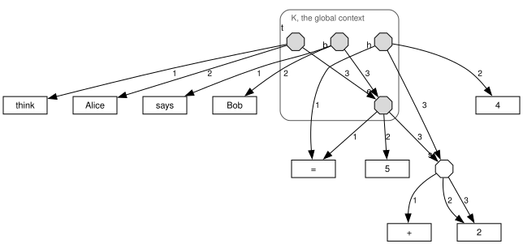
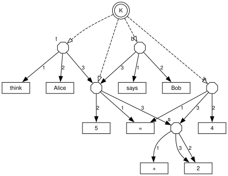

# P1f.22 — contexts: the user's notes of 2026-11-17, worked out

**Phase:** [P1f.22](README.md). The user started the phase and, shown the six questions of
[`analysis.md` § 4](analysis.md#4-what-is-the-users-to-decide), answered with the notes of § 1. This page says what
each note rules, runs the engine on what the notes ask, and puts what is still to decide. Every output is a run of
the gate build, `ein.rs/target/gate/ein`, taken for this page; each program is given in full.

Two companions, written on the same word: [`q392_state_file_and_written.md`](q392_state_file_and_written.md)
(Q-M1f.392 in detail) and [`q394_words.md`](q394_words.md) (Q-M1f.394 with examples).

## 1. The notes, verbatim

> docs/ein/reasoning/ - canonical graph representation has to somehow show that nexted fact is in global context
> or/and is in local/fact context. Now it is not explicitely presented. Maybe consider approach similar to `absent`
> drawing in rules. The implementation (ein.rs) renders nested facts as atoms with names made from entire tuple. It
> is not valid because if fact present in multiple contexts it will be drawn multiple times, while canonical
> (semi-Levi-bipartite) graph has every object drawn once. I want to have: all rules are global, so no rule binds
> nested-only fact as global fact, but can bind it as nested fact. So there could be separate global rules for this
> fact and another rules for same facts in the context - the straightforward way to write pattern as is wrapping
> every fact with context, and maybe macros could be useful here to simplify this wrappings? Q-M1f.391 Rule for
> (not (not g)) -> g is a simple rule, essential negation elimination, already trivial in ein. That's why I also
> raised a question about (and g (not g)) -> (false) could be a rule in p1f.21; Another question about rules that
> infer (false) under context - does it reach global context? If not then how is it stored or reported or affect
> further inference, maybe just store it in context and that's it, like (think Ann (false))? Then it has to be
> bindable to checks - for example to infer false if everybody's thought are false (just an example). In the
> docs/ein/reasoning all those reserved words are conceptual mathematical objects. But in docs/ein/user and
> docs/ein/ein.rs they are surface between ein reasoning kernel and pure ein theory.  Q-M1f.392 - I don't
> udnerstant - write with details into separate file in plans. Q-M1f.392 (a) for now, I don't yet know why we would
> need to change it. The only strictly required for now is to know fact's arity, for all other you can use
> variables. Q-M1f.394 explain with examples in separate file. Q-M1f.396 sections.

## 2. What the notes rule, as read here

| note | read as | state |
|---|---|---|
| *canonical graph … has to show … global context or/and local/fact context* | the reasoning's drawing must show the two **explicitly**; *a filled octagon is held* is not enough | **ruled**; how it is shown is [Q-M1f.398](../open_questions.md#q-m1f398--how-the-graph-is-drawn-to-show-the-global-context-and-a-facts-context), § 7 |
| *ein.rs renders nested facts as atoms with names made from entire tuple. It is not valid* | [Q-M1f.395](../open_questions.md#q-m1f395--what-ein-render-draws-of-a-fact-under-an-arrow): **not (a)**. Every object is drawn once; the text node goes | **ruled**; the shape to build is § 7.3, to confirm |
| *all rules are global … no rule binds nested-only fact as global fact, but can bind it as nested fact … wrapping every fact with context* | the engine as it is (§ 3); the explanation says it in these words | **ruled**: no change |
| *maybe macros could be useful here* | a question, answered in § 4 | answered; nothing to rule unless § 4's gap matters |
| *(not (not g)) -> g is a simple rule … (and g (not g)) -> (false) could be a rule in p1f.21* | [Q-M1f.391](../open_questions.md#q-m1f391--the-negation-of-a-negation-that-a-rule-builds): `(not (not g))` **is a fact**, and eliminating it is **a rule**, not the kernel's act | **read as (c) with the elimination a rule; to confirm** (§ 6) |
| *rules that infer (false) under context — does it reach global context?* | a question, answered in § 5 | answered: no; stored as `(think Ann (false))`, read by rules |
| *in reasoning the reserved words are conceptual mathematical objects; in user and ein.rs they are the surface between the kernel and pure Ein theory* | a rule for how the three perspectives write of `not`, `false`, `written` and the rest | **ruled**: [Q-M1f.397](../open_questions.md#q-m1f397--the-reserved-words-in-the-three-perspectives), § 8 |
| *Q-M1f.392 - I don't understand* | not ruled; explained | [`q392_state_file_and_written.md`](q392_state_file_and_written.md) |
| *Q-M1f.392 (a) for now, I don't yet know why we would need to change it. The only strictly required … is to know fact's arity* | **read as Q-M1f.393 (a)**: the sentence before it says .392 is not understood, and *no need to change* with *the arity is required, the rest can be variables* is .393's option (a), a rule unpacks by shape. Q-M1f.392's (a) is a change | **Q-M1f.393 ruled (a), on this reading; to confirm** |
| *Q-M1f.394 explain with examples* | not ruled; explained | [`q394_words.md`](q394_words.md) |
| *Q-M1f.396 sections* | where: (a), sections of the two pages of `01-static-ir/`. The example was not named: the default stands, the user's example beside the page's `says` | **ruled (a)** |

## 3. Rules are global: what a premise reads, and what a wrapped premise reads

**A premise is matched among held facts and nowhere else; a pattern under an arrow of a premise is matched against
the fact that stands there, held or not.** So a rule written over `(= ?x ?y)` is a rule of the global context, and
the same rule for a context is the same patterns, each wrapped. `x6.ein`:

```lisp
(= a b)
(think Ann (= c d))
(rule sym ()
  :match  (= ?x ?y)
  :assert (= ?y ?x)
  :why    "{?x} is {?y}")
(rule sym-in ()
  :match  (think ?c (= ?x ?y))
  :assert (think ?c (= ?y ?x))
  :why    "{?c} thinks {?x} is {?y}")
(query :goal (= ?x ?y))
(query :goal (think ?c (= ?x ?y)))
```

`ein solve x6.ein`:

```text
  query 1 of 2      (= ?x ?y)
                      ?x = a · ?y = b
                      ?x = b · ?y = a
  query 2 of 2      (think ?c (= ?x ?y))
                      ?c = Ann · ?x = c · ?y = d
                      ?c = Ann · ?x = d · ?y = c
```

`sym` fired on `(= a b)` and not on `(= c d)`, which only Ann thinks; `sym-in` fired on what Ann thinks and
concluded a fact Ann thinks, `(think Ann (= d c))`, and `(= d c)` is not held. The two rules do not see one
another's facts. This is the engine today, and the analysis's Propositions 1 to 3 are this said in mathematics.

**The context can be a parameter**, so one rule serves every context relation that names it. `x4.ein`:

```lisp
(think Ann (= 5 (+ 2 2)))
(think Ann (not (= 5 (+ 2 2))))
(says Bob (likes Bob Carol))
(says Bob (not (likes Bob Carol)))
(rule ctx-contradiction (?C ?R)
  :match  (and (?C ?p (?R ?a ?b)) (?C ?p (not (?R ?a ?b))))
  :assert (?C ?p (false))
  :why    "{?p}: {?R} of {?a} and {?b}, and not")
(ctx-contradiction think =)
(ctx-contradiction says likes)
(query :goal (think ?p (false)))
(query :goal (says ?p (false)))
```

`ein solve x4.ein`: alive, one state, `?p = Ann` for the first query and `?p = Bob` for the second. What is fixed
in the text is the count of arguments, of the context (`?C` of two) and of the fact in it (`?R` of two); the
relations are parameters, each bound by an activator. That is the note's *"the only strictly required … is to
know fact's arity"*.

## 4. Macros as the wrapping

**A macro wraps.** A macro's parameter may stand for a whole pattern, and its call is replaced by its body in a
`:match`, an `:assert` and a `:goal`. `m2.ein`:

```lisp
(macro in (?c ?F) (think ?c ?F) :why "{?c} thinks {?F}")
(think Ann (= a b))
(think Ann (not (= a b)))
(rule contradiction-in ()
  :match  (and (in ?c (= ?x ?y)) (in ?c (not (= ?x ?y))))
  :assert (in ?c (false))
  :why    "{?c} thinks {?x} is {?y} and not")
(query :goal (in ?c (false)))
```

`ein solve m2.ein`: `?c = Ann`, `as :expect (model (think Ann (false)))`. With the macro the rule reads as the
global rule does, each fact under `in ?c`. A macro for one fixed context is the same with one parameter, `(macro
ann (?F) (think Ann ?F) …)` (`m1.ein`, a transitivity inside what Ann thinks: `(ann (= a ?w))` answers `b` and
`c`). And a macro's call expands where it stands **inside** a pattern too: with `(macro eqp (?x ?y) (= ?x ?y) …)`,
the premise `(think ?p (eqp ?x ?y))` matches `(think Ann (= a b))` (`m3.ein`).

**A macro does not write a rule.** Its body is a premise; `(macro lifted (?c) (rule …) …)` is refused at the parse
(`m4.ein`: ``unexpected `rule` ``). So there is no form today that takes a rule written for the global context and
gives its twin for a context: **each rule is written twice**, once bare and once wrapped, or once with the context
a parameter as in § 3. The gap, if it is one:

| a program wants | today | what would close it |
|---|---|---|
| a rule for a context, written once | the rule with every fact under `(in ?c …)`, by a macro or by hand | nothing |
| one rule for several context relations | the context relation a parameter, an activator each (§ 3) | nothing |
| **a rule set written once, applied both globally and inside a context** | written twice | a form that lifts a rule, e.g. a rule-level macro; nothing has asked for it, and it is not proposed here |

## 5. `(false)` in a context

**It does not reach the global context.** `(false)` is a fact, the one of the relation `false` with no argument,
and it may stand under an arrow (Q-M1f.123). `(think Ann (false))` is then a held fact of `think` that points at
the node $\bot$; $\bot$ itself is not held, and a knowledge base is dead exactly when it *holds* $\bot$ or a fact
with its negation. `x1.ein`, a rule that infers it:

```lisp
(think Ann (= 5 (+ 2 2)))
(think Ann (not (= 5 (+ 2 2))))
(think Bob (= 5 (+ 2 2)))
(rule ctx-contradiction ()
  :match  (and (think ?p (= ?a ?b)) (think ?p (not (= ?a ?b))))
  :assert (think ?p (false))
  :why    "{?p} thinks {?a} is {?b} and thinks it is not")
(query :goal (think ?p (false)))
```

`ein solve x1.ein`: `states (k_s) 1`, `∅ in R — root is alive and owes nothing`, `?p = Ann`,
`as :expect (model (think Ann (false)))`. So:

- **stored**: as the fact `(think Ann (false))`, in the context and nowhere else, as the note proposes;
- **reported**: as any fact is, in the state, in a query's rows and in a claim; no row of the read-out treats it
  apart;
- **further inference**: it is read by the rules that match it, and by nothing else. The kernel reads $\bot$ only
  where it is held.

**It is bindable**, in a premise and under a quantifier. *Everybody's thoughts are false* is one `forall`.
`x3.ein`:

```lisp
(import std.macro :symbols (forall))
(person Ann)
(person Bob)
(think Ann (false))
(think Bob (false))
(rule all-confused ()
  :match  (forall ?p (person ?p) (think ?p (false)))
  :assert (false)
  :why    "everybody's thoughts are false")
```

`ein solve x3.ein`: `states (k_s) 0`, `unsat core (think Ann (false))`, `unsat core (think Bob (false))`,
`refuted by all-confused`. Without the line `(think Bob (false))` (`x3b.ein`): `states (k_s) 1`, root alive. So the
global `(false)` is reached from the contexts' by a rule that says so, and only so.

**What the kernel does not do in a context.** Globally, a fact held with its negation is dead with no rule
written. In a context nothing is: `(think Ann g)` beside `(think Ann (not g))` is alive until a rule such as
`ctx-contradiction` concludes `(think Ann (false))`. That is the same asymmetry P1f.21's question is about from
the other side: if $g \land \lnot g \Rightarrow \bot$ becomes a rule of Ein, its twin for a context is that rule
wrapped (§ 3), and the two read alike. A check, `(eq …)` or `(neq …)`, cannot be wrapped: it is computed, never
stored, and is refused under an arrow.

**A finding on the way** ([N-15](findings.md)). The same *everybody* written as two rules over `absent`, a rule
that derives `(some-sane)` where a person has no `(think ?p (false))` and a rule that concludes `(false)` where
`(some-sane)` is absent, answers **dead with Bob not confused** (`x2b.ein`), under `lattice monotone (the static
check)`. It is the open wrong answer `W8/fifo-gap-root` met again: two rules that wait on an `absent` at one
boundary, admitted in the agenda's order, the one that concludes `(false)` first. The `forall` form asks its
nested absence as one question and is right.

## 6. The negation of a negation, and its elimination as a rule

**Read of the note**: `(not (not g))` is to be an ordinary fact, and $\lnot\lnot g \Rightarrow g$ a rule a theory
states, as $g \land \lnot g \Rightarrow \bot$ would be in P1f.21. That is Q-M1f.391's option (c) with the
elimination moved out of the kernel into a rule. What is so today:

| | today |
|---|---|
| a rule's `(not ?x)` over a stored negation | stores `(not (not g))` (`e11.ein`); the kernel reads it as the negation of the fact `(not g)`: dead beside `(not g)`, alive beside `g` |
| a file writing `(not (not g))`, as a fact, a premise or a conclusion | refused at the parse: ``unexpected `not` `` (`d1.ein`, the rule below) |
| the state file of a state that holds one | does not load, for that reason |

So the rule is **not** writable today, though the engine already holds the fact it would read. `d1.ein`:

```lisp
(rule dne (?R)
  :match  (not (not (?R ?a ?b)))
  :assert (?R ?a ?b)
  :why    "not not")
(dne =)
```

``d1.ein:2:17: unexpected `not` ``. Under the reading above, P1f.22 would:

1. **admit `(not (not …))`** at any depth in the grammar, as a fact, a pattern and a conclusion; the knowledge-base
   page's shape of $\mathsf{not}$ loses its last clause, and Q-M1f.113's *"a fact of an ordinary relation, or its
   negation"* becomes *"a fact, or the negation of one"*;
2. change **nothing in the kernel**: a held $\lnot f$ beside a held $f$ is dead for every fact $f$, a negation
   among them, as it is now; `e11`, `f1` and `f2` answer as today, and `f2`'s state file loads;
3. leave **the elimination to a rule**, one for each count of arguments with the relation a parameter, as `dne`
   above. Where that rule lives (a module of the standard library a program imports, beside the contradiction
   rule) is P1f.21's to say, and is put there.

**One thing this reading leaves out, to know of.** A variable for a whole fact may be denied at the top of a
conclusion, `:assert (not ?f)`, and may not stand under `not` anywhere else. `x5.ein` and `x5b.ein`:

```lisp
(rule ctx-contradiction ()                     ; refused: unexpected `?f`
  :match  (and (think ?p ?f) (think ?p (not ?f)))
  :assert (think ?p (false))
  :why    "{?p} thinks {?f} and thinks not")

(rule flip ()                                  ; refused: unexpected `?f`
  :match  (and (liar ?p) (think ?p ?f))
  :assert (think ?p (not ?f))
  :why    "{?p} lies")
```

So the global rule *deny whatever a liar thinks*, which loads, has no wrapped twin: inside a context the denial
must spell the fact's relation and count, `(think ?p (not (?R ?a ?b)))`. That is consistent with *the arity is
required*, and with Q-M1f.393 (a) as read in § 2; it is said here because *wrap every fact with the context* meets
it. Admitting `(not ?x)` under an argument arrow would touch none of the analyses that Q-M1f.393's (b) touches (the
premise's and the conclusion's relation stay fixed), and is not proposed unless asked for.

## 7. The drawing

### 7.1 What the page has, and what it lacks

The knowledge-base page draws every object once and says, in one sentence of its legend, *"a filled octagon is
held, an empty one is only pointed at"*. It does not present the cases, and a reader has to infer *in a fact's
context* from an arrow's head. The note asks for both to be explicit, and suggests the way an absence is drawn in
a rule: **a frame**.

### 7.2 Three ways to show the global context, one object drawn once in each

One knowledge base, in which every case occurs:

```lisp
(think Alice (= 5 (+ 2 2)))     ; t   held, in no context
(says  Bob   (= 5 (+ 2 2)))     ; b   held, in no context
(= 5 (+ 2 2))                   ; e   held, and in the contexts of t and b
(= 4 (+ 2 2))                   ; h   held, in no context
                                ; s = (+ 2 2): in the contexts of e, h, t, b, and not held
```

**(a) A frame.** The knowledge base $K$ is drawn as a frame, and a fact is inside it exactly when it is held. An
atom, and a fact that is only in a context, is outside. *In a fact's context* is an argument arrow from a fact
inside the frame, directly or through others.



**(b) A node for the global context.** $K$ is drawn as one node, with a dashed arrow to each fact it holds. Then
both kinds of context are the same kind of mark, an incoming arrow: from $K$, or from a fact.



**(c) Two marks on the node.** Filled is held, as today; a second outline is *in a context*. Each of the three
cases is then readable off the node alone.


| | (a) frame | (b) node $K$ | (c) marks |
|---|---|---|---|
| *held* is shown by | being inside the frame | an arrow from $K$ | the filling |
| *in a fact's context* is shown by | an argument arrow from inside the frame | an argument arrow | the second outline, and the arrow |
| what it adds to the graph's definition | nothing: a frame draws the set $K$ | a node that is no object, and arrows that are no arrows of a fact | nothing |
| like what the pages already draw | the dashed frame of an absence; the *match* and *assert* panels of a rule | nothing | today's filling |
| in a pattern graph | the premises are inside a frame *match*, as the labelled-arrow drawings of a rule have it | a node for the pattern | filled premises, as today |
| the layout | a frame constrains it: the atoms spread to the sides, and it gets worse with size | free | free |
| for `ein render` | a cluster in DOT | one node and one edge a held fact | two attributes |

A fourth way was considered and is ruled out by *every object drawn once*: **a box for each context**, the nested
fact drawn inside the box of the fact that speaks about it, as conceptual graphs draw a context. A fact in two
contexts would be drawn in two boxes.

**Recommended: (a), the frame, keeping the filling inside it.** It is the note's suggestion, it adds nothing to the
definition of the graph, and it is the one convention the rule drawings already use for *the part that must be
held* and *the part that must be absent*. Its cost is the layout of a large graph, which matters for `ein render`
more than for the pages; if that bites, (c) is the fallback, since it is free in layout and changes one sentence
of the legend.

### 7.3 `ein render`, every object once

`ein render kb` on a program in which `(= 5 (+ 2 2))` is held and under the arrows of two facts draws it as a
labelled arrow `5 → (+ 2 2)` and, apart from that, as a node labelled with its text that `Alice` and `Bob` point
at: one object, drawn twice. The reasoning page's table for the labelled-arrow form has the same row (*"a fact
under an arrow of another: one node labelled with the fact's text, its own arrows not drawn"*), so the page and the
writer change together. The shape proposed:

| in the graph | drawn, in the labelled-arrow form |
|---|---|
| a held fact with three arrows **that no fact points at** | one labelled arrow, as today |
| a fact **that a fact points at**, held or not, whatever its count | **its node**: an octagon with the relation's name written in it and its argument arrows numbered, the form the table already has for a fact of another count. Drawn once; the mark of § 7.2 says whether it is held |
| a nested pattern in `ein render rule` | the same: an octagon with its arrows to its variables and atoms, so that the variables it binds are drawn |

So a fact is drawn as a labelled arrow only where nothing points at it, and a fact that something points at is
always a node with its own arrows. No text stands for a fact. This is a change to two DOT writers, to the shape
golden's lines of every program with a nested fact, and to `12-rendering.md`; a stage that changes a DOT writer is
done when `utils/ci_container.sh` is green on its commit.

## 8. The reserved words in the three perspectives

The note: in `docs/ein/reasoning/` the reserved words are conceptual mathematical objects; in `docs/ein/user/` and
`docs/ein/ein.rs/` they are the surface between the reasoning kernel and a theory written in pure Ein. Read as a
rule for the pages ([Q-M1f.397](../open_questions.md#q-m1f397--the-reserved-words-in-the-three-perspectives)):

- **`reasoning/`** defines $\lnot$, $\bot$, $\operatorname{absent}$, equality, $\mathsf{written}$, $\mathsf{relation}$
  as mathematics: what each is in the graph and what the definitions read of it. It does not speak of a *reserved
  word* as something a program must not spell, beyond the one section that lists the reserved atoms.
- **`user/`** and **`ein.rs/`** present the same names as **the kernel's surface**: the fixed list of relations
  whose facts the kernel reads or states, and what it does with each. Everything else a program reasons with is a
  rule of Ein, in the program or in the standard library. For this phase that surface is short: of a fact under
  an arrow the kernel reads `not` (a held negation of it), states `written`, and nothing else; `think`, `says` and
  every other context are theory.

P1f.21, the kernel's verdicts as rules, moves that line: each verdict that becomes a rule leaves the surface.

## 9. What is left to answer

| | question | default |
|---|---|---|
| 1 | [Q-M1f.398](../open_questions.md#q-m1f398--how-the-graph-is-drawn-to-show-the-global-context-and-a-facts-context): how the graph shows the global context: (a) a frame, (b) a node $K$, (c) marks on the node | (a), the filling kept |
| 2 | Q-M1f.395's shape (§ 7.3): a fact that a fact points at is drawn as its node with its arrows, in `ein render kb` and `ein render rule` | as § 7.3 |
| 3 | Q-M1f.391: is the reading of § 6 right: `(not (not g))` a fact, the kernel unchanged, the elimination a rule whose home is P1f.21's | yes |
| 4 | Q-M1f.393: is the reading of § 2 right, that *"Q-M1f.392 (a) for now"* is Q-M1f.393 (a) | yes |
| 5 | [Q-M1f.392](q392_state_file_and_written.md): is a state file's round trip a promise with listed exceptions (c), or with none (a) | (c) |
| 6 | [Q-M1f.394](q394_words.md): the three words | (a) on each |

S1f.22.2 writes the explanation once 1, 3 and 6 are answered; 2 and 5 decide what S1f.22.3 builds.
