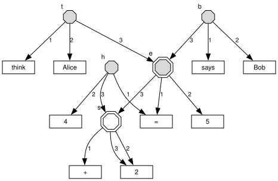
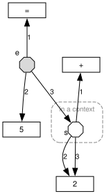
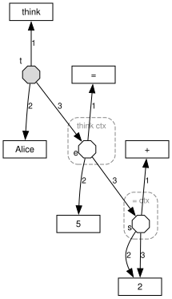
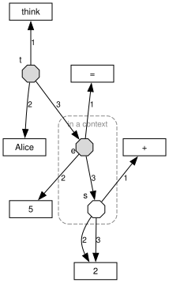
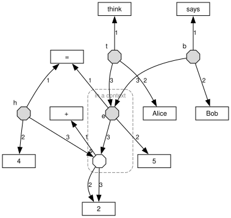
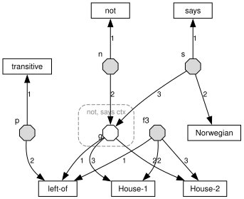
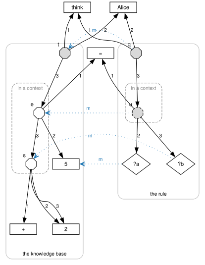

# P1f.22 — contexts: the user's notes of 2026-11-17, worked out

**Phase:** [P1f.22](README.md). The user started the phase and, shown the six questions of
[`analysis.md` § 4](analysis.md#4-what-is-the-users-to-decide), answered with the notes of § 1. This page says what
each note rules, runs the engine on what the notes ask, and puts what is still to decide. Every output is a run of
the gate build, `ein.rs/target/gate/ein`, taken for this page; each program is given in full.

Two companions, written on the same word: [`q392_state_file_and_written.md`](q392_state_file_and_written.md)
(Q-M1f.392 in detail) and [`q394_words.md`](q394_words.md) (Q-M1f.394 with examples).

## 1. The notes, verbatim

> docs/ein/reasoning/ - canonical graph representation has to somehow show that nexted fact is in global context
> or/and is in local/fact context. Now it is not explicitely presented. Maybe consider approach similar to `absent`
> drawing in rules. The implementation (ein.rs) renders nested facts as atoms with names made from entire tuple. It
> is not valid because if fact present in multiple contexts it will be drawn multiple times, while canonical
> (semi-Levi-bipartite) graph has every object drawn once. I want to have: all rules are global, so no rule binds
> nested-only fact as global fact, but can bind it as nested fact. So there could be separate global rules for this
> fact and another rules for same facts in the context - the straightforward way to write pattern as is wrapping
> every fact with context, and maybe macros could be useful here to simplify this wrappings? Q-M1f.391 Rule for
> (not (not g)) -> g is a simple rule, essential negation elimination, already trivial in ein. That's why I also
> raised a question about (and g (not g)) -> (false) could be a rule in p1f.21; Another question about rules that
> infer (false) under context - does it reach global context? If not then how is it stored or reported or affect
> further inference, maybe just store it in context and that's it, like (think Ann (false))? Then it has to be
> bindable to checks - for example to infer false if everybody's thought are false (just an example). In the
> docs/ein/reasoning all those reserved words are conceptual mathematical objects. But in docs/ein/user and
> docs/ein/ein.rs they are surface between ein reasoning kernel and pure ein theory.  Q-M1f.392 - I don't
> udnerstant - write with details into separate file in plans. Q-M1f.392 (a) for now, I don't yet know why we would
> need to change it. The only strictly required for now is to know fact's arity, for all other you can use
> variables. Q-M1f.394 explain with examples in separate file. Q-M1f.396 sections.

## 2. What the notes rule, as read here

| note | read as | state |
|---|---|---|
| *canonical graph … has to show … global context or/and local/fact context* | the reasoning's drawing must show the two **explicitly**; *a filled octagon is held* is not enough | **ruled**; how it is shown is [Q-M1f.398](../open_questions.md#q-m1f398--how-the-graph-is-drawn-to-show-the-global-context-and-a-facts-context), § 7 |
| *ein.rs renders nested facts as atoms with names made from entire tuple. It is not valid* | [Q-M1f.395](../open_questions.md#q-m1f395--what-ein-render-draws-of-a-fact-under-an-arrow): **not (a)**. Every object is drawn once; the text node goes | **ruled**; the shape to build is § 7.3, to confirm |
| *all rules are global … no rule binds nested-only fact as global fact, but can bind it as nested fact … wrapping every fact with context* | the engine as it is (§ 3); the explanation says it in these words | **ruled**: no change |
| *maybe macros could be useful here* | a question, answered in § 4 | answered; nothing to rule unless § 4's gap matters |
| *(not (not g)) -> g is a simple rule … (and g (not g)) -> (false) could be a rule in p1f.21* | [Q-M1f.391](../open_questions.md#q-m1f391--the-negation-of-a-negation-that-a-rule-builds): `(not (not g))` **is a fact**, and eliminating it is **a rule**, not the kernel's act | **read as (c) with the elimination a rule; to confirm** (§ 6) |
| *rules that infer (false) under context — does it reach global context?* | a question, answered in § 5 | answered: no; stored as `(think Ann (false))`, read by rules |
| *in reasoning the reserved words are conceptual mathematical objects; in user and ein.rs they are the surface between the kernel and pure Ein theory* | a rule for how the three perspectives write of `not`, `false`, `written` and the rest | **ruled**: [Q-M1f.397](../open_questions.md#q-m1f397--the-reserved-words-in-the-three-perspectives), § 8 |
| *Q-M1f.392 - I don't understand* | not ruled; explained | [`q392_state_file_and_written.md`](q392_state_file_and_written.md) |
| *Q-M1f.392 (a) for now, I don't yet know why we would need to change it. The only strictly required … is to know fact's arity* | **read as Q-M1f.393 (a)**: the sentence before it says .392 is not understood, and *no need to change* with *the arity is required, the rest can be variables* is .393's option (a), a rule unpacks by shape. Q-M1f.392's (a) is a change | **Q-M1f.393 ruled (a), on this reading; to confirm** |
| *Q-M1f.394 explain with examples* | not ruled; explained | [`q394_words.md`](q394_words.md) |
| *Q-M1f.396 sections* | where: (a), sections of the two pages of `01-static-ir/`. The example was not named: the default stands, the user's example beside the page's `says` | **ruled (a)** |

## 3. Rules are global: what a premise reads, and what a wrapped premise reads

**A premise is matched among held facts and nowhere else; a pattern under an arrow of a premise is matched against
the fact that stands there, held or not.** So a rule written over `(= ?x ?y)` is a rule of the global context, and
the same rule for a context is the same patterns, each wrapped. `x6.ein`:

```lisp
(= a b)
(think Ann (= c d))
(rule sym ()
  :match  (= ?x ?y)
  :assert (= ?y ?x)
  :why    "{?x} is {?y}")
(rule sym-in ()
  :match  (think ?c (= ?x ?y))
  :assert (think ?c (= ?y ?x))
  :why    "{?c} thinks {?x} is {?y}")
(query :goal (= ?x ?y))
(query :goal (think ?c (= ?x ?y)))
```

`ein solve x6.ein`:

```text
  query 1 of 2      (= ?x ?y)
                      ?x = a · ?y = b
                      ?x = b · ?y = a
  query 2 of 2      (think ?c (= ?x ?y))
                      ?c = Ann · ?x = c · ?y = d
                      ?c = Ann · ?x = d · ?y = c
```

`sym` fired on `(= a b)` and not on `(= c d)`, which only Ann thinks; `sym-in` fired on what Ann thinks and
concluded a fact Ann thinks, `(think Ann (= d c))`, and `(= d c)` is not held. The two rules do not see one
another's facts. This is the engine today, and the analysis's Propositions 1 to 3 are this said in mathematics.

**The context can be a parameter**, so one rule serves every context relation that names it. `x4.ein`:

```lisp
(think Ann (= 5 (+ 2 2)))
(think Ann (not (= 5 (+ 2 2))))
(says Bob (likes Bob Carol))
(says Bob (not (likes Bob Carol)))
(rule ctx-contradiction (?C ?R)
  :match  (and (?C ?p (?R ?a ?b)) (?C ?p (not (?R ?a ?b))))
  :assert (?C ?p (false))
  :why    "{?p}: {?R} of {?a} and {?b}, and not")
(ctx-contradiction think =)
(ctx-contradiction says likes)
(query :goal (think ?p (false)))
(query :goal (says ?p (false)))
```

`ein solve x4.ein`: alive, one state, `?p = Ann` for the first query and `?p = Bob` for the second. What is fixed
in the text is the count of arguments, of the context (`?C` of two) and of the fact in it (`?R` of two); the
relations are parameters, each bound by an activator. That is the note's *"the only strictly required … is to
know fact's arity"*.

## 4. Macros as the wrapping

**A macro wraps.** A macro's parameter may stand for a whole pattern, and its call is replaced by its body in a
`:match`, an `:assert` and a `:goal`. `m2.ein`:

```lisp
(macro in (?c ?F) (think ?c ?F) :why "{?c} thinks {?F}")
(think Ann (= a b))
(think Ann (not (= a b)))
(rule contradiction-in ()
  :match  (and (in ?c (= ?x ?y)) (in ?c (not (= ?x ?y))))
  :assert (in ?c (false))
  :why    "{?c} thinks {?x} is {?y} and not")
(query :goal (in ?c (false)))
```

`ein solve m2.ein`: `?c = Ann`, `as :expect (model (think Ann (false)))`. With the macro the rule reads as the
global rule does, each fact under `in ?c`. A macro for one fixed context is the same with one parameter, `(macro
ann (?F) (think Ann ?F) …)` (`m1.ein`, a transitivity inside what Ann thinks: `(ann (= a ?w))` answers `b` and
`c`). And a macro's call expands where it stands **inside** a pattern too: with `(macro eqp (?x ?y) (= ?x ?y) …)`,
the premise `(think ?p (eqp ?x ?y))` matches `(think Ann (= a b))` (`m3.ein`).

**A macro does not write a rule.** Its body is a premise; `(macro lifted (?c) (rule …) …)` is refused at the parse
(`m4.ein`: ``unexpected `rule` ``). So there is no form today that takes a rule written for the global context and
gives its twin for a context: **each rule is written twice**, once bare and once wrapped, or once with the context
a parameter as in § 3. The gap, if it is one:

| a program wants | today | what would close it |
|---|---|---|
| a rule for a context, written once | the rule with every fact under `(in ?c …)`, by a macro or by hand | nothing |
| one rule for several context relations | the context relation a parameter, an activator each (§ 3) | nothing |
| **a rule set written once, applied both globally and inside a context** | written twice | a form that lifts a rule, e.g. a rule-level macro; nothing has asked for it, and it is not proposed here |

## 5. `(false)` in a context

**It does not reach the global context.** `(false)` is a fact, the one of the relation `false` with no argument,
and it may stand under an arrow (Q-M1f.123). `(think Ann (false))` is then a held fact of `think` that points at
the node $\bot$; $\bot$ itself is not held, and a knowledge base is dead exactly when it *holds* $\bot$ or a fact
with its negation. `x1.ein`, a rule that infers it:

```lisp
(think Ann (= 5 (+ 2 2)))
(think Ann (not (= 5 (+ 2 2))))
(think Bob (= 5 (+ 2 2)))
(rule ctx-contradiction ()
  :match  (and (think ?p (= ?a ?b)) (think ?p (not (= ?a ?b))))
  :assert (think ?p (false))
  :why    "{?p} thinks {?a} is {?b} and thinks it is not")
(query :goal (think ?p (false)))
```

`ein solve x1.ein`: `states (k_s) 1`, `∅ in R — root is alive and owes nothing`, `?p = Ann`,
`as :expect (model (think Ann (false)))`. So:

- **stored**: as the fact `(think Ann (false))`, in the context and nowhere else, as the note proposes;
- **reported**: as any fact is, in the state, in a query's rows and in a claim; no row of the read-out treats it
  apart;
- **further inference**: it is read by the rules that match it, and by nothing else. The kernel reads $\bot$ only
  where it is held.

**It is bindable**, in a premise and under a quantifier. *Everybody's thoughts are false* is one `forall`.
`x3.ein`:

```lisp
(import std.macro :symbols (forall))
(person Ann)
(person Bob)
(think Ann (false))
(think Bob (false))
(rule all-confused ()
  :match  (forall ?p (person ?p) (think ?p (false)))
  :assert (false)
  :why    "everybody's thoughts are false")
```

`ein solve x3.ein`: `states (k_s) 0`, `unsat core (think Ann (false))`, `unsat core (think Bob (false))`,
`refuted by all-confused`. Without the line `(think Bob (false))` (`x3b.ein`): `states (k_s) 1`, root alive. So the
global `(false)` is reached from the contexts' by a rule that says so, and only so.

**What the kernel does not do in a context.** Globally, a fact held with its negation is dead with no rule
written. In a context nothing is: `(think Ann g)` beside `(think Ann (not g))` is alive until a rule such as
`ctx-contradiction` concludes `(think Ann (false))`. That is the same asymmetry P1f.21's question is about from
the other side: if $g \land \lnot g \Rightarrow \bot$ becomes a rule of Ein, its twin for a context is that rule
wrapped (§ 3), and the two read alike. A check, `(eq …)` or `(neq …)`, cannot be wrapped: it is computed, never
stored, and is refused under an arrow.

**A finding on the way** ([N-15](findings.md)). The same *everybody* written as two rules over `absent`, a rule
that derives `(some-sane)` where a person has no `(think ?p (false))` and a rule that concludes `(false)` where
`(some-sane)` is absent, answers **dead with Bob not confused** (`x2b.ein`), under `lattice monotone (the static
check)`. It is the open wrong answer `W8/fifo-gap-root` met again: two rules that wait on an `absent` at one
boundary, admitted in the agenda's order, the one that concludes `(false)` first. The `forall` form asks its
nested absence as one question and is right.

## 6. The negation of a negation, and its elimination as a rule

**Read of the note**: `(not (not g))` is to be an ordinary fact, and $\lnot\lnot g \Rightarrow g$ a rule a theory
states, as $g \land \lnot g \Rightarrow \bot$ would be in P1f.21. That is Q-M1f.391's option (c) with the
elimination moved out of the kernel into a rule. What is so today:

| | today |
|---|---|
| a rule's `(not ?x)` over a stored negation | stores `(not (not g))` (`e11.ein`); the kernel reads it as the negation of the fact `(not g)`: dead beside `(not g)`, alive beside `g` |
| a file writing `(not (not g))`, as a fact, a premise or a conclusion | refused at the parse: ``unexpected `not` `` (`d1.ein`, the rule below) |
| the state file of a state that holds one | does not load, for that reason |

So the rule is **not** writable today, though the engine already holds the fact it would read. `d1.ein`:

```lisp
(rule dne (?R)
  :match  (not (not (?R ?a ?b)))
  :assert (?R ?a ?b)
  :why    "not not")
(dne =)
```

``d1.ein:2:17: unexpected `not` ``. Under the reading above, P1f.22 would:

1. **admit `(not (not …))`** at any depth in the grammar, as a fact, a pattern and a conclusion; the knowledge-base
   page's shape of $\mathsf{not}$ loses its last clause, and Q-M1f.113's *"a fact of an ordinary relation, or its
   negation"* becomes *"a fact, or the negation of one"*;
2. change **nothing in the kernel**: a held $\lnot f$ beside a held $f$ is dead for every fact $f$, a negation
   among them, as it is now; `e11`, `f1` and `f2` answer as today, and `f2`'s state file loads;
3. leave **the elimination to a rule**, one for each count of arguments with the relation a parameter, as `dne`
   above. Where that rule lives (a module of the standard library a program imports, beside the contradiction
   rule) is P1f.21's to say, and is put there.

**One thing this reading leaves out, to know of.** A variable for a whole fact may be denied at the top of a
conclusion, `:assert (not ?f)`, and may not stand under `not` anywhere else. `x5.ein` and `x5b.ein`:

```lisp
(rule ctx-contradiction ()                     ; refused: unexpected `?f`
  :match  (and (think ?p ?f) (think ?p (not ?f)))
  :assert (think ?p (false))
  :why    "{?p} thinks {?f} and thinks not")

(rule flip ()                                  ; refused: unexpected `?f`
  :match  (and (liar ?p) (think ?p ?f))
  :assert (think ?p (not ?f))
  :why    "{?p} lies")
```

So the global rule *deny whatever a liar thinks*, which loads, has no wrapped twin: inside a context the denial
must spell the fact's relation and count, `(think ?p (not (?R ?a ?b)))`. That is consistent with *the arity is
required*, and with Q-M1f.393 (a) as read in § 2; it is said here because *wrap every fact with the context* meets
it. Admitting `(not ?x)` under an argument arrow would touch none of the analyses that Q-M1f.393's (b) touches (the
premise's and the conclusion's relation stay fixed), and is not proposed unless asked for.

## 7. The drawing

### 7.1 What the page has, and what it lacks

The knowledge-base page draws every object once and says, in one sentence of its legend, *"a filled octagon is
held, an empty one is only pointed at"*. It does not present the cases, and a reader has to infer *in a fact's
context* from an arrow's head. The note asks for both to be explicit, and suggests the way an absence is drawn in
a rule: **a frame**.

### 7.2 Three ways to show the global context, one object drawn once in each

One knowledge base, in which every case occurs:

```lisp
(think Alice (= 5 (+ 2 2)))     ; t   held, in no context
(says  Bob   (= 5 (+ 2 2)))     ; b   held, in no context
(= 5 (+ 2 2))                   ; e   held, and in the contexts of t and b
(= 4 (+ 2 2))                   ; h   held, in no context
                                ; s = (+ 2 2): in the contexts of e, h, t, b, and not held
```

**(a) A frame.** The knowledge base $K$ is drawn as a frame, and a fact is inside it exactly when it is held. An
atom, and a fact that is only in a context, is outside. *In a fact's context* is an argument arrow from a fact
inside the frame, directly or through others.


**(b) A node for the global context.** $K$ is drawn as one node, with a dashed arrow to each fact it holds. Then
both kinds of context are the same kind of mark, an incoming arrow: from $K$, or from a fact.


**(c) Two marks on the node.** Filled is held, as today; a second outline is *in a context*. Each of the three
cases is then readable off the node alone.



| | (a) frame | (b) node $K$ | (c) marks |
|---|---|---|---|
| *held* is shown by | being inside the frame | an arrow from $K$ | the filling |
| *in a fact's context* is shown by | an argument arrow from inside the frame | an argument arrow | the second outline, and the arrow |
| what it adds to the graph's definition | nothing: a frame draws the set $K$ | a node that is no object, and arrows that are no arrows of a fact | nothing |
| like what the pages already draw | the dashed frame of an absence; the *match* and *assert* panels of a rule | nothing | today's filling |
| in a pattern graph | the premises are inside a frame *match*, as the labelled-arrow drawings of a rule have it | a node for the pattern | filled premises, as today |
| the layout | a frame constrains it: the atoms spread to the sides, and it gets worse with size | free | free |
| for `ein render` | a cluster in DOT | one node and one edge a held fact | two attributes |

A fourth way was considered and is ruled out by *every object drawn once*: **a box for each context**, the nested
fact drawn inside the box of the fact that speaks about it, as conceptual graphs draw a context. A fact in two
contexts would be drawn in two boxes.

**Recommended: (a), the frame, keeping the filling inside it.** It is the note's suggestion, it adds nothing to the
definition of the graph, and it is the one convention the rule drawings already use for *the part that must be
held* and *the part that must be absent*. Its cost is the layout of a large graph, which matters for `ein render`
more than for the pages; if that bites, (c) is the fallback, since it is free in layout and changes one sentence
of the legend.

### 7.3 `ein render`, every object once

`ein render kb` on a program in which `(= 5 (+ 2 2))` is held and under the arrows of two facts draws it as a
labelled arrow `5 → (+ 2 2)` and, apart from that, as a node labelled with its text that `Alice` and `Bob` point
at: one object, drawn twice. The reasoning page's table for the labelled-arrow form has the same row (*"a fact
under an arrow of another: one node labelled with the fact's text, its own arrows not drawn"*), so the page and the
writer change together. The shape proposed:

| in the graph | drawn, in the labelled-arrow form |
|---|---|
| a held fact with three arrows **that no fact points at** | one labelled arrow, as today |
| a fact **that a fact points at**, held or not, whatever its count | **its node**: an octagon with the relation's name written in it and its argument arrows numbered, the form the table already has for a fact of another count. Drawn once; the mark of § 7.2 says whether it is held |
| a nested pattern in `ein render rule` | the same: an octagon with its arrows to its variables and atoms, so that the variables it binds are drawn |

So a fact is drawn as a labelled arrow only where nothing points at it, and a fact that something points at is
always a node with its own arrows. No text stands for a fact. This is a change to two DOT writers, to the shape
golden's lines of every program with a nested fact, and to `12-rendering.md`; a stage that changes a DOT writer is
done when `utils/ci_container.sh` is green on its commit.

## 8. The reserved words in the three perspectives

The note: in `docs/ein/reasoning/` the reserved words are conceptual mathematical objects; in `docs/ein/user/` and
`docs/ein/ein.rs/` they are the surface between the reasoning kernel and a theory written in pure Ein. Read as a
rule for the pages ([Q-M1f.397](../open_questions.md#q-m1f397--the-reserved-words-in-the-three-perspectives)):

- **`reasoning/`** defines $\lnot$, $\bot$, $\operatorname{absent}$, equality, $\mathsf{written}$, $\mathsf{relation}$
  as mathematics: what each is in the graph and what the definitions read of it. It does not speak of a *reserved
  word* as something a program must not spell, beyond the one section that lists the reserved atoms.
- **`user/`** and **`ein.rs/`** present the same names as **the kernel's surface**: the fixed list of relations
  whose facts the kernel reads or states, and what it does with each. Everything else a program reasons with is a
  rule of Ein, in the program or in the standard library. For this phase that surface is short: of a fact under
  an arrow the kernel reads `not` (a held negation of it), states `written`, and nothing else; `think`, `says` and
  every other context are theory.

P1f.21, the kernel's verdicts as rules, moves that line: each verdict that becomes a rule leaves the surface.

## 9. What is left to answer

| | question | default |
|---|---|---|
| 1 | [Q-M1f.398](../open_questions.md#q-m1f398--how-the-graph-is-drawn-to-show-the-global-context-and-a-facts-context): how the graph shows the global context: (a) a frame, (b) a node $K$, (c) marks on the node | (a), the filling kept |
| 2 | Q-M1f.395's shape (§ 7.3): a fact that a fact points at is drawn as its node with its arrows, in `ein render kb` and `ein render rule` | as § 7.3 |
| 3 | Q-M1f.391: is the reading of § 6 right: `(not (not g))` a fact, the kernel unchanged, the elimination a rule whose home is P1f.21's | yes |
| 4 | Q-M1f.393: is the reading of § 2 right, that *"Q-M1f.392 (a) for now"* is Q-M1f.393 (a) | yes |
| 5 | [Q-M1f.392](q392_state_file_and_written.md): is a state file's round trip a promise with listed exceptions (c), or with none (a) | (c) |
| 6 | [Q-M1f.394](q394_words.md): the three words | (a) on each |

**Answered by the user the same day**; § 10 has the answers, and § 15 what is left after them.

---

## 10. The user's second notes, verbatim, and what they rule

> Q-M1f.393 yes (a); Q-M1f.391 OK; Q-M1f.398 lets try (a) and see how it looks; Q-M1f.395 - yes, 3-arity fact can
> an arrow only when nothing points on it; Q-M1f.392 I still do not understand, show an issue, how to reproduce it,
> explain for dummies. Q-M1f.394 held = in the global context; in a context = in a fact's (local) context;
> Question 2: `not` obviously holds something like logically mirrored world where all true facts are false and all
> false are true, right? it looks quite consistent with context idea here, isn't it? And it already meets some
> criterias, e.g. denied facts not bind to rules without context, right? E.g. this is a way to define tri-state,
> multi-state logic and other kinds of logic. This also leads me to the surface between ein theory and reasoning
> kernel - things like (false) and (open) are effectively controlling the search. Maybe word `false` is too heavey
> loaded with classical binary logic and not expose it's actual function in ein? Maybe (abort) or (dead) is more
> clear? Or some common search control interface accassible from ein? Like (ein.search.state.refute)? Also for
> (open) (in p1f.21) if we will emit ordinary facts (open (lives-in Alice House-1)) they naturally are hypotheses,
> what rules can do with them? And, (open) context contains "open" questions, like "Does Alice live in House-1?" -
> so there is a menaning of those facst, so we can write rules to infer something from them directly, right? What,
> for instance? Question 3 — value, term, object, fact - is't simple - they are in different contexts: object - in
> core ein theory explained on graphs, we have to say what are all those nodes - they are objects; value - wording
> "(knows Carol Dan) inside the claims fact is a value, not a fact of the knowledge base." is not correct. Use word
> `value` only when talk about variables in rules, it's obvious that {var 1-n values} and here value is an object,
> but the object is a value only when binded to variable; `relational node` - don't use it, it is too SQL-ish;
> graph node - ok; In docs/ein/ein.rs - use whatever naming convention you want, just make software documentation
> good; term - is mostly about syntax; I found only one place where now "ground term" exists, maybe survey showed
> false positive here.

| | ruled |
|---|---|
| Q-M1f.393 | **(a)**, confirmed: a rule unpacks by shape; the count is what is fixed |
| Q-M1f.391 | **(c)**, confirmed: `(not (not g))` is a fact, the kernel is not changed, its elimination is a rule whose home is P1f.21's |
| Q-M1f.398 | **(a), to try**: tried in § 14 on six of the real figures, for the user to look at |
| Q-M1f.395 | **confirmed**: a fact of three arrows is drawn as a labelled arrow only when nothing points at it; a fact something points at is its node with its arrows |
| Q-M1f.392 | not ruled; [`q392_state_file_and_written.md`](q392_state_file_and_written.md) is written again from the start, with a program and three commands |
| Q-M1f.394 | **ruled**, all three points: [`q394_words.md`](q394_words.md) has them in the user's words, and a correction: the survey's quotations of the user's pages were behind the pages ([N-16](findings.md)) |

## 11. `not` as a context

**Right: `not` is a context, and it already behaves as one.** The fact a negation denies is under the negation's
arrow and is not held, so no bare premise binds it; a rule about denied facts writes its patterns under `not`, as
a rule about what Ann thinks writes them under `think`. `n1.ein`:

```lisp
(not (= 5 (+ 2 2)))
(rule seen ()
  :match  (= ?a ?b)
  :assert (seen-held ?a)
  :why    "an equality is held")
(rule seen-denied ()
  :match  (not (= ?a ?b))
  :assert (seen-denied ?a)
  :why    "an equality is denied")
(query :goal (seen-held ?x))
(query :goal (seen-denied ?x))
```

`ein solve n1.ein`: `(seen-held ?x)` has no row; `(seen-denied ?x)` answers `?x = 5`.

**Not quite: it is no mirror of the global context.** A mirror would hold every fact the global context lacks,
and then a fact would be held or denied and nothing else. The `not` context holds exactly the facts that something
stated or concluded as denied, and grows the way the global one does, by what is written and what rules conclude.
A fact in neither is **open**. So there are two contexts that grow independently, and four things they can say of
one fact:

| | in the global context | in the `not` context |
|---|---|---|
| asserted | yes | no |
| negated | no | yes |
| open | no | no |
| contradicted | yes | yes |

The three-valued reading is already there (asserted, negated, open), and it comes from `not` *not* being the
complement. Where it is a mirror is one step further out: with the elimination of § 6 as a rule, the `not` context
of the `not` context is the global one again.

**What makes `not` different from `think` is one reading by the kernel**: a fact in both contexts makes the state
dead. That reading is the rule $g \land \lnot g \Rightarrow \bot$ that P1f.21 is about; once it is a rule a theory
states, the kernel reads **no** context, and `not` is a context a module gives its meaning to, as a program gives
`think` its.

**Other logics, as contexts.** A program adds a truth value by adding a context relation and the rules between
the contexts. `n2.ein`, four verdicts of one fact, the third value the program's own `maybe`:

```lisp
(import std.macro :symbols (unknown))
(= a b)
(not (= a c))
(maybe (= a d))
(pair a b) (pair a c) (pair a d) (pair a e)
(rule v-true    () :match (and (pair ?x ?y) (= ?x ?y))         :assert (verdict ?x ?y yes)   :why "held")
(rule v-false   () :match (and (pair ?x ?y) (not (= ?x ?y)))   :assert (verdict ?x ?y no)    :why "denied")
(rule v-maybe   () :match (and (pair ?x ?y) (maybe (= ?x ?y))) :assert (verdict ?x ?y maybe) :why "maybe")
(rule v-unknown () :match (and (pair ?x ?y) (unknown (= ?x ?y)) (absent (maybe (= ?x ?y))))
                   :assert (verdict ?x ?y unknown) :why "nothing said")
(query :goal (verdict a ?y ?v))
```

`ein solve n2.ein`: `?v = yes · ?y = b`, `?v = no · ?y = c`, `?v = maybe · ?y = d`, `?v = unknown · ?y = e`, under
`lattice monotone (the static check)`. What such a logic *means* (what follows from `maybe g` beside `not g`) is
the rules the program writes between the contexts; the kernel supplies it only for `not`.

## 12. The kernel's surface: `(false)` and `(open)` control the search

**The observation is right, and it is half of what `(false)` is.** It has two parts to play, and the name fits
neither well:

| where `(false)` stands | what it does | run |
|---|---|---|
| **held**, in the global context | the kernel's verdict *this state is impossible*: the node is dropped, its core recorded, the search goes on elsewhere. This is control | every dead state |
| **under an arrow**, in a context | a proposition, *what this context says is contradictory*: `(think Ann (false))`. It controls nothing, and rules read it | `x1.ein`, § 5 |

It is not a truth value in either. No fact of Ein *is false*: a denied fact is `(not g)`, and `(false)` is what
logic writes $\bot$, the absurd. So the worry is sound: a reader who knows two-valued logic reads `(false)` as
*the value false* and `(not g)` as *g is false*, and only the second is near the truth.

**Three ways to go**, none of them this phase's to build:

| | what | reads, held | reads, in a context | costs |
|---|---|---|---|---|
| (a) keep `false` | the pages say once that it is no truth value and what the kernel does with it (Q-M1f.397's surface) | `(false)` | `(think Ann (false))` | nothing |
| (b) a word for the proposition | `(contradiction)`, `(impossible)` or `(absurd)` | *this state holds a contradiction* | `(think Ann (contradiction))` | a rename |
| (c) a word for the search's act | `(dead)`, `(abort)`, `(refute)` | *drop this state* | `(think Ann (dead))`, `(think Ann (abort))`: a command where a proposition goes | a rename |
| (d) the surface as a named interface | every relation the kernel reads or states under one prefix, `ein.…`, as a module's names are under `std.…`; a program writes the short names | `(ein.refute)` or `(false)` by a short name | as written | a rename, and a decision on how a program gets the short names |

`(abort)` says more than happens: one state is dropped and the search continues. `(dead)` is the word the pages
already use for the *verdict* on a state, which P1f.21's design keeps apart from the fact that causes it (*dead
from `(false)`*). The rename itself is mechanical and wide: `(false)` is written 658 times in 278 programs under
`examples/`, `tests/` and `stdlib/` (`grep -c '(false)'` over the three, summed), and in the pages, the
diagnostics and the goldens.

**What I would do.** Not rename in this phase. It is the same question as P1f.21's, what the kernel's verdicts
are and how a program sees them, so it is put there as
[Q-M1f.399](../open_questions.md#q-m1f399--the-names-of-what-controls-the-search-false-and-open), with the options
above. If it is renamed, I would take a word for the **proposition** ((b)), because the same fact has to read well
under an arrow, where it controls nothing; the control is then one sentence of the kernel's surface: *a state that
holds it is dropped*. And (d) is worth its own look there: it would make Q-M1f.397's line between kernel and
theory something a reader sees in every name.

## 13. Questions as facts: what rules can do with `(open q)`

Today `open` is the verdict and nothing else: `(think Alice (open p))` is refused at the parse (*"open is
reserved: it is the verdict a rule's :assert states … and names no relation and no value"*). So the runs below
write the relation `question` where the note writes `open`; nothing else differs.

**They are naturally hypotheses: yes.** An hrule over the question facts proposes exactly what is asked.
`q2.ein`:

```lisp
(relation lives-in Person House :why "{?1} lives in {?2}")
(question (lives-in Alice House-1))
(question (lives-in Bob House-2))
(lives-in Carol House-3)
(hrule ask ()
  :match  (question (lives-in ?p ?h))
  :assert (lives-in ?p ?h)
  :why    "suppose {?p} lives in {?h}: it is asked")
```

`ein show hyps q2.ein`: `(lives-in Alice House-1)`, `(lives-in Bob House-2)`, ``H, built by the rung `hrules`: 2
candidates``. That is the second rung of the ladder, *the facts that would discharge what root owes*, written as a
rule of Ein instead of read off the obligations by the kernel.

**What rules can infer from a question directly.** `q1.ein`:

```lisp
(relation lives-in Person House :why "{?1} lives in {?2}")
(relation has Person Key        :why "{?1} has {?2}")
(question (lives-in Alice House-1))
(key-of House-1 Key-1)
(has Alice Key-1)
(rule sub-question ()
  :match  (and (question (lives-in ?p ?h)) (key-of ?h ?k))
  :assert (question (has ?p ?k))
  :why    "to know whether {?p} lives in {?h}, ask whether {?p} has {?k}")
(rule answer ()
  :match  (and (question (lives-in ?p ?h)) (key-of ?h ?k) (has ?p ?k))
  :assert (lives-in ?p ?h)
  :why    "{?p} has {?k}, the key of {?h}")
(query :goal (question ?q))
(query :goal (lives-in ?p ?h))
(solve :no-search)
```

`ein solve q1.ein`: the questions are `(lives-in Alice House-1)` and `(has Alice Key-1)`; `(lives-in Alice
House-1)` is held. So, each a thing a rule can do with a question:

| | from a question | the example |
|---|---|---|
| 1 | **a further question**: what would have to be known to answer it. Reasoning from the goal backwards, in an engine that only goes forwards | `sub-question` |
| 2 | **an answer, computed only where asked** | `answer`. The calculator already works so: `(add X Y)` is a question and `sum-of` its answer, which is why it computes only what a program asks |
| 3 | **a hypothesis** | `q2.ein` above |
| 4 | **a contradiction**: every answer to a question is denied | what domain elimination concludes |
| 5 | **a report**: which questions nothing answers | `(question q)` with `(unknown q)`; it reads an absence, so it is a boundary rule and not a monotone one |

**The one thing an ordinary fact cannot be is *still open*.** A held fact is never removed, so `(question q)`,
held, means *q was asked*, in this state and in every larger one, and it stays held after `q` is answered. *Still
unanswered* is the question together with the absence of `q` and of `(not q)`, which is what the kernel's pass
computes today and what P1f.21's survey found of `(open R)` (*"it can be removed"*). That lines the note up with
Q-M1f.390's option (c): the question (there, the *requirement*) is a fact, the answer (the *payment*) is a fact,
and *owed* is their difference, never stored. It is entered there as [V-5](../p1f.21_verdicts_as_rules/findings.md#v-5--the-users-notes-from-p1f22-questions-as-facts-the-two-negation-rules-and-the-names).

## 14. The frame, tried twice

**First trial: a frame around the held facts**, the knowledge base as a frame (Q-M1f.398's (a)), on six of the
real figures. The user, on seeing them: *"I would like to see frame around facts in contexts rather than around
global facts."* Its figures are dropped; what it showed that still matters: a frame around $K$ takes in every
figure of the pages, forces their layout to be let go, and cannot stand beside the extent's dashed frame.

**Second trial: a frame around the facts that are in a context.** The two properties get one mark each, and the
marks are independent, as the properties are:

| | the mark |
|---|---|
| **held**, in the global context | the octagon is **filled**, as the pages have it today |
| **in a context**, a fact's | the octagon is **inside a dashed frame labelled with the context's relation**, `think ctx` |

So a fact that is only held is filled and outside; one that is only in a context is empty and inside; one that is
both is filled and inside. The frame is the dashed, rounded one an absence has in a rule's drawing.

**The label**, on the user's word after the second trial's first figures (*"label contexts `<relation name> cts`
instead of `in context`"*; written `ctx` here): a frame is named for the relation of the facts that point at what
is in it. The facts under an arrow of a fact of `think` are in the frame `think ctx`; $s$, under the third arrow
of a fact of `=`, is in `= ctx`. Two things follow from *every object drawn once*, and are how the figures below
are drawn:

- **a fact that facts of two relations point at is in one frame that names both**, `says, think ctx`: it cannot
  be in two frames;
- **the frames are side by side and never one inside another**: $s$ is in `= ctx` beside `think ctx`, not within
  it, and that $s$ is also in the context of $t$ is read off the path $t \to e \to s$.

The sources and pictures are under [`diagrams/`](diagrams/), `inctx-*.dot` and `inctx-*.svg`.

The user's example, the three cases. $K = \lbrace e \rbrace$: $e$ is held and in no context, and $s$, which nobody
states, is in the context of $e$:



$K = \lbrace t \rbrace$: $e$ and $s$ are in the context of $t$, and neither is held:



$K = \lbrace t, e \rbrace$: $e$ is held and in the context of $t$:



One knowledge base with every case: $t$, $b$ and $h$ only held; $e$ held and in the contexts of $t$ and $b$; $s$
only in a context:



The page's figure of a fact about a relation, a fact about a fact and a negation; $g$ is in the contexts of $n$
and $s$:



A rule that unpacks, and its match. In the pattern the frame is around the fact pattern under the premise's
arrow, which is the rule's conclusion; in the knowledge base around $e$ and $s$:



**What this trial shows.**

- **The three cases are told apart at a glance**, and each object is drawn once: a fact in the contexts of two
  facts is one octagon in the frame with two arrows into it.
- **A figure with no fact under an arrow does not change.** The page's first figure, its declaration and its
  extent keep their sources, their layout and, for the extent, its own dashed frame; only the figures that have a
  nested fact gain a frame. The first trial changed all of them.
- **A frame is a context relation's, not one context fact's.** A frame for each fact that speaks, holding what
  that one fact speaks about, cannot be drawn where one fact is in two contexts, which is the case the phase was
  opened for. Named for the relation, every fact is in exactly one frame, and *which* fact speaks about it is
  read off the arrows that enter the frame.
- **Atoms stay outside.** The frame holds facts; an atom under an arrow of a nested fact is outside, as every atom
  is.
- In a figure of two graphs, a rule and a knowledge base, each has its own frame, inside the frame of its graph.

## 15. What is left

| | question | |
|---|---|---|
| 1 | **the frame**: settled by the user's two looks, a dashed frame around the facts in a context, labelled with the context's relation; S1f.22.2 draws every figure that has a nested fact so | none |
| 2 | **Q-M1f.392**: ruled a bug, to be fixed and held by a simple unit test. Which fix, and whether `written` stays as it is: [`q392_state_file_and_written.md`](q392_state_file_and_written.md), its last two sections | the user's word on the fix |
| 3 | **Q-M1f.399**, and `(open)` as facts: P1f.21's, with the user's direction recorded there | does not hold this phase |

S1f.22.2 is planned in [its stage file](s1f.22.2_the_explanation_written.md) and is started.
