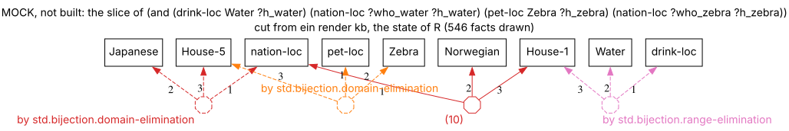
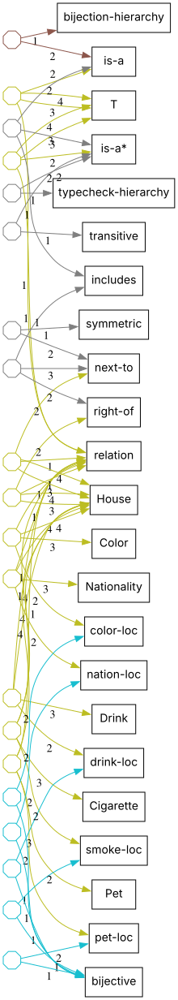
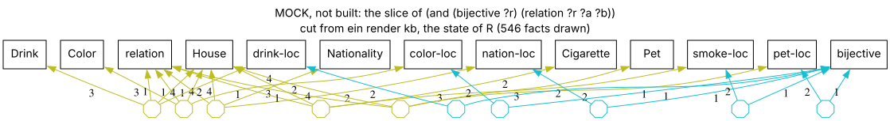
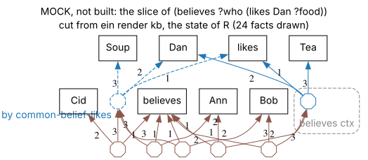
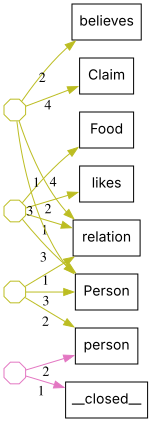
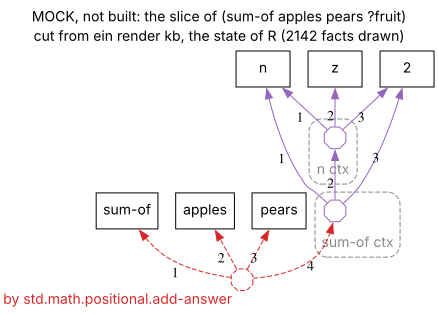
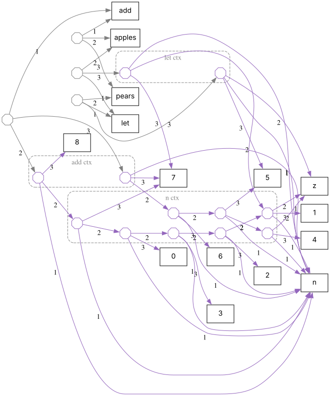

# S1f.23.7, task 1 — a slice of the knowledge base by a query, shown on real programs

**Stage:** [S1f.23.7](s1f.23.7_a_slice_by_a_query.md), task 1, of [P1f.23](README.md). It builds nothing and
stops for the user's look.

**Today** is every line quoted from the binary `build/review-bin/ein-head-545e4d6b` (`ein 0.1.0`, master at
`545e4d6b`), run by [`s1f.23.7_examples/run.sh`](s1f.23.7_examples/run.sh) on the programs in
[`s1f.23.7_examples/`](s1f.23.7_examples/) and on the corpus, and marked *output*; the files it wrote sit beside
it. A drawing cut by hand from today's drawing, and every form Ein does not have, is marked ***MOCK, not built***.

The user's words, on Q-M1f.426 (a): *"would be nice to formalize this KB slice with something, e.g. ein query or rule
that selects all nodes where relation is argument (is it correct definition?), and together with `constraints` allow
to render arbitrary query."*

## What it comes to

- **The view selects a fact by how it is written; the user's definition by what stands under its arrows.** The view
  (V) takes, from the file as written, every fact with no `:source`, `:rule` or `:using` whose relation the file does
  not declare. The user's slice (U) takes, from a knowledge base, every fact with a relation under one of its
  argument arrows.
- **Is it correct?** As the definition of *a fact about a relation*, yes, and it is the project's own:
  [Q-M1f.381](../../../docs/decisions/language/Q-M1f.381-a-relation-is-the-atom-under-a-facts-first-arrow.md) says
  that a fact with a relation's atom under a later arrow *speaks of the relation as one object*. It is what the view
  means to draw (its doc comment: *"co-located is symmetric / color-loc is a bijection"*), and V is a proxy for it
  that misses and overshoots. As a description of what the view draws today, no: they agree exactly on 13 of the
  664 corpus programs that load, 12 of them with both empty. Two things need pinning: **"a relation" is a relation
  of the program** (reading (c), § 2.1), so the slice is the same in every state; and **an atom that is a relation
  is one wherever it stands**, so a fact that writes it as a plain object is selected too: `(n z 4)`, since
  `std.math.arith` declares `z` as a relation of no argument, and the digit tables' `(cl eq 0 0 eq)`, since `eq` is
  every program's relation. Those two atoms select 67 426 and 23 109 facts of the corpus's slice.
- **On the corpus** (§ 3, *output*): V selects 3 604 facts on 621 programs; U, under (c), 204 599 on 644, 191 412 of
  them in the 257 programs that import `std.math`; 13 187 in the other 407, against V's 2 010 there. Cut to the
  facts the file writes, the two agree on 362 of 664.
- **As Ein** (§ 4): the view's selection is no goal and no rule, since a fact's `:source` and its file are no part
  of it. The user's slice is a goal only per relation, count and place, and only for declared relations: `(and
  (relation ?r) (symmetric ?r))` runs. What a goal lacks is a relation it binds by matching, a pattern of any count,
  and a way to say *?r is a relation* of an undeclared one. A rule with the fact's relation as a parameter runs, one
  rule a count, and on `zebra2` the loader refuses it for `symmetric` (Q-M1f.1).
- **Any goal's slice drawn** (§ 5, ***MOCK***): the facts of the goal's class and what they point at, cut from `ein
  render kb`, on `zebra2`, `beliefs/01` and `arith/add`, beside the constraint view. Default for how a goal is given:
  **a flag, `ein render kb FILE --goal '(…)'`**, of root or of a saved state, since a query is about R and a slice is
  about one knowledge base: `zebra2`'s queries have nothing to answer at root.

## 1. The view's selection today, read from the code

[`ein-render/src/constraints.rs`](../../../ein.rs/crates/ein-render/src/constraints.rs)'s `render_constraints`, as
[`ein-cli/src/render.rs`](../../../ein.rs/crates/ein-cli/src/render.rs)' `cmd_constraints` calls it, in the
project's words:

> Read the file named on the command line as written, its imports unresolved and its macros' calls unexpanded,
> once the loader has accepted the whole program. A **fact of the file** is a top-level form whose relation, the
> atom under its first arrow, is none of the eight declarators `rule`, `hrule`, `macro`, `query`, `solve`, `config`,
> `import`, `trace`. A relation is **declared by the file** when it stands under arrow 2 of a `(relation …)` fact of
> the file that carries none of the three clauses below. **The view selects every fact of the file that carries no `:source`, `:rule` or `:using` and whose
> relation the file does not declare**, and draws with them every fact under their arrows, at any depth, in its
> frame where the file does not state it.

$$
V(P) = \lbrace\, f \in W(P) \mid \operatorname{ann}(f) = \emptyset,\ \operatorname{rel}(f) \notin D(P) \,\rbrace
$$

$W(P)$ the facts of the file, $\operatorname{ann}(f)$ the clauses among `:source`, `:rule`, `:using` that $f$
carries, $D(P)$ the relations the file declares. What follows from it:

- **It reads the file, not a knowledge base.** No derived fact, no fact an imported module states, and no membership
  fact `(relation R)`, which the loader adds beside each declaration, is ever selected.
- **"Declared" is the file's.** A fact of a relation an imported module declares is selected: `(add apples pears)`
  in [`examples/arith/add.ein`](../../../examples/arith/add.ein), `add` declared by `std.math.decimal-arith`.
- **The fact's relation decides, not its arguments.** A table of plain objects is selected, `(digit-succ 0 1)`, and
  so is a stored negation the file writes, `(not (lives Ann H2))`, whose relation is `not`, which no file declares.
- **Every declaration is selected**, `relation` being declared by none (Q-M1f.426 (a)).
- **A written check is selected and drawn as a fact.** The view leaves out the eight declarators and nothing else,
  where the program view's `is_fact_form` also leaves out `eq`, `neq` and `(not (eq …))`: `ein render constraints`
  draws `(eq a w)` of
  [`fact-eq-false.ein`](../../../examples/ein-bugs/wrong-answers/fact-eq-false.ein) and `(not (eq a a))` of
  [`not-eq-fact.ein`](../../../examples/ein-bugs/wrong-answers/not-eq-fact.ein) as facts, and `ein render program`
  does not (open point 9).

The census (§ 3) computes V from each file in these words and holds it to the DOT the binary draws: on all 664
programs that load, every fact the view draws that no drawn fact points at is in V, and every fact of V is drawn.

## 2. The user's definition, and whether it is correct

$$
U(K) = \lbrace\, f \in K \mid \exists\, i \ge 2:\ \operatorname{arg}_i(f) \in \mathit{Rel} \,\rbrace
$$

$K$ the facts a knowledge base holds, $\operatorname{arg}_i(f)$ the object under the fact's arrow $i$, arrow 1 being
its relation. Two things are to pin: what $\mathit{Rel}$ is, and whether *among its arguments* is arrow 2, 3, … of
the fact alone.

### 2.1 What "a relation" is — three readings

| reading | an atom is a relation when | Ein can say it | the same in every state | where it parts from (c), *output* |
|---|---|---|---|---|
| **(a) the knowledge base's** | it stands under the first arrow of a fact of $K$, held or under an arrow: [Q-M1f.381](../../../docs/decisions/language/Q-M1f.381-a-relation-is-the-atom-under-a-facts-first-arrow.md) read on one knowledge base | no: `(?f ?r)` is refused (§ 4.6) | **no**: a relation with no held fact is no relation there | `(relation spare Thing)` in [`01-two-definitions.ein`](s1f.23.7_examples/01-two-definitions.ein), `spare` declared and never stated; on the corpus 154 728 facts of (c) on 418 programs, `(relation clash)` in [`15_lookahead_two_step_on.ein`](../../../examples/branching/15_lookahead_two_step_on.ein), `(__closed__ asked)` in [`gaps.ein`](../../../examples/word_problems/gaps.ein) |
| **(b) declared** | a `(relation R …)` names it; the loader stores `(relation R)` for each, so `(relation ?r)` matches it, and whatever a rule concludes it of | yes, `(relation ?r)` | yes | an undeclared relation: 22 735 facts of (c) on 258 programs, nearly all by `eq`: `(r eq)` in [`relvar-eq-premise.ein`](../../../examples/ein-bugs/wrong-answers/relvar-eq-premise.ein), `eq` passed to a rule as a relation, and the digit tables' `(std.math.digits.cl eq 0 0 eq)` |
| **(c) a relation of the program** | the program declares it, states a fact of it, writes it in a rule's, an hrule's or an obligation's `:match` or `:assert` at any depth, or passes it where a relation's name is held, or it is `eq` or `neq`: [Q-M1f.119](../../../docs/decisions/language/Q-M1f.119-a-goal-and-a-claim-ask-only-about-relations.md)'s list, `ein_ir::from_ir`'s `program_relations`, which a goal is held to | no: nothing in the knowledge base says an undeclared atom is one | yes | — |

**Default: (c).** One notion of a relation of the program already serves a goal, a claim and the `(solve …)` lists;
under it the slice is the same in every state, as a property of a relation is; and it holds (b), and (a) in every
state. (c) is no list any command prints: the census asks the loader, appending `(query :goal (ATOM ?v))` for each
atom in doubt and reading which it refuses as *no relation of the program* ([`census.py`](s1f.23.7_examples/census.py)).

### 2.2 Directly, or anywhere under the fact

`(claims Bob (symmetric lives))` has no relation under its own arrows, `Bob` and a fact, and has one under an
argument arrow of the fact under its arrow 3. Read **directly**, it is not selected; read **at any depth**, it is.
Its `(symmetric lives)` is a fact with a relation under its arrow 2, which no state holds: a node of the graph that
no query answers. On the corpus, U (c) at any depth holds 257 977 facts against 204 599 directly, and 8 324 facts
under an arrow, held nowhere, have a relation of the program under their own arrows, on 211 programs. **Default:
directly, over held facts**, with what they point at drawn: a slice is what a goal could answer.

### 2.3 Is it correct?

**Yes, as the definition of a fact about a relation, under reading (c), directly; no, as a description of what
`ein render constraints` selects today.** The view's selection is a proxy for the same idea, *bare facts of
undeclared relations*, that misses what is given, derived, imported, or of a declared relation, and takes in tables
of objects and stored negations. The user's definition reads the graph and needs no annotation, but it cannot tell
an atom used as a relation from the same atom used as a value, so it takes in a numeral's `z` and an order's `eq`.

Every fact of [`01-two-definitions.ein`](s1f.23.7_examples/01-two-definitions.ein) (*output*:
[`01-two-definitions.dump.txt`](s1f.23.7_examples/01-two-definitions.dump.txt), the view's
[`01-two-definitions.constraints.dot`](s1f.23.7_examples/01-two-definitions.constraints.dot)); V selects 12, U (c)
18, both 8:

| fact | V | U (c) | why |
|---|:-:|:-:|---|
| `(relation lives Person House)` and the other five declarations of a relation with labels, and `(relation z)` | ✓ | ✓ | **both**: undeclared `relation`, bare; a relation under arrow 2 |
| `(symmetric next-to)` | ✓ | ✓ | **both** |
| `(relation lives)`, `(relation next-to)`, `(relation right-of)`, `(relation includes)`, `(relation spare)`, `(relation n)` | | ✓ | U only: **the membership fact**, which the loader adds and the file does not write |
| `(includes right-of next-to)` | | ✓ | U only: a **declared** relation's fact about relations |
| `(co-located lives Ann lives Bob :source "condition (2)")` | | ✓ | U only: **given**, with a `:source` |
| `(closed-under-swap next-to)` | | ✓ | U only: **derived** at root, by `swap-closed` |
| `(n z 4)` | | ✓ | U only, under (b) and (c), not (a): **`z` is a relation and an object**, declared `(relation z)` and written as a numeral's zero |
| `(digit-succ 0 1)`, `(digit-succ 1 2)` | ✓ | | V only: an undeclared **table of objects** |
| `(not (lives Ann H2))` | ✓ | | V only: a **stored negation** the file writes |
| `(claims Bob (symmetric lives))` | ✓ | | V only: the relation only **under a fact under an arrow** (U at any depth: ✓) |
| `(lives Ann H1)`, `(right-of H2 H1)`, `(next-to H1 H2)`, `(next-to H2 H1)` | | | neither |

Under (a), `(relation spare Thing)`, `(relation spare)`, `(relation z)` and `(n z 4)` leave U: neither `spare` nor
`z` heads a fact of root.

## 3. On the corpus

[`census.py`](s1f.23.7_examples/census.py) over the 888 paths of `corpus/corpus.toml`; its whole report is
[`census.md`](s1f.23.7_examples/census.md), a row a program [`census.tsv`](s1f.23.7_examples/census.tsv). 664 load
and saturate; the 224 refused are `examples/broken/` (65) and `examples/ein-bugs/` (159). One probe of (c) did not
run, on [`tests/saved/04_a_saved_node.ein`](../../../tests/saved/04_a_saved_node.ein), a saved file to which a query
cannot be appended; there (c) is (a), (b) and the relation table. *Output*:

| selection | facts | programs where it is not empty |
|---|---:|---:|
| V, the view | 3 604 | 621 |
| U (a), directly | 49 871 | 630 |
| U (b), directly | 181 864 | 644 |
| **U (c), directly** | **204 599** | 644 |
| U (c), at any depth | 257 977 | 645 |

Root's knowledge bases hold 634 008 facts. The calculator's programs carry most of U:

| programs | how many | root's facts | V | U (c) | V = U (c) | V = U (c) over the facts the file writes |
|---|---:|---:|---:|---:|---:|---:|
| import `std.math` | 257 | 611 171 | 1 594 | 191 412 | 0 | 51 |
| the rest | 407 | 22 837 | 2 010 | 13 187 | 13 | 311 |

**They agree exactly on 13 programs**, 12 with both empty (the seven standard library modules that are programs and
five of `examples/syntax/`) and [`examples/syntax/nullary.ein`](../../../examples/syntax/nullary.ein), one fact.
**Over the facts the file writes**, U cut to the file's top-level facts as the view reads it, on 362.

**The kinds of difference**, each fact of $V \setminus U$ and $U \setminus V$ under (c), directly:

| kind | facts | programs | one example |
|---|---:|---:|---|
| V only: the relation only under a fact under an arrow | 698 | 177 | `add.ein`: `(add (n (n … z 1) …) …)`, shortened: `z` inside the numerals |
| V only: a fact about no relation, of an undeclared relation | 271 | 39 | [`05_liar_denial_beside_the_fact.ein`](../../../examples/beliefs/05_liar_denial_beside_the_fact.ein): `(= 5 (+ 2 2))` |
| V only: a fact of a relation an imported module declares, about no relation | 137 | 62 | `add.ein`: `(add apples pears)` |
| V only: a stored negation the file writes | 53 | 34 | [`04_liar_denial_contradicted.ein`](../../../examples/beliefs/04_liar_denial_contradicted.ein): `(not (= 5 (+ 2 2)))` |
| V only: written, no fact root holds | 3 | 3 | `fact-eq-false.ein`: `(eq a w)`, a check; `not-eq-fact.ein`: `(not (eq a a))`; and `(__closed__ k.is-a)` in [`import-directives-twice.ein`](../../../examples/ein-bugs/wrong-answers/import-directives-twice.ein), the fact root prints `(__closed__ m.is-a)`, one module under two aliases |
| U only: derived at root | 118 263 | 321 | [`12_typed_blind_solve.ein`](../../../examples/branching/12_typed_blind_solve.ein): `(functional-negative color-of)` |
| U only: stated outside the file, by an import or a macro | 53 763 | 292 | `add.ein`: `(__closed__ std.math.digits.adj)` |
| U only: the membership fact `(relation R)` | 29 826 | 643 | [`01_common_belief.ein`](../../../examples/beliefs/01_common_belief.ein): `(relation believes)` |
| U only: a fact of a declared relation, about a relation | 217 | 15 | [`casting_out_nines.ein`](../../../examples/beyond_arith/casting_out_nines.ein): `(count z (n (n z 4) 0))` |
| U only: written with a `:source` | 88 | 12 | [`zebra2-bad.ein`](../../../examples/ein-bugs/zebra2-bad.ein): `(adjacent-via next-to nation-loc Norwegian color-loc Blue)` |

**The atoms that select**: of U (c)'s facts, `z` selects 67 426 on 232 programs and `eq` 23 109 on 257; the next
are the calculator's own relations, `std.math.decimal-arith.operand` (3 618), `n` (3 433),
`std.math.decimal-arith.operand-is` (3 417), each named by its declaration, its membership fact, its `(__closed__
…)` and the activators by which `std.math.positional`'s rules take it as a parameter, `(std.math.positional.add-ask
add std.math.decimal-arith.operand std.math.decimal-arith.add-first)`: facts about relations, as the definition
means. In the rest, the zebra family's own: in
[`zebra2.ein`](../../../examples/zebra2.ein), V draws 20 facts and U (c) holds 169 of root's 390.

## 4. Each definition as Ein

### 4.1 What a goal can say today

- A goal names its relations: **a relation written as a variable is refused**, since only a rule's parameter, bound
  by its activator, may stand there, and a query has no activator
  ([Q-M1f.119](../../../docs/decisions/language/Q-M1f.119-a-goal-and-a-claim-ask-only-about-relations.md),
  [Q-M1f.202](../../../docs/decisions/language/Q-M1f.202-a-relation-written-as-a-variable-is-held-to-no.md)).
- **A pattern matches facts of its own count**, so one pattern sees one count, and an argument's place is fixed
  ([Q-M1f.393](../../../docs/decisions/language/Q-M1f.393-a-rule-unpacks-a-fact-by-its-count.md)).
- `(or …)` is a whole `:match` or a whole goal, never a premise inside an `(and …)`: the loader refuses one there,
  *an (or …) is a whole :match, each of its premises one way it holds: lift it to the top of the :match, or split
  the rule*, which is why [`04-about.ein`](s1f.23.7_examples/04-about.ein)'s rules repeat the pattern in each
  disjunct.
- *?r is a declared relation* is `(relation ?r)`, the membership fact. Nothing says *?r is a relation* of an
  undeclared one, nor that a fact was given, derived or written in a given file: provenance is no part of a fact,
  whose identity is its tuple.

### 4.2 The view's selection: no goal

One goal per relation the view draws, [`02-goals.ein`](s1f.23.7_examples/02-goals.ein) queries 1 to 7 (*output*,
[`02-goals.out.txt`](s1f.23.7_examples/02-goals.out.txt)), answers V and six facts more: `(relation ?r)` answers
the six membership facts beside `(relation z)`, since a goal cannot tell a written declaration from what the
loader adds. And on `zebra2`, where the view draws no `co-located` fact, *output*
([`zebra2-goals.out.txt`](s1f.23.7_examples/zebra2-goals.out.txt)):

```text
  query 2 of 2      (co-located ?r1 ?v1 ?r2 ?v2)
  over              all of R — 1 state → 1 projection class
  as :expect        (model (co-located color-loc Green drink-loc Coffee)
                           (co-located color-loc Red nation-loc Englishman)
                           …16 facts: the 8 conditions, each with a :source, and the 8 mirrors co-located-fanout derives)
```

So V is no goal, even one per relation: no goal leaves out a fact for its `:source` or its rule, and *a relation
the file does not declare* would be `(absent (relation ?F))` over the fact's own relation `?F`, a variable no goal
binds.

### 4.3 The user's slice under (b): a goal per relation, count and place

[`02-goals.ein`](s1f.23.7_examples/02-goals.ein) queries 8 to 12, *output*:

```text
  query 8 of 12     (and (relation ?r) (symmetric ?r))
  as :expect        (model (relation next-to) (symmetric next-to))
  query 9 of 12     (and (relation ?r) (closed-under-swap ?r))
  as :expect        (model (closed-under-swap next-to) (relation next-to))
  query 11 of 12    (and (relation ?r1) (co-located ?r1 ?a ?r2 ?b))
  as :expect        (model (co-located lives Ann lives Bob) (relation lives))
  query 12 of 12    (and (relation ?r) (n ?r ?d))
  as :expect        (model (n z 4) (relation z))
```

Each runs, and each class lists the membership fact beside the fact about the relation, the goal's own pattern. A
program needs one goal per relation that has facts about relations, per count and per place: the program has to
know its own slice to ask for it. **In one goal, by `(or …)`, it loads and binds right, and its class is not a list
of facts** (*output*, query 10, and on `zebra2`):

```text
  query 10 of 12    (or (and (relation ?r) (includes ?r ?s)) (and (relation ?s) (includes ?r ?s)))
                      ?r = right-of · ?s = next-to
  as :expect        (model (or (and (relation right-of) (includes right-of next-to)) (and (relation next-to) (includes right-of next-to))))

  query 2 of 2      (or (symmetric ?r) (bijective ?r) (transitive ?r))
  as :expect        (model (or (symmetric color-loc) (bijective color-loc) (transitive color-loc))
                           …)
```

The class writes the `(or …)` itself, with disjuncts no state holds, `(symmetric color-loc)`; and the `as :expect`
of `02-goals.ein`'s query 10, pasted back under the query, is refused at the parse: `unexpected or`
([`or-pasted.out.txt`](s1f.23.7_examples/or-pasted.out.txt)). A finding
outside the stage (open point 10).

### 4.4 The user's slice under (c): no goal

Nothing in the knowledge base marks an undeclared atom as a relation, so no goal can test it. A program can make
the mark by a rule, `(rule r () :match (symmetric ?x) :assert (relation ?x) …)`, which concludes the membership fact
([`02-syntax.md`](../../../docs/ein/user/04-reference/02-syntax.md), *The membership fact*), and then (b) reads it: a
program that marks its own relations, one rule per place a relation stands.

### 4.5 A rule: the fact's relation as a parameter

[`04-about.ein`](s1f.23.7_examples/04-about.ein): `about-1`, `about-2` and `about-4`, one rule per count, each with
the fact's relation as its parameter `?F`, an activator per relation the slice reads, `(about-1 symmetric)`,
`(about-2 includes)`, `(about-4 co-located)`. *Output* ([`04-about.out.txt`](s1f.23.7_examples/04-about.out.txt)):

```text
  query 1 of 4      (in-slice-1 ?f ?r)
  as :expect        (model (in-slice-1 symmetric next-to))
  query 2 of 4      (in-slice-2 ?f ?x ?y)
  as :expect        (model (in-slice-2 includes right-of next-to))
  query 3 of 4      (in-slice-4 ?f ?a ?b ?c ?d)
  as :expect        (model (in-slice-4 co-located lives Ann lives Bob))
  query 4 of 4      (about-1 ?f)
  as :expect        (model (about-1 symmetric))
```

It runs, and it shows the costs: a rule per count, an activator per relation, both written by someone who knows the
slice already; and the slice's own machinery enters the slice, since `(about-1 symmetric)` and `(in-slice-1
symmetric next-to)` are facts with a relation under an argument arrow. On `zebra2` the rule runs with
`(about-1 bijective)`, and so does the one that packs the fact itself, `:assert (in-slice (?F ?r))`, whose goal
`(in-slice ?f)` answers `(in-slice (bijective color-loc))` and the four others; it is refused with
`(about-1 symmetric)`, *output*:

```text
kb load error: rule 'std.algebra.imply1': its :assert writes (?R2 ?a), whose ?a is rule 'symmetric''s parameter ?rel, which names a relation, and (?R1 ?a) can bind ?a to a fact, as an argument of the relation ?R1 names — a relation is named by a symbol, not a fact
```

`symmetric` is `std.algebra`'s rule, whose parameter names a relation; passed as `?F`, it becomes a relation
`std.algebra.imply1` could conclude a fact of with a fact as its argument, and
[Q-M1f.1](../../../docs/decisions/language/Q-M1f.1-a-rule-that-could-derive-an-activator-binding.md) refuses a
program where a rule *could* derive such an activator, whether or not a run does.

### 4.6 The forms that are refused

[`03-refused.ein`](s1f.23.7_examples/03-refused.ein), the slice of facts of one argument under (b), as a goal and as
a rule, *output* ([`03-refused.out.txt`](s1f.23.7_examples/03-refused.out.txt)):

```text
kb load error: rule 'about-a-relation': its :match writes (?f ?r) with ?f as its relation, which no parameter binds — a relation is named by a name or by a parameter its activator binds; query: its :goal writes (?f ?r) with ?f as its relation, which nothing binds — a relation is named by a name, or by a rule's parameter its activator binds, and a query has no activator
```

### 4.7 What a query would need

1. **A relation it binds by matching**: `(?f ?r)` over every held fact, whatever its relation. Today refused (§ 4.6).
2. **A pattern of any count, or a way to say *under some argument arrow***: today a pattern sees one count and one
   place, so the slice is a goal per count and place.
3. **A test that an atom is a relation of the program**, for an undeclared one: today only `(relation ?r)`, the
   declared ones.
4. For *at any depth*: a pattern that reaches under the arrows of a fact under an arrow.
5. For V alone: a fact's provenance and its file, which are no objects of the knowledge base. Nothing should give a
   goal those; it is the reason V is no slice.

The smallest addition that makes the user's slice one goal, ***MOCK, not built***: two computed relations, held to
what `eq` and `neq` are, never stored. `(under ?f ?x)`: `?x` stands under an argument arrow of the held fact `?f`;
`(a-relation ?x)`: `?x` is a relation of the program, reading (c). The slice is then

```lisp
;; MOCK, not built: no such relations exist
(query :goal (and (under ?f ?r) (a-relation ?r)))
```

and its slice, the facts `?f` binds. The alternative is no language change: the slice is defined once, in the
engine, as the constraint view's selection (open point 8).

## 5. Any goal's slice drawn

[`slice.py`](s1f.23.7_examples/slice.py), for a program and a goal: a copy of the program with `(query :goal …)`
appended is solved with `--dump-answer`, and the query's one class read off its `as :expect` (*output*); the state of
R it was read in, `models/01.ein`, a saved file, is drawn by `ein render kb` (*output*); and **of that drawing the
octagons of the class's facts are kept, with every arrow they draw and every fact and atom those reach, a fact's
frame labelled by the kept facts that point at it** (***MOCK, not built***). Beside it, `ein render constraints` of
the program, as it draws today (*output*). The counts below are
[`slices.out.txt`](s1f.23.7_examples/slices.out.txt)'s.

### 5.1 `zebra2`, the puzzle's question

`(and (drink-loc Water ?h_water) (nation-loc ?who_water ?h_water) (pet-loc Zebra ?h_zebra) (nation-loc ?who_zebra
?h_zebra))`, the program's own query: 4 facts, `(drink-loc Water House-1)`, `(nation-loc Japanese House-5)`,
`(nation-loc Norwegian House-1)`, `(pet-loc Zebra House-5)`, and their 9 atoms, of the state's 546 octagons.

| the goal's slice, ***MOCK, not built*** | `ein render constraints`, *output*, 20 facts |
|---|---|
|  |  |

### 5.2 `zebra2`, a goal near the constraint view

`(and (bijective ?r) (relation ?r ?a ?b))`: the five `bijective` facts and the five declarations they name, 10
facts. It is a slice of the constraint view's family that one goal can give, since it names its relations.



### 5.3 `beliefs/01_common_belief`

`(believes ?who (likes Dan ?food))`: 5 facts, Ann, Bob and Cid believing `(likes Dan Soup)` and Ann and Bob `(likes
Dan Tea)`, and the 2 facts under their arrows: `(likes Dan Soup)`, which root holds, derived by
`common-belief-likes`, drawn dashed and in no frame; `(likes Dan Tea)`, held nowhere, in the frame `believes ctx`.
7 facts and 8 atoms of 24 octagons. The constraint view draws 4: three declarations and `(__closed__ person)`.

| the goal's slice, ***MOCK, not built*** | `ein render constraints`, *output* |
|---|---|
|  |  |

### 5.4 `arith/add`, the calculator

`(sum-of apples pears ?fruit)`: 1 fact, `(sum-of apples pears (n (n z 2) 2))`, and the two numerals under its arrow
4, each in its frame since no state holds a numeral: 3 facts and 6 atoms of the state's 2 142 octagons. The
constraint view draws the file's four requests and named constants and their numerals, 16 octagons.

| the goal's slice, ***MOCK, not built*** | `ein render constraints`, *output* |
|---|---|
|  |  |

### 5.5 How a goal is given

A query is about R and a slice about one knowledge base. `zebra2`'s root is not in R, so a query asked of it has
nothing to answer from, *output* ([`zebra2-root-query.out.txt`](s1f.23.7_examples/zebra2-root-query.out.txt)):

```text
  query 2 of 2      (and (drink-loc Water ?h) (nation-loc ?who ?h))
  over              all of R — --no-search read root alone, and root owes 36 instances, so ∅ is not in R: no state to answer from, and R was not searched
```

while root holds both facts, `(drink-loc Water House-1)` derived and `(nation-loc Norwegian House-1)` given: its
slice is well defined. Three ways, ***MOCK, not built***:

| way | what it is | default | why |
|---|---|---|---|
| **a flag** | `ein render kb FILE --goal '(and (relation ?r) (symmetric ?r))'`: the goal parsed and held to what a query's `:goal` is held to (Q-M1f.119), matched against the knowledge base the command draws, root or a saved state | **yes** | it asks of one knowledge base without editing the program, and a saved state is already a `FILE`, so a state's slice needs nothing more |
| **a form the program carries** | `ein render kb FILE --query N`: the `:goal` of the program's N-th `(query …)`, its `:over` and `:expect` not read | beside the flag | the program's own question is the slice most often wanted; but a query is about R, and the flag says the same in one more word |
| **a saved state with a query** | `ein solve FILE --dump-answer DIR`, then `ein render kb DIR/models/01.ein --goal …`: how § 5's mocks were read | nothing to add | it is the flag on a saved file |

The constraint view becomes one such goal only once a goal can say *a fact about a relation* (§ 4.7); until then
`ein render constraints` is a named slice whose definition the engine holds (open points 7 and 8).

## 6. Open points for the user

1. **The slice's definition**: every fact a knowledge base holds with a relation of the program directly under an
   argument arrow, U (c). *Default.* Alternatives: V as it is; reading (a) or (b); at any depth.
2. **"A relation"**: (c), a relation of the program, Q-M1f.119's. *Default.* Alternatives: (a), which varies by state;
   (b), declared only.
3. **An atom that is a relation and an object**, `z` in a numeral, `eq` in an order: selected, as the graph has it.
   *Default.* Alternative: leave out `eq` and `neq`, whose facts are never stored.
4. **Depth**: directly, arrows 2, 3, … of the fact. *Default.* Alternative: at any depth.
5. **What is drawn with the slice**: what its facts point at, at any depth, a fact held nowhere in its frame.
   *Default.* Alternative: the selected facts alone.
6. **A fact under an arrow, held nowhere**: selected only through a held fact that points at it. *Default.*
   Alternative: every fact node with a relation under its arrows.
7. **How a goal is given**: `ein render kb FILE --goal '(…)'`, of root or a saved state, with `--query N` beside it.
   *Default.* Alternatives: the form only; a saved state only.
8. **What `ein render constraints` becomes**: the slice of open point 1 on root's saturated knowledge base, defined
   in the engine and drawn by the KB view's code, with no language change. *Default.* Alternatives: the two computed
   relations of § 4.7 and the view as the goal they write; the view kept as it is; the view removed for `--goal`.
9. **A written check in the constraint view**, `(eq a w)`: left out, as the program view leaves it. *Default.*
   Alternative: drawn as a fact, as today.
10. **The class of an `(or …)` goal**, which writes the `(or …)` and its unheld disjuncts and does not parse back:
    a finding outside the stage, for the phase's findings page. *Default:* a class lists the facts of the
    disjuncts that hold.
