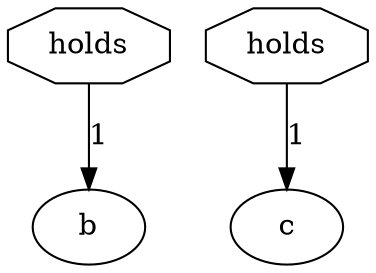

# S1f.5.17 — CI green again: the per-commit job on Ubuntu 26.04's Graphviz, and the nightly's mutant baseline

**Phase:** [P1f.5](README.md) (The no-owner items, then NL and `:priority`)
**Estimate:** 1 day.
- Half a day to reproduce the per-commit failure on the runner's Graphviz, find what in a view sets it off,
  and fix it.
- A quarter of a day for the mutant baseline: which commit killed the two mutants, and the baseline
  re-banked.
- A quarter of a day to run both tiers on the runner's image, and the record.

**Status:** specified 2026-11-08 on the user's instruction: *"add new stage to this phase - fix failing CI
jobs [agutikov/ein] Run failed: per-commit - master (ec004a4)"*. **Done 2026-11-08** on the user's go-ahead
to run the phase stage by stage: T1f.5.17.1 `3e6e40f8` (both failures reproduced and their causes found,
[§ Step 1](#step-1--reproduced-and-the-causes-2026-11-08)), T1f.5.17.2 `76ede241` (the two fixes) and
T1f.5.17.3, the commit after it (the record, and `utils/ci_container.sh`). Neither failure needed the user:
the per-commit one had a view-side fix, the stage's first preference, and a commit killed the mutants, not
the platform. Every step of both workflows is green in a container built like the runner
([§ What changed](#what-changed-and-both-tiers-on-the-runners-image)). The CI itself is read when the user
pushes.
**Depends on:** nothing. **It runs next after [S1f.5.0](s1f.5.0_the_known_wrong_answers_filed.md)**,
before any other stage. Each later stage boundary can then be held to a green CI as well as a green
`./run_tests.sh`.

## The instruction

The per-commit workflow is red on `master` at `ec004a48`, and it was red at `916d97ac`. The nightly has been
red since 2026-11-06. Nothing local shows either failure: `./run_tests.sh` was green at both commits.

## The case

Every run since 2026-11-03, read with `gh run view <id>` and `gh run view <id> --log-failed`, 2026-11-08.
The logs are banked under `build/ci/`, which is gitignored and re-fetched by the same commands:

| run | workflow | commit | image | `graphviz` | result |
|---|---|---|---|---|---|
| 41707292256 | per-commit | `3ee7796a` | ubuntu-24.04 | 2.42.2-9ubuntu0.1 | green |
| 42011053976 | nightly | `3ee7796a` | ubuntu-24.04 | 2.42.2-9ubuntu0.1 | green |
| 42193521554 | per-commit | `916d97ac` | **ubuntu-26.04** | **14.1.2-1ubuntu1** | red: `dot_wellformed` |
| 42203265579 | nightly | `916d97ac` | **ubuntu-26.04** | | red: `stdlib_mutants.py --check` |
| 42360943742 | nightly | `916d97ac` | **ubuntu-26.04** | **14.1.2-1ubuntu1** | red: `stdlib_mutants.py --check` |
| 42412840680 | per-commit | `ec004a48` | **ubuntu-26.04** | **14.1.2-1ubuntu1** | red: `dot_wellformed` |

**The runner moved.** Every workflow asks for `runs-on: ubuntu-latest`. The runs carry GitHub's annotation:
*"The ubuntu-latest label will migrate to Ubuntu 26 beginning October 19, 2026"*. The label reached this
repository between the green runs of 2026-11-05 and the red ones of 2026-11-06. Every red run is on 26.04,
and every green one on 24.04. Locally `dot -V` prints `graphviz version 16.0.0`, and the gate is green.
So three Graphviz versions now meet these views, and only 14.1.2 refuses them.

### Per-commit: `dot_wellformed` on Graphviz 14.1.2

`ein-render/tests/dot_wellformed.rs`'s `graphviz_accepts_every_view_of_every_corpus_file` fails on 16 views
of 9 files:
- `ir-overlay` and `rules-overlay` of the zebra2 family: `zebra2`, `zebra2-hints`, `zebra2-minus-15`,
  `zebra2-minus-15-obligations`, `zebra2-obligations`, `ein-bugs/zebra2-bad` and `ein-bugs/zebra2-hints`;
- `ir-levi` of W18's two witnesses, `ein-bugs/wrong-answers/str-in-absent.ein` and `str-in-guard.ein`.

On each one `dot` exits 0 and writes `lib/pathplan/shortest.c:333: triangulation failed` and
`shortest.c:203: cannot find triangle path` on stderr. The test reads stderr as its signal, because
*"Graphviz exits 0 on a warning"* (`dot_wellformed.rs`, `fn graphviz`). The message is a failure in Graphviz's
spline router, not a parse error, so the question is what in these views the router cannot route on 14.1.2.

**Three steps never ran** in either red per-commit run. `cargo test` failed first, so `check_test_scratch.py`,
`review_bundle.py --smoke` and the bench smoke were skipped, and a second failure could be hiding behind the
first.

### Nightly: two mutants killed since the baseline

`utils/stdlib_mutants.py --check` holds `tests/mutation_survivors.txt` in both directions. A new survivor
fails it, and so does a banked survivor that is now killed. Both red nightlies report the same two:

```
bijection.ein::bijective-setup::swap-assert::(surjective ?R ?isa)   <- killed since the baseline
bijection.ein::bijective-setup::swap-assert::(total ?R ?isa)        <- killed since the baseline
```

Every other step of the `deep-corpus` job is green, and the mutant step is the job's last, so nothing is
hidden behind it. A killed survivor means the suite got stronger. The open question is where: a commit in
`3ee7796a..916d97ac` (M1e2's S1e2.2.21 to S1e2.3.10), or the platform.

## What it changes

- **The views or the test, not the runner by default.** The fix makes `dot_wellformed` hold on the runner's
  Graphviz 14.1.2, on 2.42.2, and on the local 16.0.0. Two fixes are in reach, and the stage prefers them in
  this order:
  1. **A view-side fix.** Some attribute or structure of the overlay and Levi views makes 14.1.2's router
     fail, for example an edge between two nodes of a cluster, a `splines` setting, or a self-loop with a
     port. If such a fix exists, the view stops writing that thing. A change to a view's output moves its
     goldens, and they are named before they move.
  2. **The test's reading of stderr.** If no view-side fix exists, the test tells a parse error (malformed
     DOT) from a layout warning that Graphviz's own router raises. This changes what the test asserts, so it
     goes to the user first (below).

  `runs-on: ubuntu-24.04` would be a stopgap that hides the problem until 24.04 is retired. It is not taken
  without the user.
- **The mutant baseline re-banked** with `utils/stdlib_mutants.py --bless`, once the stage has found which
  commit killed the two mutants and why. The two lines leave `tests/mutation_survivors.txt`, and
  `tests/README.md`'s mutation count moves with them, re-taken with its command and date.
- **Whatever the skipped steps show**, under the same rule: a failure there is fixed in this stage, or it
  becomes a question if the fix is a choice.

## Questions it may put to the user

- If the per-commit fix has to change what `dot_wellformed` asserts (option 2 above): which warnings, if any,
  may a view raise on a Graphviz the gate meets? The stage brings the 16 views, the warning each raises, the
  version that raises it, and the rendered SVG from each version.
- If either failure depends on the platform rather than the code: does the CI pin an image, or does the gate
  hold on every image `ubuntu-latest` names?

## The method

### Task T1f.5.17.1 — reproduced on the runner's image, and the cause

Run both tiers in an `ubuntu:26.04` container (`docker` is on this machine), with the workflow's own steps:
`apt-get install graphviz`, the pinned toolchain, and `./run_tests.sh` and `./run_tests.sh --nightly`, or
their steps one by one. Use a target directory under `build/`, not `ein.rs/target`. Record the versions.
Then:
- `dot_wellformed`: reproduce the 16, minimise one view to the smallest DOT that 14.1.2 refuses and 16.0.0
  accepts, and name the attribute or structure that triggers it. Run the same DOT on 2.42.2 too (a
  `ubuntu:24.04` container).
- The mutants: run `stdlib_mutants.py --check` on the container and on the host, at HEAD and at `3ee7796a`.
  Bisect `3ee7796a..916d97ac` for the commit that kills the two, or show that only the platform does.
- The steps the red runs skipped: run each one on 26.04.

### Task T1f.5.17.2 — the fixes

The view-side fix with its goldens named before they move, or the question to the user. The baseline
re-banked, and the commit that killed the two named in the commit message and in `tests/README.md`.
`./run_tests.sh` green on the host, and both tiers green in the 26.04 container.

### Task T1f.5.17.3 — the record

The stage's Status and the phase README's row. If the cause is the image, the gate's section of `AGENTS.md`
gets a sentence: the CI runs on whatever `ubuntu-latest` names, and Graphviz's version is part of what
`dot_wellformed` checks. If the stage's container commands are worth keeping, they go into `utils/` as a
script with a line in `utils/README.md`, so a later image move can be checked before a push.

## Acceptance

- `dot_wellformed` passes on Graphviz 14.1.2, 2.42.2 and 16.0.0, and no view's rendering on 16.0.0 got worse.
  Or the user has ruled on what the test asserts, and it holds what they ruled.
- `stdlib_mutants.py --check` passes on the host and on 26.04, and the commit that killed the two mutants is
  named.
- Every step of `per-commit.yml` and `nightly.yml` is green in an `ubuntu:26.04` container, including the
  three the red runs skipped.
- `./run_tests.sh` is green.
- The CI itself is read when the user pushes. The stage does not push.

## Step 1 — reproduced, and the causes (2026-11-08)

T1f.5.17.1, at `cdbd0970`. Everything below was taken on this machine (Intel i9-14900HX, which implements
x86-64-v3) in `docker` containers built from `ubuntu:26.04` and `ubuntu:24.04`, each with `graphviz`,
`python3`, `cmake`, `g++` and rustup's `1.97.1` (`ein.rs/rust-toolchain.toml`), run as the host's user on
a clone of the commit under `build/s1f.5.17/`, with its own `ein.rs/target` there. The probes, logs and
SVGs are under `build/s1f.5.17/`, which is gitignored.

### The runner is not `ubuntu:26.04`: it installs the `amd64v3` build

A plain `ubuntu:26.04` container installs the same `graphviz 14.1.2-1ubuntu1` the runner does, and **the
whole per-commit gate is green there**: `./run_tests.sh`, 13 min 59 s, every step, the three the red runs
skipped among them (`build/s1f.5.17/gate-26.04-cdbd0970.log`). The difference is in the runner's apt log:
it unpacks `libpathplan4_14.1.2-1ubuntu1_amd64v3.deb` and eight more `_amd64v3.deb` files
(`gh run view 42412840680 --log`, the *Run sudo apt-get … graphviz* step). Ubuntu 26.04 ships an
architecture variant built for x86-64-v3 (AVX2, FMA), and the runner image selects it. With
`APT::Architecture-Variants "amd64v3";` in the container's apt configuration the failure reproduces
exactly: `cargo test -p ein-render --test dot_wellformed` fails with *20 of 4967 views are not valid DOT*,
the CI log's 16 and four more from S1f.5.0's witnesses (below), each with the log's `shortest.c` lines.

| image | `graphviz` | variant | `dot_wellformed` |
|---|---|---|---|
| GitHub `ubuntu-26.04`, image 20261101.186.1 (the red runs) | 14.1.2-1ubuntu1 | amd64v3 | 16 of the then corpus's views refused |
| `ubuntu:26.04` + `APT::Architecture-Variants "amd64v3"` | 14.1.2-1ubuntu1 | amd64v3 | **20 of 4 967** refused |
| `ubuntu:26.04` | 14.1.2-1ubuntu1 | amd64 | green, and the whole gate with it |
| `ubuntu:24.04` | 2.42.2-9ubuntu0.1 | amd64 | green: only `stdlib/slots.ein`'s five known crashes, which the test re-splits |
| this machine (Manjaro) | 16.0.0 | — | green |

### The cause: `libpathplan`'s orientation test under FMA contraction

Swapping one package at a time with `dpkg -i` pins it to **`libpathplan4` alone**: its amd64v3 build put
into the baseline image refuses all 20 views, and its baseline build put into the amd64v3 image refuses
none, where `libgvc7` or `libcgraph8` swapped either way moves nothing. Built from Ubuntu's own source
(`apt-get source graphviz`), `lib/pathplan` with `lib/util/list.c`, and put in place of the installed
library:

| `libpathplan.so.4`, Graphviz 14.1.2 | FMA instructions | views refused, of the 20 |
|---|---:|---:|
| Ubuntu's amd64v3 build, as installed | 86 | 20 |
| `gcc -O2 -march=x86-64` | 0 | 0 |
| `gcc -O2 -march=x86-64-v3` | 86 | 20 |
| `gcc -O2 -march=x86-64-v3 -ffp-contract=off` | 0 | 0 |

`lib/pathplan/shortest.c`'s `ccw` is the classic `a·b − c·d`:
`(p1.y - p2.y) * (p3.x - p2.x) - (p3.y - p2.y) * (p1.x - p2.x)`. GCC contracts it into a fused
multiply-add under `-march=x86-64-v3` (`-ffp-contract=fast` is GNU C's default), so one product is rounded
and the other is not, and three collinear points can come out on one side. The ear-clipping triangulation
then finds no diagonal (`triangulation failed`, `shortest.c:333`) and the funnel no path (`cannot find
triangle path`, `:203`). `dot` exits 0 and falls back to a simpler curve for that one edge. Nothing is
dropped: six of the 20 views render byte for byte as the baseline build renders them, and in the zebra2
overlays the one difference is that edge's path (`?V2 -> ?h` in `co-located-negative`, a single Bézier
where the baseline routes three). A collinear triple on an axis-aligned line has exact zero products,
which no contraction disturbs, so only slanted sides can trip it: a `diamond`'s or an `octagon`'s.

**It is Graphviz's own build, then, and not the bytes**, which is how the test already reads a signal
(`dot_wellformed.rs`, § When Graphviz is the one that is broken), and not how it reads stderr.

### What in the views sets it off

Every refused digraph is one of two kinds (`build/s1f.5.17/which_digraph.base.log`, each digraph of each
refused view put to `dot` alone):

| digraph | writer | refused | in |
|---|---|---:|---|
| `rule_co_located_overlay` | `rules.rs`, `render_overlay` | 14 | the zebra2 family's seven files, `ir-overlay` and `rules-overlay` |
| `rule_co_located_negative_overlay` | `rules.rs`, `render_overlay` | 12 | six of the seven, both views |
| `rule_s_overlay` | `rules.rs`, `render_overlay` | 4 | `underscore-core-two-ways.ein` and its `-twin` (S1f.5.0's W29, new since the stage was written), both views |
| `ontology` | `builder.rs`, a Levi digraph | 2 | W18's `str-in-absent.ein` and `str-in-guard.ein`, `ir-levi` |

The overlay draws a rule's variables as diamonds and its n-ary atoms as octagons, with labelled edges and
no cluster; a Levi digraph draws every fact as an octagon with labelled role edges. The smallest program
14.1.2's amd64v3 build refuses and every other build accepts is two such pairs side by side:



A `box` or an ellipse in place of the octagons, no edge labels, `xlabel` for `label`, or one pair alone, and
it is accepted. The edge labels matter through `lib/dotgen/rank.c`'s `edgelabel_ranks`: when any edge has
a label, dot doubles every edge's length and halves the rank separation,
`GD_ranksep(g) = (GD_ranksep(g) + 1) / 2`. The default `ranksep` of 0.5 in is 36 pt, so the half is 18 pt,
which is the half-height of a default node (0.5 in). That coincidence is what puts slanted sides through
exactly collinear corners. The sweep says so (every view under `dot -Tsvg` on the amd64v3 image, a graph
attribute inserted into every digraph):

| graph attributes | views refused, of 4 967 | which views |
|---|---:|---|
| none | 20 | `ir-levi` 2, `ir-overlay` 9, `rules-overlay` 9 |
| `nodesep` 0.20, 0.21 … 0.40 (21 values) | 3 to 22 at **every** value | only `ir-levi`, `ir-overlay`, `rules-overlay`, also in `stdlib/algebra.ein`, `bijection.ein` and `examples/broken/load/unimported_std_macro.ein` |
| `ranksep=0.5`, written out | 20 | the same 20 |
| `ranksep` 0.4, 0.45, 0.51, 0.55, 0.6, 0.75 or 1.0 | **0**, at `nodesep` 0.2, 0.25, 0.26 and 0.35 alike | — |

So changing the geometry at random only moves the failure to other views, and the default rank separation
is the one value that keeps it. No KB, constraint or side-by-side rule view was refused under any of the
perturbations, though octagons occur in all three. The side-by-side rules draw theirs inside clusters.

**The fix taken, the stage's first preference:** the two writers that were refused set `ranksep=0.55` on
their digraphs: a rule's overlay digraph always, and a `Builder` digraph (the per-form IR renderer's)
whenever it holds an octagon hyperedge node. The halved separation becomes 20 pt. Prototyped on a clone
(`build/s1f.5.17/probe-src`, every view of every corpus file dumped as `dot_wellformed.rs` feeds it):

- **0 of 4 967 views refused** on 14.1.2 amd64v3, 14.1.2 amd64 and 16.0.0. On 2.42.2, `slots.ein`'s five
  crashes remain, which the test already re-splits and which are views the fix does not touch.
- **0 at every `nodesep` from 0.20 to 0.40**, on the amd64v3 build, where the views as they are fail at
  each of those values.
- **1 198 views change**: `ir-levi` 351, `ir-overlay` 317, `rules-overlay` 278, and `ir`, `ir-forms`
  and `ir-trace-dag` 84 each (the files with a fact the compact mode draws as an octagon too: one with no
  argument, three or more, or a nested fact for its one argument).
- **On 16.0.0 no rendering got worse**: in each of the 6 214 digraphs of those views every node and edge
  is drawn as before, none warns, heights grow by 0 to 28 pt (at most 4.2 %), and widths move by −2 to
  +4 pt in 29 digraphs (`build/s1f.5.17/compare-16.0.0.txt`). The 20 views' SVGs from all four builds,
  before and after, are under `build/s1f.5.17/svg/views/`.

### The three steps the red runs skipped

`check_test_scratch.py`, `review_bundle.py --smoke` and the bench smoke are green on `ubuntu:26.04` in
the gate above. On the amd64v3 image, `review_bundle.py --smoke` (12 SVGs, the link check exit 0) and
`cargo bench --bench engine -- --test` are green at `cdbd0970`
(`build/s1f.5.17/v3-cdbd0970-dot_wellformed.log`). `check_test_scratch.py` reads what a green
`cargo test` left, so T1f.5.17.2's run in that image takes it.

### The mutants: `597b2b7e` killed them

`python3 utils/stdlib_mutants.py --check` fails **on this machine too** at `cdbd0970`, with the nightly's
two lines, so the platform is not the cause. `stdlib/` and `tests/` have not changed since the last green
nightly (`git diff 3ee7796a HEAD -- stdlib tests` is empty). `git bisect run` over `3ee7796a..916d97ac`,
which built each commit's release `ein` and ran `stdlib_mutants.py -k bijective-setup`, names
**`597b2b7e`**: T1e2.2.5.2, *forbid*'s refusal (2026-11-04). Measured the way `tests/README.md` measures a
kill: at its parent `c887a35b` both mutants pass `ein test tests/` (66 held, exit 0); at `597b2b7e` both
are refused, exit 2, with one error:

```
ERROR        tests/stdlib/bijection/06_blind_enumeration.ein
    rule 'total' [activator is-a seats]: concludes (false) from (absent …) over seats, a relation a
    commitment can still extend — so it calls a state that has not yet decided seats a contradiction, …
```

and `rule 'surjective' [activator is-a seats]` for the other. The swapped assertion turns
`bijective-setup`'s `(total ?R ?isa)` into `(total is-a seats)`, so `std.algebra`'s `total` reads `seats`
under `absent`. `06_blind_enumeration.ein` is the one program in `tests/stdlib/bijection/` that leaves the
blind enumerator on, so `seats` is a relation a commitment can extend, and *forbid* refuses the program at
load. The suite noticed the defect: the kill is real, and T1f.5.17.2 re-banks it.

## What changed, and both tiers on the runner's image

**T1f.5.17.2, `76ede241`.** The view-side fix of § Step 1: `dot_util::POLYGON_RANKSEP`, `ranksep=0.55`,
written by a rule's overlay digraph (`rules.rs`, `render_overlay`) and by a `Builder` digraph that holds an
octagon hyperedge node (`builder.rs`, `build`), each with its reason in a doc comment, and in
[`04_dot_rendering.md`](../../../docs/kernel/ir/03-ein-lang/04_dot_rendering.md) under the overlay. Named
before they moved, from `cargo test`'s own list before `EIN_BLESS`: `ein-render`'s `corpus_shapes.md5`,
**1 198 lines over 384 corpus files**, `ir-levi` 351, `ir-overlay` 317, `rules-overlay` 278, and `ir`,
`ir-forms` and `ir-trace-dag` 84 each, each digraph one line longer, the prototype's count. No DOT golden,
answer, exit code or other golden moved. The mutant baseline: `tests/mutation_survivors.txt` re-banked by
`stdlib_mutants.py --bless`, its diff the two lines removed and nothing added, **167 of 217** killed and 50
surviving, 42 of them in `slots.ein`. [`tests/README.md`](../../../tests/README.md#what-a-mutation-sweep-says-about-them)'s
table of kills names `597b2b7e` and the program that kills each, and the script's docstring,
`utils/README.md` and `AGENTS.md` carry the count. `./run_tests.sh` green, 13 min 27 s
(`build/gate-s1f.5.17-T2.log`).

**Both tiers on the runner's image**, at `76ede241`, by `utils/ci_container.sh`: Ubuntu 26.04.1,
Graphviz 14.1.2 with `libpathplan4 14.1.2-1ubuntu1` **amd64v3**, Python 3.14.4, rustc 1.97.1, run as the host's
user on a clone under `build/ci-container/`.

| tier | command | result |
|---|---|---|
| per-commit | `utils/ci_container.sh` | **green**, 13 min 19 s from a fresh build: the six static checks, `cargo test --workspace` (`dot_wellformed` among it), and the three steps the red runs skipped, `check_test_scratch.py`, `review_bundle.py --smoke` (12 SVGs, link check exit 0) and the bench smoke (`build/s1f.5.17/container-26.04-amd64v3-gate-76ede241.log`) |
| nightly | `utils/ci_container.sh --nightly` | **green**, 26 min 27 s: `deep-corpus`'s five test steps at their slow depths, `check_test_scratch.py`, `stdlib_census.py --check`, the whole review bundle (137 cases, 0 failed) and its link check (6 752 pages, 0 findings), and `stdlib_mutants.py --check` at **167 of 217**; both fuzz seeds at 10⁶; the bench smoke (`build/s1f.5.17/container-26.04-amd64v3-nightly-76ede241.log`) |

**And on the runner before it**: `utils/ci_container.sh --image ubuntu:24.04 --variant none --tests-only`,
Ubuntu 24.04.5 with Graphviz 2.42.2-9ubuntu0.1 and Python 3.12.3, is green at `76ede241` in 15 min 13 s
from a fresh build and image. That covers `cargo test --workspace` with `dot_wellformed` (`slots.ein`'s
crashes re-split, as before), `check_test_scratch.py` and `review_bundle.py --smoke`
(`build/s1f.5.17/container-24.04-tests-76ede241.log`). `--tests-only` because 24.04's Python is not the
3.14 `setup-python` gave that runner. With the host's 16.0.0 (`./run_tests.sh` above), `dot_wellformed`
holds on all three Graphviz versions the gate meets.

**T1f.5.17.3.** [`utils/ci_container.sh`](../../../utils/ci_container.sh) keeps the container commands:
the image built like the runner (`APT::Architecture-Variants "amd64v3"`, what the workflows install, the
pinned toolchain), HEAD as committed cloned under `build/ci-container/`, and `./run_tests.sh` run there
with any argument. It has a row in [`utils/README.md`](../../../utils/README.md), and `AGENTS.md`'s gate
section says which Graphviz build `dot_wellformed` meets on the CI, and how to check one before a push.

## Notes

- **The cause is Graphviz's, or Ubuntu's build of it**, and this stage reported it nowhere: `ccw` in
  `lib/pathplan/shortest.c` is not robust to FMA contraction, and Ubuntu builds the amd64v3 variant with
  GNU C's default `-ffp-contract=fast`. Whether to report it upstream (Graphviz's issue tracker, or
  Launchpad's `graphviz` package) was the user's, and **the user ruled it on 2026-11-08: not reported**
  (*"don't report the graphviz bug upstream"*). The view-side fix stands on its own. The evidence is
  § Step 1's tables, and `build/s1f.5.17/tools/pathplan_fma.sh` rebuilds the library both ways.
- **`dot_wellformed` still reads stderr as a refusal.** A router fallback on one build is Graphviz's
  statement about itself, as the test already reads a signal. The stage reserved telling the two apart for
  the user, and did not need to ask, since a view-side fix existed. If a later corpus program trips the
  amd64v3 router on a view the fix does not cover, that question is where to start. `utils/ci_container.sh`
  finds such a view before a push.
- The script's first two runs failed for its own reasons, and it was fixed before it was committed. A
  `target/` compiled with the checkout mounted elsewhere kept the old `CARGO_MANIFEST_DIR`, so `ein-corpus`
  found no repo root (`build/s1f.5.17/container-26.04-amd64v3-gate-76ede241.stale-target.log`). With the
  checkout mounted at `/w`, `corpus_shapes.rs`'s `portable` replaced every `/w` in the renderings' text with
  `<repo>`, and 1 446 digests moved (`….mount-w.log`). It now mounts the checkout at its own path, as the
  runner's is a real one.
- `utils/ci_container.sh` needs an x86-64-v3 CPU for the amd64v3 image, and `docker`. A runner image that
  moves again, or `ubuntu-latest` naming 28.04, is checked with `--image`.
