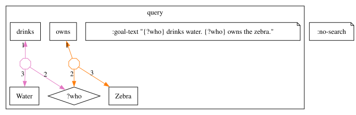

# S2.2.5's one shot: from a text to a short answer

[S2.2.5](../s2.2.5_from_text.md)'s report. **`einaf from-text` turns a text into an Ein program in the three steps and
prints the short answer that program prints**: the answer query's `:goal-text` filled per row with its values
formatted, or one of EinAf's fixed texts where no program prints one; each step's program judged at root and kept,
the complete program asked the least questions its answer needs, the run recorded with every call slim. The code is
`einaf::from_text`, `einaf::answer` and `einaf::format` ([the page](../../../../docs/einaf/08-from-text.md)); the records
are this folder's ([§ 9](#9-the-files)). Everything was run on 2026-11-26 on the machine the work runs on, on AC
power, the GPU free of any other model; the model `qwen3.5:4b` alone, thinking off, greedy, seed 1, a context of 65 536
tokens and a budget of 12 288 generated tokens a call, each kernel call under a clock of 60 s, on `8c2037b0`'s binary;
the plan was committed before its first generation (`261d4768`). **The tables are the runs replayed on the final code**
([`tables.md`](tables.md), `replay.sh` then `analyse.py`).

**What it comes to.**

- **The pieces hold with no model**, in EinAf's gate step: every one of the seven outcomes, an answer query with no
  row and with two classes, and a program with no answer query print the answer table's line through `einaf
  from-text --replay`, from a record of one call written slim; with no formatter, EinAf's line is the kernel's byte
  for byte on 5 187 lines of 183 corpus programs; the sixteen word problems' own programs under the three forms of an
  import print no numeral as a term; the stage's word problem over the calculator prints *Bob has 3 apples*; the
  Zebra puzzle's steps by hand print *The Norwegian drinks water. The Japanese owns the zebra.*; and a recorded run of
  the model replays step by step from 15.5 KB of slim calls. The formatters' module is built and tested alone by
  `rustc`.
- **The minimal goal is not met** (Q-M2.17): on the Zebra puzzle the model's program is dead at step 2, eleven houses for
  five places and four kinds with no member, either fault alone deadly (L-M2.23), and `einaf from-text` prints *The statements contradict each other.*, the core naming *Coffee is drunk
  in the green house.*: the program S2.2.4 recorded, call for call, the requests being the same. Its answer query
  asks one person both questions (L-M2.21), so a right grid would have printed the undetermined text too. The puzzle
  less its fifteenth clue is dead the same way; with *The Norwegian drinks milk.* added it is dead on a contradiction
  of the model's own, and the reader scores the printed string right for a reason that is not the text's (L-M2.22).
- **The word problems, the library alone** (13 texts, 16 problems): 11 programs load; the stand-in reader reads 3
  right, each the undetermined text from an answer query with no row (two from a calculator's name the import does
  not list, one from a step cut by its budget), 8 wrong and 2 no answer; `bob1` and `bystander` print the right
  number among others, a row a pass of a rule that reads what it concludes (E-124, Q-M2.33). No numeral is left a
  term: the 20 values printed are each a decimal formatter's.
- **With the word theory's modules given beside the library** (`--module-dir`, the widest condition, labelled so): 8
  programs load and 3 are read right, `bystander`'s *Carol has 9 apples.* the stage's one right number; no program
  imports a module given (Q9), and the right answer came from a step 2 the budget cut, read as the forms written
  before the cut.
- **What it found of Ein**: the seven candidates the stage listed, six confirmed and one refuted as worded (§ 7);
  **E-126**, a root that dies on a link several rules derive takes 72 s that no clock stops, 63 ms with the lever
  (Q-M2.34); **E-127**, the kernel's line is a template a caller fills again byte for byte.

## 1. What was built

| what | where |
|---|---|
| **the one shot**, a library function the loop's GENERATE and the harness's run will call: the steps over a catalogue, the complete program asked `--no-search` and `--single` and, where the answer query's one class is a lower bound, described; the answer read off the objects; the record | [`einaf::from_text`](../../../../einaf/src/from_text.rs) (`run`, `answer_of`, `write_record`, `explain`, `sidecar`) |
| **the answer**: the rule that chooses what is printed by the answer query's classes, the seven fixed texts, the stand-in reader of the answer's comparison | [`einaf::answer`](../../../../einaf/src/answer.rs) |
| **the formatters**, standard library only, built and tested alone: a value's text read back as a term, its names resolved from the program's imports, the decimal numeral, the word theory's quantities by cases that are data, the template filled again by the kernel's rule | [`einaf::format`](../../../../einaf/src/format/mod.rs), [`decimal.rs`](../../../../einaf/src/format/decimal.rs), [`facts.rs`](../../../../einaf/src/format/facts.rs), [`cases/words.txt`](../../../../einaf/src/format/cases/words.txt) |
| **a call slim**, the request's digest and what came back, no request body, the generated tokens their digest; replay reads it | `einaf::model::Slim`, [`replay.rs`](../../../../einaf/src/model/replay.rs) |
| **the formalization's new options**: the requests' seed; an output the budget cut read as the forms written before the cut; a catalogue with a directory of modules given beside the library, loaded from it | [`einaf::formalize`](../../../../einaf/src/formalize.rs) (`Cut`, `keep_forms`, `run_with`), [`einaf::catalogue`](../../../../einaf/src/catalogue.rs) (`Given`, `with_modules`) |
| **the kernel module's additions**: the kernel's trace of an answer; root's narration kept to 64 MiB | `einaf::kernel::explain`, `einaf::kernel::NARRATION_LIMIT` |
| **the command** | `einaf from-text` ([`from_text_cmd.rs`](../../../../einaf/src/from_text_cmd.rs)) |
| **the page** | [`docs/einaf/08-from-text.md`](../../../../docs/einaf/08-from-text.md); EinAf's index, the model's runtime (a call slim), the steps (the seed, the cut, modules given), the contract (its answer's enforcers) and the feedback object (what the bounds do not stop, a fourth row) name it |
| **the tests**, EinAf's gate step, no model | [`from_text.rs`](../../../../einaf/tests/from_text.rs) (8), [`corpus.rs`](../../../../einaf/tests/corpus.rs)' `the_answer_line_with_no_formatter_is_the_kernels_byte_for_byte`; fixtures under [`fixtures/answer/`](../../../../einaf/tests/fixtures/answer/) and [`fixtures/from_text/`](../../../../einaf/tests/fixtures/from_text/) |

## 2. The answer: the fixed texts and the formatters

**What is printed is chosen by the answer query's classes**, under the last question asked that is not `--no-search`
([the page § 2](../../../../docs/einaf/08-from-text.md#2-the-answer)):

| the kernel found | printed | an answer |
|---|---|---|
| a state in R, the answer query one class with a row, over a complete set | each row through the `:goal-text`, its values formatted, a line each | yes |
| a state in R, two classes or more | **The statements do not determine the answer.** and, beneath, each class's lines | yes |
| a state in R, one class with no row | **The statements do not determine the answer.** | yes |
| *inconsistent* | **The statements contradict each other.** | yes |
| *incomplete* | **No answer: the program is incomplete.** and, beneath, what root owes in the kernel's sentences | no |
| *not decided* | **No answer: not decided.** and, beneath, the bound that stopped it | no |
| *flagged* | **No answer is claimed: the program is not monotone.** and, beneath, the kernel's warning and lines | no |
| *invalid*, or no program | **No answer: the program was refused.** and, beneath, each diagnostic with its kind and place | no |
| a state in R, no answer query | **No answer: the program states no answer query.** | no |

**The formatters** ([the page § 3](../../../../docs/einaf/08-from-text.md#3-the-formatters)): `decimal`, a numeral
`z` or `(std.math.decimal.n P D)` as its digits by value; `words`, the word theory's nine quantities in their
declarations' own words, each argument formatted in turn, *(amount Bob apples t1)* as *how many apples Bob has at
t1*. A value none takes prints as written. A value is matched by its full name, resolved from the program's imports,
so the three forms of an import format alike.

<!-- output -->
```text
$ R=plans/m2_nl_to_ir/p2.2_formalizer/from_text/runs/library/bob1
$ einaf/target/gate/einaf from-text plans/m2_nl_to_ir/p2.2_formalizer/steps/texts/bob1.txt --id bob1 --answer-line word --replay $R/generations.jsonl 2>/dev/null
Bob has 1 apples.
Bob has 3 apples.
Bob has 5 apples.
$ einaf/target/gate/einaf from-text plans/m2_nl_to_ir/p2.2_formalizer/steps/texts/bob1.txt --id bob1 --answer-line word --replay $R/generations.jsonl --no-format 2>/dev/null
Bob has (n z 1) apples.
Bob has (n z 3) apples.
Bob has (n z 5) apples.
```

**With no formatter the line is the kernel's, byte for byte**, on 5 187 lines of the 183 corpus programs with a
`:goal-text` that are not `slow`, under every question (E-127).

## 3. The record, and what a run commits

`--record DIR` writes `config.json`, `generations.jsonl` (every call slim), `program.ein`, `program.sidecar.json`,
`steps/stepN.ein`, `kernel.jsonl`, `answer.json` and `run.json` ([the page § 4](../../../../docs/einaf/08-from-text.md#4-the-record)).
**By the user's ruling, a run commits** `generations.jsonl`, `program.ein`, `program.sidecar.json` and the live run's
`stderr.txt`; the rest is `replay.sh`'s, and git ignores it ([`.gitignore`](.gitignore)). **A call slim weighs a tenth
of a call whole**: the Zebra puzzle's three calls with its contradiction added are 15.5 KB slim, where S2.2.4's `bob1`
fixture, three calls whole, is 160 KB.

## 4. The runs

The plan, 29 runs fixed before the first generation ([`plan.tsv`](plan.tsv), `261d4768`), each one `einaf from-text`
([`run.sh`](run.sh)), the model loaded once a run: **library**, the main arms' condition, the Zebra puzzle and its two
edits and the thirteen texts of the sixteen word problems; **module-dir**, the thirteen with
`examples/word_problems/`'s modules given. S2.2.4's budgets and prompts, so the library condition's requests are
S2.2.4's: **37 of its 43 calls on S2.2.4's texts wrote S2.2.4's output byte for byte**, and the other six are a step
the budget cut, read now as the forms before the cut, or a step after one.

| condition | runs | calls | generation | calls to the budget | wall |
|---|---:|---:|---:|---|---:|
| library | 16 | 49 | 1 333 s | 5: `unused` 2, `boxes12` 3, `boxes13` 2b and 3, `pencils` 3 | 1 807 s |
| module-dir | 13 | 39 | 805 s | 3: `boxes12` 2, `boxes13` 3, `bystander` 2 | 1 019 s |

**An output the budget cut** (L-M2.17's choice): 8 calls, every one a loop inside a form or in comment lines, none a
form repeated; the forms written before the cut were kept (21, 1, 0, 0, 0, 18, 0 and 15) and, where none was, the step
ended the run. **The questions asked**: `--no-search` and `--single` of every complete program; no run needed a
description, no answer query having one class with a row over the two states `--single` lists. **The replay**
([`replay.sh`](replay.sh)) gives the 29 committed programs byte for byte from their slim calls alone, on the final
code; every table is the replay's ([`tables.md`](tables.md), [`analyse.py`](analyse.py)).

## 5. The Zebra puzzle, and where the minimal goal stands

| text | step 1 | step 2 | step 3 | `--single` | the answer printed | gold | read |
|---|---|---|---|---|---|---|---|
| [`zebra.txt`](../../../../nl2smt/puzzles/zebra.txt) | 53 forms; root not decided, H `blind` (7 840) | 69 forms; root **inconsistent** | 15 forms | inconsistent | *The statements contradict each other.* | *the Norwegian drinks water, the Japanese owns the zebra* | wrong |
| [`zebra-minus-15.txt`](../../../../nl2smt/puzzles/zebra-minus-15.txt) | 53 forms; not decided, `blind` (6 931) | 74 forms; **inconsistent** | 17 forms | inconsistent | *The statements contradict each other.* | *The statements do not determine the answer.* | wrong |
| [`zebra-contradiction.txt`](../../../../nl2smt/puzzles/zebra-contradiction.txt) | 56 forms; not decided, `blind` (8 428) | 78 forms; **inconsistent** | 9 forms | inconsistent | *The statements contradict each other.* | *The statements contradict each other.* | right, for a reason not the text's |

**The minimal goal is not met**: the one shot, the pinned model, the theory selected from the library, prints the
unsatisfiable text, not the two names. **Where the run stopped**: at step 2, where the model's ontology names a house
for each coloured house beside the five numbered ones and a middle house, eleven houses for `std.slots`' five places,
with *next to* read as *in*, and four kinds with no member, and root is dead of either fault alone (L-M2.23);
the description's core names *(instance GreenHouse House)* with its sentence, *Coffee is drunk in the green house.*,
refuted by `std.slots.slot-no-fill` (E-125). Step 3 selects the read-back over kinds with no members
(`selection-inactive` 5) and writes `(solve :no-search)` beside the obligations (`mechanism-not-the-one-stated`).
**Step by step against the steps by hand** ([`tables.md`](tables.md)): step 1 has 4 of its 53 forms the hand's, 2 of
its facts the hand's by sentence (passives folded into actives, *next to* into *lives in*), the relations
`are-smoked-in`, `are-smoked-next-to`, `is-drunk-in` and `lives-next-to` never declared; step 2 selects what the hand
selects, `includes`, `symmetric`, `slot-partition`, `slot-spatial`, spelled right, reading the four verbs into
`same-house` as the hand does, beside an ontology of its own (five relations of a kind and a house,
`drinker-and-house` and the others, that the hand has not, and none of the hand's passives); step 3 selects `converse`, `meet` and `top` and no `compose`. **The library's rules root fired**:
the same rules as the reference, `std.slots`' and `std.algebra`'s, the place rules up to a thousand times as often
(`slot-locate` 5 742 against 6, `slot-negative` 6 424 against 108, `slot-occupied` 6 064 against 136), and three the
reference never fires, `slot-no-room`, `slot-no-fill`, the one that kills root, and `std.core.inconsistent`. **Its answer query asks one person
both questions**, `(and (drinks ?who Water) (owns ?who Zebra))` (L-M2.21), on all three texts.

**The model's Zebra program** ([`runs/library/zebra/program.ein`](runs/library/zebra/program.ein), 104 forms), drawn
by `ein render program`: its knowledge base, [`zebra.program.svg`](zebra.program.svg), and its query,
[`zebra.query.svg`](zebra.query.svg), one variable under both questions:



<!-- output -->
```text
$ ein solve plans/m2_nl_to_ir/p2.2_formalizer/from_text/runs/library/zebra/program.ein --single      # 72 s: E-126
solve · plans/m2_nl_to_ir/p2.2_formalizer/from_text/runs/library/zebra/program.ein --single
──────────────────────────────────────────────────────────────
  asked             is R one state? (--single)
  verdict           Contradiction — R is empty: every node is dead
  decided           yes — R is empty
  lattice           monotone (the static check) — R is convex: no hole
  universe          0 candidates
  route             1, the alive down-set — L1 dead is upward-closed
  work              1 saturation · 0 facts beyond root

  query             (and (drinks ?who Water) (owns ?who Zebra))
  over              all of R — R is empty, root is dead: no state to answer from
  as :expect        (false)
$ ein solve plans/m2_nl_to_ir/p2.2_formalizer/from_text/runs/library/zebra/program.ein | sed -n 13,17p
  unsat core        (instance GreenHouse House)
  unsat core        (type Color Attribute)
  core search       cut at its budget of 64 environments per fact: a smaller core may exist
  source            (instance GreenHouse House) :source "Coffee is drunk in the green house."
  refuted by        std.slots.slot-no-fill
```

## 6. The word problems, one shot

*Word problems, one shot*, and not a result: prompts were developed on these problems. A row a text, the problems it
is of beside it; read by the stand-in reader against the gold of `plan.tsv`, which is the directory's README's.

| text | library: `--single` | library: the answer printed | read | module-dir: `--single` | module-dir: the answer printed | read | the README's answer |
|---|---|---|---|---|---|---|---|
| `bob1` | one | *Bob has 1 apples. / 3 / 5* | wrong | one | the same | wrong | 3 |
| `gap` (+ `gap_assume`) | one | *The statements do not determine the answer.* | right | one | the same | right | not stated: Alice's apples |
| `gap_fact` | one | *The statements do not determine the answer.* | wrong | invalid (a conclusion's variable unbound) | *No answer: the program was refused.* | no answer | Bob 3, Alice 6, together 9 |
| `contra` | one | *Bob has 5 apples.* | wrong | one | the same | wrong | a contradiction |
| `unused` | invalid (`has` declared twice, E-104) | *No answer: the program was refused.* | no answer | invalid (the same) | the same | no answer | 3 |
| `bystander` | one | *Carol has 1 apples. / 3 / 5 / 7 / 9* | wrong | one | ***Carol has 9 apples.*** | **right** | 9 |
| `before` | one | *Bob had 1 apples before. / 3 / 5* | wrong | one | the same | wrong | 7 (the theory: no answer) |
| `kinds` (+ `kinds_assume`, `kinds_listed`) | one | *The statements do not determine the answer.* | right | invalid (unbound) | *No answer: the program was refused.* | no answer | not stated: Alice's apples |
| `kinds_full` | one | *The statements do not determine the answer.* | wrong | one | the same | wrong | 8 |
| `more` | invalid (a goal on `gt`) | *No answer: the program was refused.* | no answer | invalid (the same) | the same | no answer | Alice, by 7 |
| `boxes12` | several | *The statements do not determine the answer.* | wrong | invalid (`sum-of` bound twice) | *No answer: the program was refused.* | no answer | 4 |
| `boxes13` | several | *The statements do not determine the answer.* | right | several | the same | right | 4 or 5, by the reading of *need* |
| `pencils` | several | *The statements do not determine the answer.* | wrong | one | the same | wrong | 47 each, 21 left over |
| **of 13** | **11 load** | | **3 right**, 8 wrong, 2 no answer | **8 load** | | **3 right**, 5 wrong, 5 no answer | |

**Read right, and why.** Every *right* of the library alone is the undetermined text, from an answer query with no
row: `gap` and `kinds` because the program writes the calculator's `sum-of` as its own (`name-not-listed`), `boxes13`
because its steps 2b and 3 ran to the budget and kept no form; none is right for the reason the README gives (L-M2.22).
**The one right number** is `bystander`'s with the modules given: its step 2 ran to the budget, its 15 forms were
kept, and step 3 wrote a giver's rule that reads the kind (`(gave ?giver ?k ?thing ?receiver)`) and leaves Carol's 9
alone; no module given was imported. **A row a pass**: `bob1`, `bystander` (library) and `before` print one value a
pass of a rule that reads what it concludes, the right number among others in two (E-124, Q-M2.33). Every numeral
the answers print is formatted, 20 values, none left a term.

## 7. What the stage found of Ein

The seven candidates of the stage's T2.2.5.6, each with its program and command, are lines of the entries named;
two new entries; and four findings of EinAf's and the process's ([the stage's record](../s2.2.5_from_text.md#record)
has each):

| the candidate | verdict | the entry |
|---|---|---|
| a row's value reaches a caller as text, in the main file's spelling | confirmed | [E-56](../../evaluation/library/E-56-a-rows-value-reaches-a-caller-of-the-library-as-text.md) |
| the read-out's query carries no `:goal-text` | confirmed | E-56 |
| a line is printed per row only | confirmed, sharpened | [E-42](../../evaluation/natural-language/E-42-a-negative-answer-has-no-sentence.md), [E-22](../../evaluation/natural-language/E-22-the-answers-line-is-in-no-key-of-ein-summary-2.md), [E-23](../../evaluation/natural-language/E-23-a-value-has-no-text-of-its-own.md) |
| nothing in a solve stops a saturation with no fixpoint | refuted as worded (closed by S2.1.2); the closing holds on the one shot | [E-45](../../evaluation/bounds/E-45-nothing-in-a-solve-stops-a-saturation-that-has-no-fixpoint.md) |
| the `ein` binary does not start under `ulimit -v` | confirmed (exit 134; `einaf` answers) | [E-61](../../evaluation/bounds/E-61-the-ein-binary-does-not-start-under-a-cap-on-its-address.md) |
| the writer of H is in no key of `ein-summary/2` | confirmed | [E-39](../../evaluation/hypotheses/E-39-the-answer-does-not-say-who-wrote-the-candidates.md) |
| a goal at another count has no row and no word | confirmed, first hand | [E-12](../../evaluation/language/E-12-an-undeclared-relation-and-a-form-of-a-declared-relation-at.md) |
| **new**: a root that dies on a link several rules derive takes 72 s past every clock, 63 ms with the lever | limit | [E-126](../../evaluation/bounds/E-126-a-root-that-dies-on-a-link-several-rules-derive-takes-its-time-past-every-clock.md) |
| **new**: the kernel's line is a template a caller fills again byte for byte | strength | [E-127](../../evaluation/natural-language/E-127-the-kernel-s-line-is-a-template-filled-by-a-rule-a-caller-writes-again.md) |

## 8. The commands, with their outputs

**With no model, from the committed record** (`einaf/target/gate/einaf`, which `cargo build --manifest-path
einaf/Cargo.toml --profile gate` builds), one word problem end to end, the module-dir condition's `bystander`:

<!-- output -->
```text
$ einaf/target/gate/einaf from-text plans/m2_nl_to_ir/p2.2_formalizer/steps/texts/bystander.txt --id bystander \
    --answer-line word --module-dir examples/word_problems --gold-answer 9 \
    --replay plans/m2_nl_to_ir/p2.2_formalizer/from_text/runs/module-dir/bystander/generations.jsonl
einaf: replaying 3 recorded calls
step 1     4643 prompt tokens, 168 generated (end-of-turn, 2.7 s), 6 forms; at root not decided; H from blind (0); 0 findings
step 2     14575 prompt tokens, 12288 generated (max-tokens, 222.0 s), 15 forms; cut by the budget: 15 forms kept, 0 repeats dropped; at root not decided; H from blind (0); 7 findings
step 3     15520 prompt tokens, 446 generated (end-of-turn, 7.9 s), 5 forms
the program: H from no-search (0); 7 findings of the check
  --no-search: not decided (--no-search: root is alive, and R was not searched), 0.0 s
  --single: one (Solution: one state), 0.0 s
the answer: lines (from program)
einaf from-text: 2.6 s
against the gold answer "9": right (every claim stated, no other number)
Carol has 9 apples.
$ … the same … --no-format --explain T.md 2>/dev/null
Carol has (n z 9) apples.
$ sed -n '/Step 4 —/,/Step 5 —/p' T.md
### Step 4 — `giving-asks-the-difference`

> Bob had (n z 5) and gave (n z 2): ask (n z 5) less (n z 2)

Premises: `gave(Bob, n(z, 2), Apple, Alice)`, `has(Bob, n(z, 5), Apple)` — from Bob gave 2 apples to Alice., Bob has 5 apples.

Derives `sub(n(z, 5), n(z, 2))`.
```

The formatted line against the kernel's: *Carol has 9 apples.* where the kernel filled *Carol has (n z 9) apples.*,
`ein solve runs/module-dir/bystander/program.ein --single` printing it so (*class 1 of 1 … “Carol has (n z 9)
apples.”*). The times on a replay are the record's, the generation's; the kernel's are the replay's own.

**The Zebra puzzle with no model** (4 min, E-126):

<!-- output -->
```text
$ einaf/target/gate/einaf from-text nl2smt/puzzles/zebra.txt --id zebra --answer-line zebra \
    --gold-answer 'Norwegian water|Japanese zebra' \
    --replay plans/m2_nl_to_ir/p2.2_formalizer/from_text/runs/library/zebra/generations.jsonl
einaf: replaying 3 recorded calls
step 1     4787 prompt tokens, 1032 generated (end-of-turn, 16.3 s), 53 forms; at root not decided; H from blind (7840); 0 findings
step 2     12627 prompt tokens, 1160 generated (end-of-turn, 19.9 s), 69 forms; at root inconsistent; H from stuck (0); 0 findings
step 3     13869 prompt tokens, 308 generated (end-of-turn, 5.3 s), 15 forms
the program: H from no-search (0); 6 findings of the check
  --no-search: inconsistent (root is dead, so every node is), 79.1 s
  --single: inconsistent (Contradiction: R is empty and every node is dead), 79.0 s
the answer: inconsistent (from einaf)
einaf from-text: 239.8 s
against the gold answer "Norwegian water|Japanese zebra": wrong (the fixed text "The statements contradict each other." against values)
The statements contradict each other.
```

**With the model** (`./build.sh --einaf` builds no model; the model's runtime is `CMAKE_CUDA_ARCHITECTURES=89 cargo
build --release --features cuda --manifest-path einaf/Cargo.toml`), the same run as recorded, its stderr committed
([`runs/library/zebra/stderr.txt`](runs/library/zebra/stderr.txt)):

<!-- output -->
```text
$ EINAF_MODEL=/var/lib/ollama/blobs/sha256-a9d0a3e1d8c91732a3812becd31f8d4a8ff57414903f226306069f0437e2ac50
$ einaf/target/release/einaf from-text nl2smt/puzzles/zebra.txt --id zebra --answer-line zebra \
    --gold-answer 'Norwegian water|Japanese zebra' --record DIR --model $EINAF_MODEL
einaf: qwen35 4.2B (sha256:a9d0a3e1d8c91732a3812becd31f8d4a8ff57414903f226306069f0437e2ac50), 32 layers on CUDA0 (NVIDIA GeForce RTX 4060 Laptop GPU), a context of 65536 tokens
step 1     4787 prompt tokens, 1032 generated (end-of-turn, 16.3 s), 53 forms; at root not decided; H from blind (7840); 0 findings
step 2     12627 prompt tokens, 1160 generated (end-of-turn, 19.9 s), 69 forms; at root inconsistent; H from stuck (0); 0 findings
step 3     13869 prompt tokens, 308 generated (end-of-turn, 5.3 s), 15 forms
the program: H from no-search (0); 6 findings of the check
  --no-search: inconsistent (root is dead, so every node is), 78.2 s
  --single: inconsistent (Contradiction: R is empty and every node is dead), 78.3 s
the answer: inconsistent (from einaf)
einaf from-text: 291.8 s
against the gold answer "Norwegian water|Japanese zebra": wrong (the fixed text "The statements contradict each other." against values)
The statements contradict each other.
```

The whole plan again: `EINAF_MODEL=… sh run.sh` (a run already recorded is not made again), then `sh replay.sh` and
`python3 analyse.py`; `ONLY=module-dir` runs one condition.

## 9. The files

| file | what |
|---|---|
| [`plan.tsv`](plan.tsv), [`run.sh`](run.sh), [`replay.sh`](replay.sh), [`analyse.py`](analyse.py) | the plan of runs, committed before the first generation; the scripts |
| `runs/CONDITION/ITEM/generations.jsonl` | every call of the run slim: the request's digest, the generation, no request body |
| `runs/CONDITION/ITEM/program.ein`, `program.sidecar.json` | the complete program, and its categories and each step's findings and writer of H |
| `runs/CONDITION/ITEM/stderr.txt` | the live run's stderr: each call with its time, each step's judgement, the questions, the score |
| [`tables.md`](tables.md) | the tables, written by `analyse.py` from the replay |
| [`zebra.program.svg`](zebra.program.svg), [`zebra.query.svg`](zebra.query.svg) | the model's Zebra program drawn by `ein render program`, its knowledge base and its query |
| `replayed/`, and each run's `config.json`, `kernel.jsonl`, `answer.json`, `run.json`, `steps/`, `stdout.txt` | written again by `replay.sh` and ignored by git ([`.gitignore`](.gitignore)), by the user's ruling on what a run commits |

The texts are where they are: the Zebra puzzle's under [`nl2smt/puzzles/`](../../../../nl2smt/puzzles/), the word
problems' S2.2.4's, [`../steps/texts/`](../steps/texts/).
