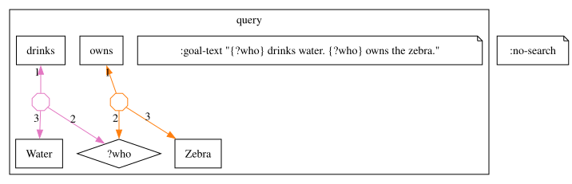
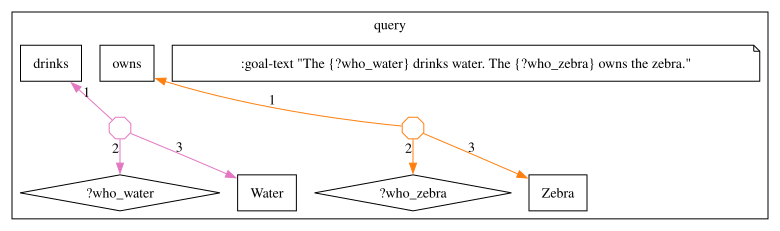
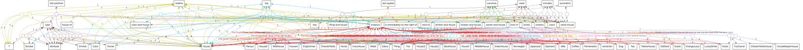
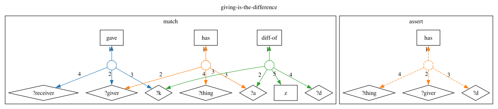

# P2.2 — the phase report, for the user's review

**What this is.** P2.2, the formalizer, ran all its stages, S2.2.0a to S2.2.5, each in a subagent that committed its
work, and **stops here for the user's review. It is not closed**: closing it is the user's word. This page is what
to review: what the phase built, where the minimal goal stands, commands to run with their real outputs, worked
examples, renderings, the numbers, the defaults taken, the questions left, and what the phase found.

**The user's words that ran it** (2026-11-26):

- *"start next phase plans/m2_nl_to_ir/p2.2_formalizer, execute s2.2.0a and pause"*: S2.2.0a ran alone;
- *"Ok, I like what I see, after s2.2.0a continue with other stages of the phase"*: S2.2.1 to S2.2.5, one by one;
- S2.2.4 was stopped on *"stop s2.2.4, I want to clarify some questions about grammar"*; the grammar was amended on
  the user's *"Yes, implement this"* ([S2.2.3's amendment](../s2.2.3_gbnf.md#amended-on-the-users-word)), and
  S2.2.4 ran again on *"continue the phase"*.

**How to see it again.** Everything under [`out/`](out/) is written by [`make_report.sh`](make_report.sh) from the
binaries; re-run it on any checkout:

```sh
export CARGO_HOME=…                                                    # where the host's rules say
./build.sh --engine --einaf                                            # ein.rs/target/release/ein, einaf/target/release/einaf
plans/m2_nl_to_ir/p2.2_formalizer/report/make_report.sh                # no model; 8 min here (8 min 34 s with --model), E-126 most of it
plans/m2_nl_to_ir/p2.2_formalizer/report/make_report.sh --quick        # the five slow runs left out; 35 s here

# the live run, with the model's runtime (this binary replaces the one ./build.sh --einaf writes, at the same path)
CMAKE_CUDA_ARCHITECTURES=89 cargo build --release --features cuda --manifest-path einaf/Cargo.toml
plans/m2_nl_to_ir/p2.2_formalizer/report/make_report.sh --live-only \
    --model /var/lib/ollama/blobs/sha256-a9d0a3e1d8c91732a3812becd31f8d4a8ff57414903f226306069f0437e2ac50
```

`out/INDEX.tsv` lists every command with its exit code, its seconds and the command as run
([§ 12](#12-every-command-make_reportsh-runs) has it as a table); `out/NAME.out` is a command's stdout and
`out/NAME.err` its stderr. **What is not committed** (`out/.gitignore`, written by the script): every DOT (its SVG
is kept), each command's `.cmd`, `.exit` and `.time` (the index holds them), the model records and run JSON a replay
writes again, and any output over 200 KB; the script writes each again.

**Written on** `fd10c690` (Ein and EinAf as of `d124b7b2`), with the release builds of that checkout, the GPU free,
on AC power ([`out/RUN.txt`](out/RUN.txt)). **The gate** is green on S2.2.5's last code commit, `d124b7b2`
(`./run_tests.sh`, exit 0: every static check, 1 427 of Ein's tests and 86 of EinAf's, none failed); since then only
plans and `AGENTS.md` changed (`git diff --stat d124b7b2 HEAD -- einaf ein.rs stdlib` is empty).

**Contents**: [1 What the phase built](#1-what-the-phase-built) ·
[2 Where the minimal goal stands](#2-where-the-minimal-goal-stands) ·
[3 Commands to try](#3-commands-to-try-with-their-real-outputs) · [4 Examples, worked](#4-examples-worked) ·
[5 Renderings](#5-renderings) · [6 The numbers](#6-the-numbers) · [7 Defaults](#7-the-defaults-taken-for-the-user-to-correct) ·
[8 Questions](#8-questions-for-the-user) · [9 What the phase found](#9-what-the-phase-found) ·
[10 What is left](#10-what-is-left) · [11 Housekeeping](#11-housekeeping-disclosures) ·
[12 Every command](#12-every-command-make_reportsh-runs)

---

## 1. What the phase built

| stage | what it ended with | commits | record · report · page |
|---|---|---|---|
| **S2.2.0a** three Zebras | `examples/zebra3.1.ein` to `zebra3.4.ein`, the puzzle's sentences in the text's own words four ways, each monotone and `Solution`, held to the published grid; six encodings measured side by side on every axis a formalizer meets; **the target shape `zebra3.1`**, by default; a program written in the order the steps make it answers as in the usual order | Ein `4bdbccaf`, `343edaf6`; plans `dd8b11b4`, `94964378`, `f6b69e34` | [record](../s2.2.0a_zebra_formulations.md#record) · [the analysis](../zebra_formulations/README.md) |
| **S2.2.1** the contract | the formalization contract: the task (five parts in three steps), the categories computed by `einaf::contract`, what the model receives, what a run records; **the steps by hand** on six texts, the Zebra puzzle to `zebra3.1.ein` among them, each step's program a file a test judges | `55e5f0b3`; record `a7939586`, `c290635b` | [record](../s2.2.1_contract.md#record) · [`einaf/contract/`](../../../../einaf/contract/) · [04-contract](../../../../docs/einaf/04-contract.md) |
| **S2.2.2** the model's runtime | `einaf::model`: `llama-cpp-2` 0.1.161 behind the feature `cuda`, the model pinned by SHA-256, the envelope, the chat template rendered by EinAf, replay with no model; held to `llama-server` (prompt tokens alike on 14 requests, text on 11); **the user's first experiment** and **the probe** of Ein with no grammar (87 runs) | plan `1be58a36`; `35fcc5af`; record `7f579af4` | [record](../s2.2.2_model_runtime.md#record) · [the probe](../model_runtime/README.md) · [05-model](../../../../docs/einaf/05-model.md) |
| **S2.2.3** the grammars | `einaf::grammar`: Ein's whole grammar as GBNF generated from `ein.l` and `ein.y`, two roots, held to the parser in both directions (937 files, 352 table rows, 2 000 sampled texts, llama.cpp's sampler alike); a grammar a step (1, 2, 2b, 3); where a grammar begins (inside the fence; at `</think>`); **amended on the user's word**: what a model writes under leaves out `<`, `>`, `\|` and the backtick | `680a94ad`, `eff7d634`, `e657682d`, `23d582aa`; plans `3ac3ecf9`, `b4f63367`, `61a566a7`; records `a0324459`, `de2202a5` | [record](../s2.2.3_gbnf.md#record) · [report](../grammars/README.md), [narrowed](../grammars/narrowed/README.md) · [06-grammars](../../../../docs/einaf/06-grammars.md) |
| **S2.2.4** the steps | the catalogue (19 entries, each a program the kernel runs), the prompts (excerpt v2, a template a step, three examples), the contract's check (seven findings), the formalization in three steps or one call; **64 runs** with the model | `7aaefe6f`, `49dcdd68`, `6953c6f5`, `9e65df4c`; plans `cde1100b`, `7ae5bb97`; record `c7f81431` | [record](../s2.2.4_passes.md#record) · [report](../steps/README.md), [tables](../steps/tables.md) · [07-steps](../../../../docs/einaf/07-steps.md) |
| **S2.2.5** from a text to a short answer | `einaf from-text`, the one shot: the steps, the least questions the answer needs, the answer chosen by the answer query's classes, seven fixed texts, the formatters (`einaf::format`); every call recorded slim; **29 runs** with the model, every one replayed to its program byte for byte | `8c2037b0`, `d124b7b2`; plan `261d4768`; record `fd10c690` | [record](../s2.2.5_from_text.md#record) · [report](../from_text/README.md), [tables](../from_text/tables.md) · [08-from-text](../../../../docs/einaf/08-from-text.md) |

**Ein** changed only in S2.2.0a: four example programs with their corpus entries, an acceptance test for each, and
two test lists (`4bdbccaf`, `343edaf6`); no engine code and no library rule. Everything else is EinAf's
([`docs/einaf/`](../../../../docs/einaf/README.md), pages 04 to 08 new) or the plans'.

**What a user of `einaf` has now** (P2.1 left `outcome` and `feedback`):

| command | what it does | page |
|---|---|---|
| `einaf from-text TEXT (--model M \| --replay R)` | a text to an Ein program in three steps and **the short answer it prints**; `--record`, `--explain`, `--no-format`, `--module-dir`, `--gold-answer` | [08](../../../../docs/einaf/08-from-text.md) |
| `einaf steps run TEXT --out DIR (--model M \| --replay R)` | the steps alone, each judged at root; `--mode whole`, `--no-grammar` | [07 § 6](../../../../docs/einaf/07-steps.md#6-the-commands) |
| `einaf steps check PROGRAM [--text T] [--step N]` | the contract's check: the seven findings the kernel does not refuse | [07 § 4](../../../../docs/einaf/07-steps.md#4-the-contracts-check) |
| `einaf catalogue [--minimal\|--generated\|--grammar]` | the library as the steps select from it | [07 § 1](../../../../docs/einaf/07-steps.md#1-the-catalogue) |
| `einaf grammar write\|accept\|sample\|render\|catalogue\|llama` | the grammars: the whole one, a step's, llama.cpp's reading of them | [06 § 6](../../../../docs/einaf/06-grammars.md#6-the-commands) |
| `einaf model`, `generate`, `render`, `probe plan\|run` | the runtime: the model loaded and pinned, a call a request, a prompt rendered, the probe | [05 § 10](../../../../docs/einaf/05-model.md#10-the-commands) |

**The two grammar roots** of [`einaf/grammars/ein.gbnf`](../../../../einaf/grammars/ein.gbnf) (910 rules, both
written by `einaf grammar write` from `ein.l` and `ein.y`): **`program`**, Ein's language exactly, held to the
parser on the corpus; **`root`**, what a model writes under, narrower than Ein (the contract's forms; names of
`[A-Za-z0-9_.*+=-]`; no block comment; no `<`, `>`, `|` or backtick in a string or a comment, so no marker of the
chat template and no fence can be written), 383 rules and 38 289 bytes in a request. Every step's grammar is
narrowed the same way.

## 2. Where the minimal goal stands

**The minimal goal is not met.** [Q-M2.17](../../open_questions/milestone/Q-M2.17-what-is-the-milestones-minimal-goal.md):
the model, which does not solve the Zebra puzzle reasoning in text, solves it with Ein. The phase's one shot, the
pinned model with the library alone, prints ***The statements contradict each other.*** for the Zebra puzzle, not
the two names. The goal is not one shot (any arm that uses Ein counts, the loop included), so it stays open for
[P2.4](../../p2.4_loop/README.md).

- **Where the run stops: step 2, root dead**, of two faults, each enough alone (this report's re-run,
  [§ 4.1](#41-the-zebra-puzzle-from-its-text-to-the-kernels-answer)):
  **(a)** step 2's ontology puts four kinds that have no member (`Smoker`, `Drinker`, `Owner`, `Color`) under
  `std.slots`' partition of the houses, so `slot-no-fill` refutes every place, which has no member of such a kind
  to hold; **(b)** step 1 made each coloured house, and the middle one, a house of its own (eleven houses: `House1`
  to `House5`, `RedHouse`, `GreenHouse`, `IvoryHouse`, `YellowHouse`, `BlueHouse`, `MiddleHouse`), and read *The
  Norwegian lives next to the blue house.* as `(lives-in Norwegian BlueHouse)` beside `(lives-in Norwegian
  House1)`: the Norwegian lives in two places, `slot-no-room`. Less both, root is alive, owes 28 instances and has
  no state, since its `(solve :no-search)` takes the obligations' candidates away. The stage records read the death
  as *ten houses for five places*: the program has eleven, and the empty kinds kill it with five houses as well
  (L-M2.23, [§ 9](#9-what-the-phase-found)).
- **The kernel's explanation names *Coffee is drunk in the green house.*** The core is `(instance GreenHouse House)`
  with that sentence and `(type Color Attribute)`, refuted by `std.slots.slot-no-fill` (E-125): fault (a) at one
  place, `GreenHouse`, whose membership quotes the sentence; any of the eleven houses would do. With the lever
  Q-M2.34 asks about, the core is fault (b) and names *The Norwegian lives next to the blue house.*
- **Its answer query asks one person both questions**: `(and (drinks ?who Water) (owns ?who Zebra))`, one
  variable for two (L-M2.21), so even a right grid would have printed the undetermined text.

**The three Zebra texts**, one shot, the library alone (S2.2.5's runs, replayed here on this checkout:
[`out/from-text/`](out/from-text/)):

| text | step 1 | step 2 | step 3 | `--single` | printed | the gold | read |
|---|---|---|---|---|---|---|---|
| [`zebra.txt`](../../../../nl2smt/puzzles/zebra.txt) | 53 forms; root alive, H `blind` (7 840) | 69 forms; **root dead** | 15 forms | inconsistent | *The statements contradict each other.* | the Norwegian, the Japanese | wrong |
| [`zebra-minus-15.txt`](../../../../nl2smt/puzzles/zebra-minus-15.txt) (clue 15 dropped) | 53; alive, `blind` (6 931) | 74; **dead** | 17 | inconsistent | *The statements contradict each other.* | *do not determine* | wrong |
| [`zebra-contradiction.txt`](../../../../nl2smt/puzzles/zebra-contradiction.txt) (*The Norwegian drinks milk.* added) | 56; alive, `blind` (8 428) | 78; **dead** | 9 | inconsistent | *The statements contradict each other.* | *contradict* | right, for a reason not the text's: dead on a contradiction of its own (`std.contradiction.clash-2`), no sentence about milk in it (L-M2.22) |

**The model's steps against the hand's and the target shape** ([the tables](../from_text/tables.md#the-zebra-puzzle-step-by-step-against-the-steps-by-hand);
the hand's steps are [`einaf/contract/zebra/`](../../../../einaf/contract/zebra/), whose step 3 is
[`examples/zebra3.1.ein`](../../../../examples/zebra3.1.ein) less its `(config …)`, the target shape S2.2.0a chose):

| step | the model wrote | of them the hand's | the hand wrote | where they part |
|---|---:|---:|---:|---|
| 1 the facts and a partial ontology | 53 forms | 4 | 55 | the passives folded into actives (*Coffee is drunk in the green house* is `(drinks Coffee GreenHouse)`), *next to* into *lives in* (`(lives-in Norwegian BlueHouse)` for *lives next to the blue house*); a coloured house a house of its own; the relations `are-smoked-in`, `are-smoked-next-to`, `is-drunk-in`, `lives-next-to` never declared; 2 of the hand's facts by sentence |
| 2 the ontology whole, the theory selected | 69 | 14 | 39 | the same selections, spelled right (`includes` of the four verbs into `same-house`, `symmetric`, `slot-partition`, `slot-spatial`), over an ontology of its own: kinds `Smoker`, `Drinker`, `Owner`, `Color` with no member, five relations of a kind and a house; **root dead** |
| 3 the read-back and the mechanism | 15 | 0 | 18 | `converse`, `meet` and `top` over the kinds with no member (`selection-inactive` 5), no `compose`; `(solve :no-search)` beside the obligations, which takes H away (`mechanism-not-the-one-stated`) |
| the program, against `zebra3.1.ein` | 104 | 18 | 113 | |

**The library's rules root fired** are the reference's (`std.slots`' and `std.algebra`'s), the place rules up to a
thousand times as often (`slot-locate` 5 742 against 6, `slot-negative` 6 424 against 108), and three the reference
never fires: `slot-no-room` and `slot-no-fill`, either of which kills root, and `std.core.inconsistent`
([the table](../from_text/tables.md#the-librarys-rules-root-fired-the-models-zebra-program-against-the-reference)).

**What else the phase measured on the goal's two sides** ([S2.2.2](../model_runtime/README.md)): shown
`zebra3.1.ein` as its one example (the user's first experiment), the model **copies it whole** and the program
prints *The Norwegian drinks water. The Japanese owns the zebra.* (a floor, in no table); **alone, thinking on**, the
model solves the puzzle in its thinking by about its 5 900th token and then repeats an 85-token cycle to its budget
of 65 000, writing no answer: greedy decoding's loop stopped it, not a limit.

## 3. Commands to try, with their real outputs

From the repository's root, after `./build.sh --engine --einaf`. Below, `ein` is `ein.rs/target/release/ein`,
`einaf` is `einaf/target/release/einaf`, and `$P` is `plans/m2_nl_to_ir/p2.2_formalizer`. Every output is the file
`make_report.sh` wrote on this checkout, linked beside it; where it is long, an excerpt. **No model first**: what the
model did is replayed from the committed records, call by call, through the same code.

### 3.1 The kernel through EinAf's one door (P2.1's, briefly)

<!-- output -->
```text
$ einaf outcome einaf/contract/zebra/step1.ein --no-search     # the hand's step 1, judged at root as the steps judge it
  not decided   over all of R           --no-search: root is alive, and R was not searched
$ einaf outcome einaf/contract/zebra/step3.ein --single        # the hand's step 3, zebra3.1.ein less its config
  one           over all of R           Solution: one state
$ einaf feedback $P/from_text/runs/module-dir/bystander/program.ein --single    # the feedback object, JSON (condensed)
  … "outcome": [{"part": "all", "outcome": "one", "why": "Solution: one state"}] …
  … "goal_text": "Carol has {?n} apples.", "classes": [{"rows": [{"n": "(n z 9)"}], "lines": ["Carol has (n z 9) apples."] …
```

[`out/kernel/`](out/kernel/): four outcomes and the feedback object whole
([`feedback-model-bystander-single.out`](out/kernel/feedback-model-bystander-single.out)).

### 3.2 The grammars

<!-- output -->
```text
$ einaf grammar write --check                    # einaf/grammars/ein.gbnf is what the command writes from ein.l and ein.y
einaf grammar: grammars/ein.gbnf and grammars/MANIFEST.sha256 as written
$ einaf grammar render 1 --text nl2smt/puzzles/zebra.txt --fence     # step 1's grammar for the Zebra text, 15 024 bytes
…
# a `:source`: one of the input's sentences, verbatim
source ::= "\"" ( "There are five houses." | "The Englishman lives in the red house." | … | "Who owns the zebra?" ) "\""
…
fenced ::= "```" [a-z]* "\n" root "\n" "\n"? "```"
$ einaf grammar accept --root root $P/from_text/runs/library/zebra/program.ein examples/zebra3.1.ein einaf/contract/zebra/step3.ein
plans/m2_nl_to_ir/p2.2_formalizer/from_text/runs/library/zebra/program.ein: accepted
examples/zebra3.1.ein: refused at 5:42, '`'
einaf/contract/zebra/step3.ein: refused at 10:5, '`'                 # exit 1
$ einaf grammar accept examples/zebra3.1.ein einaf/contract/zebra/step3.ein     # the root `program`, Ein exactly
examples/zebra3.1.ein: accepted
einaf/contract/zebra/step3.ein: accepted
```

The narrowed root refuses the hand-written programs at a backtick in a comment, which a model may not write (the
chat template's markers and the fence, L-M2.15); `program` takes them. The step grammars whole:
[step 1 for Zebra](out/grammars/render-1-zebra-fence.out), [step 2 on the hand's step 1](out/grammars/render-2-zebra-fence.out)
(the command renders on the library's catalogue, every module; a run of the steps renders on the 19 entries', which
`einaf catalogue --grammar` lists, [06 § 3](../../../../docs/einaf/06-grammars.md#3-a-grammar-a-step)), and
[the root a whole program is written under](out/grammars/render-whole-fence.out) (38 341 bytes with the fence).

### 3.3 The catalogue and the contract's check

`einaf catalogue` is the library as a prompt shows it, 19 entries, each a program the kernel ran with its answer
([`out/catalogue/catalogue.out`](out/catalogue/catalogue.out), 19 416 bytes;
[`--grammar`](out/catalogue/catalogue-grammar.out)). The check, on programs the kernel loads in silence:

<!-- output -->
```text
$ einaf steps check $P/from_text/runs/library/zebra/program.ein --text nl2smt/puzzles/zebra.txt
…/zebra/program.ein: H from no-search (0 candidates); the program states no-search and obligations
selection-inactive (2, from step 2): root's saturation names no firing of meet with these arguments and no owe of it
    (meet same-house color-and-house lives-in)
selection-inactive (2, from step 2): root's saturation names no firing of top with these arguments and no owe of it
    (top color-and-house instance Color House)
… three more `top`, the kinds Drinker, Owner, Smoker …
mechanism-not-the-one-stated (3, from step 3): the program states no-search and obligations, and the writer of H is no-search
6 findings
$ einaf steps check $P/from_text/runs/module-dir/bystander/program.ein --text $P/steps/texts/bystander.txt
undeclared (4, from step 1): a fact of instance, which the program does not declare and no imported module has
    (instance Alice Person :source "Bob gave 2 apples to Alice.")
… six more: instance and type, never declared …
7 findings
```

[§ 4.3](#43-what-the-contracts-check-catches-and-the-kernel-loads-in-silence) has the clearest case, `name-not-listed`.
The hand's step 3 carries two (`compose` read-backs that fire only above root:
[`out/check/hand-zebra-step3.out`](out/check/hand-zebra-step3.out)).

### 3.4 The steps, and the one shot, replayed

**The steps** (S2.2.4's gate fixture; any run's `calls.jsonl` replays the same way):

<!-- output -->
```text
$ einaf steps run $P/steps/texts/bob1.txt --id bob1 --answer-line word --replay einaf/tests/fixtures/steps/bob1/calls.jsonl --out DIR
bob1: steps mode, grammar on, whole
  step 1     4636 prompt tokens, 142 generated (end-of-turn), 5 forms; at root not decided; H from blind (0); 0 findings
  step 2     11589 prompt tokens, 122 generated (end-of-turn), 5 forms; at root not decided; H from blind (0); 0 findings
  step 3     12351 prompt tokens, 230 generated (end-of-turn), 3 forms; at root not decided; H from no-search (0); 0 findings; 2 markers
  complete, --no-search: not decided
    Bob has (n z 1) apples.
    Bob has (n z 3) apples.
    Bob has (n z 5) apples.
  complete, --single: one
    … the same three lines …
  findings: none
```

**The one shot**, from S2.2.5's slim records (stderr is the run, stdout the answer; the times of a step are the
recorded generation's, the kernel's are this run's):

<!-- output -->
```text
$ einaf from-text nl2smt/puzzles/zebra.txt --id zebra --answer-line zebra --gold-answer 'Norwegian water|Japanese zebra' \
    --replay $P/from_text/runs/library/zebra/generations.jsonl --record DIR          # 236 s, E-126
einaf: replaying 3 recorded calls
step 1     4787 prompt tokens, 1032 generated (end-of-turn, 16.3 s), 53 forms; at root not decided; H from blind (7840); 0 findings
step 2     12627 prompt tokens, 1160 generated (end-of-turn, 19.9 s), 69 forms; at root inconsistent; H from stuck (0); 0 findings
step 3     13869 prompt tokens, 308 generated (end-of-turn, 5.3 s), 15 forms
the program: H from no-search (0); 6 findings of the check
  --no-search: inconsistent (root is dead, so every node is), 77.9 s
  --single: inconsistent (Contradiction: R is empty and every node is dead), 77.9 s
the answer: inconsistent (from einaf)
einaf from-text: 236.0 s
against the gold answer "Norwegian water|Japanese zebra": wrong (the fixed text "The statements contradict each other." against values)
The statements contradict each other.
```

The two edits of the text replay in 11 s and 3 s:
[`zebra-minus-15`](out/from-text/zebra-minus-15/replay.err) (*contradict*, gold *undetermined*: wrong) and
[`zebra-contradiction`](out/from-text/zebra-contradiction/replay.err) (*contradict*, gold *contradict*: right, for a
reason not the text's). A word problem, with and without the formatters:

<!-- output -->
```text
$ einaf from-text $P/steps/texts/bystander.txt --id bystander --answer-line word --gold-answer 9 \
    --module-dir examples/word_problems --replay $P/from_text/runs/module-dir/bystander/generations.jsonl \
    --record DIR --explain DIR/explain.md
einaf: replaying 3 recorded calls
step 1     4643 prompt tokens, 168 generated (end-of-turn, 2.7 s), 6 forms; at root not decided; H from blind (0); 0 findings
step 2     14575 prompt tokens, 12288 generated (max-tokens, 222.0 s), 15 forms; cut by the budget: 15 forms kept, 0 repeats dropped; at root not decided; H from blind (0); 7 findings
step 3     15520 prompt tokens, 446 generated (end-of-turn, 7.9 s), 5 forms
the program: H from no-search (0); 7 findings of the check
  --no-search: not decided (--no-search: root is alive, and R was not searched), 0.0 s
  --single: one (Solution: one state), 0.0 s
the answer: lines (from program)
einaf from-text: 2.4 s
against the gold answer "9": right (every claim stated, no other number)
Carol has 9 apples.
$ … the same … --no-format
Carol has (n z 9) apples.
$ einaf from-text $P/steps/texts/gap.txt --id gap --answer-line word --gold-answer @undetermined \
    --replay $P/from_text/runs/library/gap/generations.jsonl
… the answer: no-row (from einaf) …
against the gold answer "@undetermined": right (the fixed text "The statements do not determine the answer.")
The statements do not determine the answer.
```

[`out/from-text/`](out/from-text/): the three Zebra texts, `bob1`, `bystander` and `gap`, each with its record's
`steps/` and `answer.json`; every replayed program is the committed one, byte for byte (`same-program.txt`).

### 3.5 Ein on the model's programs

The model's Zebra program costs the kernel 72 s a question, past any clock (E-126); with the lever that keeps one
justification a fact, 0.07 s and the same answer:

<!-- output -->
```text
$ ein solve $P/from_text/runs/library/zebra/program.ein --single           # 72.0 s, exit 0
  asked             is R one state? (--single)
  verdict           Contradiction — R is empty: every node is dead
  …
  query             (and (drinks ?who Water) (owns ?who Zebra))
  over              all of R — R is empty, root is dead: no state to answer from
$ ein solve $P/from_text/runs/library/zebra/program.ein --single -T 5      # 72.1 s, exit 0: the clock does not stop it
  … the same …
$ ein solve $P/report/out/ein/model-zebra-lever.ein --single     # the program and (config :record-alternative-justifications false): 0.07 s
  … the same verdict …
```

**H, as Ein facts** (`ein show hyps`, stderr's note; [`out/ein/`](out/ein/)), the model's steps against the hand's:

| program | the model's | the hand's |
|---|---|---|
| step 1 | `blind`: 7 840 candidates (`(drinks BlueHouse Chesterfields)`, …) | `blind`: 9 896 candidates (E-114) |
| step 2 | `stuck`: no candidate (root dead) | `obligations`: 112 candidates (`(same-house Chesterfields Fifth)`, …) |
| the program | `no-search`: no candidate, the program states `:no-search` | `obligations`: 112 (step 3, as `zebra3.1.ein`) |

**The answers the programs print**, `--single`: the hand's step 3 and `zebra3.1.ein`, *“The Norwegian drinks water. The
Japanese owns the zebra.”* ([`out/ein/hand-zebra-step3-single.out`](out/ein/hand-zebra-step3-single.out),
[`zebra3.1-single.out`](out/ein/zebra3.1-single.out)); the hand's step 2, one state and *the goal has no row* (the
theory has to make the query answerable, and step 3's read-back does); the model's `bob1` and `bystander`, their rows
([`model-bob1-single.out`](out/ein/model-bob1-single.out), [`model-bystander-single.out`](out/ein/model-bystander-single.out)).

### 3.6 With the model

`--model GGUF` adds one live run of `bob1`, as S2.2.5's `run.sh` made it (thinking off, greedy, seed 1, a context
of 65 536, 12 288 tokens a call, the whole catalogue, each step under its grammar), the model's file given by
`--model`, the GPU free before and after ([`out/live-nvidia-smi.txt`](out/live-nvidia-smi.txt),
[`-after.txt`](out/live-nvidia-smi-after.txt)):

<!-- output -->
```text
$ einaf from-text $P/steps/texts/bob1.txt --id bob1 --answer-line word --record DIR --gold-answer 3 \
    --model /var/lib/ollama/blobs/sha256-a9d0a3e1d8c91732a3812becd31f8d4a8ff57414903f226306069f0437e2ac50
ggml_cuda_init: found 1 CUDA devices (Total VRAM: 7857 MiB):
  Device 0: NVIDIA GeForce RTX 4060 Laptop GPU, compute capability 8.9, VMM: yes, VRAM: 7857 MiB
einaf: qwen35 4.2B (sha256:a9d0a3e1d8c91732a3812becd31f8d4a8ff57414903f226306069f0437e2ac50), 32 layers on CUDA0 (NVIDIA GeForce RTX 4060 Laptop GPU), a context of 65536 tokens
step 1     4636 prompt tokens, 142 generated (end-of-turn, 2.3 s), 5 forms; at root not decided; H from blind (0); 0 findings
step 2     11589 prompt tokens, 122 generated (end-of-turn, 2.2 s), 5 forms; at root not decided; H from blind (0); 0 findings
step 3     12351 prompt tokens, 230 generated (end-of-turn, 3.9 s), 3 forms
the program: H from no-search (0); 0 findings of the check
  --no-search: not decided (--no-search: root is alive, and R was not searched), 0.0 s
  --single: one (Solution: one state), 0.0 s
the answer: lines (from program)
einaf from-text: 22.2 s
against the gold answer "3": wrong (a line states 1, which the gold does not)
Bob has 1 apples.
Bob has 3 apples.
Bob has 5 apples.
$ cat $P/report/out/live/bob1-against-the-record.txt
program.ein: the committed one (plans/m2_nl_to_ir/p2.2_formalizer/from_text/runs/library/bob1/program.ein), byte for byte
calls: 3 live, 3 recorded; the request alike on 3, the generated tokens alike on 3
```

**The model reproduces itself**: the live run's three requests and three generations are the committed record's, and
so is the program. `einaf model --model …` prints the pin and the envelope's runtime
([`out/live/model.out`](out/live/model.out)). **The Zebra puzzle live** is S2.2.5's committed stderr
([`from_text/runs/library/zebra/stderr.txt`](../from_text/runs/library/zebra/stderr.txt)): the same three steps as
the replay above, 16.3 s, 19.9 s and 5.3 s of generation, the two questions 78.2 s and 78.3 s, 291.8 s in all. To
make it again (5 min): the `einaf from-text … --model` line above with `nl2smt/puzzles/zebra.txt --id zebra
--answer-line zebra --gold-answer 'Norwegian water|Japanese zebra'` and `--record` a directory of your own.

## 4. Examples, worked

### 4.1 The Zebra puzzle, from its text to the kernel's answer

**The text** ([`nl2smt/puzzles/zebra.txt`](../../../../nl2smt/puzzles/zebra.txt)), fifteen statements and two
questions, a sentence a line: *There are five houses. The Englishman lives in the red house. … Coffee is drunk in the
green house. … The Norwegian lives next to the blue house. Who drinks water? Who owns the zebra?*

**What the model wrote**, step by step, thinking off, greedy, each step under its grammar inside the fence (the
outputs are S2.2.4's records, which S2.2.5's run made again call for call: [step 1](../steps/runs/steps/zebra/step1.out.ein),
[step 2](../steps/runs/steps/zebra/step2.out.ein), [step 3](../steps/runs/steps/zebra/step3.out.ein); each step's
program, the steps so far, is the replay's [`out/from-text/zebra/record/steps/`](out/from-text/zebra/record/steps/)).

**Step 1**, 53 forms: nineteen statements, each with its sentence as `:source` (the grammar admits only the text's
sentences there), the answer query, seven declarations and 26 memberships. Excerpt:

```lisp
(instance House1 House :source "There are five houses.")         ; … House5
(lives-in Englishman RedHouse :source "The Englishman lives in the red house.")
(drinks Coffee GreenHouse :source "Coffee is drunk in the green house.")             ; a passive made active
(lives-in Norwegian BlueHouse :source "The Norwegian lives next to the blue house.")  ; *next to* made *in*

;; Who drinks water? Who owns the zebra?
(query
  :goal (and (drinks ?who Water) (owns ?who Zebra))                 ; one variable for both questions (L-M2.21)
  :goal-text "{?who} drinks water. {?who} owns the zebra.")

(relation drinks Person Thing :why "a {?3} drinks a {?4}")
(instance GreenHouse House :source "Coffee is drunk in the green house.")            ; a coloured house, a house
```

The hand wrote the same sentences as `(is-drunk-in Coffee Green …)`, `(lives-next-to Norwegian Blue …)`, the
houses named by their places (`First` … `Fifth`), a colour a value of the kind `Color`, and the query with two
variables, `(and (drinks ?who_water Water) (owns ?who_zebra Zebra))`
([`einaf/contract/zebra/step1.ein`](../../../../einaf/contract/zebra/step1.ein)).

**Step 2**, 69 forms: the ontology whole (kinds `Attribute`, `House`, `Person`, `Thing`, `Smoker`, `Drinker`,
`Owner`, `Color`; five relations of a kind and a house; the row `House1` … `House5`), and the theory, selected and
spelled right:

```lisp
(import std.algebra :symbols (symmetric includes converse top meet))
(import std.slots)
(includes lives-in same-house)  (includes owns same-house)  (includes drinks same-house)  (includes smokes same-house)
(includes is-immediately-to-the-right-of next-to)
(symmetric same-house)  (symmetric next-to)
(slot-partition same-house instance type Attribute House)
(slot-spatial   same-house is-immediately-to-the-right-of instance House)
```

`slot-partition` makes every `House` a place: `House1` to `House5`, and `RedHouse`, `GreenHouse`, `IvoryHouse`,
`YellowHouse`, `BlueHouse` (and `MiddleHouse`) beside them. **Root is dead at step 2.**

**Step 3**, 15 forms: four `converse`, five `top`, five `meet` (the read-back over `Smoker`, `Drinker`, `Owner`,
`Color`, which have no member), and `(solve :no-search)` beside the obligations step 2 selected.

**The assembled program** ([`from_text/runs/library/zebra/program.ein`](../from_text/runs/library/zebra/program.ein),
104 forms, in synthesis order) and **the kernel's answer** (the describe, 72 s, E-126):

<!-- output -->
```text
$ ein solve $P/from_text/runs/library/zebra/program.ein          # 72.0 s, exit 0
  asked             all of R — describe
  states (k_s)      0
  empty             every node is dead — root's own fixpoint holds a contradiction
  universe          no candidate: the program states :no-search, so R is {∅} or empty, decided by root alone
  …
  unsat core        (instance GreenHouse House)
  unsat core        (type Color Attribute)
  core search       cut at its budget of 64 environments per fact: a smaller core may exist
  source            (instance GreenHouse House) :source "Coffee is drunk in the green house."
  refuted by        std.slots.slot-no-fill

  (false)

  query             (and (drinks ?who Water) (owns ?who Zebra))
  over              all of R — R is empty, root is dead: no state to answer from
```

**What kills root, found by this report's re-run** (the program with the lever, which moves a dead node's core and
never whether it is dead; each an `ein solve` describe of under 0.1 s, [`out/ein/`](out/ein/)):

| the model's program | root | the core | refuted by |
|---|---|---|---|
| [as written, with the lever](out/ein/model-zebra-lever-describe.out) | dead | the eleven houses, `(instance Norwegian Person)`, `(lives-in Norwegian House1)`, `(lives-in Norwegian BlueHouse)` *The Norwegian lives next to the blue house.*, `(type House Attribute)`, `(type Person Attribute)` | `std.slots.slot-no-room`: the Norwegian has every place excluded |
| [less the six houses made of a description](out/ein/model-zebra-less-houses.out) (`GreenHouse` … `MiddleHouse` not houses) | dead | `(instance House1 House)` *There are five houses.*, `(type Smoker Attribute)` | `std.slots.slot-no-fill`: a place with no `Smoker` to hold |
| [less the four kinds with no member](out/ein/model-zebra-less-kinds.out) (`Smoker`, `Drinker`, `Owner`, `Color`) | dead | the first row's | `std.slots.slot-no-room` |
| [less both](out/ein/model-zebra-less-both.out) | **alive**; R empty: root owes 28 instances and `(solve :no-search)` proposes nothing | — | — |

So the repair the loop has to find is two: step 2's empty kinds, and step 1's coloured houses with *next to* read as
*in*; and a third before the answer prints, the query's one variable. This corrects the stage records' *ten houses
for five places* (it is eleven, and the empty kinds kill it with five as well) and E-125's reading of its Zebra row
(the sentence the core names is one house's of eleven; with the lever the core names the other misreading).

**Its renderings**: [§ 5](#5-renderings), the model's query beside the hand's.

### 4.2 A word problem, end to end

**`bystander`**, with the word theory's modules given (`--module-dir examples/word_problems`, the widest condition,
labelled so): *Bob has 5 apples. Carol has 9 apples. Bob gave 2 apples to Alice. How many apples does Carol have?*
The model's [program](../from_text/runs/module-dir/bystander/program.ein) states the three sentences, asks
`(has Carol ?n Apple)` with `:goal-text "Carol has {?n} apples."`, imports the calculator's subtraction, and writes
four rules (a giver's and a receiver's, each a request and its read-back); its step 2 ran to the budget and its 15
forms were kept. No module given was imported.

<!-- output -->
```text
$ einaf from-text $P/steps/texts/bystander.txt --id bystander --answer-line word --gold-answer 9 \
    --module-dir examples/word_problems --replay $P/from_text/runs/module-dir/bystander/generations.jsonl
Carol has 9 apples.                                     ← EinAf's line, the numeral formatted
$ … the same … --no-format
Carol has (n z 9) apples.                               ← the kernel's line, byte for byte
```

**The formatted line against the kernel's**: the kernel fills the `:goal-text` with the row's value as the program
spells it, `(n z 9)`; EinAf reads that text back as a term, resolves its names from the program's imports
(`n` is `std.math.decimal.n`), formats the decimal numeral as its digits, and fills the template again by the
kernel's rule (E-127). Scored right by the stand-in reader (*every claim stated, no other number*). It is right
because Carol is the bystander: her 9 is a statement, and the rules change Bob's apples alone. The kernel's trace of
the answer, `--explain` ([`out/from-text/bystander/explain.md`](out/from-text/bystander/explain.md), 61 steps at
root):

<!-- output -->
```text
### Step 4 — `giving-asks-the-difference`

> Bob had (n z 5) and gave (n z 2): ask (n z 5) less (n z 2)

Premises: `gave(Bob, n(z, 2), Apple, Alice)`, `has(Bob, n(z, 5), Apple)` — from Bob gave 2 apples to Alice., Bob has 5 apples.

Derives `sub(n(z, 5), n(z, 2))`.
```

**`bob1`**, the library alone, *Bob has 5 apples. He gave 2 to Alice. How many apples does Bob have?*: the right
number among others, **a row a pass** (E-124). The model's giving rule reads what it concludes, `(has Bob (n z 5) Apple)` gives
`(has Bob (n z 3) Apple)`, which gives `(has Bob (n z 1) Apple)`; with no moment in the facts, one state holds all three:

<!-- output -->
```text
$ einaf from-text $P/steps/texts/bob1.txt --id bob1 --answer-line word --gold-answer 3 --replay $P/from_text/runs/library/bob1/generations.jsonl
Bob has 1 apples.
Bob has 3 apples.
Bob has 5 apples.
against the gold answer "3": wrong (a line states 1, which the gold does not)      (stderr)
$ … --no-format
Bob has (n z 1) apples.
Bob has (n z 3) apples.
Bob has (n z 5) apples.
```

A class with several rows prints each (Q-M2.33's default); the hand's `apples` writes the moments (`Start`, `After`)
and prints *Bob has 3 apples* ([`einaf/contract/apples/step3.ein`](../../../../einaf/contract/apples/step3.ein)).

### 4.3 What the contract's check catches, and the kernel loads in silence

**`gap`**, the library alone: *Bob has 5 apples. He gave 2 to Alice. How many apples do they have together?* The
model declares the calculator's answer relation as its own and does not list it in the import:

```lisp
(relation sum-of Number Number Number :why "a {?3} plus a {?4} is a {?5}")
(import std.math.decimal-arith :symbols (add product-of))           ; sum-of not listed
(query :goal (sum-of (n z 5) (n z 2) ?n) :goal-text "They have {?n} apples together.")
```

The calculator answers `(add 5 2)` under its full name, `std.math.decimal-arith.sum-of`; the program's `sum-of` is
another relation, which nothing derives. **The kernel loads it and answers, with no word of the slip:**

<!-- output -->
```text
$ ein solve $P/from_text/runs/library/gap/program.ein --single
  verdict           Solution — R is one state
  …
  query             (sum-of (n z 5) (n z 2) ?n)
  over              all of R — 1 state → 1 projection class
    class 1 of 1    1 state (1) — the goal has no row: undetermined here
$ einaf steps check $P/from_text/runs/library/gap/program.ein --text $P/steps/texts/gap.txt
…/gap/program.ein: H from no-search (0 candidates); the program states no-search
name-not-listed (2, from step 2): the program writes sum-of, which std.math.decimal-arith declares and its import
does not list: the module's facts are std.math.decimal-arith.sum-of, and the program's sum-of is its own
1 findings
```

`einaf from-text` prints *The statements do not determine the answer.*, which the reader scores **right** against
the gold (*not enough information*: the text never says how many Alice had), for a reason that is not the text's
(L-M2.22). The same slip makes `kinds` right and `gap_fact` and `kinds_full` wrong.

## 5. Renderings

`ein render program FILE`, the program as written in three parts (its knowledge base, a digraph per rule, its query),
each digraph drawn to SVG by Graphviz (`dot`) as the script runs; the DOT beside each is written again by the script
and not committed. Every picture is under [`out/render/`](out/render/).

**The model's Zebra query against the hand's**: the model's two goal facts share one variable `?who`; the hand's have
`?who_water` and `?who_zebra`.





**The model's Zebra knowledge base as written** (322 edges): the statements, the declarations, the memberships of
the kinds, among them the eleven members of `House` and the four kinds with no member, and the selecting facts:



**Every picture**, a column a part of the program (`kb` its facts and declarations as written, before any rule runs;
`query` the answer query; one picture a rule):

| program | knowledge base | query | rules |
|---|---|---|---|
| the model's Zebra program (104 forms) | [kb](out/render/model-zebra/kb.svg) (322 edges, 207 KB) | [query](out/render/model-zebra/query.svg) | none: it writes no rule |
| the hand's Zebra step 1 | [kb](out/render/hand-zebra-step1/kb.svg) (176 edges, 118 KB) | [query](out/render/hand-zebra-step1/query.svg) | none |
| the hand's Zebra step 2 | [kb](out/render/hand-zebra-step2/kb.svg) (304 edges, 199 KB) | the same as step 1's (and `zebra3.1.ein`'s) | none |
| [`zebra3.1.ein`](../../../../examples/zebra3.1.ein), the target shape (the hand's step 3 and its `config`) | [kb](out/render/zebra3.1/kb.svg) (376 edges, 236 KB) | [query](out/render/zebra3.1/query.svg) | none |
| the model's `bystander` (module-dir) | [kb](out/render/model-bystander/kb.svg) | [query](out/render/model-bystander/query.svg) | [giving-asks-the-difference](out/render/model-bystander/rule_giving_asks_the_difference_lhs_rhs.svg), [giving-is-the-difference](out/render/model-bystander/rule_giving_is_the_difference_lhs_rhs.svg), [receiving-asks-the-sum](out/render/model-bystander/rule_receiving_asks_the_sum_lhs_rhs.svg), [receiving-is-the-sum](out/render/model-bystander/rule_receiving_is_the_sum_lhs_rhs.svg) |
| the model's `bob1` (library) | [kb](out/render/model-bob1/kb.svg) | [query](out/render/model-bob1/query.svg) | [giving-asks-the-difference](out/render/model-bob1/rule_giving_asks_the_difference_lhs_rhs.svg), [giving-is-the-difference](out/render/model-bob1/rule_giving_is_the_difference_lhs_rhs.svg) |

**The rule that makes `bob1`'s rows**, a pass a row: it matches `has` and `diff-of` and concludes `has` again, so
its own conclusion is its next premise (E-124):



**Left out, and why**: the hand's step 3's knowledge base (the same drawing as `zebra3.1.ein`'s but for its
`:source` texts); the model's step programs' (the complete program's holds them; their text is
[`out/from-text/zebra/record/steps/`](out/from-text/zebra/record/steps/)); `ein render kb`, the saturated knowledge
base (the hand's Zebra root holds 882 facts, a word problem's over 2 000 of the calculator's, too many edges to
read); `ein render h-space` of `zebra3.1.ein` (its pair layer is past the default budget, E-111) and of the model's
programs (root dead, or H empty); `ein render lattice` (the model's Zebra root is dead: nothing past it).

## 6. The numbers

Summaries; each stage's report has the full tables, written from its records.

**S2.2.2, the probe: Ein written with no grammar** ([§ 5](../model_runtime/README.md#5-the-probe-ein-written-with-no-grammar)),
87 runs, read by the fenced block:

| condition | thinking | runs | parse | load | `--single` one / several / inconsistent / not decided |
|---|---|---:|---:|---:|---|
| a whole program over the library | off | 14 | 13 | 8 | 6 / 0 / 1 / 1 |
| | on | 14 | 0 | 0 | every run a loop the budget cut |
| a theory given | off | 13 | 13 | 11 | 10 / 0 / 1 / 0 |
| described (a paragraph, no example) | off | 15 | 1 | 0 | — |
| step 1 alone | off | 5 | 5 | 5 | 0 / 5 / 0 / 0 |

The excerpt and the examples are what make the model write Ein; with thinking on, greedy decoding writes no program
(36 of 36 loops, Q-M2.27); **what loaded is not right** (none of the library's loaded programs prints the right
answer). The runtime: 41 to 67 tokens a second generated, 5 186 MiB of the GPU at a context of 65 536; ten calls of a
request give one answer.

**S2.2.3, the grammars** ([report](../grammars/README.md), [narrowed](../grammars/narrowed/README.md)): the whole
grammar accepts the corpus's 937 files exactly when the parser does (856 and 81), refuses the 352 table rows, and 2 000
sampled texts parse; llama.cpp's sampler reads 781 251 tokens as EinAf does. **Narrowed** (the amendment): a request
for a whole program 50 131 → **38 289 bytes**, 531 → **383 rules**; 805 of the corpus's 856 accepted files and the
contract's 21 programs still accepted (comments emptied), 57 of the model's 60 loaded programs. **Speed** (tokens a
second, Zebra): none 64.1; under `every-token` 11.2 (whole) to 25.6 (step 2b); under `chosen-first`, the default,
58.7 to 63.4, the narrowed root 62.8; a sampler built in under 0.6 ms
([§ 5](../grammars/README.md#5-the-speeds)).

**S2.2.4, the steps** ([tables](../steps/tables.md)): 64 runs, the 16 texts × steps / one call × a grammar / none.

| | the steps | the one call |
|---|---|---|
| a complete program; it loads | 16; 14 | 15; 14 |
| `--single` | one 9, several 3, inconsistent 2, invalid 2 | one 11, inconsistent 3, invalid 1 |
| the Zebra puzzle | dead at step 2, the core naming the misread sentence | no program (a form repeated 718 times to the budget) |
| the word texts' answers, by hand | none right alone; 2 the right count among others | 1 right (`kinds_full`) |
| findings of the check in the complete programs | 34 (10 of 14 programs that load) | 111 |
| with no grammar | the same answers, 11 load, a selection misspelt 11 times, a `:source` no sentence 7 times | |

**S2.2.5, the one shot** ([tables](../from_text/tables.md)): 29 runs, 88 calls, 2 138 s of generation; every replay
the committed program byte for byte.

| condition | texts | load | read right | wrong | no answer |
|---|---:|---:|---:|---:|---:|
| library (the main arms') | 13 word texts | 11 | **3**, each the undetermined text from a missing row | 8 | 2 |
| module-dir (the widest ablation, labelled so) | 13 | 8 | **3**, `bystander`'s *Carol has 9 apples.* the one right number | 5 | 5 |
| library | 3 Zebra texts | 3 | 1 (`zebra-contradiction`, for a reason not the text's, L-M2.22) | 2 | 0 |

*Word problems, one shot* and no result: prompts were developed on these problems. Every numeral printed (20 values) is
formatted. With no formatter, EinAf's line is the kernel's byte for byte on 5 187 lines of 183 corpus programs (E-127).

## 7. The defaults taken, for the user to correct

Each stage numbered its defaults in its record, with the reason for each: **147 in all** — S2.2.0a
[20](../s2.2.0a_zebra_formulations.md#defaults-taken), S2.2.1 [15](../s2.2.1_contract.md#defaults-taken), S2.2.2
[26](../s2.2.2_model_runtime.md#defaults-taken), S2.2.3 [31](../s2.2.3_gbnf.md#defaults-taken) (23 to 31 the
amendment's), S2.2.4 [28](../s2.2.4_passes.md#defaults-taken), S2.2.5 [27](../s2.2.5_from_text.md#defaults-taken);
and the re-plan's 40, [the phase README's](../README.md#defaults-taken-at-the-re-plan). **The ones that matter
most:**

1. **The target shape is `zebra3.1.ein`** (S2.2.0a 16; the README's 1): the sentences' verbs in their voice, no rule
   of its own, the theory selected from the library (32 selecting facts), H by the obligations. The cost stated
   beside it: twice `zebra.ein`'s facts (E-111), 32 spellings a model can get wrong in silence (E-107, E-110), a
   description folded into a word. `zebra3.2` is nearer the text (six rules), `zebra2` cheapest to run. Which axis
   weighs most is the user's.
2. **The narrowed model grammar** (S2.2.3 23 to 31, on the user's *"Yes, implement this"*): `root` and every step's
   grammar leave out `<`, `>`, `|` and the backtick but in a sentence of the input, and `/` in a name; the
   separators are free ([Q-M2.30](../open_questions/model/Q-M2.30-does-a-grammar-the-model-writes-under-fix-its-layout.md):
   no fixed layout). A token is held to its grammar by the chain's choice first
   ([Q-M2.28](../open_questions/model/Q-M2.28-is-a-token-held-to-its-grammar-by-the-chain-s-choice-first.md)).
3. **B2's mode is the steps** (S2.2.4; [Q-M2.32](../open_questions/formalizer/Q-M2.32-which-mode-does-baseline-b2-run-with.md)):
   the one call is no worse on the word problems and worse on the Zebra puzzle (no program against a program whose
   core names what to repair).
4. **Q9: B with C in the main arms, A the escape hatch** (S2.2.4): the vocabulary the text's own, the theory selected
   from the catalogue, a family's own modules given only under `--module-dir`; S2.2.5's module-dir runs imported no
   module given.
5. **The bounds** (S2.2.5 3): the kernel's defaults (a facts budget of 2²⁰, a cube limit of 16, 2²⁰ firings a
   saturation) and a clock of 60 s a call; a budget of 12 288 generated tokens a call, a context of 65 536; greedy,
   seed 1, thinking off. An output the budget cut keeps the forms written before the cut (S2.2.5 4, L-M2.17).
6. **The fixed texts' wording** (S2.2.5 5): *The statements do not determine the answer.* and *The statements
   contradict each other.* (answers); *No answer: the program is incomplete.*, *No answer: not decided.*, *No answer is
   claimed: the program is not monotone.*, *No answer: the program was refused.*, *No answer: the program states no
   answer query.* A class with several rows prints each
   ([Q-M2.33](../open_questions/answer/Q-M2.33-is-a-class-with-several-rows-an-answer-of-several-values-or-the-undetermined-text.md)).
7. **Stand-ins for P2.5's record layout and reader** (S2.2.5 14 to 18): the record is `config.json`,
   `generations.jsonl`, `program.ein` with `program.sidecar.json`, `steps/`, `kernel.jsonl`, `answer.json`,
   `run.json` (schemas `einaf-from-text-config/1`, `einaf-call/1`, `einaf-sidecar/1`, `einaf-answer/1`), written
   where `--record` says; `einaf::answer::score` reads a gold short answer as a fixed text's name or claims of words,
   no other number allowed. [S2.5.1](../../p2.5_harness/s2.5.1_experiment_record.md) and
   [S2.5.3](../../p2.5_harness/s2.5.3_metrics.md) own both.
8. **The slim records, by the user's ruling on what a run commits** (S2.2.5 15, 16;
   [M2 § Where EinAf's things are](../../README.md#where-einafs-things-are)): a call is its request's digest and its
   generation, no request body, the tokens their digest; a run commits its calls, its program and sidecar, and the
   live stderr; the rest `replay.sh` writes again. S2.2.4's records stay whole, as committed.

## 8. Questions for the user

Every open question of the phase, and the milestone's that P2.2 answered by default. Each default stands until the
user rules; none is a ruling.

| Q | the question | the default taken |
|---|---|---|
| [Q-M2.6](../../open_questions/formalizer/Q-M2.6-one-gbnf-or-many.md) | One GBNF grammar, or many? | **many**: a grammar a step, the whole grammar kept for a program in one call (S2.2.3: three kinds of the probe's errors a step's grammar removes and the whole one does not; no cost a call can measure) |
| [Q9](../../open_questions/formalizer/Q9-ontology-provenance.md) | A per-puzzle ontology given, or inferred from the text? | **B with C, A the escape hatch** (S2.2.4; S2.2.5: the modules given were not taken up) |
| [Q-M2.22](../open_questions/answer/Q-M2.22-is-a-membership-no-sentence-states-a-faithfulness-event.md) | Is a membership no sentence states a faithfulness event, or the ontology searched for? | an event, the contract's table as it stands (so every attribute puzzle carries events: Zebra by hand 11) |
| [Q-M2.23](../open_questions/kernel/Q-M2.23-does-the-library-grow-a-reading-of-a-literal-vocabulary.md) | Does the library grow a reading of a literal vocabulary? | no module; the catalogue's recipes |
| [Q-M2.24](../open_questions/kernel/Q-M2.24-does-ein-hold-that-an-answer-does-not-depend-on-the-order.md) | Does Ein hold that an answer does not depend on the order of a program's forms? | a test beside `import_invariance.rs` and a decision, written when the user says |
| [Q-M2.25](../open_questions/answer/Q-M2.25-is-a-clause-of-a-sentence-a-source-or-only-the-whole.md) | Is a clause of a sentence a `:source`? | only the whole sentence (step 1's grammar holds it so) |
| [Q-M2.26](../open_questions/answer/Q-M2.26-does-zebra3-1-quote-in-each-membership-the-sentence-that-names.md) | Does `zebra3.1.ein` quote, in each membership of a thing a sentence names, the sentence? | no; the contract's reading is `einaf/contract/zebra/step3.ein` |
| [Q-M2.27](../open_questions/model/Q-M2.27-do-the-phase-s-thinking-runs-stay-greedy-when-greedy-thinking-loops.md) | Do the runs with thinking on stay greedy, when greedy thinking loops? | greedy, every loop recorded ([P2.2b](../../p2.2b_guided_thinking/README.md) takes it up) |
| [Q-M2.28](../open_questions/model/Q-M2.28-is-a-token-held-to-its-grammar-by-the-chain-s-choice-first.md) | Is a token held to its grammar by the chain's choice first? | yes, for every grammar EinAf writes |
| [Q-M2.29](../open_questions/formalizer/Q-M2.29-are-step-2-s-facts-held-to-the-relations-step-2-declares.md) | Are step 2's facts held to the relations step 2 declares? | no grammar holds them; the contract's check does (3 of 16 texts) |
| [Q-M2.30](../open_questions/model/Q-M2.30-does-a-grammar-the-model-writes-under-fix-its-layout.md) | Does a grammar the model writes under fix its layout? | no fixed layout (measured: 31 199 bytes against 34 631) |
| [Q-M2.31](../open_questions/model/Q-M2.31-does-a-step-s-grammar-bound-the-comment-lines-the-model-writes.md) | Does a step's grammar bound the comment lines the model writes? | no bound (L-M2.16: the model thinks in comment lines, and loops there) |
| [Q-M2.32](../open_questions/formalizer/Q-M2.32-which-mode-does-baseline-b2-run-with.md) | Which mode does baseline B2 run with? | the steps |
| [Q-M2.33](../open_questions/answer/Q-M2.33-is-a-class-with-several-rows-an-answer-of-several-values-or-the-undetermined-text.md) | Is one class with several rows an answer of several values, or the undetermined text? | its lines (`bob1` prints 1, 3 and 5; E-124) |
| [Q-M2.34](../open_questions/kernel/Q-M2.34-does-einaf-s-kernel-call-set-the-lever-that-keeps-one-justification.md) | Does EinAf's kernel call set the lever that keeps one justification a fact? | no (E-126: the model's Zebra program costs 72 s a question without it, 63 ms with it; [§ 3.5](#35-ein-on-the-models-programs)) |

Beside them, by the user and not the phase's: **which axis of S2.2.0a's table weighs most** (the target shape), the
milestone's [Q-M2.10](../../open_questions/answer/Q-M2.10-what-does-ein-certifies-a-unique-model-mean-on-r.md)
(*unique* on R, which E-124's row-a-pass reads), and **closing the phase**.

## 9. What the phase found

**Of Ein**: 24 entries, E-104 to E-127, in [the phase's evaluation](../evaluation/README.md), every one open or a
strength (so every one moves to the milestone's at the close); the next free id is E-128. No wrong-answer row: the
kernel answered every program as Ein says.

| kind | entries |
|---|---|
| **bugs**, both **open, unfixed, no owner** | [**E-104**](../evaluation/language/E-104-a-relation-declared-at-a-second-count-is-refused-where-the.md) a relation declared at a second count is refused where the program imports a module, against Q-M1f.447 (the model's `unused` met it: `has` declared twice, refused); [**E-105**](../evaluation/stdlib/E-105-std-slots-lets-two-values-stated-next-to-each-other-share-a.md) `std.slots` lets two values stated next to each other share a house (the rules against their page). A fix of either leaves Ein's syntax and semantics as they are (Q-M2.16) |
| strengths | [E-112](../evaluation/language/E-112-a-program-s-forms-may-be-written-in-the-order-they-are-made.md) a program's forms may be written in the order they are made; [E-117](../evaluation/diagnostics/E-117-a-fence-around-a-program-is-the-parse-s-only-error-with-its-repair.md) a fence is the parse's only error, with its repair; [E-122](../evaluation/language/E-122-ein-s-syntax-is-context-free-but-for-two-refusals.md) Ein's syntax is context-free but for two refusals, and a second reader takes it exactly; [E-125](../evaluation/diagnostics/E-125-a-dead-root-s-core-names-the-sentence-the-model-misread.md) a dead root's core names the sentence the model misread (on its Zebra row by the accident of which house the core took, [§ 4.1](#41-the-zebra-puzzle-from-its-text-to-the-kernels-answer)); [E-127](../evaluation/natural-language/E-127-the-kernel-s-line-is-a-template-filled-by-a-rule-a-caller-writes-again.md) the kernel's line is a template a caller fills again byte for byte |
| weaknesses | [E-106](../evaluation/answer/E-106-the-static-check-reads-a-relation-not-a-shape.md) the static check reads a relation, not a shape; [E-107](../evaluation/diagnostics/E-107-a-theory-s-missing-activating-fact-is-reported-as-the.md) a missing activating fact is reported as a contradiction; [E-109](../evaluation/natural-language/E-109-a-sentence-written-as-a-rule-s-activating-fact-is-in-no.md) a sentence written as an activating fact is in no core; [E-111](../evaluation/bounds/E-111-the-answer-in-the-statements-own-words-costs-the-kernel.md) the text's own words cost twice the facts; [E-113](../evaluation/bounds/E-113-a-dead-state-s-core-costs-minutes-on-a-link-re-derived-many.md) a dead state's core costs minutes unless a lever is set; [E-114](../evaluation/hypotheses/E-114-a-partial-program-s-h-is-set-by-its-relations-count-of-places.md) a partial program's H is set by its relations' places (Zebra step 1: 9 896 candidates by hand, 7 840 the model's); [E-118](../evaluation/stdlib/E-118-a-numeral-written-with-two-digits-in-one-place-is-refuted-as-a-contradiction.md) `(n z 12)` makes root dead and reads as a contradiction; [E-119](../evaluation/natural-language/E-119-a-relation-s-why-that-names-an-arrow-its-declaration-lacks-loads.md) a `:why` naming a missing arrow loads; [E-120](../evaluation/language/E-120-a-string-glued-to-a-block-comment-is-refused-where-a-name-glued-to-one-is-not.md) a string glued to a block comment is refused |
| gaps | [E-110](../evaluation/stdlib/E-110-the-library-has-no-reading-of-a-literal-vocabulary.md) no reading of a literal vocabulary (Q-M2.23); [E-115](../evaluation/stdlib/E-115-a-stored-negation-of-a-verb-does-not-reach-the-link-it-is-read-into.md) a stored negation of a verb does not reach its link; [E-116](../evaluation/answer/E-116-a-query-with-no-row-does-not-say-which-of-its-premises-matched.md) a query with no row does not say which premise matched nothing; [E-121](../evaluation/language/E-121-the-banked-table-of-refused-shapes-misses-two-of-the-lexer-s-token-ends.md) the banked table misses two token ends; [E-123](../evaluation/diagnostics/E-123-no-value-says-whether-a-selecting-fact-was-taken-up.md) no value says whether a selecting fact was taken up |
| limits | [E-108](../evaluation/answer/E-108-a-clue-with-its-arguments-swapped-is-answered-one-with.md) a clue with its arguments swapped is answered *one*, the same answer; [E-124](../evaluation/answer/E-124-one-state-may-answer-a-question-of-one-value-with-a-row-a-pass.md) one state may answer a question of one value with a row a pass (`bob1`); [E-126](../evaluation/bounds/E-126-a-root-that-dies-on-a-link-several-rules-derive-takes-its-time-past-every-clock.md) a root that dies on a link several rules derive takes its time past every clock (the model's Zebra program, [§ 3.5](#35-ein-on-the-models-programs)) |

**The milestone's entries the phase confirmed or read again**, a line each in
[the milestone's evaluation](../../evaluation/README.md): E-2, E-11, E-12 (an undeclared relation or another count
loads in silence: met from S2.2.2 on), E-13, E-18, E-22, E-23, E-27, E-39, E-42, E-45 (refuted as worded: S2.1.2
closed it, and the closing holds on the one shot), E-56, E-60, E-61, E-73, E-80.

**Found by this report's re-runs: L-M2.23, the Zebra program dies of two faults, not of *ten houses for five
places*.** The records of S2.2.4 and S2.2.5, the phase README's stage row, E-125's Zebra row and EinAf's own page
([`03-feedback.md` § 4](../../../../docs/einaf/03-feedback.md#4-what-the-bounds-do-not-stop): *a model's Zebra
puzzle that places ten houses in five places*) read the death of the model's Zebra program at step 2 as *ten houses
for five places*, the core naming the misread sentence. Re-run here
([§ 4.1](#41-the-zebra-puzzle-from-its-text-to-the-kernels-answer), four programs in
[`out/ein/`](out/ein/)): the program has **eleven** houses, and root dies of either of two faults alone, step 2's
four kinds with no member (`slot-no-fill` at every place) and step 1's coloured houses with *next to* read as *in*
(`slot-no-room`, the Norwegian in two houses); less both it is alive. The core's *Coffee is drunk in the green
house.* is one house's sentence of eleven, taken by the core search; with the lever (Q-M2.34) the core names *The
Norwegian lives next to the blue house.* What it changes: the loop's repair is two faults and the query's variable,
not one; E-125 holds, its Zebra row's reading does not. **Not written into the ledgers**: this commit is the report
alone, so the finding's file, its index line, a line on E-125 and the page's row are the coordinator's to change;
E-128 and Q-M2.35 stay free.

**Of the model and EinAf**: L-M2.5 to L-M2.22 in [the phase's findings](../findings/README.md); with this report's
L-M2.23, the next free id is L-M2.24.

| | findings |
|---|---|
| **open** (8; to the milestone at the close) | [L-M2.7](../findings/model/L-M2.7-a-lazy-grammar-is-fed-from-its-trigger-s-first-group.md) a lazy grammar is fed from its trigger's first group; [L-M2.8](../findings/model/L-M2.8-a-kept-context-and-a-whole-evaluation-of-one-prompt-part.md) a kept context and a whole evaluation part under greedy decoding; [L-M2.10](../findings/einaf/L-M2.10-a-program-with-no-fixpoint-costs-the-bounded-call-its-clock-once-a-saturation.md) a runaway program costs the call its clock once a saturation; [L-M2.16](../findings/model/L-M2.16-with-thinking-off-the-model-thinks-in-comment-lines.md) with thinking off the model thinks in comment lines; [L-M2.18](../findings/model/L-M2.18-a-sentence-s-polarity-and-a-thing-s-kind-go-wrong-in-silence.md) a polarity and a kind go wrong in silence; [L-M2.19](../findings/model/L-M2.19-a-grammar-s-refusal-sends-greedy-decoding-into-a-loop-it-does-not-enter-free.md) a grammar's refusal sends greedy decoding into a loop; [L-M2.21](../findings/model/L-M2.21-the-model-s-zebra-answer-query-asks-one-person-both-questions.md) the Zebra answer query asks one person both questions; [L-M2.22](../findings/model/L-M2.22-a-fixed-text-scored-right-can-rest-on-a-contradiction-of-the-model-s-own.md) a fixed text scored right can rest on the model's own contradiction |
| closed (10) | [L-M2.5](../findings/process/L-M2.5-agents-md-names-the-slow-set-test-as-corpus-cli-s.md), [L-M2.6](../findings/einaf/L-M2.6-the-bounded-call-returns-no-writer-of-h.md) (the writer of H, `einaf::kernel::root`), [L-M2.9](../findings/model/L-M2.9-the-excerpt-shows-the-ordering-family-s-program.md) (the excerpt v2), [L-M2.11](../findings/model/L-M2.11-a-grammar-applied-to-every-candidate-costs-a-generation-most-of-its-speed.md) (the chosen token first), [L-M2.12](../findings/einaf/L-M2.12-the-grammars-catalogue-is-every-module-and-every-rule.md), [L-M2.13](../findings/einaf/L-M2.13-the-steps-by-hand-carry-no-marker-of-the-grammars-shape.md), [L-M2.14](../findings/model/L-M2.14-a-grammar-that-leaves-out-the-fence-a-prompt-asks-for-derails-the-model.md) (the fenced frame), [L-M2.15](../findings/model/L-M2.15-the-model-s-grammar-admitted-the-chat-template-s-markers-and-the-fence.md) (the narrowed grammar), [L-M2.17](../findings/model/L-M2.17-an-output-the-budget-cuts-under-a-grammar-does-not-parse.md) (the cut keeps the forms), [L-M2.20](../findings/einaf/L-M2.20-the-check-s-narration-of-a-runaway-root-grows-with-the-square-of-its-firings.md) (as far as memory) |

**In a sentence each**: the model writes Ein in its examples' shape when shown an excerpt and examples, and none
when told about it; a grammar inside the fence changes a greedy run only where it refuses a token; what loads is
rarely right, and what makes it wrong is mostly silent to the kernel (a coreference, a voice, a kind, a moment, a
name not listed), which the contract's check sees in part and the faithfulness judge has to see in the rest.

## 10. What is left

- **P2.3, the benchmark**: the Zebra reference program (the steps by hand, assembled) as its Zebra instance, in no
  split; the list of corpus programs a prompt quotes, out of every split ([S2.3.4](../../p2.3_benchmark/s2.3.4_splits.md));
  the formatters for integers, rationals and binary numerals when [S2.3.1](../../p2.3_benchmark/s2.3.1_families_and_seed_set.md)'s
  families print one.
- **P2.4, the loop**: the minimal goal, from the one shot's miss: step 2's four empty kinds and step 1's coloured
  houses with *next to* read as *in*, each enough to kill root (L-M2.23), then the answer query's one variable and
  the read-back over the empty kinds; `einaf::from_text::run` is GENERATE; what no check
  reads (a polarity, a kind, a moment: L-M2.18, E-124) is [S2.4.4](../../p2.4_loop/s2.4.4_faithfulness.md)'s.
- **P2.5, the harness**: the record's layout and the answer's comparison, for which S2.2.5's are stand-ins (§ 7,
  item 7); B2 is this phase's output unchanged, in the steps' mode by default (Q-M2.32).
- **[P2.2b](../../p2.2b_guided_thinking/README.md), guided thinking, is planned and not started**: its baseline is
  S2.2.4's `steps` condition, thinking off, whole in [`steps/runs/steps/`](../steps/runs/steps/); it starts only on
  the user's word.
- **Unowned in Ein**: E-104 and E-105 (bugs), and the rest of § 9's open entries; E-126 with Q-M2.34.
- **Closing the phase**, when the user says so, would by the ledgers' rules: move the 13 open questions
  (Q-M2.22 to Q-M2.34) to [the milestone's `open_questions/`](../../open_questions/README.md), the 8 open findings
  to its `findings/`, the 24 evaluation entries (all open or strengths) to its `evaluation/`; write the defaults that
  stand into `plans/m2_nl_to_ir/defaults/p2.2.md`, as P2.1's went to [`defaults/p2.1.md`](../../defaults/p2.1.md);
  re-aim what reads the folder (P2.2b's baseline records, the stage links of P2.3 to P2.5, M2's README,
  `plans/README.md`, `AGENTS.md`'s pointer); and delete the folder, this report and its records with it, kept in
  `git log --diff-filter=D`.

## 11. Housekeeping disclosures

**Crates in `~/.cargo`, outside the host's rules.** When S2.2.2 added `minijinja` to `einaf/Cargo.toml`, the user's
editor (rust-analyzer, which watches the manifest with the default `CARGO_HOME`) fetched three crates into
`~/.cargo` at 06:13 on 2026-11-26; no stage command wrote there, every cargo command running with a scratch
`CARGO_HOME`. A read-only look on 2026-11-26 at 20:30 (`stat`'s birth times) finds, created that day and nowhere else
under `~/.cargo/registry`:

- `cache/index.crates.io-1949cf8c6b5b557f/{memo-map-0.3.4,minijinja-2.24.0,minijinja-contrib-2.24.0}.crate` (12, 204
  and 46 KB) and their sources under `src/index.crates.io-1949cf8c6b5b557f/` (108 KB, 1.1 MB, 244 KB);
- the index's cache entries of those three, and of `llama-cpp-sys-2`, `find_cuda_helper` and `valuable`, all at
  06:13:03 to 06:13:05 (`index/index.crates.io-1949cf8c6b5b557f/.cache/…`);
- `~/.cargo/.global-cache`, cargo's record of when each crate was last used, last written at **18:42:30** (an
  earlier write at 06:34 is S2.2.2's record's); no file under `registry/` is newer than 06:13:08.

**S2.2.5 ran one `cargo check --offline` without the scratch `CARGO_HOME`**, at about 18:33; its agent found
nothing under `~/.cargo` written at that time. The 18:42:30 write to `.global-cache` is nine minutes later, and no
stage's record names it; a crate fetch it is not (nothing under `registry/` is that new).

**To remove the three crates, if you wish** (cargo fetches them again when a build needs them; not run here):

```sh
rm ~/.cargo/registry/cache/index.crates.io-1949cf8c6b5b557f/memo-map-0.3.4.crate \
   ~/.cargo/registry/cache/index.crates.io-1949cf8c6b5b557f/minijinja-2.24.0.crate \
   ~/.cargo/registry/cache/index.crates.io-1949cf8c6b5b557f/minijinja-contrib-2.24.0.crate
rm -r ~/.cargo/registry/src/index.crates.io-1949cf8c6b5b557f/memo-map-0.3.4 \
      ~/.cargo/registry/src/index.crates.io-1949cf8c6b5b557f/minijinja-2.24.0 \
      ~/.cargo/registry/src/index.crates.io-1949cf8c6b5b557f/minijinja-contrib-2.24.0
# and, optionally, the index's cache entries created the same minute (cargo writes them again on demand)
rm ~/.cargo/registry/index/index.crates.io-1949cf8c6b5b557f/.cache/me/mo/memo-map \
   ~/.cargo/registry/index/index.crates.io-1949cf8c6b5b557f/.cache/mi/ni/minijinja \
   ~/.cargo/registry/index/index.crates.io-1949cf8c6b5b557f/.cache/mi/ni/minijinja-contrib
```

The `llama-cpp-2` 0.1.161 crate in the same cache is from 2026-11-25 13:56, before the phase.

**Model processes**: none left running; the GPU was free before this report's live run and after it
([before](out/live-nvidia-smi.txt), [after](out/live-nvidia-smi-after.txt)). Every cargo command of this report ran
with the scratch `CARGO_HOME`, and at its end nothing under `~/.cargo` was newer than 18:42:30.

## 12. Every command make_report.sh runs

Every command `make_report.sh --model …` ran on this checkout, in its order, from [`out/INDEX.tsv`](out/INDEX.tsv):
its exit code and wall seconds, with what it printed. `$P` is `plans/m2_nl_to_ir/p2.2_formalizer`, `$M` the model's
file; `ein` and `einaf` the release builds. Every exit is 0 but one, `grammar accept --root root`, which exits 1
because two of its three files are refused, as it should.

| # | output | command | exit | s |
|---:|---|---|---:|---:|
| 1 | `kernel/outcome-hand-zebra-step1-no-search` [out](out/kernel/outcome-hand-zebra-step1-no-search.out) | `einaf outcome einaf/contract/zebra/step1.ein --no-search` | 0 | 0.09 |
| 2 | `kernel/outcome-hand-zebra-step2-single` [out](out/kernel/outcome-hand-zebra-step2-single.out) | `einaf outcome einaf/contract/zebra/step2.ein --single` | 0 | 0.07 |
| 3 | `kernel/outcome-hand-zebra-step3-single` [out](out/kernel/outcome-hand-zebra-step3-single.out) | `einaf outcome einaf/contract/zebra/step3.ein --single` | 0 | 0.08 |
| 4 | `kernel/outcome-model-bystander-single` [out](out/kernel/outcome-model-bystander-single.out) | `einaf outcome $P/from_text/runs/module-dir/bystander/program.ein --single` | 0 | 0.09 |
| 5 | `kernel/feedback-model-bystander-single` [out](out/kernel/feedback-model-bystander-single.out) | `einaf feedback $P/from_text/runs/module-dir/bystander/program.ein --single` | 0 | 0.09 |
| 6 | `grammars/write-check` [out](out/grammars/write-check.out) | `einaf grammar write --check` | 0 | 0.05 |
| 7 | `grammars/render-1-zebra-fence` [out](out/grammars/render-1-zebra-fence.out) | `einaf grammar render 1 --text nl2smt/puzzles/zebra.txt --fence` | 0 | 0.04 |
| 8 | `grammars/render-2-zebra-fence` [out](out/grammars/render-2-zebra-fence.out) | `einaf grammar render 2 --program einaf/contract/zebra/step1.ein --fence` | 0 | 0.10 |
| 9 | `grammars/render-whole-fence` [out](out/grammars/render-whole-fence.out) | `einaf grammar render whole --fence` | 0 | 0.05 |
| 10 | `grammars/accept-root` [out](out/grammars/accept-root.out) | `einaf grammar accept --root root $P/from_text/runs/library/zebra/program.ein examples/zebra3.1.ein einaf/contract/zebra/step3.ein` | 1 | 0.07 |
| 11 | `grammars/accept-program` [out](out/grammars/accept-program.out) | `einaf grammar accept examples/zebra3.1.ein einaf/contract/zebra/step3.ein` | 0 | 0.09 |
| 12 | `catalogue/catalogue` [out](out/catalogue/catalogue.out) | `einaf catalogue` | 0 | 0.11 |
| 13 | `catalogue/catalogue-grammar` [out](out/catalogue/catalogue-grammar.out) | `einaf catalogue --grammar` | 0 | 0.37 |
| 14 | `check/model-gap` [out](out/check/model-gap.out) | `einaf steps check $P/from_text/runs/library/gap/program.ein --text $P/steps/texts/gap.txt` | 0 | 0.62 |
| 15 | `check/model-gap-ein-single` [out](out/check/model-gap-ein-single.out) | `ein solve $P/from_text/runs/library/gap/program.ein --single` | 0 | 0.07 |
| 16 | `check/model-zebra` [out](out/check/model-zebra.out) | `einaf steps check $P/from_text/runs/library/zebra/program.ein --text nl2smt/puzzles/zebra.txt` | 0 | 0.87 |
| 17 | `check/model-bystander` [out](out/check/model-bystander.out) | `einaf steps check $P/from_text/runs/module-dir/bystander/program.ein --text $P/steps/texts/bystander.txt` | 0 | 0.62 |
| 18 | `check/hand-zebra-step3` [out](out/check/hand-zebra-step3.out) | `einaf steps check einaf/contract/zebra/step3.ein --text einaf/contract/zebra/text.txt` | 0 | 0.59 |
| 19 | `steps/bob1-replay` [out](out/steps/bob1-replay.out) · [err](out/steps/bob1-replay.err) | `einaf steps run $P/steps/texts/bob1.txt --id bob1 --answer-line word --replay einaf/tests/fixtures/steps/bob1/calls.jsonl --out $P/report/out/steps/bob1` | 0 | 2.09 |
| 20 | `from-text/zebra/replay` [out](out/from-text/zebra/replay.out) · [err](out/from-text/zebra/replay.err) | `einaf from-text nl2smt/puzzles/zebra.txt --id zebra --answer-line zebra --gold-answer 'Norwegian water\|Japanese zebra' --replay $P/from_text/runs/library/zebra/generations.jsonl --record $P/report/out/from-text/zebra/record` | 0 | 236.03 |
| 21 | `from-text/zebra-minus-15/replay` [out](out/from-text/zebra-minus-15/replay.out) · [err](out/from-text/zebra-minus-15/replay.err) | `einaf from-text nl2smt/puzzles/zebra-minus-15.txt --id zebra-minus-15 --answer-line zebra --gold-answer @undetermined --replay $P/from_text/runs/library/zebra-minus-15/generations.jsonl --record $P/report/out/from-text/zebra-minus-15/record` | 0 | 11.22 |
| 22 | `from-text/zebra-contradiction/replay` [out](out/from-text/zebra-contradiction/replay.out) · [err](out/from-text/zebra-contradiction/replay.err) | `einaf from-text nl2smt/puzzles/zebra-contradiction.txt --id zebra-contradiction --answer-line zebra --gold-answer @contradiction --replay $P/from_text/runs/library/zebra-contradiction/generations.jsonl --record $P/report/out/from-text/zebra-contradiction/record` | 0 | 3.08 |
| 23 | `from-text/bob1/replay` [out](out/from-text/bob1/replay.out) · [err](out/from-text/bob1/replay.err) | `einaf from-text $P/steps/texts/bob1.txt --id bob1 --answer-line word --gold-answer 3 --replay $P/from_text/runs/library/bob1/generations.jsonl --record $P/report/out/from-text/bob1/record` | 0 | 2.08 |
| 24 | `from-text/bob1/replay-no-format` [out](out/from-text/bob1/replay-no-format.out) · [err](out/from-text/bob1/replay-no-format.err) | `einaf from-text $P/steps/texts/bob1.txt --id bob1 --answer-line word --replay $P/from_text/runs/library/bob1/generations.jsonl --no-format` | 0 | 2.10 |
| 25 | `from-text/bystander/replay` [out](out/from-text/bystander/replay.out) · [err](out/from-text/bystander/replay.err) | `einaf from-text $P/steps/texts/bystander.txt --id bystander --answer-line word --gold-answer 9 --replay $P/from_text/runs/module-dir/bystander/generations.jsonl --record $P/report/out/from-text/bystander/record --module-dir examples/word_problems --explain $P/report/out/from-text/bystander/explain.md` | 0 | 2.47 |
| 26 | `from-text/bystander/replay-no-format` [out](out/from-text/bystander/replay-no-format.out) · [err](out/from-text/bystander/replay-no-format.err) | `einaf from-text $P/steps/texts/bystander.txt --id bystander --answer-line word --module-dir examples/word_problems --replay $P/from_text/runs/module-dir/bystander/generations.jsonl --no-format` | 0 | 2.42 |
| 27 | `from-text/gap/replay` [out](out/from-text/gap/replay.out) · [err](out/from-text/gap/replay.err) | `einaf from-text $P/steps/texts/gap.txt --id gap --answer-line word --gold-answer @undetermined --replay $P/from_text/runs/library/gap/generations.jsonl --record $P/report/out/from-text/gap/record` | 0 | 2.11 |
| 28 | `ein/model-zebra-describe` [out](out/ein/model-zebra-describe.out) | `ein solve $P/from_text/runs/library/zebra/program.ein` | 0 | 72.02 |
| 29 | `ein/model-zebra-single` [out](out/ein/model-zebra-single.out) | `ein solve $P/from_text/runs/library/zebra/program.ein --single` | 0 | 72.01 |
| 30 | `ein/model-zebra-single-T5` [out](out/ein/model-zebra-single-T5.out) | `ein solve $P/from_text/runs/library/zebra/program.ein --single -T 5` | 0 | 72.06 |
| 31 | `ein/model-zebra-lever-single` [out](out/ein/model-zebra-lever-single.out) | `ein solve $P/report/out/ein/model-zebra-lever.ein --single` | 0 | 0.07 |
| 32 | `ein/model-zebra-lever-describe` [out](out/ein/model-zebra-lever-describe.out) | `ein solve $P/report/out/ein/model-zebra-lever.ein` | 0 | 0.06 |
| 33 | `ein/model-zebra-less-houses` [out](out/ein/model-zebra-less-houses.out) | `ein solve $P/report/out/ein/model-zebra-less-houses.ein` | 0 | 0.03 |
| 34 | `ein/model-zebra-less-kinds` [out](out/ein/model-zebra-less-kinds.out) | `ein solve $P/report/out/ein/model-zebra-less-kinds.ein` | 0 | 0.05 |
| 35 | `ein/model-zebra-less-both` [out](out/ein/model-zebra-less-both.out) | `ein solve $P/report/out/ein/model-zebra-less-both.ein` | 0 | 0.04 |
| 36 | `ein/hand-zebra-step2-single` [out](out/ein/hand-zebra-step2-single.out) | `ein solve einaf/contract/zebra/step2.ein --single` | 0 | 0.03 |
| 37 | `ein/hand-zebra-step3-single` [out](out/ein/hand-zebra-step3-single.out) | `ein solve einaf/contract/zebra/step3.ein --single` | 0 | 0.04 |
| 38 | `ein/zebra3.1-single` [out](out/ein/zebra3.1-single.out) | `ein solve examples/zebra3.1.ein --single` | 0 | 0.04 |
| 39 | `ein/model-bob1-single` [out](out/ein/model-bob1-single.out) | `ein solve $P/from_text/runs/library/bob1/program.ein --single` | 0 | 0.08 |
| 40 | `ein/model-bystander-single` [out](out/ein/model-bystander-single.out) | `ein solve $P/from_text/runs/module-dir/bystander/program.ein --single` | 0 | 0.07 |
| 41 | `ein/show-hyps-model-zebra-step1` [err](out/ein/show-hyps-model-zebra-step1.err) · [head](out/ein/show-hyps-model-zebra-step1.head.txt) | `ein show hyps $P/report/out/from-text/zebra/record/steps/step1.ein` | 0 | 0.03 |
| 42 | `ein/show-hyps-model-zebra-step2` [err](out/ein/show-hyps-model-zebra-step2.err) | `ein show hyps $P/report/out/from-text/zebra/record/steps/step2.ein` | 0 | 0.05 |
| 43 | `ein/show-hyps-model-zebra` [err](out/ein/show-hyps-model-zebra.err) | `ein show hyps $P/from_text/runs/library/zebra/program.ein` | 0 | 0.08 |
| 44 | `ein/show-hyps-hand-zebra-step1` [err](out/ein/show-hyps-hand-zebra-step1.err) · [head](out/ein/show-hyps-hand-zebra-step1.head.txt) | `ein show hyps einaf/contract/zebra/step1.ein` | 0 | 0.04 |
| 45 | `ein/show-hyps-hand-zebra-step2` [out](out/ein/show-hyps-hand-zebra-step2.out) · [err](out/ein/show-hyps-hand-zebra-step2.err) | `ein show hyps einaf/contract/zebra/step2.ein` | 0 | 0.03 |
| 46 | `ein/show-hyps-model-bystander` [err](out/ein/show-hyps-model-bystander.err) | `ein show hyps $P/from_text/runs/module-dir/bystander/program.ein` | 0 | 0.08 |
| 47 | `render/model-zebra/render-program` [kb](out/render/model-zebra/kb.svg) [query](out/render/model-zebra/query.svg) | `ein render program $P/from_text/runs/library/zebra/program.ein` | 0 | 0.06 |
| 48 | `render/hand-zebra-step1/render-program` [kb](out/render/hand-zebra-step1/kb.svg) [query](out/render/hand-zebra-step1/query.svg) | `ein render program einaf/contract/zebra/step1.ein` | 0 | 0.02 |
| 49 | `render/hand-zebra-step2/render-program` [kb](out/render/hand-zebra-step2/kb.svg) [query](out/render/hand-zebra-step2/query.svg) | `ein render program einaf/contract/zebra/step2.ein` | 0 | 0.02 |
| 50 | `render/zebra3.1/render-program` [kb](out/render/zebra3.1/kb.svg) [query](out/render/zebra3.1/query.svg) | `ein render program examples/zebra3.1.ein` | 0 | 0.02 |
| 51 | `render/model-bystander/render-program` [kb](out/render/model-bystander/kb.svg) [query](out/render/model-bystander/query.svg) [rule_giving_asks_the_difference_lhs_rhs](out/render/model-bystander/rule_giving_asks_the_difference_lhs_rhs.svg) [rule_giving_is_the_difference_lhs_rhs](out/render/model-bystander/rule_giving_is_the_difference_lhs_rhs.svg) [rule_receiving_asks_the_sum_lhs_rhs](out/render/model-bystander/rule_receiving_asks_the_sum_lhs_rhs.svg) [rule_receiving_is_the_sum_lhs_rhs](out/render/model-bystander/rule_receiving_is_the_sum_lhs_rhs.svg) | `ein render program $P/from_text/runs/module-dir/bystander/program.ein` | 0 | 0.07 |
| 52 | `render/model-bob1/render-program` [kb](out/render/model-bob1/kb.svg) [query](out/render/model-bob1/query.svg) [rule_giving_asks_the_difference_lhs_rhs](out/render/model-bob1/rule_giving_asks_the_difference_lhs_rhs.svg) [rule_giving_is_the_difference_lhs_rhs](out/render/model-bob1/rule_giving_is_the_difference_lhs_rhs.svg) | `ein render program $P/from_text/runs/library/bob1/program.ein` | 0 | 0.07 |
| 53 | `live/model` [out](out/live/model.out) · [err](out/live/model.err) | `einaf model --model $M` | 0 | 2.69 |
| 54 | `live/bob1` [out](out/live/bob1.out) · [err](out/live/bob1.err) | `einaf from-text $P/steps/texts/bob1.txt --id bob1 --answer-line word --record $P/report/out/live/bob1 --gold-answer 3 --model $M` | 0 | 24.74 |
