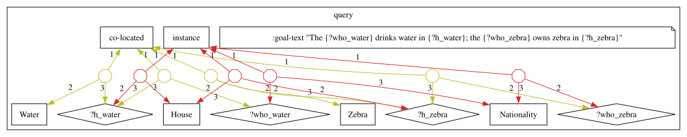
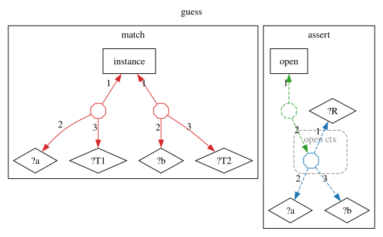
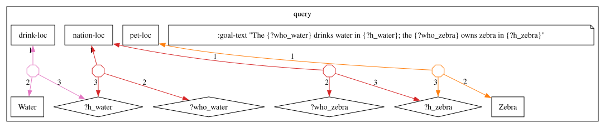
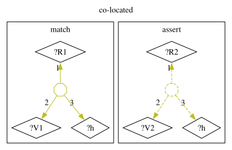
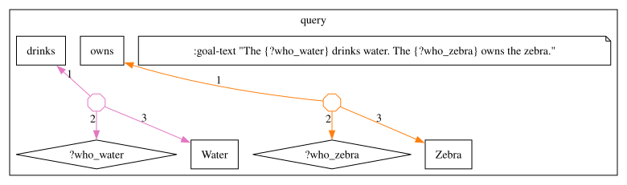
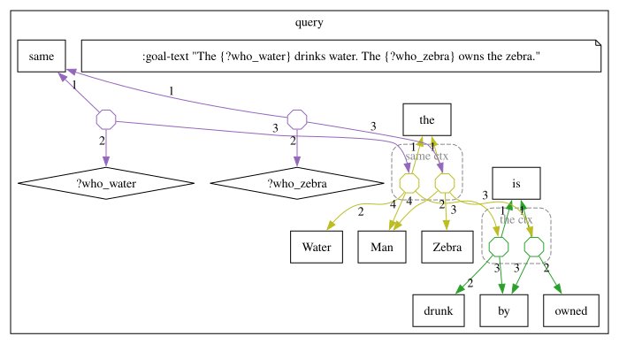
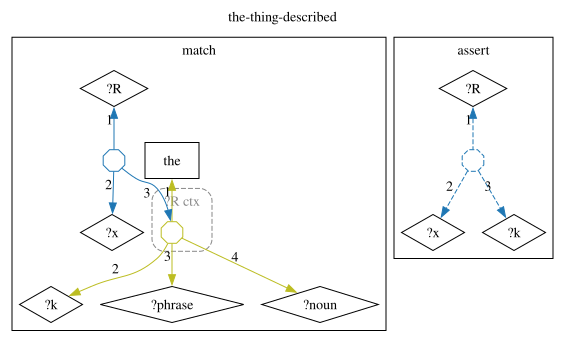
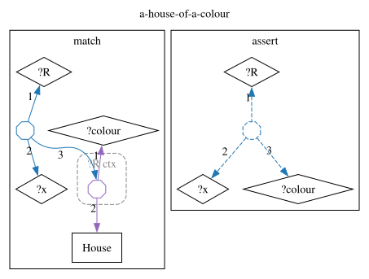
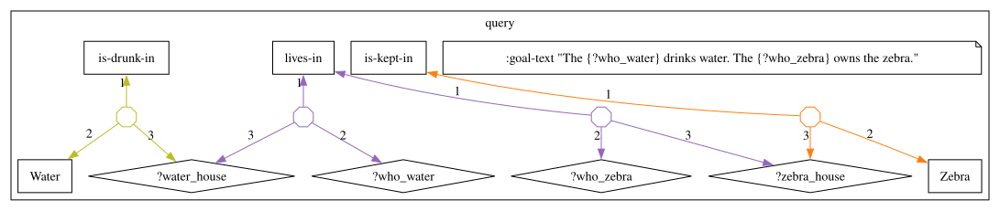
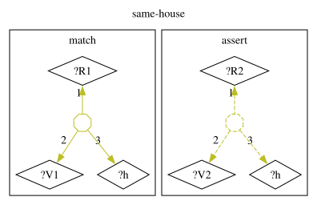

# Six Zebras: the generic link, the projections, and the text's own words

[S2.2.0a](../s2.2.0a_zebra_formulations.md)'s analysis: the Zebra puzzle's two encodings of the corpus,
[`zebra.ein`](../../../../examples/zebra.ein) (one generic `co-located`) and [`zebra2.ein`](../../../../examples/zebra2.ein)
(five projections, `color-loc` …), and the four written by this stage, whose statements are the sentences of
[`nl2smt/puzzles/zebra.txt`](../../../../nl2smt/puzzles/zebra.txt) in the text's own words, measured side by side
on every axis that bears on a formalizer. Each number carries the command that takes it again, and the scripts that
took them all are under [`probes/`](probes/README.md), with what they wrote under [`probes/results/`](probes/results/).
The counts are of the release binaries built from `5fdfe80f`, whose engine `4bdbccaf` leaves as it was (`./build.sh`); the times were taken under
`utils/bench_env.sh --cores PT`, which printed *AC (ACAD online=1), 16 P-core threads on 8 physical cores, governor `powersave`, turbo on, loadavg 1.29*.

**No axis is folded into another, and none is weighed here**: which weighs most is the user's
([the stage's risks](../s2.2.0a_zebra_formulations.md#risks)). [§ 7](#7-the-users-reading-axis-by-axis) says, axis by
axis, where the user's reading (*"seemingly better generalized relations … work not so good as literally
translated"*) holds and where it does not.

## The six encodings

| | the vocabulary | *The Englishman lives in the red house* | the theory | rules of its own | what writes H |
|---|---|---|---|---|---|
| [`zebra.ein`](../../../../examples/zebra.ein) | one generic link | `(co-located Englishman Red)` | `std.slots` | 1, `guess` | `guess` and `std.slots`' obligations (`union`) |
| [`zebra2.ein`](../../../../examples/zebra2.ein) | five projections, a clue an activator | `(co-located nation-loc Englishman color-loc Red)` | `std.bijection`, and the clue rules | 15 | `guess` and `std.bijection`'s obligations (`union`) |
| [`zebra3.1.ein`](../../../../examples/zebra3.1.ein) | one relation a verb, each sentence in its voice | `(lives-in Englishman Red)` | `std.slots` and `std.algebra` selected: `includes`, `converse`, `compose`, `top`, `meet` | 0 | `std.slots`' obligations |
| [`zebra3.2.ein`](../../../../examples/zebra3.2.ein) | descriptions, facts of `the`, and what is `same` | `(same (the Englishman (lives in) House) (the Red House))` | `std.slots`, and rules reading a description | 6 | `std.slots`' obligations |
| [`zebra3.3.ein`](../../../../examples/zebra3.3.ein) | one relation a verb, a house's adjective a relation of one argument | `(lives-in Englishman (red House))` | `zebra3.1`'s, and rules reading an adjective | 5 | `std.slots`' obligations |
| [`zebra3.4.ein`](../../../../examples/zebra3.4.ein) | the verb as an argument (the user's `same-house`) | `(same-house Englishman lives-in Red color-of)` | `std.bijection` over five verbs, and `zebra2`'s clue rules over them | 14 | `std.bijection`'s obligations |

`grep -c '^(rule ' examples/<file>` counts the rules. Each `zebra3.n.ein` is written in synthesis order (the
statements, the questions, the ontology, the theory), monotone, `Solution` under every question, and held to the
published grid cell by cell by `ein-infer/tests/acceptance.rs`
([Q-M1e.25](../../../../docs/decisions/corpus/Q-M1e.25-every-zebra-encoding-is-held-to-the-published.md)).

## 1. Distance from the text

For each of the fifteen statements of [`zebra.txt`](../../../../nl2smt/puzzles/zebra.txt), how many of its words
(less *the*, *a*, *an*, *there*, *is*, *are*) survive in the forms that state it: in the relation's name, split at
`-`, or as an argument; a word survives in another form of itself (*houses* in `House`, *smokes* in
`smoke-loc`), by a shared prefix of all but two letters of the shorter (`python3 probes/measure.py text`,
`results/text.json`). A crude count, the same for all six. Each sentence is one fact, but (1).

| | sentence | words | `zebra` | `zebra2` | `zebra3.1` | `zebra3.2` | `zebra3.3` | `zebra3.4` |
|---|---|---:|---:|---:|---:|---:|---:|---:|
| (1) | There are five houses. | 2 | 1 (4 facts) | 1 (4 facts) | 1 (5 facts) | 1 (5 facts) | 1 (5 facts) | 1 (5 facts) |
| (2) | The Englishman lives in the red house. | 5 | 2 | 2 | 4 | 5 | 5 | 5 |
| (3) | The Spaniard owns the dog. | 3 | 2 | 2 | 3 | 2 | 3 | 2 |
| (4) | Coffee is drunk in the green house. | 5 | 2 | 2 | 4 | 5 | 5 | 5 |
| (5) | The Ukrainian drinks tea. | 3 | 2 | 3 | 3 | 2 | 3 | 2 |
| (6) | The green house is immediately to the right of the ivory house. | 8 | 4 | 4 | 6 | 8 | 8 | 7 |
| (7) | The Old Gold smoker owns snails. | 5 | 3 | 4 | 4 | 4 | 4 | 4 |
| (8) | Kools are smoked in the yellow house. | 5 | 2 | 3 | 4 | 5 | 5 | 5 |
| (9) | Milk is drunk in the middle house. | 5 | 2 | 2 | 4 | 5 | 5 | 4 |
| (10) | The Norwegian lives in the first house. | 5 | 2 | 2 | 4 | 5 | 5 | 4 |
| (11) | The man who smokes Chesterfields lives in the house next to the man with the fox. | 12 | 4 | 5 | 5 | 11 | 5 | 7 |
| (12) | Kools are smoked in the house next to the house where the horse is kept. | 10 | 4 | 5 | 5 | 9 | 5 | 9 |
| (13) | The Lucky Strike smoker drinks orange juice. | 6 | 3 | 5 | 4 | 4 | 4 | 4 |
| (14) | The Japanese smokes Parliaments. | 3 | 2 | 3 | 3 | 3 | 3 | 3 |
| (15) | The Norwegian lives next to the blue house. | 6 | 4 | 4 | 5 | 6 | 6 | 6 |
| | **all fifteen** | **83** | **39** | **47** | **59** | **75** | **67** | **68** |

*(4) Coffee is drunk in the green house.*

| | the fact | the sentence's words it lost |
|---|---|---|
| `zebra` | `(co-located Coffee Green)` | drunk, in, house |
| `zebra2` | `(co-located drink-loc Coffee color-loc Green)` | drunk, in, house |
| `zebra3.1` | `(is-drunk-in Coffee Green)` | house |
| `zebra3.2` | `(same (the Coffee (is drunk in) House) (the Green House))` | — |
| `zebra3.3` | `(is-drunk-in Coffee (green House))` | — |
| `zebra3.4` | `(same-house Coffee is-drunk-in Green color-of)` | — |

*(7) The Old Gold smoker owns snails.*

| | the fact | the sentence's words it lost |
|---|---|---|
| `zebra` | `(co-located Old_Gold Snail)` | smoker, owns |
| `zebra2` | `(co-located smoke-loc Old_Gold pet-loc Snail)` | owns |
| `zebra3.1` | `(owns Old_Gold Snail)` | smoker |
| `zebra3.2` | `(same (the Old_Gold Smoker) (the Snail (is owned by) Man))` | owns |
| `zebra3.3` | `(owns Old_Gold Snail)` | smoker |
| `zebra3.4` | `(same-house Old_Gold are-smoked-in Snail is-kept-in)` | owns |

*(11) The man who smokes Chesterfields lives in the house next to the man with the fox.*

| | the fact | the sentence's words it lost |
|---|---|---|
| `zebra` | `(next-to Chesterfields Fox)` | man, who, smokes, lives, in, house, man, with |
| `zebra2` | `(adjacent-via next-to smoke-loc Chesterfields pet-loc Fox)` | man, who, lives, in, house, man, with |
| `zebra3.1` | `(lives-next-to Chesterfields Fox)` | man, who, smokes, in, house, man, with |
| `zebra3.2` | `(next-to (the (the Chesterfields (is smoked by) Man) (lives in) House) (the Fox (with) Man))` | who |
| `zebra3.3` | `(lives-next-to Chesterfields Fox)` | man, who, smokes, in, house, man, with |
| `zebra3.4` | `(house-next-to Chesterfields are-smoked-in Fox is-kept-in)` | man, who, lives, man, with |


**The questions**, *Who drinks water? Who owns the zebra?*: in `zebra`, eight conjuncts over `co-located` and
`instance`; in `zebra2`, four over the projections; in `zebra3.1` and `zebra3.3`, `(drinks ?who_water Water)` and
`(owns ?who_zebra Zebra)`; in `zebra3.2`, `(same ?who_water (the Water (is drunk by) Man))` and its twin; in
`zebra3.4`, `(is-drunk-in Water ?h)` and `(lives-in ?who ?h)` twice. Only the literal four ask in the text's own
verb, and only `zebra3.1` and `zebra3.3` in its voice.

## 2. What the theory is, and who writes it

Every top-level form of each file, by the step of a formalization that writes it (`python3 probes/forms.py
examples/<file>.ein`; `results/text.json`'s `kinds`): a **statement** is a fact with its sentence as `:source`, a
**membership** a fact of `instance`, `type` or `is-a`, a **structure** fact one of a declared relation that states no
sentence (the row, `(first House-1)`), a **selector** a fact of a relation the file does not declare, which selects
what a rule does (a library rule's activator, or one of the file's own rules'), a **directive** `(config …)`.

| | `zebra` | `zebra2` | `zebra3.1` | `zebra3.2` | `zebra3.3` | `zebra3.4` |
|---|---:|---:|---:|---:|---:|---:|
| statement | 18 | 18 | 19 | 19 | 19 | 19 |
| query | 1 | 1 | 1 | 1 | 1 | 1 |
| declaration | 5 | 9 | 22 | 11 | 29 | 12 |
| membership | 37 | 37 | 32 | 32 | 32 | 32 |
| structure | 0 | 0 | 4 | 4 | 6 | 4 |
| import | 2 | 2 | 2 | 2 | 2 | 2 |
| directive | 1 | 0 | 1 | 1 | 1 | 0 |
| selector | 11 | 16 | 32 | 18 | 34 | 11 |
| rule | 1 | 15 | 0 | 6 | 5 | 14 |
| **all** | **76** | **98** | **113** | **94** | **129** | **95** |

`zebra` and `zebra2` write sentence (1) as the four facts of the row, with `:source "condition (1)"`; the four
literal ones as the five houses, `(instance First House :source "There are five houses.")`, and the row as
structure, since the text never states it.

**The selectors, by head**, and whose rule each selects:

| | the library's | the file's own |
|---|---|---|
| `zebra` | 6: `symmetric` ×2, `includes`, `slot-partition`, `slot-spatial` ×2 | 5: `guess` |
| `zebra2` | 11: `bijective` ×5, `bijection-hierarchy`, `typecheck-hierarchy`, `includes` ×2, `transitive`, `symmetric` | 5: `guess`; and 12 of its 18 statements are activators of its rules `co-located` and `adjacent-via` |
| `zebra3.1` | 32: `includes` ×9, `symmetric` ×2, `slot-partition`, `slot-spatial` ×2, `converse` ×4, `compose` ×6, `top` ×4, `meet` ×4 | 0 |
| `zebra3.2` | 6: `includes`, `symmetric` ×2, `slot-partition`, `slot-spatial` ×2 | 12: `the-thing-named` ×3, `the-thing-described` ×3, `-first` ×4, `the-one-who` ×2 |
| `zebra3.3` | 32, as `zebra3.1` | 2: `a-house-in-a-place` ×2; and five activators per colour derived from the colours' memberships |
| `zebra3.4` | 11, as `zebra2` but `guess` | 0; and 8 of its 19 statements are activators of its rule `same-house` |

**How each property is spelled to be active**: `std.slots` by one fact of five arguments, `(slot-partition
co-located instance type Attribute House)`, and one `(slot-spatial R S isa PT)` per relation of the row;
`std.bijection` by `(bijective R)` per projection with two facts naming the membership relation and its closure,
`(bijection-hierarchy is-a)` and `(typecheck-hierarchy is-a*)`, which `(includes is-a is-a*)` and `(transitive is-a*)`
build; a verb read into the link by `(includes VERB same-house)`; an active and its passive by `(converse drinks
is-drunk-by)`; a passive of place by `(compose is-drunk-by lives-in is-drunk-in)` and `(compose is-drunk-in
is-lived-in-by is-drunk-by)`; where a value is, by `(top drink-and-house instance Drink House)` and `(meet
same-house drink-and-house is-drunk-in)`.

**Active and passive, the user's later word** (*"(is-drunk-by ?drink ?human) -> (drinks ?human ?drink) and back"*):

| | pairs of voices related | how | the way back |
|---|---|---|---|
| `zebra3.1`, `zebra3.3` | 4: `drinks`/`is-drunk-by`, `smokes`/`are-smoked-by`, `owns`/`is-owned-by`, `lives-in`/`is-lived-in-by` | the library, one `converse` fact a pair | the library: `converse-pair-symmetric` derives `(converse is-drunk-by drinks)` from `(converse drinks is-drunk-by)` |
| `zebra3.1`, `zebra3.3` | 3 passives of place: `is-drunk-in`, `are-smoked-in`, `is-kept-in`, each through the man who lives in the house | the library, two `compose` facts a passive | none: the second `compose` is written, since `is-drunk-by = is-drunk-in ; is-lived-in-by` holds because `lives-in` is one to one, which no lemma of the algebra reads |
| `zebra3.2` | none: the voice is inside a description, `(is drunk in)` and `(is drunk by)`, and the rules read a description as the name it is built on whatever its phrase | — | — |
| `zebra3.4` | none: its five verbs are all of place (`lives-in`, `is-drunk-in`, …), and the text's actives are written with them (*drinks tea* as `lives-in` beside `is-drunk-in`) | — | — |
| `zebra`, `zebra2` | none: no verb is a relation | — | — |

**What a reader has to know to see a sentence in its fact**:

- `zebra`: that `co-located` means *lives in*, *owns*, *drinks*, *is drunk in*, *smokes*, *are smoked in* by turns;
  that `House-3` is *the middle house* and `House-1` *the first*; that `Old_Gold` stands for *the Old Gold smoker*.
- `zebra2`: the five projections (`nation-loc` is *lives in*); the activator's order of its arguments, role before
  value, and that `adjacent-via right-of color-loc Ivory color-loc Green` puts *Green* on the right.
- `zebra3.1`: that a colour stands for the house of that colour and a brand for its smoker; that `First` and
  `Middle` are houses.
- `zebra3.2`: how `the` reads, the name it is built on first (`(the Dog (is owned by) Man)`, *the man the dog is
  owned by*); that a sentence of the row is a relation between descriptions and every other sentence a `same`.
- `zebra3.3`: that a colour is a relation of one argument, `(red House)` *the red house*, and the same colour also
  a value, `red`.
- `zebra3.4`: that a value is named with the verb that puts it in its house, `Red color-of` *the house Red is the
  colour of*.

## 3. What the kernel does

Each encoding under each question (`einaf feedback FILE QUESTION`'s `outcome` and `work`, and `ein solve FILE
QUESTION --json-summary S`'s; `python3 probes/measure.py kernel`, `results/kernel.json`); *sat* is saturations, the
facts are beyond root. Every searching question answers *one* under each of its readings, on every encoding;
`--no-search` answers *not decided* (root is alive and owes, and R is not searched).

| | `zebra` | `zebra2` | `zebra3.1` | `zebra3.2` | `zebra3.3` | `zebra3.4` |
|---|---|---|---|---|---|---|
| H, `ein show hyps FILE` | 112, from `union` | 56, from `union` | 112, from `obligations` | 112, from `obligations` | 112, from `obligations` | 56, from `obligations` |
| root's facts | 703 | 543 | 882 | 788 | 1 083 | 485 |
| describe, `ein solve` | 353 sat · 34 060 | 120 sat · 5 411 | 353 sat · 74 213 | 353 sat · 60 418 | 353 sat · 85 675 | 124 sat · 5 600 |
| `--single` | 9 sat · 784 | 7 sat · 278 | 9 sat · 1 679 | 9 sat · 1 278 | 9 sat · 1 956 | 11 sat · 449 |
| `--maximal`, `--maximal --single` | 9 sat · 784 | 7 sat · 278 | 9 sat · 1 679 | 9 sat · 1 278 | 9 sat · 1 956 | 11 sat · 449 |
| `--minimal`, `--minimal --single` | 663 sat · 57 360 | 267 sat · 11 807 | 663 sat · 117 598 | 663 sat · 94 916 | 663 sat · 136 130 | 267 sat · 11 814 |
| `--count` | 353 sat · 34 060 | 120 sat · 5 411 | 353 sat · 74 213 | 353 sat · 60 418 | 353 sat · 85 675 | 124 sat · 5 600 |

The wall clock, best of seven after one discarded, in ms, the median beside it (`../../../../utils/bench_env.sh
--cores PT python3 probes/measure.py times`, `results/times.json`):

| | describe | `--single` | `--maximal` | `--minimal` | `--count` |
|---|---:|---:|---:|---:|---:|
| `zebra` | 269.8 (276.3) | 27.9 (28.7) | 27.7 (29.0) | 399.5 (401.7) | 267.6 (276.7) |
| `zebra2` | 91.6 (96.6) | 29.3 (29.9) | 28.4 (29.4) | 148.1 (154.5) | 88.5 (92.5) |
| `zebra3.1` | 368.8 (371.7) | 25.1 (25.3) | 25.3 (26.6) | 548.7 (555.7) | 369.2 (377.9) |
| `zebra3.2` | 601.0 (615.7) | 29.5 (29.9) | 29.4 (30.1) | 806.8 (816.3) | 594.5 (597.9) |
| `zebra3.3` | 523.2 (543.0) | 31.3 (33.0) | 31.3 (31.6) | 762.8 (774.3) | 525.1 (530.8) |
| `zebra3.4` | 82.4 (83.6) | 20.2 (21.1) | 19.8 (20.3) | 135.0 (141.3) | 78.8 (79.9) |

The search is the theory's: the four `std.slots` encodings search alike (112 candidates, 36 of them dead alone, 353
saturations to describe R, 9 to decide `--single`), the two over projections alike (56 candidates, 21 dead alone,
120 and 124 saturations), and the vocabulary of the facts moves only what each state carries: the literal ones carry
their verbs, descriptions or adjectives beside the link, and read the answer back into the questions' words, which
doubles the facts (E-111). `ein render h-space FILE`, the structure of H, reads `zebra`'s pairs whole (705 808 facts)
and stops at the default budget on `zebra3.1`, `zebra3.2` and `zebra3.3` (its `whole` row,
[`renderings/`](renderings/)`*.h-space.txt`), whose pair layers take 1 733 960, 1 380 168 and 2 052 718 facts whole
(`--region-budget 8388608`): Ein's sweeps of the structure leave the three out by name (`pair_layer.rs`'
`PAST_THE_BUDGET`). The corpus cost of each `zebra3.n` entry, its runs together, is
533, 791, 713 and 179 ms (`utils/bench_env.sh --cores PT python3 utils/corpus_cost.py -k examples/zebra3`), none
slow.

## 4. What the kernel says back

**The answer's sentence.** `zebra` and `zebra2`: *“The Norwegian drinks water in House-1; the Japanese owns zebra in
House-5”*; the four literal ones: *“The Norwegian drinks water. The Japanese owns the zebra.”* (`ein solve FILE
--single`, the class's row). The text asks *who*; the first sentence answers *where* too.

**How a derived fact reads, through its rule's `:why`** (`ein solve FILE --single --trace T.md`, the line above
`Derives …`):

| | the Englishman's house | the answer's fact |
|---|---|---|
| `zebra` | *Englishman shares a slot with Red, and Red is at House-3 ⟹ Englishman is at House-3.* | `co-located(Water, House-1)`: *co-located is symmetric: House-1 ↔ Water.* |
| `zebra2` | *co-located: (color-loc Red House-3) ⟹ (nation-loc Englishman House-3).* | `drink-loc(Water, House-1)`: *every Drink except Water excluded for House-1 → (drink-loc Water House-1).* |
| `zebra3.1` | *Englishman shares a slot with Red, and Red is at Middle ⟹ Englishman is at Middle.* | `drinks(Norwegian, Water)`: *(converse is-drunk-by drinks): mirror is-drunk-by(Water,Norwegian) → drinks(Norwegian,Water)*, from *(compose is-drunk-in is-lived-in-by is-drunk-by): is-drunk-in(Water,First)∧is-lived-in-by(First,Norwegian) → is-drunk-by(Water,Norwegian).* |
| `zebra3.2` | as `zebra3.1` | `same(Norwegian, the(Water, is(drunk, by), Man))`: *the Nationality Norwegian and the Drink Water are in First: the Norwegian is the man Water (is drunk by)* |
| `zebra3.3` | *Englishman shares a slot with red, and red is at House-3 ⟹ Englishman is at House-3.*; and `red(House-3)`: *House-3 is red* | as `zebra3.1` |
| `zebra3.4` | *every House except Middle excluded for Englishman → (lives-in Englishman Middle).* | `is-drunk-in(Water, First)`: *every Drink except Water excluded for First → (is-drunk-in Water First).* |

A placement reads in the library's words in every encoding; the literal vocabulary shows in what the answer's fact
is (`drinks(Norwegian, Water)`) and in the converse it is read through. A trace names a premise's sentence only where
the premise is stated: `same-house(Englishman, Red)` is derived from the sentence `(lives-in Englishman Red)` by
`includes`, so the placement's premises carry *There are five houses* (the membership's) and not *The Englishman
lives in the red house*, which is one step further back.

**What a contradiction is explained by**: the cores of [§ 5](#5-what-a-formalizers-mistake-does). In the literal
encodings a core is the text's sentences ([E-109](../evaluation/natural-language/E-109-a-sentence-written-as-a-rule-s-activating-fact-is-in-no.md));
in `zebra2` and `zebra3.4`, where a clue is a rule's activator, it is a rule's name.

**The renderings** ([`renderings/`](renderings/), `python3 probes/render.py`): each encoding's query as `ein render
program` draws it, and the one rule that reads a sentence into its theory:

| | the query | a rule |
|---|---|---|
| `zebra` |  |  |
| `zebra2` |  |  |
| `zebra3.1` |  | no rule |
| `zebra3.2` |  |  |
| `zebra3.3` |  |  |
| `zebra3.4` |  |  |

Drawn as a size and not as a picture, each too large to read (`renderings/sizes.json`, edges counted in the DOT):
the knowledge base of `ein render kb` (root's facts: 3 065, 1 934, 3 698, 3 579, 4 496 and 1 834 edges), the
program's knowledge base of `ein render program` (232, 277, 376, 369, 424, 273 edges), and the exclusion graph of
`ein render h-space --view exclusion` (112, 56, 112, 76, 76, 56 nodes; 1 944, 410, 1 371, 1 258, 818, 410 edges). `ein
render h-space FILE`'s read-out is kept as text for each, [`renderings/*.h-space.txt`](renderings/).

## 5. What a formalizer's mistake does

The same seven damages on each encoding, written by `python3 probes/measure.py damage` into
[`probes/damaged/`](probes/damaged/) and run through `einaf feedback FILE` (describe) and `einaf feedback FILE
--single` (`results/damage.json`). *n states* is R's states found where the description stopped at the default
budget.

| damage | `zebra` | `zebra2` | `zebra3.1` | `zebra3.2` | `zebra3.3` | `zebra3.4` |
|---|---|---|---|---|---|---|
| sentence (15) dropped | several, 55 states | several, 32 states | several, 55 states | several, 55 states | several, 55 states | several, 32 states |
| *Coffee is drunk in the first house* added | inconsistent | inconsistent | inconsistent | inconsistent | inconsistent | inconsistent |
| sentence (6)'s two arguments swapped | **one**, another grid | **one**, another grid | **one**, the same sentence | **one**, the same sentence | **one**, the same sentence | **one**, the same sentence |
| `(symmetric next-to)` misspelt `symetric` | inconsistent | incomplete | inconsistent | several, 124 states | inconsistent | inconsistent |
| `(symmetric next-to)` left out | inconsistent | incomplete | inconsistent | several, 124 states | inconsistent | inconsistent |
| the drinks' activating fact left out | one (no effect) | several, 7 680 states | several, 24 states | not decided (no state met) | several, 24 states | several, 15 states |
| *water is a drink* left out | inconsistent | inconsistent | inconsistent | inconsistent | inconsistent | inconsistent |

*Several* is `--single`'s word; the description says *not decided* where it stopped in the classes with every
state found (55, 32, 24, 124 of them; the `partial` note says what was established). The drinks' activating fact
is `(guess co-located Drink House)` in `zebra`, `(bijective drink-loc)` in `zebra2`, `(includes drinks same-house)`
in `zebra3.1` and `zebra3.3`, `(the-thing-described same)` in `zebra3.2` and `(bijective is-drunk-in)` in
`zebra3.4`.

**Per damage, what the feedback says and whether the damage shows:**

- **A sentence dropped** shows as *several*: an under-determined text, which it is. The `std.slots` encodings answer
  55 states where the projections answer 32, and 23 of the 55 put Chesterfields with the fox or Kools with the
  horse in one house, which *next to* excludes: `std.slots`' pruning rules exempt a value's own house
  ([E-105](../evaluation/stdlib/E-105-std-slots-lets-two-values-stated-next-to-each-other-share-a.md)).
- **A contradicting sentence** shows, and every encoding's core names it. The literal cores name the two sentences
  it contradicts besides, `zebra3.1`'s `(is-drunk-in Coffee First)`, `(is-drunk-in Coffee Green)`,
  `(is-immediately-to-the-right-of Green Ivory)`; `zebra2`'s and `zebra3.4`'s name the added fact, a membership and a
  declaration, refuted by the clue rules `co-located` / `same-house` and their negatives (E-109).
- **A swapped clue** does not show at all: the swapped puzzle has one solution, the zebra in the fourth house, and in
  the literal encodings, which answer *who*, even the sentence is the right one's
  ([E-108](../evaluation/answer/E-108-a-clue-with-its-arguments-swapped-is-answered-one-with.md)).
- **A misspelt activator** is a fact of an undeclared relation and loads in silence; its outcome is the left-out
  one's in all six. Where it is *inconsistent*, the core names the Norwegian's sentences, which are right
  ([E-107](../evaluation/diagnostics/E-107-a-theory-s-missing-activating-fact-is-reported-as-the.md)); `zebra2`
  says *incomplete*, R empty with every alive state owing, which is nearer the truth (the theory cannot place what it
  should), and `zebra3.2` *several*.
- **The drinks' activating fact left out** shows as *several* where it is the only bridge from a sentence to the
  theory: `zebra3.1`'s `includes` carries sentences (5) and (13), `zebra2`'s `bijective` a whole projection
  (7 680 states). In `zebra` it changes nothing, since `std.slots`' obligations write the same candidates as the
  `guess` rule it activates.
- **A membership left out** (*water is a drink*, which no sentence states but the question) shows as *inconsistent*,
  and no core can name what is absent: a house left with no drink to fill is what `slot-fill` or `surjective`
  refutes, from the memberships that are there.

## 6. The program in the order it is made

**Six forms, each before one it may need** ([`probes/order-cases/`](probes/order-cases/), `order-cases/run.sh`, each
program beside the same forms in the usual order):

| the case | loads | read-out against the usual order | a page that says it |
|---|---|---|---|
| a fact before its relation's declaration | yes | the same | none |
| a short name before the import that lists it | yes | the same | none |
| an activating fact before its rule | yes | the same | none |
| a macro's call before the macro | yes | the same | none |
| a query before what it names | yes | the same | none |
| a `(solve …)` list before the relations it names | yes | the same | none |

[`02-syntax.md` § 2](../../../../docs/ein/user/04-reference/02-syntax.md#2-top-level-forms) says a program is a flat
sequence of forms and says nothing of their order; the order rules are written in is the agenda's, and decides no
answer of a monotone program (the same page, on `:priority`). No form has to come first, and the loader reads the
file whole.

**The six encodings in both orders** ([`probes/order/`](probes/order/), `python3 probes/measure.py order` and
`order-texts`; `results/order-compare.json`, `results/order-texts.json`). Each file's forms, unchanged, written in
synthesis order (statements, query, declarations, memberships, the row, then the config, imports, selecting facts
and rules) and in theory-first order (config, imports, rules, declarations, selecting facts, memberships, the row,
statements, query). The four `zebra3.n` are written in synthesis order already.

- **The same, held by comparison, in every pair of orders and on every encoding**: the outcome under each reading of
  every question (eight), the readings, the classes and rows of the answer query, the answer sentence, the states,
  H (`ein show hyps`, line for line), the `work` counts; and the read-out of `ein solve` and of `ein solve
  --single`, byte for byte once the file's path is taken off. The contradictory twin (*Coffee is drunk in the first
  house* added) has the same outcome, the same core and the same read-out in both orders.
- **What differs, as [§ 1.3](../../../../docs/ein/ein.rs/03-design/01-determinism-and-order.md#13-what-varies-and-why-it-may)
  allows**: the trace and the event stream of `--single` on the four literal encodings, theory-first against
  synthesis order (lines that differ, of the trace's / of the event stream's):

| | the trace | the event stream | the twin's trace |
|---|---|---|---|
| `zebra` | the same | the `run` line alone | the same |
| `zebra2` | the same | the `run` line alone | the same |
| `zebra3.1` | 5 954 of 87 768 | 3 510 of 18 719 | 7 702 of 413 236 |
| `zebra3.2` | 4 900 of 101 889 | 2 572 of 31 340 | 4 722 of 483 890 |
| `zebra3.3` | 6 960 of 116 263 | 3 564 of 23 958 | 51 662 of 526 917 |
| `zebra3.4` | 1 352 of 23 451 | 512 of 13 454 | 1 352 of 107 045 |

  The event streams' first line, `run`, names the run's own output paths and differs in every pair, and is
  counted with the rest. The order a rule's firings are queued in follows the facts' written order, so the derivation the trace
  narrates first moves; the cores and the read-outs did not.

**What follows.** The order changes nothing that § 1.3 does not allow, on these programs, and the four examples are
written in synthesis order. Whether Ein states it and holds it over the corpus, with a test beside
`import_invariance.rs`, is a proposal for the user
([Q-M2.24](../open_questions/kernel/Q-M2.24-does-ein-hold-that-an-answer-does-not-depend-on-the-order.md);
[E-112](../evaluation/language/E-112-a-program-s-forms-may-be-written-in-the-order-they-are-made.md)). No kernel
code was changed.

## 7. The user's reading, axis by axis

The user's reading: *"seemingly better generalized relations "co-located, instance, type" work not so good as
literally translated "drink-loc, nation-loc, ..."* — `zebra2.ein` (the projections) works better than `zebra.ein`
(the generic link) — and its extension, that a vocabulary nearer the text works better still. Each axis by itself;
which weighs most is the user's.

| axis | `zebra2` against `zebra` | the literal four against both | the run that shows it |
|---|---|---|---|
| **distance from the text** | **holds, barely**: 47 of the 83 words against 39; `drink-loc` keeps *drink* | **holds**: 59 to 75; `zebra3.2` keeps all but eight words, `zebra3.1` every verb but in the folded descriptions | [§ 1](#1-distance-from-the-text) |
| **the theory, and who writes it** | **refuted**: fifteen rules of the file's own against one, `guess`, which the theory makes redundant | **mixed**: `zebra3.1` writes no rule (the library selected, 32 facts), the others six, five and fourteen | [§ 2](#2-what-the-theory-is-and-who-writes-it), `grep -c '^(rule ' FILE` |
| **what the kernel does** | **holds**: 5 411 facts to describe R against 34 060, 120 saturations against 353, 91.6 ms against 269.8; H 56 against 112 | **refuted**: the `std.slots` literal ones cost 1.8 to 2.5 times `zebra`'s facts; `zebra3.4`, over projections, costs what `zebra2` does | [§ 3](#3-what-the-kernel-does), `einaf feedback FILE` |
| **what the kernel says back: the answer** | equal: the same sentence | **holds**: the questions are answered in the text's verbs, `(drinks Norwegian Water)`, with a sentence that answers *who* | [§ 4](#4-what-the-kernel-says-back) |
| **what the kernel says back: an explanation** | **refuted**: `zebra2`'s core of a contradiction names a rule where `zebra`'s names the sentences | **holds** for `zebra3.1` to `zebra3.3`, whose cores are the text's sentences; **refuted** for `zebra3.4`, `zebra2`'s shape | [§ 5](#5-what-a-formalizers-mistake-does), E-109 |
| **a mistake: a sentence dropped** | **holds**: 32 states, the right count; `zebra`'s 55 are 23 too many, a bug of `std.slots` (E-105) | the `std.slots` literal ones inherit the 55; `zebra3.4` has the 32 | § 5, `ein solve FILE --maximal` |
| **a mistake: a missing or misspelt selector** | **holds, a little**: `zebra2` says *incomplete*, `zebra` blames two right sentences | **refuted**: four of the six blame the statements (E-107), and the literal theory has the most selectors to get wrong (E-110) | § 5 |
| **a mistake: a swapped clue** | equal: both *one*, the wrong grid | **refuted**: the literal answer's sentence is the right one's word for word (E-108) | § 5 |
| **a mistake: a contradiction added** | **refuted**: see the explanation row | **holds**: the core is the sentences | § 5 |

So the reading holds where the literal words are the point (the text, the answer, the explanation of a
contradiction) and on the kernel's cost for the projections, and does not hold on who writes the theory (a literal
vocabulary is paid for in selectors or in rules) or on the mistakes a theory's spelling makes, which every
encoding reports badly and the literal ones report worst.


## 8. The four literal vocabularies: the choices each made

The four are the user's three variants in the user's order and the user's own example, each a complete example
(the user: *"write variants zebra3.1 3.2 3.3 with all variants of literal vocabularies, don't throw them out"*). Each
choice is written with its alternative and why; the forms a choice ruled out are kept under [`probes/`](probes/).

**Shared by the four.**

- **The facts are the sentences, one fact a sentence**, `:source` the sentence verbatim; *There are five houses*
  is five memberships with that source (alternative: the row's facts with it, as `zebra` and `zebra2` do; but the
  text states five houses and never a row, so the row is structure, with no source).
- **A noun is written once for its forms**: *snails* is `Snail`, *Parliaments* `Parliament`, *orange juice* `Juice`
  (alternative: the text's spelling; but *which words name the same object* is step 1's question, and one name a
  thing is its answer). The grid's names are kept, so one test reads all six.
- **The questions are one query in the statements' own relations**, its `:goal-text` *"The {?who_water} drinks
  water. The {?who_zebra} owns the zebra."*: the text asks *who*, not *where*, so no house is named (alternative:
  `zebra`'s sentence with the houses; but that sentence answers a question the text does not ask, and E-108 shows
  what that costs and buys).
- **The houses are named by their places**, `First`, `Second`, `Middle`, `Fourth`, `Fifth`, two of them as the text
  names them (`zebra3.3` excepted, below); alternative: `House-1` … `House-5`, which the text never says.
- **The hypotheses are the theory's obligations**, `std.slots`' or `std.bijection`'s, and no rule of the file's
  own concludes `(open F)` (alternative: `zebra`'s `guess` rule and its five activators; dropping it from `zebra`
  changes nothing, [§ 5](#5-what-a-formalizers-mistake-does), `drop-drinks-link`, since its theory's obligations
  write the same candidates; it is a rule a formalizer would have to write for nothing).
- **The program is written in synthesis order** ([§ 6](#6-the-program-in-the-order-it-is-made)).

**`zebra3.1`, one relation a verb.** A sentence keeps its verb and its voice: `(drinks Ukrainian Tea)`,
`(is-drunk-in Coffee Green)`, `(are-smoked-in Kools Yellow)`.

- *One relation per verb, or a few that name the verb as an argument*: one per verb (the alternative is
  `zebra3.4`). Each verb costs the theory one `includes` into the link, and a verb whose answer the questions ask
  (`drinks`, `owns`) its read-back.
- *A description*: written as the word it is built on, *the red house* `Red`, *the Old Gold smoker* `Old_Gold`,
  *the man with the fox* `Fox` (alternative: a description as a fact, `zebra3.2`). In a puzzle of shared houses a
  thing and what picks it out are in one house, so the theory needs nothing for it; the reader has to know it.
- *The passives*: kept passive, `is-drunk-in` with the house the colour names; the theory relates an active and its
  passive as converses and a passive of place through the man who lives there, all selected from `std.algebra`
  ([§ 2](#2-what-the-theory-is-and-who-writes-it); the user's word). The alternative, every passive written active
  (*the man who lives in the green house drinks coffee*), changes a sentence step 1 should not change.
- *The theory*: the library's alone, no rule. The read-back of the answer was first `(compose same-house same-house
  in-one-house)` with a `meet` per question (86 854 facts to describe R), and a rule of the file's own was cheaper
  (50 622, [E-111](../evaluation/bounds/E-111-the-answer-in-the-statements-own-words-costs-the-kernel.md)); the
  converses made a third reading, through the verbs of place, 74 213, kept because it relates the verbs as the
  language does and stays the library's.

**`zebra3.2`, descriptions and what is the same.** The user's `(same (the Coffee (is drunk in) House) (the Green
House))`: a verb phrase cannot be a relation (*"here is the first Ein limitation"*; a relation is a name, never a
fact, [Q-M1f.381](../../../../docs/decisions/language/Q-M1f.381-a-relation-is-the-atom-under-a-facts-first-arrow.md)),
so it is a fact inside the description, `(is drunk in)`, a fact of `is`.

- *Every sentence a `same` of two descriptions*, a person's sentence too: *The Spaniard owns the dog* is
  `(same Spaniard (the Dog (is owned by) Man))`; the alternative, the verb as a relation for a sentence with no
  house in it, would mix in `zebra3.1`.
- *The three sentences of the row* are relations between descriptions, `(next-to (the Norwegian (lives in) House)
  (the Blue House))`. Written as `same` with a description of the neighbouring house, `(same (the Norwegian (lives
  in) House) (the House (next to) (the Blue House)))`, the program is flagged
  ([E-106](../evaluation/answer/E-106-the-static-check-reads-a-relation-not-a-shape.md);
  [`probes/zebra3.2-spatial-as-same.ein`](probes/zebra3.2-spatial-as-same.ein)).
- *A description is read in place*: four rules read `(the K …)` as `K` in either place of a sentence, and one reads
  a `same` of two names as `same-house`. The first monotone form put every description into `same-house` as an
  object of its own, which `std.slots` then placed and excluded like a value (110 510 facts to describe R against 60 418,
  [`probes/zebra3.2-descriptions-in-same-house.ein`](probes/zebra3.2-descriptions-in-same-house.ein)); a reading
  through a relation `means` was cheaper still and flagged
  ([`probes/zebra3.2-read-through-means.ein`](probes/zebra3.2-read-through-means.ein), E-106).
- *`the` at two counts* is declared at one: the second declaration is refused where a program imports a module
  ([E-104](../evaluation/language/E-104-a-relation-declared-at-a-second-count-is-refused-where-the.md)).

**`zebra3.3`, an adjective a relation of one argument.** The user's `(is-drunk-in Coffee (green House))`.

- *Which adjectives*: the house's, its colour and its place (`red`, `first`, `middle`); a man's description stays a
  word, as in `zebra3.1` (alternative: `(old-gold-smoker Man)`, a relation a description, which multiplies the
  relations and reads no better).
- *A colour is two things*: a relation of a house, `(red House-3)` in the answer, and the value `std.slots` places,
  `(instance red Color)`; a rule writes the one from the other. A place is a relation the row gives, `(first
  House-1)`; so the houses keep `House-1` … names, since `(first First)` says nothing.
- *A rule over a colour's relation* takes the colour as a parameter, and is activated for each colour by a rule that
  reads `(instance ?colour Color)`: a relation is named by a name or a parameter, never by a variable a premise
  binds (the loader: *"its :match writes (?c House) with ?c as its relation, which no parameter binds"*).

**`zebra3.4`, the verb as an argument.** The user's `(same-house Englishman lives-in Red color-of)`: each kind of
value is in its house by its own verb, and those five verbs are the projections, `zebra2`'s `*-loc` named by the
text. A sentence that names its house is one of them, `(is-drunk-in Milk Middle)`; a sentence of two values names
each with its verb. The text's actives are paraphrased into the verbs of place (*drinks tea*: `lives-in` and
`is-drunk-in`), which is what the user's two examples set against each other (*"(same-house …) or (drinks Ukrainian
Tea)"*); `zebra3.1` is the other. Its rules are `zebra2`'s over the verbs, and two that read a sentence of
neighbouring houses into `zebra2`'s `adjacent-via`.

## 9. What follows for the formalizer

**The target shape, by default for the user: `zebra3.1`** ([the phase README's default 1](../README.md#defaults-taken-at-the-re-plan),
amended): the statements the sentences' verbs in their voice, a description the word it is built on, the questions
in the statements' relations, the theory selected from the library with no rule of the file's own (`std.slots` and
`std.algebra`'s `includes`, `converse`, `compose`, `top`, `meet`), H by the library's obligations, the program in
synthesis order. By the table: among the six it is the encoding whose facts are the text's words that needs no
rule (`zebra3.2`, nearer the text, needs six, and `zebra3.4`, the user's own example, fourteen; `zebra`, the
re-plan's model, keeps 39 of the 83 words); it is monotone and *one* under every question; its cores are the
sentences. What it costs is stated beside it: twice `zebra`'s facts (E-111), thirty-two selecting facts any of
which a model can misspell in silence (E-107, E-110), and a description folded into a word, which step 1 has to
decide and the reader to know. The alternatives the table would support, each on another axis: `zebra3.2`
(nearest the text), `zebra2` or `zebra3.4` (cheapest to run, the projections' 32 states on an under-determined
text), `zebra` (fewest forms).

**For the steps** ([the user's notes](../README.md#formalization-in-steps-the-users-notes-on-the-whole-phase)):
`zebra3.1`'s nineteen statements and its query are what step 1 writes for the Zebra puzzle (*which words name the
same object*: *the Old Gold smoker* is `Old_Gold`, *snails* `Snail`; one fact a sentence, five for *There are five
houses*); its declarations, memberships and row are step 2's ontology; its selecting facts are steps 2 and 3's
theory, with nothing to synthesise. The other three vocabularies are other step-1 answers, and each moves work into
step 3: six rules for descriptions, five for adjectives, fourteen for the verb as an argument. The program is read
as the steps write it (§ 6). [S2.2.1](../s2.2.1_contract.md)'s T2.2.1.8 works the Zebra puzzle through the steps to
`zebra3.1.ein`.

**For the catalogue** ([S2.2.4](../s2.2.4_passes.md)'s T2.2.4.8): what the literal vocabulary needs of the library
and how the library has it. A verb into the link: `(includes VERB same-house)`. An active and its passive:
`(converse ACTIVE PASSIVE)`, one fact, the way back the library's. A passive of place: two `compose` facts through
the verb a man lives in. A value in a house by its kind's verb: `top` and `meet`. A description, `(the K …)`, or an
adjective, `(red House)`, has no reading in the library, and is a rule of the program's own
([E-110](../evaluation/stdlib/E-110-the-library-has-no-reading-of-a-literal-vocabulary.md)); whether `stdlib/` grows
one is the user's ([Q-M2.23](../open_questions/kernel/Q-M2.23-does-the-library-grow-a-reading-of-a-literal-vocabulary.md),
default: no module, the catalogue's recipes). A literal program on `std.slots` needs `(config
:record-alternative-justifications false)` wherever a dead state's core is printed
([E-113](../evaluation/bounds/E-113-a-dead-state-s-core-costs-minutes-on-a-link-re-derived-many.md)): a recipe of the
catalogue too.

## 10. What the stage filed

- **The evaluation of Ein**, [the phase's](../evaluation/README.md): E-104 (bug: a relation's second count refused
  where the program imports), E-105 (bug: `std.slots` lets two neighbours share a house), E-106 (weakness: the static
  check reads a relation, not a shape), E-107 (weakness: a missing selector reported as contradicting statements),
  E-108 (limit: a swapped clue answered *one*), E-109 (weakness: an activator's sentence in no core), E-110 (gap: no
  library reading of a literal vocabulary), E-111 (weakness: the answer in the text's words costs twice the facts),
  E-112 (strength: forms in the order they are made), E-113 (weakness: a core's cost on a re-derived link).
- **The questions**, [the phase's](../open_questions/README.md): Q-M2.23 (does the library grow a reading of a
  literal vocabulary?) and Q-M2.24 (does Ein hold that an answer does not depend on the order of a program's
  forms?).
- **The findings**, [the phase's](../findings/README.md): L-M2.5 (AGENTS.md names the slow-set test's crate wrong).
- No wrong-answer row: no answer moved with the order, and E-105 is the library's rules against their page, which
  the kernel answers as written.

## Commands

```sh
ein solve examples/zebra3.1.ein --single          # Solution: "The Norwegian drinks water. The Japanese owns the zebra."
einaf/target/release/einaf outcome examples/zebra3.2.ein   # one, over all of R and over both lines
ein show hyps examples/zebra3.4.ein               # H, from `obligations`: 56 candidates
cargo test --manifest-path ein.rs/Cargo.toml --profile gate -p ein-infer --test acceptance   # the published grid, every encoding
cd plans/m2_nl_to_ir/p2.2_formalizer/zebra_formulations/probes
python3 measure.py kernel; python3 measure.py damage; python3 measure.py order; python3 measure.py order-texts
order-cases/run.sh                                # six forms out of order, each read as in order
EIN_STDLIB=<a copy with the diff applied> ein solve damaged/zebra.drop-15.ein --maximal   # 32 states, where the library gives 55
```
